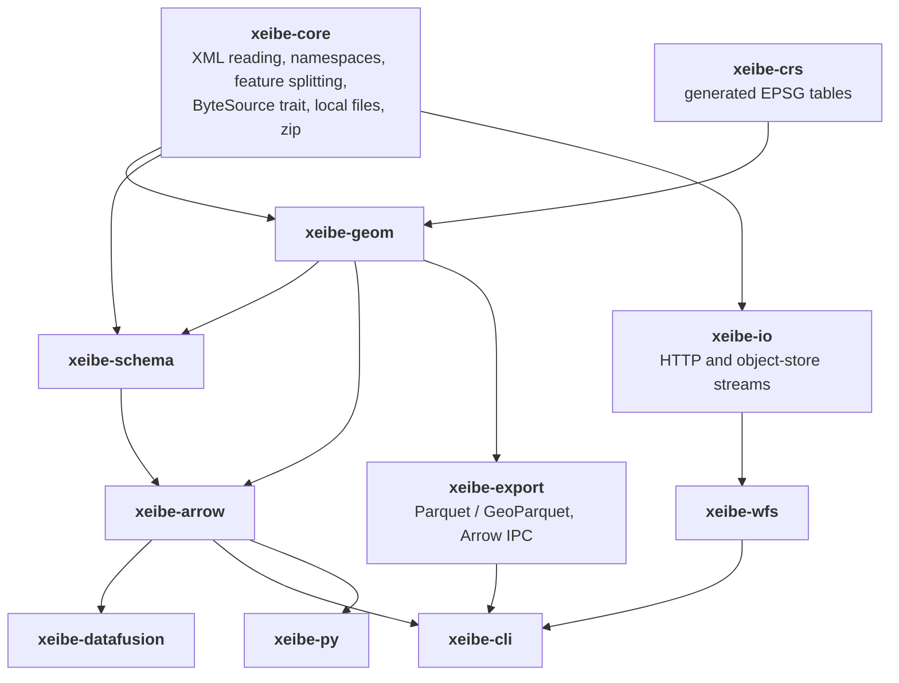
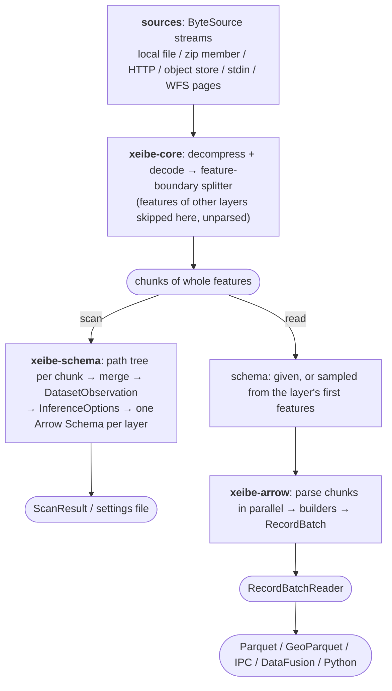
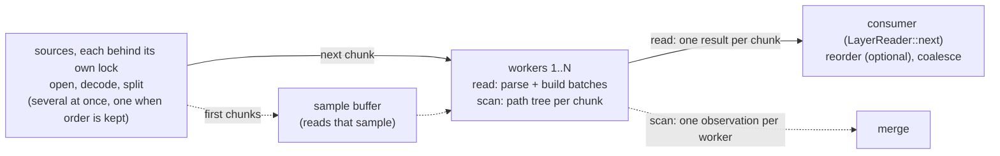

# Architecture

## Principles

1. **Bounded memory.** Memory use depends on the settings, never on input size:
   roughly `target_chunk_bytes × (queue_depth + threads)` for chunks, plus the
   batches in flight, the buffered sample, and at most one WFS page. See
   [Memory](#memory).
2. **Observation before policy.** Scanning collects facts. Separate rules turn
   those facts into a schema.
3. **Lossless by default, lossy by opt-in.** Examples: linearizing curves, allowing
   lossy type conversions. A schema from a scan describes everything the scan saw.
   Leaving columns out of a schema is how a user chooses not to read something.
4. **Arrow-native.** The output is always `RecordBatch`es. Formats such as Parquet
   and GeoParquet, and engines such as DataFusion, SedonaDB and Python, are
   separate layers built on top.
5. **Explainable.** Every schema decision can be traced back to the observation
   that caused it.
6. **Stateless.** Every input is read as a stream from start to end. The library
   keeps no cache, no index and no files of its own. What is worth keeping (a
   schema) is handed to the user, who decides where it lives.

## User-facing API: scan and read

There are two operations:

| Operation | Input | Output |
|---|---|---|
| **scan** | sources; full or a sample | every layer (feature type) found, with its inferred schema and summary. Can be saved as a [settings file](#settings-file) |
| **read** | sources, **one layer**, optionally a schema | a `RecordBatchReader` for that layer. The schema says which XML paths are read and into which columns |

```rust
// Scan once (full, or the first N features of the input), keep the result.
let scan = xeibe_arrow::scan(sources, ScanExtent::Full, &options)?;
for layer in scan.layers() { println!("{} {:?}", layer.name, layer.feature_count); }
scan.to_settings()?.save("prg.json")?;

// Read with a known schema: one pass, no inference.
let settings = Settings::load("prg.json")?;
let schema = settings.schema("AD_PunktAdresowy")?;
let reader = xeibe_arrow::read(sources, "AD_PunktAdresowy", Some(schema), &settings.options)?;

// Or read without a schema: inferred from the first features of that layer.
let reader = xeibe_arrow::read(sources, "AD_PunktAdresowy", None, &ReadOptions::default())?;
```

- A scan is done once. The schema it produces can be reused for later reads of the
  same data, and of other data of the same kind (for example, one voivodeship's PRG
  scan for all 16).
- A read without a schema samples the first `sample.features_per_layer` features
  **of the requested layer** (not of the file), infers a schema from them with
  conservative types, and then streams the rest. See
  [schema-inference.md](schema-inference.md#6-sampled-schemas).
- **The two are decoupled.** Naming, type rules and list detection belong to the
  scan (and to the sampling inside a read without a schema). A read only matches
  XML paths to columns. It doesn't need to know how a name was chosen.
- **The schema is also the projection.** Content whose path isn't in the schema is
  not read: whole subtrees that no column's path leads into are skipped unparsed.
  Nothing records what was skipped. This is how an old or hand-written schema
  meets new data. See [schema-inference.md](schema-inference.md#63-data-that-doesnt-fit).
- A **sampled scan** reads only the first N features of the input. Layers that start
  later in the file are not listed. Only a full scan guarantees the complete layer
  list. Choosing between them is up to the user.
- Scan and read are separate passes. For a remote source, a scan followed by a read
  downloads it twice. Reading with a saved schema, or with a sampled one, downloads
  it once.

### Settings file

Read parameters and schemas are kept apart. The same JSON file can hold either or
both:

```json
{
  "format_version": 1,
  "options": {
    "geometry": { "axis": "XY" }
  },
  "layers": {
    "prgad:AD_PunktAdresowy": {
      "@id": "text",
      "lokalnyId": { "type": "text", "path": "idIIP/*/lokalnyId" },
      "przestrzenNazw": { "type": "text", "path": "idIIP/*/przestrzenNazw" },
      "wersjaId": { "type": "timestamptz", "path": "idIIP/*/wersjaId" },
      "poczatekWersjiObiektu": "timestamp",
      "numerPorzadkowy": "text",
      "georeferencja": "geometry(Point)",
      "kodPocztowy": "text",
      "dataNadania": "date",
      "miejscowosc": { "type": "text", "path": "miejscowosc/@href" }
    },
    "xplan:BP_Plan": {
      "@id": "text",
      "referenzName": { "type": "text[]", "path": "externeReferenz[]/*/referenzName" },
      "referenzURL": { "type": "text[]", "path": "externeReferenz[]/*/referenzURL" },
      "datum": { "type": "date[]", "path": "externeReferenz[]/*/datum" },
      "raeumlicherGeltungsbereich": "geometry(MultiPolygon)"
    }
  }
}
```

- **`options`** is `ReadOptions` (see [below](#read-options)). Every key is optional,
  and parameters given on the command line or in code override the file.
  `xeibe gml scan` writes the options it used, with the axis-order decision as a plain
  mode (`"axis": "XY"`), so a later read doesn't depend on evidence gathering.
  Per-srsName overrides appear only when one input mixes srsNames that were decided
  differently (see [geometry.md](geometry.md#decision-key-and-scope)).
- **`layers`** maps each layer to its columns, in column order. Every column is
  nullable. A column is either `"name": "type"` or
  `"name": { "type": "…", "path": "…" }`. **Without `path`, the name is the
  path**, which is all a flat schema written by hand needs (`"nazwa": "text"`,
  `"@id": "text"`).
- The **name** is free. The scan suggests the shortest unique one (see
  [schema-inference.md](schema-inference.md#31-column-names)), and users can rename
  columns by editing it.
- CRS and axis order are **not** part of the schema. They come from the data
  (`srsName`) and from the options.
- A settings file is plain JSON, named `*.json`. There is no special extension,
  and nothing checks the name.
- `xeibe gml convert` and `xeibe wfs convert` **embed the settings they read with** in
  the output: the `gml:settings` key-value metadata of a Parquet file, or the
  footer's custom metadata of an Arrow IPC file. It is a complete settings file
  (`LayerReader::settings()`): the read options, with the axis-order decision as a
  plain mode, and the schema of the one layer read. Saved as a `.json` file, it
  reads the same data, or data of the same kind, the same way again.
- In Rust, Python and DataFusion, a schema can be an ordinary Arrow `Schema` instead.
  The field name is the column name, and the field metadata `gml:path` is the path
  (without it, the name is the path). Geometry columns are recognized by their
  GeoArrow extension type.

**Paths.** A path is relative to the feature element:

| Syntax | Meaning | Example |
|---|---|---|
| `a/b/c` | child elements by local name | `idIIP/AD_IdentyfikatorIIP/lokalnyId` |
| `@name` | an attribute, as the last step | `miejscowosc/@href`, `@id` (the feature's `gml:id`) |
| `*` | any one element. The scan writes it for [type wrappers](schema-inference.md#32-structure), which can differ between features (XPlanung's `externeReferenz` holds an `XP_ExterneReferenz` or an `XP_SpezExterneReferenz`) | `idIIP/*/lokalnyId` |
| `[]` after a step | the **anchor** of a list column: the element whose occurrences the list follows (see [Lists](schema-inference.md#lists-and-alignment)). At most one per path | `externeReferenz[]/*/datum` |
| `prefix:name` | a namespace-qualified step, only needed when two siblings differ only by namespace. The prefix is declared in the settings file's top-level `"namespaces"` object (`"namespaces": { "gml": "http://www.opengis.net/gml/3.2" }`), or in the schema metadata `gml:ns` of an Arrow schema. It is never taken from the document | `gml:name` |

- A geometry column's path ends at the geometry **property** (`georeferencja`), not
  at the geometry element inside it.
- A `text` column whose path ends at an element with child elements receives that
  element's content as raw XML (used for mixed content).
- A list column without `[]` is anchored on its first step. The scan always writes
  `[]` for list columns.

**Types** are Arrow `DataType` strings as `arrow-schema` prints and parses them
(`Utf8View`, `Int64`, `List(Utf8View)`, `Timestamp(µs, "UTC")`), or one of these
aliases, which follow PostgreSQL and DuckDB. Aliases are case-insensitive, and the
scan writes them:

| Alias | Arrow type |
|---|---|
| `text`, `varchar`, `string` | `Utf8View` |
| `boolean`, `bool` | `Boolean` |
| `smallint`, `int2` / `integer`, `int`, `int4` / `bigint`, `int8` | `Int16` / `Int32` / `Int64` |
| `real`, `float4` / `double`, `double precision`, `float8` | `Float32` / `Float64` |
| `date` | `Date32` |
| `timestamp` / `timestamptz` | `Timestamp(µs)` / `Timestamp(µs, "UTC")` |
| `time` | `Time64(µs)` |
| `bytea`, `blob` | `Binary`: the geometry at the column's path as ISO WKB, without a GeoArrow type or CRS. `bytea[]` is a list of them, like `geometry[]` |
| `map` | `Map(Utf8View → Utf8View)` |
| `T[]` | `List(T)`, e.g. `text[]`, `date[]` |
| `geometry` | `geoarrow.wkb` |
| `geometry(<kind>[, <dims>])` | a native GeoArrow type, e.g. `geometry(MultiPolygon, XYZ)` |
| `geometry[]` | `List(geoarrow.wkb)`, for a geometry below a repeated element |

There is deliberately no `numeric` or `decimal`. They are rejected with a hint to
use `double` or `text` (see [type-mapping.md](type-mapping.md)).

### Read options

```rust
pub struct ReadOptions {
    pub geometry: GeometryOptions,       // axis order, CRS override, target CRS, curves, primary column
    pub inference: InferenceOptions,     // reads without a schema only
    pub sample: SampleOptions,           // reads without a schema
    pub on_feature_error: OnFeatureError,
    pub splitter: SplitterOptions,
    pub batch_size: usize,
    pub threads: usize,                  // all threads used; 1 = the calling thread only
    pub preserve_order: bool,            // off (default): rows in the order chunks finish
    pub queue_depth: usize,              // chunks in flight beyond `threads` (backpressure)
    pub location_column: Option<String>, // a last column with where each row is written
    pub projection: Option<Vec<String>>, // not serialized
    pub namespaces: IndexMap<String, String>, // prefix → URI for path steps; not serialized
    pub grid_loader: Option<GridLoader>, // fetches grids for target_crs; not serialized
}
```

`location_column` adds a last column, a struct of `source` (the input's index),
`start` and `end`: the byte range of the row's feature element, from its `<` to
the end of its end tag, in that input's decoded text (decompressed, UTF-8, no
BOM). A chunk holds only its features, without what was between them in the
stream, so it carries where each feature started (`FeatureChunk::feature_offsets`),
and readers of a chunk (`GmlReader::for_chunk`) give every location, error
locations included, in the stream. The web page uses the column to show a
row's XML.

`geometry` holds the only geometry options: axis order, CRS override, curve
linearization and the primary geometry column (see
[geometry.md](geometry.md#options)). They apply to every read. `inference` is
only used when a read has no schema and samples one.

## Crates



The integration crates (`xeibe-datafusion`, `xeibe-cli`, `xeibe-py`) also use `xeibe-io`
to turn paths and URLs into sources.

| Crate | Responsibility | Key dependencies |
|---|---|---|
| `xeibe-core` | Streaming XML reader on top of `quick-xml`; namespace context; GML version detection; **feature-boundary splitter**; input decompression (gzip/zstd) and character-encoding conversion; the synchronous `ByteSource` trait with local-file and one-shot-reader implementations; zip archives (local files, or held in memory) | `quick-xml`, `memchr`, `encoding_rs`, `zip` |
| `xeibe-crs` | EPSG facts per CRS (first axis, dimension, units, area of use) for the axis-order decision; PROJJSON for GeoArrow/GeoParquet CRS metadata; EPSG's CRS aliases. Generated by `scripts/gen_crs_tables.py` from an EPSG Dataset release, so there is no PROJ dependency. The data is IOGP's (`EPSG-NOTICE.md`), not CC0 | `zstd` |
| `xeibe-geom` | Parses GML geometry elements into an internal model that implements `geo-traits`; writes ISO WKB, curves included; srsName parsing and axis-order handling on top of `xeibe-crs` | `xeibe-crs`, `geo-traits`, `wkb` |
| `xeibe-schema` | Scan → **path tree** (`DatasetObservation`); merging; `InferenceOptions`; rule engine → Arrow `Schema`; binding a given schema's paths to XML; `--explain` | `arrow-schema`, `serde` |
| `xeibe-arrow` | `scan()` and `read()`; settings file; feature → Arrow builders; parallel read pipeline | `arrow-array`, `geoarrow-array` |
| `xeibe-export` | Writes a read's batches to a file, a batch at a time, to any `Write`: Parquet with the `GEOMETRY` logical type and GeoParquet 1.1 `geo` metadata (feature `parquet`), Arrow IPC (feature `ipc`). Used by the CLI and the web page | `parquet` (feature `geospatial`), `arrow-ipc` |
| `xeibe-io` | `ByteSource`s that stream from HTTP(S) and object stores; resolving inputs (paths, globs, URLs, `archive.zip!/member`) | `reqwest` (feature `http`), `object_store` + `tokio` (feature `object-store`) |
| `xeibe-wfs` | WFS capabilities, hit counts, paging; pages streamed into a read | `xeibe-io` (HTTP client), `quick-xml` (capabilities, exception reports) |
| `xeibe-datafusion` | `TableProvider` for one layer; `read_gml()` table function; adapter from DataFusion's `ObjectStore` registry to `ByteSource` | `datafusion` |
| `xeibe-cli` | `xeibe gml scan`, `xeibe gml convert` (one layer to Parquet or Arrow IPC), `xeibe wfs` | `clap`, `xeibe-export` |
| `xeibe-py` | Python package `xeibe`: `scan()`, `read()` returning arro3 schemas and streams (Arrow PyCapsule interface); `xeibe.sedona`, GML as a SedonaDB data source (see [below](#sedonadb)) | `pyo3`, `pyo3-arrow`; Python: `arro3-core`, `sedonadb` (optional) |
| `xeibe-proj-py` | Python package `xeibe_proj`: a pyproj-compatible `CRS` and `Transformer` over `xeibe-crs` and `xeibe-reproject` ([pyproj-compat.md](pyproj-compat.md)) | `pyo3`; Python: none (numpy optional, never imported) |

`xeibe-testkit` is test support only (sample loading, independent WKT/WKB readers); see
[testing.md](testing.md).

`xeibe-core`, `xeibe-crs` and `xeibe-geom` must not depend on Arrow. `xeibe-core` must not depend on an
async runtime or an HTTP client.

### Module map

Where each design topic lives in the code (`crates/<crate>/src/…`):

| Topic (doc) | Modules |
|---|---|
| Feature splitting, chunks, namespaces, version (architecture.md) | `xeibe-core`: `splitter`, `chunk`, `namespace`, `qname`, `version`, `reader`, `decode`, `source` |
| Remote input (architecture.md) | `xeibe-io`: `http`, `object_store`, `resolve`, `options` |
| Zip archives (architecture.md) | `xeibe-core`: `archive` (on top of the `zip` crate) |
| Geometry model, `geo-traits`, WKB (geometry.md) | `xeibe-geom`: `model`, `traits`, `wkb`, `linearize` |
| Geometry parsing, coordinates, arcs (geometry.md) | `xeibe-geom`: `parse/{coords,primitives,curves,surfaces,aggregates,envelope,assemble}`, `arcs`, `dialect` |
| EPSG tables, PROJJSON, aliases (geometry.md) | `xeibe-crs`: `table`, `aliases` (generated), `data/projjson.bin`, `data/usages.bin`, `data/operations.bin`, `data/remarks.bin` (generated) |
| CRS, srsName forms, axis order (geometry.md) | `xeibe-geom`: `crs`, `epsg` (lookups into `xeibe-crs`), `axis`; `xeibe-arrow`: `axis` (applies decisions) |
| Geometry sampling during scans (schema-inference.md) | `xeibe-geom`: `sniff` |
| Path tree, value stats, merge, scan (schema-inference.md) | `xeibe-schema`: `observation`, `node`, `value`, `geometry_stats`, `merge`, `scan` |
| `InferenceOptions`, presets, rule engine, binding, `--explain` (schema-inference.md, type-mapping.md) | `xeibe-schema`: `options`, `presets`, `pattern`, `rules`, `bind`, `explain` |
| `scan()`, `read()`, settings file, path routes and list alignment, builders, pipeline, read report | `xeibe-arrow`: `api`, `settings`, `reader`, `route`, `feature`, `builders`, `geometry_column`, `value`, `pipeline`, `report`, `options` |
| Parquet and Arrow IPC output (geometry.md) | `xeibe-export`: `parquet_writer`, `geo_columns`, `ipc_writer` |
| WFS (wfs.md) | `xeibe-wfs`: `capabilities`, `request`, `response`, `paging`, `pages`, `http`, `exception`, `xml`, `options` |
| DataFusion | `xeibe-datafusion`: `table`, `partition`, `function`, `sources` |
| CLI | `xeibe-cli`: `args`, `commands/*` (binary `xeibe`) |
| Python, SedonaDB | `xeibe-py`: the native module `xeibe._xeibe` (`src/lib.rs`), `python/xeibe/__init__.py`, `python/xeibe/sedona.py` |
| pyproj-compatible API (pyproj-compat.md) | `xeibe-proj-py`: the native module `xeibe_proj._native` (`src/lib.rs`), `python/xeibe_proj/` (`crs/`, `transformer`, `_grids`, `database`, …) |

Arrow is pinned to **59** because `geoarrow-array` 0.9 and DataFusion 55 depend on it.
`xeibe-datafusion`, `xeibe-py` and `xeibe-proj-py` are not default workspace members (slow builds): use
`cargo check --workspace` or `-p`.

## Data flow



## Sources and remote input

Every input is read **once, from start to end**, whether it is a local file, an
object in S3 or a URL. Nothing depends on range requests, so servers without them
(such as `opendata.geoportal.gov.pl`) work like any other. Nothing is downloaded to
disk or cached. When a framework we are embedded in has a cache of its own, it
applies as usual. Grids for reprojection are not inputs: they are fetched by
byte range ([reprojection.md](reprojection.md#decisions-so-far), decision 6).

```rust
/// Raw bytes of one input. Synchronous; `xeibe-io` bridges async stores.
pub trait ByteSource: Send + Sync + Debug {
    fn name(&self) -> &str;                         // path or URL, for messages
    fn len(&self) -> Option<u64>;                   // for progress, if known
    fn open(&self) -> Result<Box<dyn Read + Send>>; // a fresh stream from the start
}
```

- **Local files** are opened with `File::open`.
- **HTTP(S)** (`xeibe-io`, blocking `reqwest`) is one `GET`, read as it arrives.
  An HTTP URL names **one file**: there is no directory listing and no globbing
  (index pages differ by server, and on data portals they mostly list zips,
  which can't be read remotely). Pass several URLs for several files. Retries
  (5xx, 429 with `Retry-After`, network errors) happen only before the first byte
  was handed on. A connection that breaks mid-body fails the read, and the user
  reruns it.
- **Object stores** (`xeibe-io`, feature `object-store`) are one streaming `get`. The
  async body runs on a tokio runtime and reaches the splitter through a bounded
  channel. Parsing stays synchronous and CPU-bound.
- **stdin** and other one-shot readers can be opened once. A read with a given or
  sampled schema works. A scan followed by a read needs the data twice, so the
  second open fails with `NotReopenable`.
- Compression in transit (`Content-Encoding: gzip`) is removed by the HTTP client.
  A compressed file (`.gml.gz`) is detected from its magic bytes after that.

Several sources (a directory, a glob, WFS pages) are passed as `Sources`: a list,
or a lazily produced sequence (`Sources::lazy`), which is how WFS pages arrive.

## Layers (feature types)

Each distinct feature element, identified by `QName` = namespace URI + local name,
becomes a **layer**. This matches GDAL/QGIS, where a GML file with several feature
types offers a "select layers" dialog. A read returns one layer.

Layers can be stored one after another (PRG) or interleaved. Either way, a read
passes over the whole input. The splitter recognizes each feature's element name
without parsing it, so features of other layers are skipped at splitting speed.
Reading PRG's `AD_PunktAdresowy`, which starts after the other two layers, costs a
pass over the bytes before it, not a parse of them.

Reading several layers of one input means one read per layer. There is no
multi-output read: with several outputs consumed at different speeds, the fast
ones would have to buffer without bound.

## Feature-boundary splitter

The splitter cuts the decoded stream into chunks that can be parsed in parallel. It
does **not** fully parse the XML. It only tracks element depth and recognizes
feature-member containers (`SplitterOptions.member_rules`):

- `gml:featureMember` (one feature per element)
- children of `gml:featureMembers` (several features in one element)
- `wfs:member` (WFS 2.0)
- a configurable list for application schemas that define their own collections

A document whose root element *is* a feature, with no collection around it (e.g. a
WFS 2.0 `GetFeatureById` response), is read as a one-feature dataset when
`allow_single_feature_root` is set.

Before the first chunk, the splitter reads everything up to the first feature
member into a **document header**: the root element, its namespace declarations,
`xsi:schemaLocation`, the WFS response attributes (`numberMatched`,
`numberReturned`, `next`; WFS 1.1 `numberOfFeatures`) and whether the root declares
the FME namespace. WFS paging uses the response attributes, and axis-order
evidence uses the FME flag (see [geometry.md](geometry.md#auto-evidence-based-decision)).

Details:
- Namespace declarations from the root element and the ancestors of the feature
  container are recorded once and passed to every chunk. A chunk can then be parsed
  on its own.
- A collection's `boundedBy` (`gml:boundedBy`, or `wfs:boundedBy` in WFS 2.0) is
  copied as written and passed to the chunks of the features it bounds
  (`FeatureChunk::collection_bounded_by`), which inherit its srsName and
  srsDimension (see [geometry.md](geometry.md#srsname-inheritance)). In a WFS 2.0
  response with several queries each inner collection passes on its own, and a
  chunk never spans two of them.
- Comments, CDATA, processing instructions and quoted attribute values are handled
  correctly, so a `<` inside them doesn't mislead the splitter.
- Inside a feature the splitter looks only for the feature's end. XML allows no
  raw `<` in text or attribute values, so it jumps from `<` to `<` (`memchr`) and
  reads a tag only when it is a comment, CDATA, a processing instruction or an
  element named like the feature, which it counts to find the matching end tag.
- With a layer filter (every read), features of other layers never enter a chunk.
- Chunks are cut at the first feature boundary after `target_chunk_bytes`
  (default 2 MB). A single feature larger than that becomes a chunk of its own, so
  the largest feature sets a floor on chunk memory. Chunks are numbered as
  workers take them, so a read that keeps the order can restore it.
- Small chunks keep every worker busy: the first ones are ready almost at once,
  the last ones finish together, and a chunk is still in the CPU cache when a
  worker takes it. On a 6-core machine, 2 MB chunks against 32 MB made reads of
  corpus files 10–55% faster and scanning a directory of 73 BDOT10k files 2.7×
  faster. Their batches are combined into `batch_size` ones before output.

## Parallel pipeline

`threads` is the number of threads a scan or read works on, all included. With
`threads = 1` everything runs on the calling thread and nothing is spawned,
which is also how xeibe runs on WebAssembly. With `threads = N` there are N
workers and no other threads: splitting, decompression and reordering are not
stages with threads of their own, but work that a worker or the consumer does
in turn.



- **Workers take their own chunks.** Each open source sits behind a lock of
  its own. A free worker takes the lock of the oldest source no other worker
  holds, pulls its next chunk (opening the source on the first one), splits as
  far as needed, and releases the lock before parsing. Splitting a source is
  sequential, but cheap: on PRG address points it costs about a tenth of
  parsing, so one source keeps about 10 workers busy. Decompression costs about
  as much again; workers do it ahead of the splitter (below). When every open
  source is held, the worker opens the next one, so several sources are split
  at once (see [Several sources at once](#several-sources-at-once)).
- **The consumer combines batches, and reorders on request.** In a read, each
  worker sends its chunk's batches to the consumer. `LayerReader::next`
  combines the small batches that end chunks into `batch_size` ones (Arrow's
  `BatchCoalescer`; a batch of at least half that size passes through
  uncopied). With `preserve_order` it first puts them back in chunk order. Off
  by default: the rows within a chunk keep their order, but chunks come as
  they are finished.
- **Backpressure through tickets.** A worker needs a ticket to take a chunk,
  and the consumer returns it when it has passed that chunk's batches on. At most
  `queue_depth + threads` chunks are between the source and the consumer, however
  slow the consumer (such as a Parquet writer) is. Without order, the consumer
  returns each ticket as soon as the chunk's batches arrive. In order, the
  sources are split one at a time, so chunks are taken in input order: the
  chunk the consumer waits for has always been taken by a worker already, and
  the read can't wait on itself.
- **Workers never share builders.** Each worker produces complete batches for its
  chunk.
- **Errors and panics.** A panic while parsing a chunk becomes an error in its
  place in the output, rather than a gap the consumer would wait on. An error
  or a panic while opening or splitting a source, or while decoding ahead, ends
  the input: nothing is taken after it, and in order it comes after every chunk
  before it. Chunks and the stop are numbered under one lock, so no chunk
  taken after the stop slips in behind the error.
- **Dropping the reader stops the read.** Workers stop taking chunks, and those
  waiting for a ticket are woken and end.
- **Scans use the same chunk stream.** Each worker builds a path tree per chunk
  (`Scanner::scan_chunk`) and merges it into its own observation. The workers'
  observations are merged at the end; merging is independent of order (layers and
  child elements are kept in order of first appearance). What belongs to a source
  rather than to a chunk (its header, `SourceContext`, GML version hints) is kept
  per source and combined at the end, so the sources of a scan run on without a
  pause between them, several at once. A sampled scan (`ScanExtent::Sample`)
  splits its sources one at a time and gives each chunk its share of the budget
  when it is taken (each chunk knows its feature count): it is the first N
  features of the input, on all threads. A sample of each source
  (`ScanExtent::SamplePerSource`) gives every source its own budget instead,
  so its sources run several at once like a full scan's.
- **Sampling happens before the workers start.** A read without a schema, or an
  `Auto` axis-order decision with a given schema, first takes the layer's chunks
  until they hold `sample.features_per_layer` features and scans them on all
  threads. It infers the schema or decides the axis order from them, then starts
  the workers and feeds them the buffered chunks first, followed by the rest of
  the source they came from and the other sources. Nothing is read twice.
- **Threads outside a read.** Network inputs have their own I/O threads: the
  blocking HTTP client runs one, and the tokio runtime `xeibe-io` starts when
  there is none for `object_store` runs two. A WFS read can fetch pages ahead on a
  thread of its own (`WfsOptions::concurrency`). None of them parses.

Measured on a 6-core machine (12 hardware threads) with a 657 MB PRG file, before
this design: parsing takes 89% of a read's CPU time, splitting 9%, decompression
6–9% (zstd, zip, gzip), transcoding from ISO-8859-2 3%, reordering under 1%.

### Decompression beside splitting

A compressed or transcoded source is decoded in blocks of 256 KB into a queue
of up to 16 (`xeibe_core::decode::DecodeAhead`). Before a worker takes its next
chunk, and while another worker splits, it decodes blocks into the queue until
the queue is full or another worker is decoding. The worker that splits then
mostly finds its input decoded, and decompression and splitting overlap without
a thread of their own; it decodes a block itself only when the queue is empty.

Measured on the machine above (657 MB PRG file, gzip, zstd, zip or ISO-8859-2),
against the earlier design, which decoded on a thread outside `threads`: 4–6%
slower at 12 threads, 11–14% at 1 to 4, where the earlier design had a
thread more to work with. Plain files are as fast as before.

### Several sources at once

When every open source is held by another worker, a worker opens the next
one, up to `threads / 2` open sources (at most 8). The sources of a
multi-file input (zip members, a BDOT10k package, WFS pages) are then
decompressed and split side by side, and a source that takes long to open
(a remote file) no longer holds up the rest. Each open source keeps its own
decode queue (`DecodeAhead` helps the oldest that has room first).

Scans, and reads without `preserve_order`, do this. A read that keeps the
order splits its sources one at a time. Splitting several would hold back
the chunks of later sources until the earlier ones are done, and tickets
would have to be set aside so that the oldest source could always go on:
a risk of the read waiting on itself, for little gain. Keeping the order is
the slower choice on multi-file input, and it is off by default. A sampled
scan also takes its sources one at a time, so that it is the first N
features.

Measured on the machine above with BDOT10k 0808 (73 files, 315 MB), a scan
at 12 threads: as plain files 0.33 s before, 0.30 s now; zipped (deflate)
0.52 s before, 0.40 s now. In the zip, the 182 MB member alone takes 0.27 s
however many threads there are: one deflate stream is decompressed in order.

### Memory

Every stage holds a bounded amount, set by `ReadOptions`:

| What | At most |
|---|---|
| Chunks between the source and the consumer (queued, being parsed, or their batches waiting to be reordered) | `queue_depth + threads` chunks |
| Chunk size | `target_chunk_bytes`, or the largest single feature if bigger |
| Open sources | `threads / 2` (at most 8; one when the order is kept), each with a decode queue of up to 4 MB and the splitter's buffer |
| Batches waiting | the batches of those chunks, plus one partly filled `batch_size` batch in the coalescer |
| Sample buffer | the chunks holding the first `sample.features_per_layer` features of the layer, until the workers take them |
| WFS | one page, fetched whole before it is parsed (see [wfs.md](wfs.md)) |

With the default 2 MB chunks, 12 workers and a queue depth of 8, chunks take
about 40 MB. Larger features raise that: each chunk holds at least one whole
feature.

## Error handling

Per-feature errors, such as malformed coordinates or unparseable XML inside one
feature, are governed by `OnFeatureError`:

| Policy | Behaviour |
|---|---|
| `Error` (default for library) | Stop with location (file, byte offset, feature seq, `gml:id`) |
| `Skip` | Skip the feature and record it in the read report |
| `NullGeometry` | Keep the attributes and set the geometry to null. Only applies to geometry errors |

A **missing value in a non-null field** is also a feature error. Inferred schemas
and settings files never have non-null fields, but an Arrow schema passed in from
code (e.g. a `pyarrow.Schema`) can. When a feature has no value for such a field
(the element is absent, empty with `empty_as_null`, or `xsi:nil`), `OnFeatureError`
applies as above. `NullGeometry` can't help here when the field is the geometry
itself, so it stops like `Error`.

A **value that doesn't fit its column** is a feature error too: one that doesn't
parse as the column's type (`abc` in a `bigint` column, a timestamp in a `date`
column), or a second value where the column holds one (a repeated element in a
scalar column, or twice within one anchor occurrence of a list). So is a geometry
kind that a native geometry column can't hold (a `MultiPolygon` in a
`geometry(Polygon)` column). The latter is a geometry error, so `NullGeometry`
applies to it.

Every read produces a **report**: the feature count, skipped features and warnings
(for example, an unknown srsName). Content outside the schema isn't counted. A sampled read
also reports the schema it inferred, in settings-file form, ready to be saved.

## Input handling

- Compression: gzip and zstd are detected from magic bytes and decompressed as a
  stream in front of the splitter. DataFusion and Spark treat compressed files the
  same way. Decompression (zip members' too) and transcoding run on a thread of
  their own, a few 256 KB blocks ahead of the splitter, the one sequential stage;
  compressed input then reads about as fast as plain.
- Zip archives: see [Zip archives](#zip-archives).
- Encoding: UTF-8 is the fast path. Other encodings declared in the XML header
  (ISO-8859-x, windows-125x, UTF-16) are converted to UTF-8 with `encoding_rs`.
- Multiple sources, such as a directory, a glob or a WFS request's pages, form one
  input. A scan merges their path trees, so they share a schema per layer.
- Security: DTDs are never processed and external entities are never resolved
  (protection against XXE and billion-laughs attacks).

### Zip archives

Real GML distributions (INSPIRE portals, geoportal.gov.pl) are usually zip files,
so zip is supported, but kept minimal. No mainstream Arrow engine (DataFusion,
Spark, Polars) reads zip at all. Only GDAL does.

- Zip directories are read with the `zip` crate as it is: zip64 and member-name
  decoding. Members are stored, deflate or **Deflate64**, which xeibe inflates
  itself (`flate2`, `deflate64`, both pure Rust). Deflate64 is what Windows
  writes for large members: GUGiK's national PRG zip has 16 of them, next to 17
  deflate ones. Other methods (bzip2, LZMA, zstd) and encrypted members are an
  error naming the member and the method, raised **when the archive is listed**,
  not when a read reaches the member after gigabytes of the others.
- **Only local zip files, or zips readable at any offset.** The central
  directory is at the end of the archive, so zip needs random access. A remote
  zip is an error (`RemoteArchive`) that tells the user to download it first.
  Zips are never read from start to end. `archive::Archive::Random` takes
  anything that implements `RandomAccess` (`read_at`): bytes in memory, or the
  web page's browser `File`, read in slices. A member's stream is then a range
  of it, read in 256 KiB pieces.
- **Member selection:** `.gml`, `.xml`, `.gml.gz` and `.xml.gz` members are
  candidates. A candidate in which the splitter finds no feature collection or
  feature member (for example ISO metadata `gmd:MD_Metadata`, or an empty NAS
  extract) is skipped: a warning in the read report, `skipped_sources` in a scan.
  The splitter can only tell at the end of the member, so the skip covers both a
  member without a root and one whose root holds nothing. This applies to every
  input of several sources (directories, globs), not only zips. If every source
  is skipped, the read or scan fails with `NoFeatures`. In the test corpus, 333 of the GML members are named `.xml`,
  more than the 186 named `.gml`. Other members (shapefiles, PDFs, XSDs, …) are
  ignored. A zip with no GML member is an error.
- All selected members of one archive form **one input**, like a directory.
- `archive.zip!/dir/file.gml` selects a single member, and
  `archive.zip!/dir/*.gml` (a glob after `!/`) several. The glob is matched
  against the whole name of each candidate member; `*` stays within a
  directory, `**` doesn't. A plain name is taken as it is, whatever its suffix.
  Member names are shown as the `zip` crate decodes them.
- Not supported: zips inside zips (29 in the corpus, none containing GML).

## Integrations

### DataFusion

- `GmlTable: TableProvider` serves **one layer**. Its schema is either given (an Arrow
  schema or a settings file) or inferred when the table is created, from a sample of
  that layer. This is how DataFusion's CSV and JSON readers work
  (`schema_infer_max_records`).
- Each source is one partition. A single source is still read in parallel inside
  its partition (splitter plus workers).
- **Network I/O belongs to DataFusion.** URLs, the object store registry
  (`register_object_store`), S3/GCS/Azure/HTTP clients, credentials and retries all
  come from `object_store`. We adapt a registered `ObjectStore` to `ByteSource` and
  read it with one streaming `get`, so servers without range support work.
  `HttpStore` lists directories with WebDAV `PROPFIND`, so plain web servers work
  only with URLs to single files.
- We add no cache. Whatever caching DataFusion or SedonaDB configure applies.
- Blocking work (parsing, `ByteSource` reads) runs in `spawn_blocking`, never on a
  tokio worker thread.
- A table function: `read_gml('path/*.gml', 'AD_PunktAdresowy', 'settings=prg.json')`.
  Options after the layer are `'key=value'` strings, because DataFusion's SQL
  planner passes no named arguments (`layer => …`) to table functions.
- Projection pushdown means columns that aren't selected are skipped without being
  built.

### SedonaDB

SedonaDB is built on DataFusion, but on its own DataFusion and Arrow versions, and
its geometry type is `geoarrow.wkb` alone: a native GeoArrow column
(`geoarrow.point`, …) is an unrecognised extension type there, which its `ST_`
functions don't take. Rather than register `xeibe-datafusion`, the integration
plugs into SedonaDB's own extension point for file formats, `ExternalFormatSpec`
(`sedona-datasource`), which LAS/LAZ and pyogrio also use: per file, infer a
schema and open a `RecordBatchReader` for a projection. SedonaDB supplies the
rest: globs, directories, hive partitions, `sd.read()` and SQL on the result.

The first form is Python, `xeibe.sedona` in the `xeibe` package. Batches cross
the Arrow C stream interface, so the versions of Arrow and DataFusion on either
side don't matter, and SedonaDB needs no change:

```python
from xeibe.sedona import GmlFormat, read_gml

df = read_gml(sd, "prg/*.gml", "AD_PunktAdresowy")      # one schema for all files
df = sd.read("bdot/", format=GmlFormat(), options={"layer": "OT_BUBD_A"})
sd.register(GmlFormat(extension="gml"))                   # sd.read("a.gml", options=…)
```

- **A table is one layer.** `layer` is required unless a sampled scan reads the
  whole input and finds exactly one layer; otherwise the error lists the layers
  seen. Left out for several files, the layer is decided per file and recorded
  in the schema metadata (`gml:layer`), so files that decided differently fail to
  merge instead of making one table of two layers.
- **The schema is optional.** Given, it is used for every file without reading
  it: an Arrow schema (which carries the paths in `gml:path`), a `Scan`, the
  layer's columns as a dict or JSON text, or a settings file (`settings`, a path,
  dict or JSON text, also supplies read options). SQL-style options arrive as
  strings, so JSON text is the way to give a schema there.
- **Without a schema** SedonaDB infers one per file and merges them, and the merge
  fails on conflicting types or paths. Inferred schemas keep only the metadata a
  read needs (`gml:path`, `gml:content`, `gml:ns`, the GeoArrow keys), because what
  a sample observed (`gml:versions`, srsNames, axis decisions) differs between
  files and blocks the merge too. `read_gml()` avoids the per-file merge: it
  picks the layer with one scan and infers one schema across all the files, as
  `xeibe.read()` does, before handing the files to SedonaDB.
- Geometry columns are always `geoarrow.wkb`, CRS and path kept.
- Projection: the projected schema is given to `xeibe.read()`, and unselected
  columns aren't built.
- Other read options come as `key=value` pairs, parsed by `ReadOptions::set` like
  `read_gml()`'s in DataFusion.
- Paths and URLs are opened by `xeibe-io`, so object stores take xeibe's
  credentials, not the stores registered in SedonaDB.
- Every file SedonaDB lists is read, and files without features (XML schemas,
  ISO metadata, anything that isn't GML) are skipped, as xeibe skips such
  sources everywhere. Each skip is a `SkippedSourceWarning` (see
  [Python](#python)); if no file holds the layer, the query fails. `extension`
  (none by default) makes SedonaDB list only files with it, in globs too, and
  is what `sd.register()` registers the format under.
- Skipping happens while SedonaDB reads a file, in Rust: xeibe notices a file
  isn't GML either while sampling, when the projection has geometry, or only at
  the end of the stream. `GmlFormat` reads each file with a private variant of
  `read()` for which such a file is no rows (and a warning) rather than a
  `NoFeaturesError`.
- The plugin's helpers live in the native module `xeibe._xeibe` and are not
  public API: `read_or_empty` (that variant of `read()`), `read_options`
  (`key=value` pairs over settings, parsed by `ReadOptions::set`),
  `layer_schema` (one layer's schema from settings) and `to_wkb` (native
  geometry columns as `geoarrow.wkb`).

Limits of SedonaDB 0.4.1, the current release: `CREATE EXTERNAL TABLE … STORED AS`
doesn't work for Python formats (SQL runs on `SELECT … FROM 'file.gml'` or on a
view of the DataFrame); a DataFrame `select()` that reorders the columns of any
Python data source fails to plan; and a scan without columns (`count(*)`) must
return one column, which `GmlFormat` does.

The second form, later, is a Rust crate implementing `ExternalFormatSpec` on
`xeibe-arrow`, offered upstream once the API is stable. Inside SedonaDB's
workspace it has to use SedonaDB's Arrow and DataFusion versions.

### Python

```python
scan = xeibe.scan(paths, sample=None)   # .layers, .schema(layer) -> arro3.core.Schema, .save(path)
reader = xeibe.read(paths, "AD_PunktAdresowy", schema=None, options=None)  # arro3.core.RecordBatchReader
```

Arrow objects are [arro3](https://github.com/kylebarron/arro3)'s: `arro3.core.Schema`
and a one-shot `arro3.core.RecordBatchReader`, made in Rust with `pyo3-arrow`, which
is built on the same Arrow and pyo3 versions as the workspace. `arro3-core` is a
3 MB wheel and the package's one dependency; PyArrow (50 MB) is not needed. Both
implement the Arrow PyCapsule interface, so they work directly with PyArrow
(`pyarrow.schema(s)`, `pyarrow.table(reader)`), GeoPandas (`from_arrow`), DuckDB,
Polars and SedonaDB's Python API.

`schema` accepts any Arrow schema (anything with `__arrow_c_schema__`: arro3,
PyArrow, …) or settings: a path, a dict or JSON text, either a whole settings file
or one layer's columns. `options` accepts the `options` section as a dict or JSON
text, or settings. An unknown layer raises `UnknownLayerError`, an input in
which no source holds features `NoFeaturesError`, both subclasses of
`XeibeError`.

The public API is `scan()`, `read()`, `Scan`, the three errors and
`SkippedSourceWarning`; `xeibe.sedona` adds `read_gml()` and `GmlFormat`.

A source without features is skipped, as in every read, and the stream issues a
`SkippedSourceWarning` (a `UserWarning`) for each one skipped when it ends: the
Python form of the read report's skipped sources.
`warnings.simplefilter("error", xeibe.SkippedSourceWarning)` makes a skip the
stream's error instead.

The package uses maturin's mixed layout: the native module is `xeibe._xeibe`, and
`python/xeibe` holds the Python modules. `xeibe.sedona` needs the `sedona` extra
(`sedonadb`).

### CLI

The CLI is deliberately simple: one command per operation, one layer per output.
The first level names the kind of input, `gml` (files) or `wfs` (a service),
and the second the operation.

```
xeibe gml scan    <src>… [--sample N] [--explain] [-o settings.json] [--settings settings.json] [read options…]
xeibe gml convert <src>… --layer <name> -o out.parquet [--settings settings.json] [--sample-features N] [output options…] [read options…]
xeibe wfs layers  <url>
xeibe wfs count   <url> --type-name <name>
xeibe wfs convert <url> --type-name <name> -o out.parquet [--settings settings.json] [--sample-features N] [--page-size N] [--srs-name …] [--sort-by …] [--param k=v]… [--layer <name>] [output options…] [read options…]
```

| Group | Flags |
|---|---|
| Read options | `--preset`, `--override pattern=action`, `--axis-order`, `--axis-override srsName=mode`, `--crs`, `--target-crs`, `--grid-dir`, `--no-grids`, `--linearize [step]`, `--arc-max-gap`, `--threads` |
| Output options | `--format parquet\|ipc`, `--bbox-column auto\|always\|never`, `--row-group-size N` |

`xeibe <command> --help` is the reference for every flag: what it accepts,
with examples. This section only records the design.

- `<src>` can be a path, a glob, a directory, a zip archive, `archive.zip!/member.gml`,
  `archive.zip!/<glob>`, `-` (stdin), or an `http(s)://`, `s3://`, `gs://` or
  `az://` URL (object stores need the `object-store` feature). Zip members are
  chosen in the input itself; there is no separate flag for them.
- `xeibe gml scan` without `-o` prints the layers with their feature counts, geometry and
  CRS, and the extent the collection declares in its `boundedBy`, if it does.
  Axis-order conflicts are printed first.
- `xeibe gml scan --settings` takes only the file's `options`; its `layers` are
  ignored, because the scan infers them anew. It is how a scan gets options
  that have no flag.
- `--layer` (`gml convert`) is the layer's local name, `prefix:name` with a
  prefix the input declares, or `{uri}name`. `wfs convert` reads the type
  `--type-name`; its `--layer` only names the layer's schema in the settings
  file, when that differs.
- `xeibe gml convert` and `xeibe wfs convert` without a schema for the layer in
  `--settings` sample the layer (`--sample-features`). A flag given on the
  command line wins over the settings file's `options`; `--axis-override` and
  `--override` add to the file's entries, and `--preset` replaces all of its
  inference options. With a schema from the file nothing is inferred, so
  `--preset` and `--override` don't change the columns.
- Converting several layers means running `xeibe gml convert` once per layer.

### Parquet and GeoParquet output

See [geometry.md](geometry.md#parquet-and-geoparquet-output). In short, by default
geometry is written as WKB with the native Parquet `GEOMETRY` logical type, which
gives bbox statistics per row group, plus GeoParquet 1.1 `geo` metadata. A
column with curves is an error unless `--linearize` is given. Row groups hold
128,000 rows (`--row-group-size`). The Parquet writer keeps a whole row group
in memory, outside the bounds in [Memory](#memory).

## Non-goals and deliberate limits

- **One-way only: GML → GeoArrow.** This project reads GML. It will never write
  GML (no GML encoder, no round-tripping, no WFS-T). Design choices such as
  `@` attributes, path metadata and lossless value rules aim for faithful reading.
  They do not aim for re-serialization.
- **No state of our own.** No download cache, no saved indexes, no saved WFS pages.
  Inputs never need range requests; only the grids of a reprojection are
  fetched by range, and kept in memory, not on disk. The only thing that
  persists is a settings file the user asked for.
- No reading several layers in one pass.
- No resolution of `xlink:href`, so no global id index. Links stay strings.
- No CityGML. No support for solids beyond what is described in the
  [support matrix](support-matrix.md).
- No XSD-driven mapping. XSDs are used only as hints, and only a WFS
  `DescribeFeatureType` (planned, see [wfs.md](wfs.md#schema-hint-from-describefeaturetype)).
