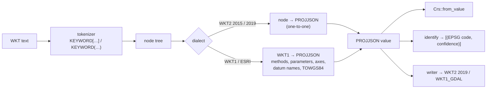
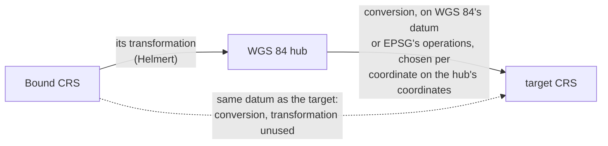
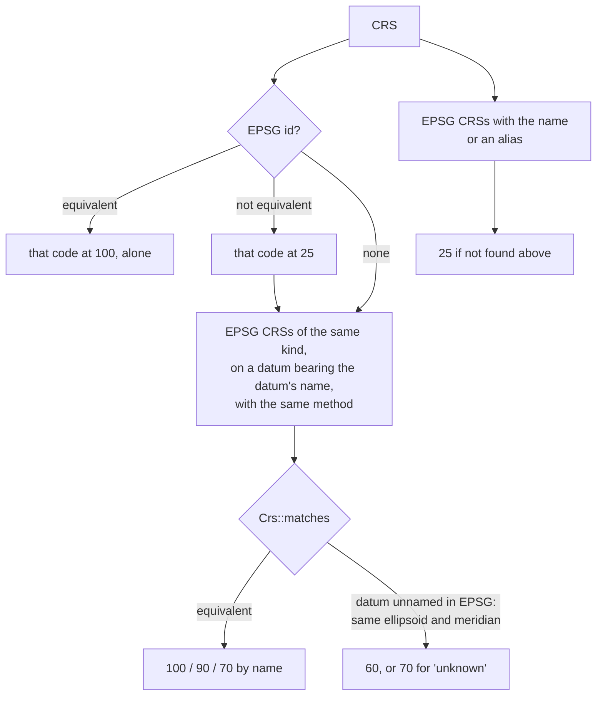

# CRS WKT: reading, writing and identifying

> **Status: design, 2026-10-22. Steps 1 to 6 are implemented:** reading
> WKT2 and WKT1 (GDAL's and ESRI's forms), writing WKT2 2019 and WKT1_GDAL
> (`xeibe_reproject::wkt`, `Crs::from_wkt`), identification
> (`Crs::identify`) and Bound CRSs (`TOWGS84`; see
> [Implementation](#implementation)).
> This is the first part of phase 2 in [pyproj-compat.md](pyproj-compat.md#phases).
> Facts about PROJ were checked against PROJ 9.8.1 through pyproj 3.8.0, and
> facts about EPSG against EPSG 13.106.

Coordinate reference systems arrive as WKT text more often than as anything
else:

- GDAL hands WKT to rasterio, fiona and pyogrio.
- Shapefiles carry ESRI WKT in their `.prj` files.
- GeoPackage stores WKT1, and WKT2 in its newer column.

Today `xeibe-reproject` reads only PROJJSON, and `xeibe_proj` raises "phase 2"
from `CRS.from_wkt`, `CRS.to_wkt` and from `to_epsg` on any CRS without an
EPSG id. This document covers three things:

- reading WKT;
- writing it;
- matching a CRS read from WKT to its EPSG code ("identification").

## Decisions

| # | Decision | Why |
|---|---|---|
| 1 | **WKT is translated to and from PROJJSON; there is no second CRS model.** The reader produces a PROJJSON value, which `Crs::from_value` then reads as it reads `xeibe-crs`'s. The writer formats a PROJJSON value. | PROJJSON was designed as the JSON form of WKT2 2019, so WKT2 maps onto it node for node. `Crs`, `xeibe_proj`'s metadata (`datum`, `axis_info`, …) and GeoParquet already use it. |
| 2 | **A `wkt` module in `xeibe-reproject`**, with identification next to it. | As planned in [pyproj-compat.md](pyproj-compat.md#changes-needed-in-the-rust-crates). Identification needs `Crs::equivalent`. The parser itself has no dependency on the conversion code, so it can move to its own crate if something outside `xeibe-reproject` needs it. Not `xeibe-crs`, although it holds the PROJJSON text: it depends only on `zstd` and is used by `xeibe-geom` and `xeibe-arrow`, which would gain `serde_json`; it is regenerated and versioned by EPSG releases; and identification would still need `xeibe-reproject`. The PROJJSON reader isn't there either. Generated EPSG data the reader needs (datum aliases) does go in `xeibe-crs`. |
| 3 | **Read** WKT2 2019, WKT2 2015, WKT1 (OGC 01-009 and GDAL's form of it) and WKT1 ESRI. **Write only WKT2 2019 and WKT1_GDAL.** `to_wkt` with any other version (`WKT2_2015`, the `_SIMPLIFIED` ones, `WKT1_ESRI`) raises `NotImplementedError` naming it. | Reading takes what is in the wild. Writing is only for the libraries that hand a pyproj CRS on as WKT: GeoPandas' `to_file` through fiona calls `crs.to_wkt()` (WKT2 2019), pyogrio's `write_dataframe` calls `crs.to_wkt("WKT1_GDAL")`, and rioxarray uses both (CF and Zarr metadata, rasterio). Nothing found asks for the other versions. |
| 8 | **The CLI and the web page take EPSG codes only**, as now: `--crs` and `--target-crs` accept no WKT and no `.prj` files, and neither writes WKT. | WKT is for `xeibe_proj`'s compatibility. GML names CRSs by URI, and an EPSG code is enough to pick a target. |
| 4 | **Datums are resolved to EPSG while reading**, not only by `to_epsg`. | A datum named only `D_WGS_1984` or `WGS_1984` has to become `EPSG:6326`. Otherwise the selection finds no operation between it and any EPSG CRS: datums match by EPSG key, or by exact name (`same_key` in `crs.rs`). |
| 5 | **Identification ranks matches with PROJ's confidence levels** (100, 90, 70, 25), measured against PROJ for every EPSG CRS in every dialect. | `to_epsg(min_confidence=70)` and `list_authority` are what callers see, and the cases where PROJ's rules aren't obvious are decided by measurement (see [Identification](#identification)). |
| 6 | **Anything not understood is an error that names it**, as in [reprojection.md](reprojection.md): an unknown projection method, a `PROJ4` extension other than Web Mercator's, a parameter that doesn't fit the method. | A CRS read wrongly converts coordinates wrongly with no visible sign. |
| 7 | **Output is equivalent to PROJ's, not identical.** Numbers keep 15 significant digits, as PROJ and EPSG write them (`0.0174532925199433`). An EPSG CRS gets `USAGE` from `xeibe_crs::usages`, as PROJ writes it, and no `REMARK`, which PROJ doesn't write either. | Divergence 7 in [pyproj-compat.md](pyproj-compat.md#deliberate-divergences-from-pyproj) already promises equivalence, not byte equality. Fifteen digits make most EPSG CRSs come out the way PROJ writes them anyway. |

## Sources

Each dialect's names come from whoever defines it, and PROJ is the reference
for behaviour throughout, because pyproj compatibility is the goal.

| Source | Shipped in the crates | Used to build tables | Used in tests |
|---|---|---|---|
| **EPSG** | The definitions (PROJJSON); CRS aliases; datum names and aliases (new, in `xeibe-crs`) | — | Its WKT archive, for reading WKT2 |
| **PROJ** (MIT, under `PROJ-NOTICE.md`) | WKT1 method and parameter names in GDAL's style (`Transverse_Mercator`, `central_meridian`), which only PROJ and GDAL define | That table, from PROJ's output for every EPSG CRS, checked against PROJ's mapping code | Its output in four versions; its reading of our output; its `list_authority` |
| **Esri** (Apache-2.0, in `xeibe-esri`) | ESRI names of datums and CRSs; old Esri codes that are now EPSG codes | ESRI method and parameter names, matched to EPSG's through Esri's WKT for EPSG CRSs | Esri's WKT for EPSG CRSs, as ArcGIS writes it into `.prj` files |

PROJ also settles what no data file does:

- the axis order of WKT1 without `AXIS`;
- the confidence levels;
- the Web Mercator `PROJ4` extension;
- what WKT1 can't express.

**EPSG stays the authority for meaning.** Esri's and PROJ's names only map
onto EPSG objects, and neither adds definitions.

ESRI WKT is tested against **two sources on purpose**. ArcGIS writes `.prj`
files in Esri's own style. GDAL writes ESRI-flavoured ones through PROJ's
imitation of that style, which differs in places. Esri's WKT has to read as
the EPSG CRS it was written for, and PROJ's ESRI output as PROJ reads it.
Cases where the two disagree are listed with the reason.

## Test data

**EPSG's own WKT export** (`example_data/EPSG-v13_106-WKT.Zip`) comes with
the PostgreSQL archive that `gen_crs_tables.py` reads. It is EPSG rendering
its own database as WKT2 2019, one file per object:

| Files | Count |
|---|---|
| CRSs | 8,360, of which 4 are prose ("WKT is not supported for vertical CRS derived in multiple steps") |
| Transformations, concatenated operations, point motion operations | 2,795, 220, 7 |

The 8,356 CRSs are 6,274 `PROJCRS`, 916 `GEOGCRS`, 576 `COMPOUNDCRS`, 304
`VERTCRS`, 259 `GEODCRS`, 23 `ENGCRS` and 4 `DERIVEDPROJCRS`.

The archive's limits:

- **Current CRSs only.** EPSG publishes no WKT for the ~836 deprecated ones.
- **No `USAGE` or `REMARK`.** Every object carries an `ID`, so the archive
  exercises reading with ids, not identification.
- **Only WKT2 2019.** It has no WKT1 and nothing in GDAL's or ESRI's style.

`gen_crs_tables.py` already uses the archive, but only as a gate: a
minimal parser (`parse_wkt`) compares a few facts per CRS with the generated
PROJJSON. Nothing in the crates contains WKT, and nothing writes it.

So the archive is the **test oracle for reading WKT2**: parse each file and
compare the result with `xeibe_crs::projjson` for the same code. A small
subset is committed under `tests/data/crs-wkt/` (IOGP data, under the notice
`xeibe-crs` already carries). The whole archive runs in an `--ignored` test.

The rest comes from **PROJ through the oracle database**
(`target/proj-oracle/`, [reprojection.md](reprojection.md)). PROJ's
database there is built from the same EPSG release, so the two sides see
the same data. A new script, `scripts/gen_wkt_vectors.py`, writes these
vectors:

- for every EPSG CRS, PROJ's `WKT2_2019`, `WKT2_2015`, `WKT1_GDAL` and
  `WKT1_ESRI`;
- the same strings with their ids removed, and PROJ's `list_authority` for
  each (the identification vectors).

Like the transformation vectors, it writes everything to
`target/crs-wkt/` with `--all`, and a committed subset otherwise.

**Esri's own WKT** comes from the CSVs in
[Esri/projection-engine-db-doc](https://github.com/Esri/projection-engine-db-doc)
(see [ESRI names](#esri-names)). Its live EPSG entries are 5,218 projected,
878 geographic and 288 vertical CRSs. Each row has Esri's WKT1 for the EPSG
code. `scripts/gen_esri_tables.py` fetches the CSVs into `example_data/`
(recorded in `example_data/SOURCES.md`), and `gen_wkt_vectors.py` writes
each live EPSG entry's WKT with PROJ's reading of it (name, axes,
`list_authority`, `to_epsg`) to `esri.jsonl`. Our reading is compared with
PROJ's. A subset is committed.

The **odd cases** come from the files already in the corpus, such as GDAL's
autotest `.prj` files and WKT strings in
`example_data/gdal-autotest-src`. They are hand-picked into the committed
subset, with PROJ's reading of each as the expected result.

## Reading

### Grammar

The tokenizer and tree are shared by every dialect:

- keywords are case-insensitive;
- either `[ ]` or `( )` delimits a node;
- quoted strings escape `"` by doubling it;
- numbers can carry exponents;
- enumerations (`north`, `ellipsoidal`) are bare words.

The output is a tree of `(keyword, [string | number | enum | node])`, with
byte offsets kept for error messages.

The dialect is decided by the root keyword and its children:

| Root | Dialect |
|---|---|
| `GEOGCRS`, `PROJCRS`, `GEODCRS`, `VERTCRS`, `COMPOUNDCRS`, `ENGCRS`, `BOUNDCRS`, `DERIVEDPROJCRS`, … and their long forms (`GEOGRAPHICCRS`, `VERTICALCRS`, …) | WKT2. 2019 if it uses 2019-only nodes (`ENSEMBLE`, `USAGE`, `BASEGEOGCRS`, `DYNAMIC`, …); otherwise read under 2015's rules, which 2019 extends. |
| `GEOGCS`, `PROJCS`, `GEOCCS`, `VERT_CS`, `COMPD_CS`, `LOCAL_CS` | WKT1. ESRI when its names follow ESRI's conventions (`GCS_`, `D_`, `PARAMETER["False_Easting"]`, `UNIT["Degree"]`) and it has no `AUTHORITY`. Otherwise OGC/GDAL. |

### WKT2

Each node maps to its PROJJSON key, with unit inheritance resolved on the
way: an `AXIS` without a unit takes the CS-level `UNIT`. Synonyms are
normalised (`SPHEROID`, `ELLIPSOID`; `DATUM`, `TRF`, `GEODETICDATUM`;
`UNIT`, `LENGTHUNIT`, …).

EPSG's archive uses these keywords:

- **Most of the grammar:** `ANCHOREPOCH`, `BASEGEOGCRS`, `BASEPROJCRS`,
  `BASEVERTCRS`, `CONVERSION`, `DATUM`, `DEFININGTRANSFORMATION`,
  `DERIVINGCONVERSION`, `DYNAMIC`, `EDATUM`, `ENSEMBLE`, `ENSEMBLEACCURACY`,
  `FRAMEEPOCH`, `GEOIDMODEL`, `MEMBER`, `MERIDIAN`, `METHOD`, `PARAMETER`,
  `PARAMETERFILE`, `PRIMEM`, `VDATUM`, `VERSION`, and the CRS, CS and unit
  keywords.
- **Operation WKT,** used by the operation files only:
  `COORDINATEOPERATION`, `CONCATENATEDOPERATION`, `POINTMOTIONOPERATION`,
  `SOURCECRS`, `TARGETCRS`, `STEP`, `OPERATIONACCURACY`.

Every keyword the CRS files use gets a PROJJSON mapping, or is skipped with
a recorded reason when PROJJSON has nowhere to put it. Operation WKT is
**out of scope** (`Transformer.from_pipeline` takes PROJ strings, not WKT
operations). `BOUNDCRS` is read; see [TOWGS84](#towgs84-and-boundcrs).

Methods and parameters often come without ids (PROJ's simplified output,
hand-written WKT). `Crs` then finds their EPSG codes by name, through
`xeibe_crs::method_code` and `parameter_code` (EPSG's names and aliases,
generated into `xeibe-crs`). A parameter without a unit takes the CRS's
length unit, its base's angle unit or unity, by what its name says it
measures.

### WKT1

WKT1 needs translation, not just mapping:

- **Methods and parameters.** WKT1 uses its own names:
  `PROJECTION["Transverse_Mercator"]` with `PARAMETER["central_meridian"]`
  in GDAL's form, and `PARAMETER["Central_Meridian"]` in ESRI's.
  - These map to EPSG method and parameter codes through a table.
  - **GDAL's names come from PROJ's output.** For every EPSG CRS, PROJ's
    `WKT1_GDAL` string is lined up with the CRS's EPSG method and
    parameters. Pairs that disagree, or that occur only once, are checked
    against PROJ's mapping tables in its C++ source (MIT).
  - **ESRI's names come from Esri's data.** Esri's WKT for each EPSG CRS
    is lined up the same way. `pe_list_projection.csv` and
    `pe_list_parameter.csv` list the names but don't link them to EPSG.
    PROJ's `WKT1_ESRI` output is the cross-check.
  - The table is generated into the crate, with the methods
    `xeibe-reproject` implements as its scope. A WKT1 method outside it
    is an error.
- **Units.** Matched by conversion factor; the name is only used to write
  the unit back out (`"Degree"`, `"metre"`, `"Meter"`, `"US survey foot"`).
- **Axes.** PROJ's rules, as measured:

  | WKT1 input | PROJ's axes |
  |---|---|
  | `GEOGCS` with `AUTHORITY["EPSG","4326"]` and no `AXIS` | The authority's: latitude, longitude |
  | `GEOGCS` with no `AUTHORITY` and no `AXIS` | Longitude, latitude (WKT1's default) |
  | `PROJCS` with no `AXIS` (any `AUTHORITY`) | Easting, northing, even for EPSG:2180, whose EPSG axes are northing, easting |

  PROJ writes EPSG:2180 and EPSG:3035 as WKT1_GDAL **without** `AXIS`, so
  reading its own output back gives east, north. This is lossy, and it is
  why such a string identifies with confidence 25, not 100 (below).
- **Datum names.** GDAL writes EPSG's names with underscores
  (`Ordnance_Survey_of_Great_Britain_1936`); ESRI prefixes `D_` and uses its
  own names (`D_ETRS_1989`). Each datum is resolved to an EPSG datum
  (decision 4):
  - by `AUTHORITY`;
  - else by normalised name (lower case, alphanumerics only, `D_` dropped)
    against EPSG's datum names and aliases, among the datums whose ellipsoid
    matches;
  - else by the ESRI table, when there is one.

  An unresolved datum keeps its name, and transformations to it then fail,
  as they would in PROJ.
- **Web Mercator.** GDAL's WKT1 for EPSG:3857 is `Mercator_1SP` on the
  WGS 84 ellipsoid, plus
  `EXTENSION["PROJ4","+proj=merc +a=6378137 +b=6378137 … +nadgrids=@null …"]`.
  That exact extension is read as EPSG method 1024 (Popular Visualisation
  Pseudo Mercator). Any other `PROJ4` extension is an error until the phase 3
  PROJ-string translator exists.

### ESRI names

Measured on PROJ's `esri.sql` (ESRI's names for EPSG objects, ArcGIS Pro 3.6
data), against EPSG's datum names and aliases:

- 495 of 659 ESRI datum names reach their EPSG datum by normalising alone,
  and 1 reaches a wrong one.
- The other 164 include the most common datums: `D_WGS_1984` normalises
  to `wgs1984` and `D_ETRS_1989` to `etrs1989`, but EPSG has only
  `World Geodetic System 1984` and `WGS 84`, and `ETRS89`.
- EPSG's own `WKT alias` naming system has 5 entries and doesn't help.

So reading ESRI WKT well needs ESRI's names: 676 datum names and 6,456 CRS
names in PROJ's `esri.sql`. PROJ's identification relies on them as well.
`GCS_ETRS_1989` identifies as EPSG:4258 with confidence 100, because PROJ
knows that name.

**Where the names come from, and their licence.** Esri publishes them in
[Esri/projection-engine-db-doc](https://github.com/Esri/projection-engine-db-doc),
under **Apache-2.0** (checked 2026-10-22: `license.txt`, no `NOTICE` file).
`csv/pe_list_datum.csv`, `pe_list_geogcs.csv` and `pe_list_projcs.csv` give
each object's WKID (the EPSG code for EPSG objects) and Esri's name. The
current files are ArcGIS Pro 3.7, synced with EPSG 12.049. PROJ's
`esri.sql` is generated from this repository, so it would be taken from
there, not from PROJ.

**Decided (2026-10-22): the names are embedded**, in a crate of their own,
`xeibe-esri`. It is generated from Esri's CSVs and carries Esri's licence in
`ESRI-NOTICE.md`, as `xeibe-crs` carries EPSG's.

| Crate | Licence |
|---|---|
| `xeibe-esri` | `CC0-1.0 AND Apache-2.0` |
| `xeibe-reproject` | `CC0-1.0 AND MIT` (the PROJ ports) |
| `xeibe_proj` | `CC0-1.0 AND MIT AND Apache-2.0 AND LicenseRef-EPSG` |

These are `AND`s: each part keeps its own licence, and redistributing
everything means passing on each notice. They aren't alternatives to choose
between, as in a dual licence.

**Old Esri codes.** Esri gave codes to some CRSs before EPSG had them, and
later moved them to EPSG's codes: `ESRI:102100` is now EPSG:3857. The CSVs
record 987 of these whose new code is an EPSG one (`xeibe_esri::epsg_code`).
`xeibe-esri` ships them as an alias table. `CRS("ESRI:102100")` then
gives EPSG:3857, and identification finds the EPSG code for an old `.prj`
file that names one of these codes. That is the exception
[pyproj-compat.md](pyproj-compat.md#crs) allows for the ESRI authority.

**CRSs only Esri defines stay out**: 1,211 live projected, 256 geographic
and 266 vertical ones (`ESRI:102173` "ETRS_1989_UWPP_1992", `ESRI:54009`
Mollweide, …). Some need methods `xeibe-reproject` doesn't have, or datums
only Esri's own transformations reach. That would mean supporting a second
authority, which is beyond this design.

`xeibe-reproject` uses `xeibe-esri` through a default feature, `esri`. A
project that can't take Apache-2.0 (a GPLv2-only one) turns the feature off.
In the workspace the feature is off for dependents (the workspace
dependency has `default-features = false`), since the CLI, the web page and
the Python module `xeibe` take EPSG codes only; `xeibe-proj-py` turns it on.
Without it, ESRI input works only for:

- datums that normalise, which `xeibe_proj` reports as resolved;
- the others by ellipsoid and parameters, at lower confidence and with a
  warning naming the datum.

**Reading, as built (step 5).** PROJ's ESRI rules from `io.cpp`, in
`src/wkt/esri.rs` and the WKT1 reader:

- **Dialect.** As PROJ's `guessDialect`: a `VERTCS`, a `GEOGCS` named
  `GCS_…`, a `DATUM` named `D_…` or ESRI's `X_Scale`/`Vertical_Shift`
  make WKT1 ESRI's; no `AXIS` and no `AUTHORITY` anywhere make it maybe
  ESRI's, which a datum found only in Esri's table confirms.
- **Names.** Datum, geographic, projected and vertical CRS names go
  through Esri's tables to EPSG's name and code (`D_WGS_1984`,
  `D_ETRS_1989`, `GCS_WGS_1984` and `D_unknown` by hand, as PROJ does). A
  datum on a prime meridian other than Greenwich takes EPSG's datum named
  for it ("Bogota 1975 (Bogota)"). A State Plane name in US feet without
  `_Feet` is the one with it.
- **Projections** through PROJ's ESRI table: the entry whose parameters
  match best, Krovak's orientation from `_East_North` in the name,
  Stereographic at a pole as Polar Stereographic (variant A), Plate Carrée's
  standard parallel at 0, Hotine's skew angle from its azimuth.
  Parameters are found by ESRI's name, then PROJ's aliases
  (`Longitude_Of_Origin` for `Central_Meridian`), then EPSG's name, which
  PROJ's own WKT1_ESRI writes for some methods.
- **`VERTCS`** with `Direction` −1 is a depth; one on a geodetic `DATUM`
  (ellipsoidal heights) or with a `Vertical_Shift` isn't read. A `GEOGCS`
  with a `LINUNIT` is 3D. `PROJCS[…],VERTCS[…]` is a compound CRS named
  from its parts, as PROJ names it.

Equivalence now follows PROJ's for conversions, which ESRI's definitions
need (`SingleOperation::_isEquivalentTo`): parameters within 2e-10; a
parameter only one side has must be neutral (1 for a scale, else 0); an
azimuth or skew angle 360° apart is the same; Lambert Conic Conformal (2SP)
may have its standard parallels swapped and is compared as the 1SP it
equals when its parameters differ (so does a 1SP against a 2SP); Mercator
(variant A) is compared as variant B.

### TOWGS84 and BoundCRS

WKT1's `TOWGS84[…]` and WKT2's `BOUNDCRS` attach a transformation to
WGS 84. PROJ reads them as a Bound CRS: a `GEOGCS` with `TOWGS84` has
`type_name` "Bound CRS", and `list_authority` finds nothing.

They are read into PROJJSON's `BoundCRS`, which `xeibe_proj` exposes as
pyproj does (`is_bound`, `source_crs`, `target_crs`,
`coordinate_operation`).

**Decided (2026-10-22): converting with the attached transformation is part
of phase 2**, right after identification. Old `.prj` files and GeoPackages
carry `TOWGS84`, and for a datum EPSG doesn't know, it is the only route
to anything. `Crs` and the selection gain the Bound CRS: the "BoundCRS" row
in [pyproj-compat.md](pyproj-compat.md#changes-needed-in-the-rust-crates).
The attached transformation becomes a candidate route through its hub, as
in PROJ, and the choice between it and EPSG's operations is compared with
PROJ's on Bound CRSs made from EPSG CRSs and their EPSG transformations to
WGS 84.

**As built (step 6).** A `Crs` read from a Bound CRS is its base CRS
carrying the transformation (`Crs::bound`): the hub, and the
transformation as an operation without a code. Only the Helmert family is
read; a Bound CRS with another transformation (a grid) is an error, and so
is a compound CRS whose horizontal part is bound, unless no transformation
is needed.

PROJ's rules (`createOperationsBoundToGeog`, `createOperationsBoundToBound`):

- Between a Bound CRS and a CRS on its base's datum, the transformation
  isn't used. Between two Bound CRSs it is, through the hub, unless they
  carry the same transformation.
- To a CRS on the hub's datum (WGS 84, Pseudo-Mercator): the
  transformation, then a conversion. Otherwise EPSG's operations from the
  hub, named "Transformation from X to WGS84 + Inverse of ETRS89 to WGS 84
  (1)" as PROJ names them.
- A base on the Clarke 1866 ellipsoid to a CRS on NAD83: WGS 84 counts as
  NAD83 there, and the transformation lands on NAD83 ("Transformation from
  Old Hawaiian to NAD83").
- Reading `TOWGS84`: 3 values are padded to 7; Position Vector to EPSG:4326
  (EPSG:4978 for a `GEOCCS`); the rotations turned round when they are an
  EPSG Coordinate Frame transformation's (PROJ's
  `toWGS84AutocorrectWrongValues`); Web Mercator drops it.
- WKT2's abridged transformation has fixed units: metres, arc-seconds and
  the scale difference as a factor (1 + ppm × 10⁻⁶).

Two of PROJ's pipeline optimisations change results, and are followed:
between two geog2D-domain Helmert steps (two Bound CRSs on one hub) the
height the first produces flows into the second; and a Helmert of zeros
between GRS 1980 and WGS 84 standing alone (a zero `TOWGS84` on ETRS89 to
WGS 84) is no step at all, where next to another geocentric step it isn't.

## Writing

From a PROJJSON value:

- **WKT2 2019** is the mapping above in reverse, in the order ISO 19162
  gives, with PROJ's choices where WKT leaves room (measured on its output
  for every EPSG CRS):
  - ids only on the CRS itself, its base CRS, `METHOD` and `PARAMETER`;
    none on compound components, datums, ellipsoids, members or units;
  - every axis with its own unit, and `ORDER` when there are several;
  - axis names with a lower-case first letter, and left out for Easting
    (E) as the first axis, Northing (N) as the second, and Geocentric X,
    Y, Z in their places: `AXIS["(E)",east]`, but `"northing (N)"` first;
  - a `PRIMEM` always, Greenwich included;
  - the PROJJSON's usages and remarks for the outermost CRS only;
  - numbers as `%.15g`, and an ensemble's accuracy as its text (`2.0`).
- **WKT1_GDAL** is the WKT1 table in reverse. `AXIS` follows pyproj's
  `output_axis_rule` (`None` meaning PROJ's automatic rule, which the
  vectors pin down). Web Mercator gets GDAL's `PROJ4` extension back.

  Some CRSs WKT1 can't express, such as engineering CRSs with non-metric
  axes, derived projected CRSs, and methods without a WKT1 name. Those
  raise and name the part, where PROJ would also fail or write something
  lossy.
- **Pretty printing** indents by 4 spaces, as PROJ does.
- **Not written** (decision 3): WKT2 2015, the `_SIMPLIFIED` variants and
  WKT1_ESRI. Each is a small step from the two above (PROJ's rules for
  2015 replace ensembles with a `DATUM` and move `USAGE` to the top level),
  to add if a caller turns up.

## Identification

`Crs::identify() -> Vec<(u32, u8)>` returns EPSG codes with a confidence,
best first. pyproj's `to_epsg()` is the first at 70 or more, and
`to_authority` and `list_authority` are thin layers over it. The levels
are PROJ's:

| Confidence | Meaning |
|---|---|
| 100 | Equivalent, with EPSG's name |
| 90 | Equivalent, with a name that matches EPSG's or one of its aliases after normalising (`WGS_1984` for "WGS 84") |
| 70 | Equivalent, under another name; or as for 60, with a datum named "unknown" or "unnamed" |
| 60 | Equivalent but for the datum, which has no EPSG code or name, and has the EPSG CRS's ellipsoid and prime meridian |
| 25 | Not equivalent, but the input's `ID`/`AUTHORITY` names this code, or the names match |

The search is simpler than PROJ's. PROJ searches by name, exactly and
then approximately, falls back to datum or ellipsoid searches, has
shortcuts for WGS 84, NAD27 and NAD83 and their UTM zones, and ranks
with a long list of tie-breaks. Here:

- **Candidates** come from `xeibe-crs`'s table, which now carries each
  CRS's datum and method codes (`CrsRecord::datum`, `method`), so finding
  them is a scan of a static table, and only they are parsed. Building an
  index from all PROJJSON instead would cost about 180 ms on first use.
- **Datums**: the input's datum id, and every EPSG datum that bears its
  name or the id's name, by name or alias. EPSG deprecated some datums
  for duplicates of the same name (EPSG:6640 and 1047, RRAF 1991) and
  keeps others' names as aliases (Guyane Francaise on EPSG:6623).
  Candidates on any of them are compared in full, datum names included.
  When no EPSG datum has the name, every CRS of the kind and method is a
  candidate, compared without the datum's identity (about 50 ms).
- **Comparison** is `Crs::equivalent` with three relaxations
  (`crs::Relax`). The axis order is one. The horizontal axes by unit
  only is another, for a WKT1 `GEOGCS` or `PROJCS` without `AXIS`,
  whose axes are defaults; Krovak and its north-orientated variant
  count as one method there. Datums by ellipsoid and prime meridian only
  is the third, for the 60 level.
- **Methods** match by code or by EPSG name. EPSG reuses two methods'
  names for their deprecated duplicates (9823 and 1029, 9842 and 1028),
  so a method read by name has the live code.
- **Ensembles and their members.** EPSG has moved about 190 CRSs named
  "ETRS89 / …" from the ETRS89 ensemble to national members of it
  (EUREF89, ETRF2000-PL), which Esri's and older WKT still put on the
  ensemble (and EPSG:2180 the other way round). A CRS on the input datum's
  ensemble or on one of its members is a candidate too, and matches,
  datum aside, only with the input's name or an alias (100 or 90). PROJ
  gets there by special cases for those names.
- **Ranking**: confidence, then live before deprecated, then CRSs whose
  axes are the input's exactly (of UTM zone 30N and its N-E twin, both
  equal to a WKT1 without `AXIS`, the E-N one, as PROJ ranks them), then
  code. Geographic 2D and 3D are one kind, told apart by their axes,
  because EPSG classes some 3D CRSs as 2D (NAD83(FBN), EPSG:8449).

Where it differs from PROJ on purpose:

- **WKT1 without `AXIS`** matches by axis units with or without its
  `AUTHORITY`. GDAL's WKT1 for EPSG:2180 (easting first, EPSG has
  northing first) is EPSG:2180 at 100. PROJ applies that rule to its name
  search only and gives the `AUTHORITY` 25, so `to_epsg()` is None for
  its own WKT1_GDAL of 2,459 CRSs.
- **Deprecated CRSs** are candidates; PROJ leaves them out of its search.
  A deprecated CRS by its own name ranks before a live one under another
  name: EPSG deprecated NAD83 / South Dakota North (ftUS), EPSG:3454, for
  having South's parameters, so it is equivalent to EPSG:3455, and the
  name says which was meant. Of two equivalent CRSs with the same name,
  the live one comes first.
- **The CRS's own name** wins over PROJ's UTM shortcut: WGS 84 / TMzn35N
  (EPSG:4037) as WKT1 is 4037, where PROJ builds WGS 84 / UTM zone 35N.
- A **CRS whose method `Crs` can't build** (26 EPSG CRSs: Lambert Conic
  Conformal (West Orientated), Polar Stereographic (variant C), Tunisia
  Mining Grid, Lambert Conic Near-Conformal, the UTM grid systems) can't
  be identified, because identification compares `Crs` values.

Unchanged from PROJ: no **engineering CRS** is identified, not even with
its `ID`.

**Transforming.** `Transform` looks operations between datums up by EPSG
code. A CRS without one (WKT without ids) now uses the code of the EPSG
CRS it is equivalent to, never one found at the 60/70 datum-relaxed
level.

## Validation

| Test | Source | Passes when |
|---|---|---|
| Reading WKT2 | EPSG's archive, 8,356 CRSs | the PROJJSON read is the same as `xeibe_crs::projjson` for the code, apart from the listed nodes EPSG leaves out (`USAGE`, `REMARK`) |
| Reading PROJ's output | `gen_wkt_vectors.py`, every EPSG CRS × 4 versions | the CRS read is `equivalent` to the EPSG CRS (with axis order ignored exactly where the WKT1 table above says PROJ loses it) |
| Writing | every EPSG CRS × 2 versions | our WKT read back by our reader is unchanged; PROJ reads it as equivalent to its own CRS for the code; a structural diff against PROJ's output for the same version shows only listed differences |
| Identification | the vectors with ids removed | our ranking matches PROJ's `list_authority`; differences are listed with a reason, in a list that only shrinks, as `oracle-known.txt` does for operations |
| pyproj's suite | `pass-list.txt` | the WKT tests in `test_crs.py` that pass are added; the list only grows |

All of these run against the oracle database and the EPSG archive, so like
the PROJ comparisons today they are `--ignored` tests run locally. The
committed subsets run everywhere, CI included.

## Implementation

**Step 1 (2026-10-22): the WKT2 reader.** It reads WKT2 2015 and 2019 into
PROJJSON (`xeibe_reproject::wkt::to_projjson`); `Crs::from_wkt` converts
with it. `scripts/gen_wkt_vectors.py` writes the vectors: EPSG's archive
(`epsg.jsonl`), PROJ's output (`wkt.jsonl`) and PROJ's identification
(`identify.jsonl`).

- All **8,356 CRSs in EPSG's archive** read as the PROJJSON `xeibe-crs`
  has for the code, and as a `Crs` equivalent to the EPSG one.
- **PROJ's WKT2 2019 and 2015** (8,883 and 8,882 strings) read as CRSs
  equivalent to the EPSG ones.

What the comparison turned up, in EPSG's export:

- It rounds prime meridians: Paris is `0.040792344` radian, 9.6e-9 from
  the database's 2.5969213 grad (2.5 mm). PROJ still finds the CRS
  equivalent; its tolerance for prime meridians is 1e-8 relative
  (measured), which `Crs::equivalent` now uses too.
- Four ensembles' ids say `"EPSG "`; the reader trims authorities.
- `BASEGEOGCRS` carries no coordinate system and often no unit, so a base
  CRS's axis units (grads for NTF (Paris)) are lost. The reader gives the
  base latitude and longitude in the unit it has, or degrees, as PROJ does.
- Axis abbreviations can hold brackets: `"Easting (E(X))"`.

In PROJ's output:

- WKT2 2015 has no ensembles, so PROJ writes three of them under
  traditional datum names (`ensembleNameToNonEnsembleName`): WGS 84 as
  "World Geodetic System 1984", ETRS89 as "European Terrestrial Reference
  System 1989", and GR96 as "Greenland 1996", the name of the datum it
  superseded (EPSG:6747). `Crs::equivalent` matches datum names with the
  same map, and as PROJ's `isEquivalentName` compares them (ported in
  `name.rs`).
- Modified Krovak (EPSG:5224, 5225, 5515, 5516) comes without its
  evaluation point and C1 to C10, which PROJ fixes in code. `Crs` adds
  EPSG's values, the same for all four, when none are given.

**Step 2 (2026-10-22): the WKT2 2019 writer** (`wkt::from_projjson`, one
line or pretty). For all 8,880 EPSG CRSs PROJ writes, ours is PROJ's token
for token (numbers within 1e-11), apart from `REMARK`, which `xeibe-crs`'s
PROJJSON doesn't carry, and 150 CRSs where PROJ's database differs from
EPSG's dataset:

- 131 derived vertical CRSs (depths, heights in feet), which PROJ stores
  as plain vertical CRSs with their base's datum: `VDATUM` where EPSG,
  and we, have `BASEVERTCRS` and a conversion;
- 15 on RH2000, whose datum EPSG types as plain vertical with a frame
  reference epoch of 2000 (its own WKT has no `DYNAMIC`); PROJ makes it
  dynamic;
- the 4 Modified Krovak CRSs, whose correction PROJ fixes in code.

Each of them also reads back, through our reader, as a CRS equivalent to
the EPSG one. The generator now writes EPSG's anchor epochs into the
PROJJSON (`xeibe-crs` 0.4.0), which the comparison showed missing for
about 2,400 CRSs. Pretty output matches PROJ's indentation (axes one level
deeper than their CS).

**Step 3 (2026-10-22): WKT1.** Reading follows PROJ's `WKTParser` and
writing its WKT1_GDAL export, rule for rule:

- `scripts/gen_wkt1_names.py` generates `src/wkt/names.rs` from PROJ's
  mapping tables (`parammappings.cpp`, MIT): 36 methods with their WKT1
  and EPSG names and 178 parameters, plus PROJ's ESRI table (40
  projections) for step 5. PROJ's own WKT1 output for every EPSG CRS
  reads back through it as the same methods and parameters, apart from
  PROJ's own quirks, which it lists.
- `xeibe-crs` gains EPSG's datums and their aliases (`DATUMS`,
  `DATUM_ALIASES`) and units by name (`unit_code`). A datum named only
  GDAL's way (`Ordnance_Survey_of_Great_Britain_1936`) resolves to its
  EPSG datum by PROJ's name matching, as PROJ resolves it.
- Reading: PROJ's default axes (a `GEOGCS`'s from the EPSG CRS its
  `AUTHORITY` names, else longitude, latitude; a `PROJCS`'s by method:
  south-west for Krovak, along meridians for polar ones), its prime
  meridian corrections (Paris in degrees under grads, sexagesimal
  meridians, which the WKT2 reader now applies too), Web Mercator by its
  `PROJ4` extension, the Mercator_1SP, Polar_Stereographic, Lambert
  Conformal Conic and Hotine special cases, and methods PROJ writes under
  their EPSG names. The one difference: the default polar axes' meridians
  turn with the longitude of origin, where PROJ gives 90° and 0° (its own
  conversions ignore them).
- Writing: `AUTHORITY` on every object (a CRS's degrees as 9122), datum
  names as GDAL 2 wrote them (`morphNameToESRI`), the prime meridian in
  degrees, `AXIS` only where PROJ writes it, " (deprecated)" on deprecated
  geodetic and projected CRSs, scale factors as plain factors, and an
  error where PROJ has none (geographic 3D CRSs and projected CRSs on
  them, methods PROJ gives no WKT1 name).

Against PROJ, for every EPSG CRS:

- **Reading PROJ's WKT1_GDAL** (8,524 strings): the axes PROJ reads, and
  equivalent to the EPSG CRS exactly when PROJ finds it equal, apart from
  13 listed in the test. In 6 PROJ is stricter than `Crs::equivalent`:
  polar axes that amount to east and north (3408, 3409, 27702), a unit
  equal by factor but not by name (4226), and a datum equal by id but not
  by name (M'poraloko). In 4 PROJ is more lenient: it compares polar axes
  by direction only, so UPS North and South and RSPS2000 written with
  easting first equal EPSG's northing first, and it takes a deprecated
  method under another's WKT1 name (3786). And EPSG:3785 (`TOWGS84`) and
  5817 (an unspecified axis direction) wait for later steps.
- **Writing WKT1_GDAL** (8,521 CRSs): PROJ's text token for token, apart
  from EPSG:3785, which PROJ writes through a path of its own. Read back,
  each is the EPSG CRS exactly when PROJ's own WKT1 is (WKT1 loses
  northing-first axis order: 2,442 projected and compound CRSs).

**Step 4 (2026-10-22): identification** (`Crs::identify`), as described
under [Identification](#identification). Against PROJ's
`list_authority`/`to_epsg` on its WKT2 2019, WKT2 2015 and WKT1_GDAL for
every EPSG CRS, with ids and without (52,400 identifications):

- `to_epsg()` agrees with PROJ's, or finds the CRS the WKT was written
  for where PROJ doesn't. That covers deprecated CRSs (about 300 per
  version), 142 WKT1 compound CRSs PROJ finds only at 25, and the WKT1
  `AUTHORITY` case above.
- The rest is listed in the test: 10 deprecated CRSs where a live CRS of
  the same name and definition comes first (RRAF 1991, IGD05); 3
  Lambert Azimuthal Equal Area (Spherical) CRSs, which WKT1 reads as the
  ellipsoidal method and so as EPSG:6931 and its siblings; 4235 and 32663,
  as in reading; and 3785 and 5817, which aren't read yet.
- Where both rank the same code first (25,564 of the strings without
  ids), the confidence is PROJ's in all but 157. 151 are CRSs PROJ finds
  only at 25 (the WKT1 compound CRSs, RRAF 1991). 3 WKT1 compound CRSs
  are at 60 here and 25 in PROJ. NTF (Paris) / Lambert zone II (EPSG:27500)
  is at 100 here and 70 in PROJ. And 32663 is listed above. Names are
  compared trimmed, as the reader trims them: two EPSG names end in a
  space.
- About 0.7 ms per identification in a release build.

**Step 5 (2026-10-23): ESRI input** with `xeibe-esri`, as described under
[ESRI names](#esri-names). `xeibe-esri` holds 920 geographic, 5,457
projected and 286 vertical CRS names, 662 geodetic and 265 vertical datum
names, and 987 old codes, from Esri's data at ArcGIS Pro 3.7.

- **Esri's own WKT** (6,384 live EPSG CRSs): 6,382 read, with PROJ's axes,
  and `to_epsg()` is PROJ's or the code Esri wrote it for (PROJ gets 6,016
  right; we get all but the 5 listed). Listed: a 3D `PROJCS` and
  `Polar_Stereographic_Variant_B`, which PROJ doesn't read as EPSG's
  either; 4088, as deprecated as its twin 3786; 22700 and 32662, whose
  Esri definitions are other EPSG CRSs', which we find.
- **PROJ's WKT1_ESRI** (8,570 strings): the axes PROJ reads, and
  equivalent to the EPSG CRS exactly when PROJ finds it equal, apart from
  those listed: 9 whose names come from PROJ's own, older copy of Esri's
  names (SIRGAS-Chile's "realization 1 epoch 2002"), 20 Norwegian CRSs on
  `D_ETRS_1989` that EPSG has on EUREF89 (PROJ equates the ensemble and
  its member through Esri's names; `Crs::equivalent` keeps them apart),
  3410 and 9895. Identified as PROJ does, with the same skew in names
  listed.
- The changes to equivalence leave the WKT2 and WKT1_GDAL comparisons as
  they were, apart from three deprecated CRSs: 32662 and 32663, whose
  deprecated methods read back under the live ones' names, and 4088,
  which is now equal to its deprecated twin 3786.

**Step 6 (2026-10-23): Bound CRSs**, as described under
[TOWGS84 and BoundCRS](#towgs84-and-boundcrs). `gen_wkt_vectors.py` makes
1,695 Bound CRSs from EPSG's Helmert transformations to WGS 84 (methods
9603, 9606, 9607, Coordinate Frame ones also as written, uncorrected), on
each source CRS and a projected CRS on it, and records PROJ's PROJJSON,
WKT2 2019, WKT1_GDAL and results from a point in the area of use to WGS 84,
Pseudo-Mercator, ETRS89, NAD83, the plain EPSG CRS and another Bound CRS
(`bound.jsonl`).

- 10,047 conversions agree with PROJ's to 2e-9° or 0.2 mm (2e-11 relative
  far outside a projection's area), without grids, as PROJ had none.
  Listed: M'poraloko (as in reading), and CGRS93, where PROJ keeps the
  signs of Coordinate Frame values because ESRI's copy of the
  transformation, which xeibe doesn't have, has them turned. CRSs with
  south-west axes (Krovak) are left out: `AxisOrder::EastFirst` keeps them
  as they are, where pyproj's `always_xy` turns them round.
- Our TOWGS84, and PROJ's WKT2 2019 (`BOUNDCRS`) and WKT1_GDAL of each,
  read back to PROJ's PROJJSON for the target CRS and the transformation
  (the scale to 1e-8 ppm: PROJ writes the abridged factor to 15 digits).
- Written as WKT2 2019 and WKT1_GDAL, the target CRS and transformation, and
  `TOWGS84`, are PROJ's token for token. The WKT2 writer now writes a
  geodetic CS's "Latitude" and "Longitude" without abbreviation, and the
  reader names WKT2 axes as PROJ's `buildAxis` does.
- A Bound CRS identifies as nothing, and isn't equivalent to its base, as
  in PROJ.

## Order of work

1. **Tokenizer and WKT2 reader**, gated on EPSG's archive.
2. **WKT2 writer**, gated on round trips and PROJ reading it.
3. **`gen_wkt_vectors.py`, then the WKT1 table, reader and WKT1_GDAL
   writer**, gated on PROJ's WKT1 output.
4. **Identification**, gated on PROJ's `list_authority`.
5. **ESRI input** with `xeibe-esri`: its generator, the names, the old
   codes and the `esri` feature, gated on Esri's WKT and PROJ's ESRI
   output.
6. **`BOUNDCRS`/`TOWGS84`**: reading, then converting with the attached
   transformation, gated on PROJ's choices.
7. **`xeibe_proj`:** `from_wkt`, WKT in `CRS(...)`, `from_user_input` and
   objects with `to_wkt()`, `to_wkt(version, pretty, output_axis_rule)` for
   the two versions written,
   `to_epsg`/`to_authority`/`list_authority` with `min_confidence`,
   `to_wkt` on the sub-objects (`Datum`, `Ellipsoid`, …), and
   `pyproj.enums.WktVersion`. Each piece is wired in as soon as the Rust
   part it needs lands.

## Later, if asked

- Writing WKT2 2015, the `_SIMPLIFIED` variants or WKT1_ESRI (decision 3).
- CRSs only Esri defines ([ESRI names](#esri-names)).
