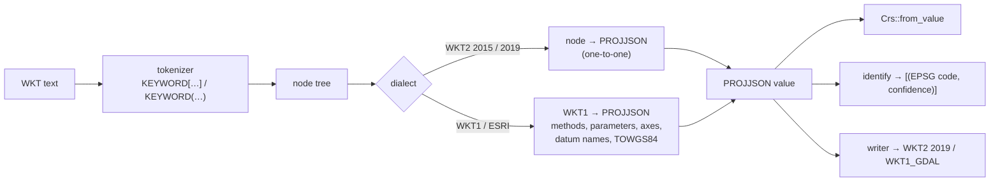

# CRS WKT: reading, writing and identifying

> **Status: design, 2026-10-22. Steps 1 and 2, the WKT2 reader and the
> WKT2 2019 writer, are implemented** (`xeibe_reproject::wkt`,
> `Crs::from_wkt`; see [Implementation](#implementation)).
> This is the first part of phase 2 in [pyproj-compat.md](pyproj-compat.md#phases).
> Facts about PROJ were checked against PROJ 9.8.1 through pyproj 3.8.0, and
> facts about EPSG against EPSG 13.106.

Coordinate reference systems arrive as WKT text more often than as anything
else:

- GDAL hands WKT to rasterio, fiona and pyogrio.
- Shapefiles carry ESRI WKT in their `.prj` files.
- GeoPackage stores WKT1, and WKT2 in its newer column.

Today `xeibe-reproject` reads only PROJJSON, and `xeibe_proj` raises "phase 2"
from `CRS.from_wkt`, `CRS.to_wkt` and from `to_epsg` on any CRS without an
EPSG id. This document covers three things:

- reading WKT;
- writing it;
- matching a CRS read from WKT to its EPSG code ("identification").

## Decisions

| # | Decision | Why |
|---|---|---|
| 1 | **WKT is translated to and from PROJJSON; there is no second CRS model.** The reader produces a PROJJSON value, which `Crs::from_value` then reads as it reads `xeibe-crs`'s. The writer formats a PROJJSON value. | PROJJSON was designed as the JSON form of WKT2 2019, so WKT2 maps onto it node for node. `Crs`, `xeibe_proj`'s metadata (`datum`, `axis_info`, …) and GeoParquet already use it. |
| 2 | **A `wkt` module in `xeibe-reproject`**, with identification next to it. | As planned in [pyproj-compat.md](pyproj-compat.md#changes-needed-in-the-rust-crates). Identification needs `Crs::equivalent`. The parser itself has no dependency on the conversion code, so it can move to its own crate if something outside `xeibe-reproject` needs it. Not `xeibe-crs`, although it holds the PROJJSON text: it depends only on `zstd` and is used by `xeibe-geom` and `xeibe-arrow`, which would gain `serde_json`; it is regenerated and versioned by EPSG releases; and identification would still need `xeibe-reproject`. The PROJJSON reader isn't there either. Generated EPSG data the reader needs (datum aliases) does go in `xeibe-crs`. |
| 3 | **Read** WKT2 2019, WKT2 2015, WKT1 (OGC 01-009 and GDAL's form of it) and WKT1 ESRI. **Write only WKT2 2019 and WKT1_GDAL.** `to_wkt` with any other version (`WKT2_2015`, the `_SIMPLIFIED` ones, `WKT1_ESRI`) raises `NotImplementedError` naming it. | Reading takes what is in the wild. Writing is only for the libraries that hand a pyproj CRS on as WKT: GeoPandas' `to_file` through fiona calls `crs.to_wkt()` (WKT2 2019), pyogrio's `write_dataframe` calls `crs.to_wkt("WKT1_GDAL")`, and rioxarray uses both (CF and Zarr metadata, rasterio). Nothing found asks for the other versions. |
| 8 | **The CLI and the web page take EPSG codes only**, as now: `--crs` and `--target-crs` accept no WKT and no `.prj` files, and neither writes WKT. | WKT is for `xeibe_proj`'s compatibility. GML names CRSs by URI, and an EPSG code is enough to pick a target. |
| 4 | **Datums are resolved to EPSG while reading**, not only by `to_epsg`. | A datum named only `D_WGS_1984` or `WGS_1984` has to become `EPSG:6326`. Otherwise the selection finds no operation between it and any EPSG CRS: datums match by EPSG key, or by exact name (`same_key` in `crs.rs`). |
| 5 | **Identification ranks matches with PROJ's confidence levels** (100, 90, 70, 25), measured against PROJ for every EPSG CRS in every dialect. | `to_epsg(min_confidence=70)` and `list_authority` are what callers see, and the cases where PROJ's rules aren't obvious are decided by measurement (see [Identification](#identification)). |
| 6 | **Anything not understood is an error that names it**, as in [reprojection.md](reprojection.md): an unknown projection method, a `PROJ4` extension other than Web Mercator's, a parameter that doesn't fit the method. | A CRS read wrongly converts coordinates wrongly with no visible sign. |
| 7 | **Output is equivalent to PROJ's, not identical.** Numbers keep 15 significant digits, as PROJ and EPSG write them (`0.0174532925199433`). An EPSG CRS gets `USAGE` from `xeibe_crs::usages`, as PROJ writes it, and no `REMARK`, which PROJ doesn't write either. | Divergence 7 in [pyproj-compat.md](pyproj-compat.md#deliberate-divergences-from-pyproj) already promises equivalence, not byte equality. Fifteen digits make most EPSG CRSs come out the way PROJ writes them anyway. |

## Sources

Each dialect's names come from whoever defines it, and PROJ is the reference
for behaviour throughout, because pyproj compatibility is the goal.

| Source | Shipped in the crates | Used to build tables | Used in tests |
|---|---|---|---|
| **EPSG** | The definitions (PROJJSON); CRS aliases; datum names and aliases (new, in `xeibe-crs`) | — | Its WKT archive, for reading WKT2 |
| **PROJ** (MIT, under `PROJ-NOTICE.md`) | WKT1 method and parameter names in GDAL's style (`Transverse_Mercator`, `central_meridian`), which only PROJ and GDAL define | That table, from PROJ's output for every EPSG CRS, checked against PROJ's mapping code | Its output in four versions; its reading of our output; its `list_authority` |
| **Esri** (Apache-2.0, in `xeibe-esri`) | ESRI names of datums and CRSs; old Esri codes that are now EPSG codes | ESRI method and parameter names, matched to EPSG's through Esri's WKT for EPSG CRSs | Esri's WKT for EPSG CRSs, as ArcGIS writes it into `.prj` files |

PROJ also settles what no data file does:

- the axis order of WKT1 without `AXIS`;
- the confidence levels;
- the Web Mercator `PROJ4` extension;
- what WKT1 can't express.

**EPSG stays the authority for meaning.** Esri's and PROJ's names only map
onto EPSG objects, and neither adds definitions.

ESRI WKT is tested against **two sources on purpose**. ArcGIS writes `.prj`
files in Esri's own style. GDAL writes ESRI-flavoured ones through PROJ's
imitation of that style, which differs in places. Esri's WKT has to read as
the EPSG CRS it was written for, and PROJ's ESRI output as PROJ reads it.
Cases where the two disagree are listed with the reason.

## Test data

**EPSG's own WKT export** (`example_data/EPSG-v13_106-WKT.Zip`) comes with
the PostgreSQL archive that `gen_crs_tables.py` reads. It is EPSG rendering
its own database as WKT2 2019, one file per object:

| Files | Count |
|---|---|
| CRSs | 8,360, of which 4 are prose ("WKT is not supported for vertical CRS derived in multiple steps") |
| Transformations, concatenated operations, point motion operations | 2,795, 220, 7 |

The 8,356 CRSs are 6,274 `PROJCRS`, 916 `GEOGCRS`, 576 `COMPOUNDCRS`, 304
`VERTCRS`, 259 `GEODCRS`, 23 `ENGCRS` and 4 `DERIVEDPROJCRS`.

The archive's limits:

- **Current CRSs only.** EPSG publishes no WKT for the ~836 deprecated ones.
- **No `USAGE` or `REMARK`.** Every object carries an `ID`, so the archive
  exercises reading with ids, not identification.
- **Only WKT2 2019.** It has no WKT1 and nothing in GDAL's or ESRI's style.

`gen_crs_tables.py` already uses the archive, but only as a gate: a
minimal parser (`parse_wkt`) compares a few facts per CRS with the generated
PROJJSON. Nothing in the crates contains WKT, and nothing writes it.

So the archive is the **test oracle for reading WKT2**: parse each file and
compare the result with `xeibe_crs::projjson` for the same code. A small
subset is committed under `tests/data/crs-wkt/` (IOGP data, under the notice
`xeibe-crs` already carries). The whole archive runs in an `--ignored` test.

The rest comes from **PROJ through the oracle database**
(`target/proj-oracle/`, [reprojection.md](reprojection.md)). PROJ's
database there is built from the same EPSG release, so the two sides see
the same data. A new script, `scripts/gen_wkt_vectors.py`, writes these
vectors:

- for every EPSG CRS, PROJ's `WKT2_2019`, `WKT2_2015`, `WKT1_GDAL` and
  `WKT1_ESRI`;
- the same strings with their ids removed, and PROJ's `list_authority` for
  each (the identification vectors).

Like the transformation vectors, it writes everything to
`target/crs-wkt/` with `--all`, and a committed subset otherwise.

**Esri's own WKT** comes from the CSVs in
[Esri/projection-engine-db-doc](https://github.com/Esri/projection-engine-db-doc)
(see [ESRI names](#esri-names)). Its live EPSG entries are 5,218 projected,
878 geographic and 288 vertical CRSs. Each row has Esri's WKT1 for the EPSG
code. They are read and compared with our CRS for the code, as with EPSG's
archive. The CSVs are fetched by the `xeibe-esri` generator into
`example_data/` and recorded in `example_data/SOURCES.md`. A subset is
committed.

The **odd cases** come from the files already in the corpus, such as GDAL's
autotest `.prj` files and WKT strings in
`example_data/gdal-autotest-src`. They are hand-picked into the committed
subset, with PROJ's reading of each as the expected result.

## Reading

### Grammar

The tokenizer and tree are shared by every dialect:

- keywords are case-insensitive;
- either `[ ]` or `( )` delimits a node;
- quoted strings escape `"` by doubling it;
- numbers can carry exponents;
- enumerations (`north`, `ellipsoidal`) are bare words.

The output is a tree of `(keyword, [string | number | enum | node])`, with
byte offsets kept for error messages.

The dialect is decided by the root keyword and its children:

| Root | Dialect |
|---|---|
| `GEOGCRS`, `PROJCRS`, `GEODCRS`, `VERTCRS`, `COMPOUNDCRS`, `ENGCRS`, `BOUNDCRS`, `DERIVEDPROJCRS`, … and their long forms (`GEOGRAPHICCRS`, `VERTICALCRS`, …) | WKT2. 2019 if it uses 2019-only nodes (`ENSEMBLE`, `USAGE`, `BASEGEOGCRS`, `DYNAMIC`, …); otherwise read under 2015's rules, which 2019 extends. |
| `GEOGCS`, `PROJCS`, `GEOCCS`, `VERT_CS`, `COMPD_CS`, `LOCAL_CS` | WKT1. ESRI when its names follow ESRI's conventions (`GCS_`, `D_`, `PARAMETER["False_Easting"]`, `UNIT["Degree"]`) and it has no `AUTHORITY`. Otherwise OGC/GDAL. |

### WKT2

Each node maps to its PROJJSON key, with unit inheritance resolved on the
way: an `AXIS` without a unit takes the CS-level `UNIT`. Synonyms are
normalised (`SPHEROID`, `ELLIPSOID`; `DATUM`, `TRF`, `GEODETICDATUM`;
`UNIT`, `LENGTHUNIT`, …).

EPSG's archive uses these keywords:

- **Most of the grammar:** `ANCHOREPOCH`, `BASEGEOGCRS`, `BASEPROJCRS`,
  `BASEVERTCRS`, `CONVERSION`, `DATUM`, `DEFININGTRANSFORMATION`,
  `DERIVINGCONVERSION`, `DYNAMIC`, `EDATUM`, `ENSEMBLE`, `ENSEMBLEACCURACY`,
  `FRAMEEPOCH`, `GEOIDMODEL`, `MEMBER`, `MERIDIAN`, `METHOD`, `PARAMETER`,
  `PARAMETERFILE`, `PRIMEM`, `VDATUM`, `VERSION`, and the CRS, CS and unit
  keywords.
- **Operation WKT,** used by the operation files only:
  `COORDINATEOPERATION`, `CONCATENATEDOPERATION`, `POINTMOTIONOPERATION`,
  `SOURCECRS`, `TARGETCRS`, `STEP`, `OPERATIONACCURACY`.

Every keyword the CRS files use gets a PROJJSON mapping, or is skipped with
a recorded reason when PROJJSON has nowhere to put it. Operation WKT is
**out of scope** (`Transformer.from_pipeline` takes PROJ strings, not WKT
operations). `BOUNDCRS` is read; see [TOWGS84](#towgs84-and-boundcrs).

Methods and parameters often come without ids (PROJ's simplified output,
hand-written WKT). `Crs` then finds their EPSG codes by name, through
`xeibe_crs::method_code` and `parameter_code` (EPSG's names and aliases,
generated into `xeibe-crs`). A parameter without a unit takes the CRS's
length unit, its base's angle unit or unity, by what its name says it
measures.

### WKT1

WKT1 needs translation, not just mapping:

- **Methods and parameters.** WKT1 uses its own names:
  `PROJECTION["Transverse_Mercator"]` with `PARAMETER["central_meridian"]`
  in GDAL's form, and `PARAMETER["Central_Meridian"]` in ESRI's.
  - These map to EPSG method and parameter codes through a table.
  - **GDAL's names come from PROJ's output.** For every EPSG CRS, PROJ's
    `WKT1_GDAL` string is lined up with the CRS's EPSG method and
    parameters. Pairs that disagree, or that occur only once, are checked
    against PROJ's mapping tables in its C++ source (MIT).
  - **ESRI's names come from Esri's data.** Esri's WKT for each EPSG CRS
    is lined up the same way. `pe_list_projection.csv` and
    `pe_list_parameter.csv` list the names but don't link them to EPSG.
    PROJ's `WKT1_ESRI` output is the cross-check.
  - The table is generated into the crate, with the methods
    `xeibe-reproject` implements as its scope. A WKT1 method outside it
    is an error.
- **Units.** Matched by conversion factor; the name is only used to write
  the unit back out (`"Degree"`, `"metre"`, `"Meter"`, `"US survey foot"`).
- **Axes.** PROJ's rules, as measured:

  | WKT1 input | PROJ's axes |
  |---|---|
  | `GEOGCS` with `AUTHORITY["EPSG","4326"]` and no `AXIS` | The authority's: latitude, longitude |
  | `GEOGCS` with no `AUTHORITY` and no `AXIS` | Longitude, latitude (WKT1's default) |
  | `PROJCS` with no `AXIS` (any `AUTHORITY`) | Easting, northing, even for EPSG:2180, whose EPSG axes are northing, easting |

  PROJ writes EPSG:2180 and EPSG:3035 as WKT1_GDAL **without** `AXIS`, so
  reading its own output back gives east, north. This is lossy, and it is
  why such a string identifies with confidence 25, not 100 (below).
- **Datum names.** GDAL writes EPSG's names with underscores
  (`Ordnance_Survey_of_Great_Britain_1936`); ESRI prefixes `D_` and uses its
  own names (`D_ETRS_1989`). Each datum is resolved to an EPSG datum
  (decision 4):
  - by `AUTHORITY`;
  - else by normalised name (lower case, alphanumerics only, `D_` dropped)
    against EPSG's datum names and aliases, among the datums whose ellipsoid
    matches;
  - else by the ESRI table, when there is one.

  An unresolved datum keeps its name, and transformations to it then fail,
  as they would in PROJ.
- **Web Mercator.** GDAL's WKT1 for EPSG:3857 is `Mercator_1SP` on the
  WGS 84 ellipsoid, plus
  `EXTENSION["PROJ4","+proj=merc +a=6378137 +b=6378137 … +nadgrids=@null …"]`.
  That exact extension is read as EPSG method 1024 (Popular Visualisation
  Pseudo Mercator). Any other `PROJ4` extension is an error until the phase 3
  PROJ-string translator exists.

### ESRI names

Measured on PROJ's `esri.sql` (ESRI's names for EPSG objects, ArcGIS Pro 3.6
data), against EPSG's datum names and aliases:

- 495 of 659 ESRI datum names reach their EPSG datum by normalising alone,
  and 1 reaches a wrong one.
- The other 164 include the most common datums: `D_WGS_1984` normalises
  to `wgs1984` and `D_ETRS_1989` to `etrs1989`, but EPSG has only
  `World Geodetic System 1984` and `WGS 84`, and `ETRS89`.
- EPSG's own `WKT alias` naming system has 5 entries and doesn't help.

So reading ESRI WKT well needs ESRI's names: 676 datum names and 6,456 CRS
names in PROJ's `esri.sql`. PROJ's identification relies on them as well.
`GCS_ETRS_1989` identifies as EPSG:4258 with confidence 100, because PROJ
knows that name.

**Where the names come from, and their licence.** Esri publishes them in
[Esri/projection-engine-db-doc](https://github.com/Esri/projection-engine-db-doc),
under **Apache-2.0** (checked 2026-10-22: `license.txt`, no `NOTICE` file).
`csv/pe_list_datum.csv`, `pe_list_geogcs.csv` and `pe_list_projcs.csv` give
each object's WKID (the EPSG code for EPSG objects) and Esri's name. The
current files are ArcGIS Pro 3.7, synced with EPSG 12.049. PROJ's
`esri.sql` is generated from this repository, so it would be taken from
there, not from PROJ.

**Decided (2026-10-22): the names are embedded**, in a crate of their own,
`xeibe-esri`. It is generated from Esri's CSVs and carries Esri's licence in
`ESRI-NOTICE.md`, as `xeibe-crs` carries EPSG's.

| Crate | Licence |
|---|---|
| `xeibe-esri` | `CC0-1.0 AND Apache-2.0` |
| `xeibe-reproject` | `CC0-1.0 AND MIT` (the PROJ ports) |
| `xeibe_proj` | `CC0-1.0 AND MIT AND Apache-2.0 AND LicenseRef-EPSG` |

These are `AND`s: each part keeps its own licence, and redistributing
everything means passing on each notice. They aren't alternatives to choose
between, as in a dual licence.

**Old Esri codes.** Esri gave codes to some CRSs before EPSG had them, and
later moved them to EPSG's codes: `ESRI:102100` is now EPSG:3857. The CSVs
record 988 of these: 868 projected, 111 geographic and 9 vertical CRSs.
`xeibe-esri` ships them as an alias table. `CRS("ESRI:102100")` then
gives EPSG:3857, and identification finds the EPSG code for an old `.prj`
file that names one of these codes. That is the exception
[pyproj-compat.md](pyproj-compat.md#crs) allows for the ESRI authority.

**CRSs only Esri defines stay out**: 1,211 live projected, 256 geographic
and 266 vertical ones (`ESRI:102173` "ETRS_1989_UWPP_1992", `ESRI:54009`
Mollweide, …). Some need methods `xeibe-reproject` doesn't have, or datums
only Esri's own transformations reach. That would mean supporting a second
authority, which is beyond this design.

`xeibe-reproject` uses `xeibe-esri` through a default feature, `esri`. A
project that can't take Apache-2.0 (a GPLv2-only one) turns the feature off.
ESRI input then works only for:

- datums that normalise, which `xeibe_proj` reports as resolved;
- the others by ellipsoid and parameters, at lower confidence and with a
  warning naming the datum.

### TOWGS84 and BoundCRS

WKT1's `TOWGS84[…]` and WKT2's `BOUNDCRS` attach a transformation to
WGS 84. PROJ reads them as a Bound CRS: a `GEOGCS` with `TOWGS84` has
`type_name` "Bound CRS", and `list_authority` finds nothing.

They are read into PROJJSON's `BoundCRS`, which `xeibe_proj` exposes as
pyproj does (`is_bound`, `source_crs`, `target_crs`,
`coordinate_operation`).

**Decided (2026-10-22): converting with the attached transformation is part
of phase 2**, right after identification. Old `.prj` files and GeoPackages
carry `TOWGS84`, and for a datum EPSG doesn't know, it is the only route
to anything. `Crs` and the selection gain the Bound CRS: the "BoundCRS" row
in [pyproj-compat.md](pyproj-compat.md#changes-needed-in-the-rust-crates).
The attached transformation becomes a candidate route through its hub, as
in PROJ, and the choice between it and EPSG's operations is compared with
PROJ's on Bound CRSs made from EPSG CRSs and their EPSG transformations to
WGS 84.

## Writing

From a PROJJSON value:

- **WKT2 2019** is the mapping above in reverse, in the order ISO 19162
  gives, with PROJ's choices where WKT leaves room (measured on its output
  for every EPSG CRS):
  - ids only on the CRS itself, its base CRS, `METHOD` and `PARAMETER`;
    none on compound components, datums, ellipsoids, members or units;
  - every axis with its own unit, and `ORDER` when there are several;
  - axis names with a lower-case first letter, and left out for Easting
    (E) as the first axis, Northing (N) as the second, and Geocentric X,
    Y, Z in their places: `AXIS["(E)",east]`, but `"northing (N)"` first;
  - a `PRIMEM` always, Greenwich included;
  - the PROJJSON's usages and remarks for the outermost CRS only;
  - numbers as `%.15g`, and an ensemble's accuracy as its text (`2.0`).
- **WKT1_GDAL** is the WKT1 table in reverse. `AXIS` follows pyproj's
  `output_axis_rule` (`None` meaning PROJ's automatic rule, which the
  vectors pin down). Web Mercator gets GDAL's `PROJ4` extension back.

  Some CRSs WKT1 can't express, such as engineering CRSs with non-metric
  axes, derived projected CRSs, and methods without a WKT1 name. Those
  raise and name the part, where PROJ would also fail or write something
  lossy.
- **Pretty printing** indents by 4 spaces, as PROJ does.
- **Not written** (decision 3): WKT2 2015, the `_SIMPLIFIED` variants and
  WKT1_ESRI. Each is a small step from the two above (PROJ's rules for
  2015 replace ensembles with a `DATUM` and move `USAGE` to the top level),
  to add if a caller turns up.

## Identification

`identify(&Value) -> Vec<(u32, u8)>` returns EPSG codes with a confidence,
best first. `to_epsg`, `to_authority` and `list_authority` are thin layers
over it. The levels are PROJ's:

| Confidence | Meaning |
|---|---|
| 100 | Equivalent definitions, and the names match (after normalising, or through an alias) |
| 90 | Equivalent, and the names are similar |
| 70 | Equivalent, and the names don't match at all |
| 25 | Not equivalent, but the input's `ID`/`AUTHORITY` names this code, or the names match |

PROJ also gives 60 and 50 (736 and 143 times in the identification
vectors). 60 comes with several equally good candidates, for example
EPSG:4173 as WKT1_GDAL without ids: `[[4173,60],[7084,60],…]`, and
`to_epsg()` gives None. The vectors pin down when each occurs. Other
measured rules:

- PROJ identifies **no engineering CRS**, not even with its `ID`.
  `identify` does the same.
- For a **deprecated CRS** without ids, PROJ ranks the live CRS that
  replaced it first: EPSG:3785 gives 3857 (and the deprecated code only 25).

Candidates:

1. **The input's own id.** It is kept at 100 when the definitions are
   equivalent. Otherwise it drops to 25, which is why PROJ's own WKT1_GDAL
   for EPSG:2180 (east, north, with `AUTHORITY["EPSG","2180"]`) gives
   `to_epsg() == None`.
2. **Otherwise, every EPSG CRS of the same kind on the resolved datum.**
   - Projected CRSs are narrowed further by method.
   - Candidates are compared with `Crs::equivalent`, and with
     `ignore_axis_order` where PROJ ignores it.
   - Measured examples, all at 100:
     - EPSG:2180 written as WKT1_GDAL with no `AUTHORITY` and axes east,
       north;
     - its ESRI form;
     - EPSG:2180's WKT2 with every `ID` removed.

     The same ESRI string under another name (`my_poland`) gives 70.
3. **Names.** The input's name is normalised and compared against EPSG's
   names and aliases (`xeibe_crs::alias`) and ESRI's, if embedded. Names
   decide between 100, 90 and 70. A name alone, without an equivalent
   definition, gives 25.

The candidate index (kind, datum, method) is built lazily on the first
call. Nothing is stored in `xeibe-crs` beyond the datum aliases the reader
also needs. Those are a new, small table, generated by `gen_crs_tables.py`
from EPSG's alias table as the CRS aliases are now.

## Validation

| Test | Source | Passes when |
|---|---|---|
| Reading WKT2 | EPSG's archive, 8,356 CRSs | the PROJJSON read is the same as `xeibe_crs::projjson` for the code, apart from the listed nodes EPSG leaves out (`USAGE`, `REMARK`) |
| Reading PROJ's output | `gen_wkt_vectors.py`, every EPSG CRS × 4 versions | the CRS read is `equivalent` to the EPSG CRS (with axis order ignored exactly where the WKT1 table above says PROJ loses it) |
| Writing | every EPSG CRS × 2 versions | our WKT read back by our reader is unchanged; PROJ reads it as equivalent to its own CRS for the code; a structural diff against PROJ's output for the same version shows only listed differences |
| Identification | the vectors with ids removed | our ranking matches PROJ's `list_authority`; differences are listed with a reason, in a list that only shrinks, as `oracle-known.txt` does for operations |
| pyproj's suite | `pass-list.txt` | the WKT tests in `test_crs.py` that pass are added; the list only grows |

All of these run against the oracle database and the EPSG archive, so like
the PROJ comparisons today they are `--ignored` tests run locally. The
committed subsets run everywhere, CI included.

## Implementation

**Step 1 (2026-10-22): the WKT2 reader.** It reads WKT2 2015 and 2019 into
PROJJSON (`xeibe_reproject::wkt::to_projjson`); `Crs::from_wkt` converts
with it. `scripts/gen_wkt_vectors.py` writes the vectors: EPSG's archive
(`epsg.jsonl`), PROJ's output (`wkt.jsonl`) and PROJ's identification
(`identify.jsonl`).

- All **8,356 CRSs in EPSG's archive** read as the PROJJSON `xeibe-crs`
  has for the code, and as a `Crs` equivalent to the EPSG one.
- **PROJ's WKT2 2019 and 2015** (8,883 and 8,882 strings) read as CRSs
  equivalent to the EPSG ones, apart from the 40 on GR96 in 2015 (below).

What the comparison turned up, in EPSG's export:

- It rounds prime meridians: Paris is `0.040792344` radian, 9.6e-9 from
  the database's 2.5969213 grad (2.5 mm). PROJ still finds the CRS
  equivalent; its tolerance for prime meridians is 1e-8 relative
  (measured), which `Crs::equivalent` now uses too.
- Four ensembles' ids say `"EPSG "`; the reader trims authorities.
- `BASEGEOGCRS` carries no coordinate system and often no unit, so a base
  CRS's axis units (grads for NTF (Paris)) are lost. The reader gives the
  base latitude and longitude in the unit it has, or degrees, as PROJ does.
- Axis abbreviations can hold brackets: `"Easting (E(X))"`.

In PROJ's output:

- WKT2 2015 has no ensembles, and PROJ writes each as a `DATUM` named
  without the word "ensemble". `Crs::equivalent` matches those names, as
  PROJ does. GR96 is the exception: PROJ writes its ensemble under the
  name of the datum it superseded, "Greenland 1996" (EPSG:6747). Matching
  that needs EPSG's datum names (decision 4), so these 40 strings are
  listed as known until WKT1 brings them.
- Modified Krovak (EPSG:5224, 5225, 5515, 5516) comes without its
  evaluation point and C1 to C10, which PROJ fixes in code. `Crs` adds
  EPSG's values, the same for all four, when none are given.

**Step 2 (2026-10-22): the WKT2 2019 writer** (`wkt::from_projjson`, one
line or pretty). For all 8,880 EPSG CRSs PROJ writes, ours is PROJ's token
for token (numbers within 1e-11), apart from `REMARK`, which `xeibe-crs`'s
PROJJSON doesn't carry, and 150 CRSs where PROJ's database differs from
EPSG's dataset:

- 131 derived vertical CRSs (depths, heights in feet), which PROJ stores
  as plain vertical CRSs with their base's datum: `VDATUM` where EPSG,
  and we, have `BASEVERTCRS` and a conversion;
- 15 on RH2000, whose datum EPSG types as plain vertical with a frame
  reference epoch of 2000 (its own WKT has no `DYNAMIC`); PROJ makes it
  dynamic;
- the 4 Modified Krovak CRSs, whose correction PROJ fixes in code.

Each of them also reads back, through our reader, as a CRS equivalent to
the EPSG one. The generator now writes EPSG's anchor epochs into the
PROJJSON (`xeibe-crs` 0.4.0), which the comparison showed missing for
about 2,400 CRSs. Pretty output matches PROJ's indentation (axes one level
deeper than their CS).

## Order of work

1. **Tokenizer and WKT2 reader**, gated on EPSG's archive.
2. **WKT2 writer**, gated on round trips and PROJ reading it.
3. **`gen_wkt_vectors.py`, then the WKT1 table, reader and WKT1_GDAL
   writer**, gated on PROJ's WKT1 output.
4. **Identification**, gated on PROJ's `list_authority`.
5. **ESRI input** with `xeibe-esri`: its generator, the names, the old
   codes and the `esri` feature, gated on Esri's WKT and PROJ's ESRI
   output.
6. **`BOUNDCRS`/`TOWGS84`**: reading, then converting with the attached
   transformation, gated on PROJ's choices.
7. **`xeibe_proj`:** `from_wkt`, WKT in `CRS(...)`, `from_user_input` and
   objects with `to_wkt()`, `to_wkt(version, pretty, output_axis_rule)` for
   the two versions written,
   `to_epsg`/`to_authority`/`list_authority` with `min_confidence`,
   `to_wkt` on the sub-objects (`Datum`, `Ellipsoid`, …), and
   `pyproj.enums.WktVersion`. Each piece is wired in as soon as the Rust
   part it needs lands.

## Later, if asked

- Writing WKT2 2015, the `_SIMPLIFIED` variants or WKT1_ESRI (decision 3).
- CRSs only Esri defines ([ESRI names](#esri-names)).
