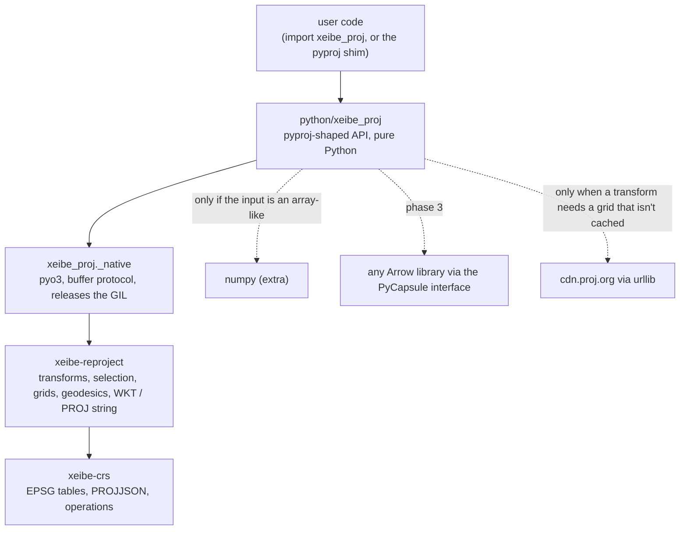
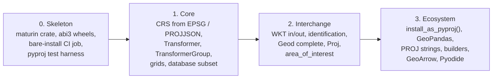

# A pyproj-compatible Python package

> **Status: phases 0 and 1 are implemented (2026-10-21), in
> `crates/xeibe-proj-py`; see
> [Implementation status](#implementation-status).** API facts below were
> checked against pyproj 3.8.0 (PROJ 9.8.1) and GeoPandas 1.2.0.

A Python package over `xeibe-crs` and `xeibe-reproject` that follows pyproj's
API closely enough that most code which converts coordinates with pyproj
runs on it after changing the import. It is **not a drop-in replacement for
all of pyproj**. Whatever needs PROJ itself (PROJ strings as pipelines, the
~200 PROJ projections, `proj.db`, other authorities) is left out, and calling
it fails with a clear error instead of an approximation.

What it offers over pyproj:

- **No C dependencies.** One small abi3 wheel per platform with nothing to
  link and no `proj.db`. It can also be built for Pyodide.
- **No required Python dependencies.** The core install pulls in nothing:
  no numpy, no Arrow. Integrations are optional extras (see
  [Dependencies](#dependencies-and-extras)).
- **A current EPSG release**, which `.github/workflows/epsg.yml` keeps
  current (13.106 today, against 12.029 in the `proj.db` that pyproj 3.8.0
  bundles).
- **Thread-safe objects.** Transformers are immutable, and conversion releases the GIL.
- **Complete type hints**, checked in strict mode (see [Type hints](#type-hints)).

## Implementation status

As of 2026-10-21, phase 0 and phase 1 are implemented, apart from
`TransformerGroup.download_grids` and `get_units_map` (both phase 2).

- **Done.**
  - The crate, abi3 wheel (2.0 MB with `--profile dist`), and the strict
    type checks. CI (`.github/workflows/proj-py.yml`) builds and tests the
    wheel on Linux, macOS and Windows. Its wheels aren't release builds:
    a manylinux build and publishing come with the first release.
  - `CRS` from every input form in the table below except WKT and PROJ
    strings, with its properties, parts, `repr`, equality, hashing and
    pickling.
  - `Transformer.from_crs`, `transform`, `itransform` and
    `transform_bounds` with the container rules, radians, directions and
    operation metadata, `get_last_used_operation`, and `TransformerGroup`.
  - Grids fetched by range, cached, read from data directories (and chosen
    among with the network off) and logged.
  - `pyproj.database`'s queries except `get_units_map`, plus `aoi`,
    `enums`, `exceptions`, `network` and `datadir`.
- **The Rust changes phase 1 needed are made**:
  - `Transform::operation_info`, `operation_index_for` and
    `with_operation_index` for the metadata and the group;
  - `Grids::Local`;
  - `Crs::equivalent`, which `CRS.equals` uses. CRSs `xeibe-reproject` can't
    read (26 of EPSG's) are compared by their PROJJSON without identifiers.
  - In `xeibe-crs`: each CRS's areas of use (EPSG's description and box)
    and scopes in its PROJJSON, as PROJ writes them; operations' scopes;
    EPSG's remarks on CRSs and operations in a file of their own, read on
    first use. The wheel grew from 2.0 to 2.2 MB.
- **Measured** (see [Testing](#testing)):
  - pyproj's own suite: 129 of its 960 tests pass, against 120 before the
    Rust changes.
  - Against the oracle `proj.db`, every EPSG CRS reports what PROJ does,
    scopes, area descriptions and remarks included, except four documented
    differences:
    - `area_of_use` is `None` where EPSG has an area but no box (15 CRSs;
      PROJ gives -1000 on every side). The description stays in the
      PROJJSON;
    - remarks PROJ's database leaves out (most CRSs'): ours are EPSG's, and
      where PROJ has one, they agree;
    - the datum of vertical CRSs on an ensemble;
    - `to_epsg` of engineering CRSs, which PROJ's identification skips.
  - Random EPSG pairs, compared with PROJ without ballparks (divergence 1),
    found 3 pairs that differ in `xeibe-reproject`'s choice of operation,
    listed in `tests/oracle-known.txt`: ties broken by EPSG's data,
    documented in
    [reprojection.md](reprojection.md#deviations-from-proj-documented-deliberate)
    (up to 0.15 m).

    Before 2026-10-22 there were 65. 55 went through PROJ's null operations
    between a datum ensemble and its members ("WGS 84 to WGS 84 (G730)",
    "ETRS89 to ETRF2014"), which `xeibe-reproject` now has too
    ([reprojection.md](reprojection.md#implementation)): 53 had no route
    at all, and ITRF2008/2014/2020 to WGS 84 moved points by 1 to 11 m.
    7 of the other 10, between ITRF realizations and NAD83, chose another
    of several equally accurate routes (up to 0.21 m apart: time-dependent
    Helmerts without an epoch), because EPSG's variant numbers were
    compared across different routes; the 8th is now a documented tie.
    Before 2026-10-21 there were 14 pairs that chose differently per
    point. 9 of them were PROJ's per-point ballpark (now compared without),
    and one was a bug: EPSG's accuracy 999 counted as 999 m, where PROJ
    reads it as unknown.
- **Fixed on the way.** `always_xy` follows PROJ's rule
  (`mustAxisOrderBeSwitchedForVisualization`). Northing-easting axes are
  swapped. Of the polar CRSs with both axes along meridians, only UPS North
  and South (N,E) and RSPS2000 are swapped. `xeibe-reproject`'s own
  east-first order, which swaps whenever the first axis points north, is
  not used for this. It differed on EASE-Grid 2.0 and SCAR IMW CRSs.
- **Interim.**
  - `to_epsg` on a CRS without an id finds the EPSG CRS of the same name
    (or components) and an equivalent definition. Identification by
    definition alone comes with phase 2.
  - The first-use log message names the grids a transformer may read, not
    the operation that read them.
- **Differences found while building it.**
  - `get_data_dir()` returns `""` when no directory is set, where pyproj
    raises `DataDirError`: no data directory is needed.
  - `Transformer.remarks` and `scope` are those of the operation when it
    is a single EPSG operation, and `None` otherwise.
  - `Transformer.name` is `"noop"`, `"conversion"` or `"transformation"`,
    and `description` is the best candidate's name, not a PROJ pipeline's.
  - `accuracy` is -1 and `area_of_use` is `None` when the operation is
    chosen per point, as in PROJ. This happens more often than in PROJ,
    because `xeibe-reproject` also offers routes through a datum
    ensemble's members ([reprojection.md](reprojection.md#deviations-from-proj-documented-deliberate)).
    EPSG:4326 to 2180 has 8 candidates where PROJ has one.
  - `Transformer.operations` gives the operation itself, not a
    concatenation's steps.
  - `TransformerGroup` has no ballpark member.
  - `CRS.__hash__` takes only the CRS type and number of axes, because
    equal CRSs may differ in their numbers by the tolerance.
  - The parts of a CRS (`Datum`, `Ellipsoid`, …) print their names, not
    WKT.
  - `CRS.to_string` is implemented already: the authority code, else the
    input.

## Naming and layout

Proposed: the crate is `crates/xeibe-proj-py`, the distribution is
`xeibe-proj`, and the import name is `xeibe_proj`. It is not published as
`pyproj`, to avoid confusion on PyPI. Instead, an explicit opt-in shim
installs it under that name (phase 3).

The Python package mirrors pyproj's module layout, so `from pyproj.crs import CRS`
becomes `from xeibe_proj.crs import CRS`, and the shim can alias submodules
one to one:

```
crates/xeibe-proj-py/
  Cargo.toml  pyproject.toml  README.md  NOTICE (EPSG, PROJ, pyproj)
  src/lib.rs              native module xeibe_proj._native (pyo3, abi3-py311)
  python/xeibe_proj/
    py.typed              marks the package as typed (PEP 561)
    _native.pyi           stub for the native module
    _typing.py            shared aliases and protocols (buffers, array-likes)
    __init__.py           CRS, Transformer, Geod, Proj, exceptions, __version__, EPSG_VERSION
    crs/                  CRS, its sub-objects (Datum, Ellipsoid, AxisInfo, …), enums
    transformer.py        Transformer, TransformerGroup
    geod.py  proj.py  database.py  aoi.py  enums.py  exceptions.py
    network.py  datadir.py
    _containers.py        pyproj's input/output container rules
    _epsg.py  _json.py    the EPSG tables, cached; typed access to PROJJSON
    _unsupported.py       the errors for what isn't implemented, naming the phase
    _grids.py             grid fetching, cache and the xeibe_proj.grids logger (stdlib urllib)
    arrow.py              GeoArrow arrays (optional, phase 3)
    compat.py             install_as_pyproj() (phase 3)
  tests/
```

The native module stays narrow. It holds CRS records and PROJJSON lookup,
transformer construction and conversion, bounds, operation metadata, grid
requests and loading, geodesics, and the text-format converters. Most of
pyproj's surface (CRS properties, `repr`, sub-objects, enums, the database
queries' filtering) is plain Python over the PROJJSON dict, so it costs no
native code.



## Dependencies and extras

pip can't switch Cargo features, so a published wheel is built once with
everything compiled in. For Python users, the "feature flags" are therefore
**extras plus lazy imports**:

- The core wheel declares no dependencies. `import xeibe_proj` imports
  only the standard library and the native module. A CI job installs it in a
  bare virtual environment and checks that `numpy` stays out of `sys.modules`
  through import, CRS creation and a transform of lists.
- Optional libraries are imported only when a call needs them, and only
  ever because the caller already handed over one of their objects:
  - **numpy**: plain lists, tuples, `array.array`, `memoryview` and
    anything else with the buffer protocol work without it. A numpy array
    *has* the buffer protocol, so float64 arrays work without importing
    numpy. numpy is imported only to convert array-likes that aren't buffers
    (`__array__`: pandas, xarray), non-float64 dtypes and non-contiguous
    arrays. The extra `xeibe-proj[numpy]` just declares the dependency.
  - **Arrow** (phase 3): GeoArrow arrays in and out through the Arrow
    PyCapsule interface (`__arrow_c_array__`). The native side reads and
    writes the C Data Interface itself (coordinates are float64 buffers), so
    pyarrow, arro3 and polars objects work without the package depending on
    any of them. Pull in `arrow-rs` only if the wheel-size cost measured in
    phase 0 is small.
  - **shapely / GeoPandas**: never imported. `Geod.geometry_*` duck-types
    shapely geometries, as pyproj does, and the shim works with whatever
    GeoPandas the user has.
- **Grid downloads** use `urllib` from the standard library. The native
  module carries no HTTP or TLS stack, which keeps the wheel small and lets
  downloads honour the system's proxies and certificates.

Extras: `numpy`, `test` (pytest and pyproj, for the differential tests),
`all`.

## Type hints

The whole public API is annotated, and the annotations are part of the
compatibility promise:

- **Inline annotations** in the pure-Python modules, `_native.pyi` for the
  native module, and `py.typed` in the wheel. No separate stubs package.
- **Strict checking in CI.** `mypy --strict` and `pyright` in strict mode
  run over the package. `stubtest` checks `_native.pyi` against the
  compiled module, so the stub can't drift from the Rust side.
- **No runtime cost or dependency.** Modules use `from __future__ import
  annotations`. numpy's and `typing_extensions`' types are imported only
  under `TYPE_CHECKING`, so neither becomes a runtime dependency and the
  bare-install check still holds.
- **pyproj's parameter names, order and defaults**, so code that
  type-checks against pyproj keeps type-checking. The exceptions are
  `errcheck` and `inplace`, which are absent, so a type checker reports their
  use before it fails at runtime. Where pyproj annotates with `Any`, we are
  more precise:
  - `Transformer.transform` has `@overload`s that follow the container rules:
    `float` in gives `float` out, `list[float]` gives `list[float]`,
    `tuple` gives `tuple`, `array.array` gives `array.array`, and
    `numpy.ndarray` gives `numpy.ndarray`. The same goes for `itransform`
    and `Proj.__call__`.
  - Buffer inputs are typed with a `Buffer` protocol (`collections.abc.Buffer`
    from 3.12, `typing_extensions.Buffer` on 3.11), and array-likes with an
    `__array__` protocol, both in `_typing.py`.
  - String options that pyproj takes as `str | Enum` (`WktVersion`,
    `TransformDirection`, `PJType`, …) also accept the `Literal` strings.
  - Constructors and `from_*` class methods return `Self`. Properties
    that may be missing return `X | None` rather than raising.
  - Sub-objects (`AxisInfo`, `AreaOfUse`, `BBox`, …) are frozen
    dataclasses with typed fields.
- **Typed usage tests**: a file of `assert_type(...)` calls over the overloads,
  checked by both type checkers, so a wrong overload fails CI.

## Versioning

PEP 440 versions of the form `MAJOR.MINOR.PATCH`, used as in semver. The
version belongs to this package alone. It is not the workspace version that
`xeibe-py` uses, because this package is released when EPSG publishes and
when its pyproj-compatible API changes, not when the GML reader changes.
`crates/xeibe-proj-py/Cargo.toml` sets its own `version` with
`publish = false`, and `pyproject.toml` reads it through
`dynamic = ["version"]`, as `xeibe-py` does.

| Bump | When |
|---|---|
| Patch | Bug fixes, including numeric fixes that bring results back to the reference values. No data change. |
| Minor | New API, such as a new phase or parameter, and **every EPSG data update**. |
| Major | Removing or changing API. Before 1.0, these go in minor instead, as with Cargo's 0.x convention. |

An EPSG update is a minor bump because it can change results with no code
change. EPSG may correct a parameter or supersede an operation, or add one
that the selection then prefers. Users who need identical results pin
`xeibe-proj~=X.Y.Z`, which allows patches only. Users who want current data
pin `~=X.Y`. Once the package exists, the PR that `.github/workflows/epsg.yml`
opens for a new EPSG release also bumps this package's minor version. The
package stays at 0.x until phase 2 is done. 1.0 means the
pyproj-compatible API is stable.

The EPSG version is not in the version string. `xeibe-crs`'s
`+epsg-13.106` is semver build metadata, which in PEP 440 is a local version
label, and PyPI rejects uploads that carry one. The EPSG version is reported
in three places:

- the constant `xeibe_proj.EPSG_VERSION` (`"13.106"`);
- `database.get_database_metadata("EPSG.VERSION")`, as in pyproj;
- `show_versions()`, together with the versions of `xeibe-crs` and
  `xeibe-reproject`.

Each release's changelog entry names its EPSG version too. Pre-releases use
PEP 440 suffixes (`0.3.0rc1`). They are written `0.3.0-rc.1` in `Cargo.toml`,
and maturin converts them.

Not chosen:

- **Calendar versions** (`2026.10`), like `certifi` and `tzdata`. They suit
  pure data packages, but they can't signal API breaks.
- **Following pyproj's version numbers.** This package isn't pyproj.
- **A separate data package**, like `tzdata`. The EPSG tables are compiled
  into the native module, so they can't be updated on their own.

## Compatibility table

Phases: **1** (core: what scripts that convert coordinates use), **2**
(interchange: WKT, geodesics, the legacy `Proj`), **3** (ecosystem:
GeoPandas, PROJ strings, builders, Arrow). **Out** means not planned, and
calling it raises `NotImplementedError` with the reason. This table
becomes the package's status tracker.

### `CRS`

| API | Phase | Notes |
|---|---|---|
| `CRS(x)`, `from_user_input`, `from_string`, `from_epsg`, `from_authority("EPSG", …)` | 1 | Integers, `"EPSG:2180"`, `"epsg:2180"`, OGC URNs and URLs (the parsing `xeibe-geom` already does for `srsName`), EPSG aliases (`xeibe_crs::alias`), another `CRS`. |
| `OGC:CRS84`, `OGC:CRS83`, `OGC:CRS27` | 1 | Longitude-first variants of 4326, 4269 and 4267. |
| `from_json`, `from_json_dict`, PROJJSON dict input | 1 | The subset `xeibe-reproject` reads, plus any PROJJSON kept as is for its metadata. |
| `name`, `type_name`, `is_geographic` / `is_projected` / `is_geocentric` / `is_vertical` / `is_compound` / `is_engineering` / `is_derived` / `is_bound`, `is_deprecated`, `utm_zone`, `remarks`, `scope` | 1 | From PROJJSON and `CrsRecord`. |
| `axis_info`, `area_of_use`, `datum`, `ellipsoid`, `prime_meridian`, `coordinate_system`, `coordinate_operation`, `geodetic_crs`, `sub_crs_list`, `source_crs`, `target_crs` | 1 | Sub-objects built from PROJJSON with pyproj's attribute names (`AxisInfo.unit_conversion_factor`, `Ellipsoid.semi_major_metre`, …). |
| `to_json`, `to_json_dict` | 1 | Our PROJJSON. GeoPandas writes this into GeoParquet. |
| `to_epsg`, `to_authority`, `list_authority`, `get_non_deprecated` | 1 / 2 | Phase 1: CRSs that carry an EPSG id. Phase 2: identifying a CRS read from WKT against the EPSG table, with PROJ's confidence levels ([crs-wkt.md](crs-wkt.md#identification)). |
| `equals(ignore_axis_order=)`, `__eq__`, `is_exact_same`, `__hash__` | 1 | Equivalence on the parsed definition (datum, ellipsoid, method, parameters, axes), not on names, as PROJ's `proj_is_equivalent_to` does. Hash on the normalised definition. |
| `repr`, `str`, `srs`, pickling | 1 | pyproj's multi-line summary. Pickles as PROJJSON, which dask and multiprocessing need. |
| `to_2d`, `to_3d`, `get_geod` | 2 | |
| `from_wkt`, objects with `to_wkt()` (rasterio, fiona) | 2 | WKT1 (GDAL and ESRI flavours) and WKT2 2015/2019 → PROJJSON, in Rust ([crs-wkt.md](crs-wkt.md)). |
| `to_wkt(version, pretty)` | 2 | WKT2_2019 and WKT1_GDAL from PROJJSON, what GeoPandas, pyogrio and rioxarray ask for; other versions raise ([crs-wkt.md](crs-wkt.md#writing)). Equivalent to PROJ's output, not byte-identical. |
| `from_proj4`, `from_dict`, `+proj=…` strings | 3 | A translator to PROJJSON for the projections we have (`longlat`, `utm`, `tmerc`, `lcc`, `merc`, `stere`, `sterea`, `laea`, `aea`, `eqc`, `cea`, `omerc`, `krovak`, …) with `+ellps`, `+datum`, `+towgs84`, `+units`, `+axis`, `+pm`. Anything else is an error. |
| `to_proj4`, `to_dict`, `to_string` | 3 | The same subset, reversed. |
| Builder classes (`GeographicCRS`, `ProjectedCRS`, `CompoundCRS`, `*Conversion`) | 3 | For the methods `xeibe-reproject` implements. |
| `to_cf`, `from_cf`, `cs_to_cf` | 3, if asked | pyproj's implementation is pure Python over PROJJSON (MIT), so it could be ported. |
| Other authorities (`ESRI:`, `IGNF:`, `IAU_2015:`, `NKG:`) | Out | Not in EPSG. Exception, in phase 2: the 988 old ESRI codes that are now EPSG codes (`ESRI:102100` → 3857), from `xeibe-esri` ([crs-wkt.md](crs-wkt.md#esri-names)). |

### `Transformer` and `TransformerGroup`

| API | Phase | Notes |
|---|---|---|
| `Transformer.from_crs(a, b, always_xy=)` | 1 | `always_xy=True` → `AxisOrder::EastFirst`, `False` → `Authority`. |
| `from_crs(…, allow_ballpark=)` | 1 | We never ballpark. When EPSG has no operation, construction raises `ProjError`, as pyproj does with `allow_ballpark=False`. This is a deliberate divergence from pyproj's default. |
| `from_crs(…, area_of_interest=, accuracy=, only_best=)` | 2 | Needs the selection to take an area of interest and a minimum accuracy. |
| `from_crs(…, authority=, force_over=)` | Out | Only EPSG operations exist. `force_over` is a PROJ pipeline detail. |
| `transform(xx, yy, zz, tt, radians, direction)` | 1 | A coordinate that fails to convert always raises `ProjError`, which names its index and the reason (`CoordinateError`). pyproj instead writes `inf` unless `errcheck=True`. `tt` passes through unchanged. A transformation that would need it beyond its reference epoch raises an error. Output is always a new object. |
| `errcheck=` (`transform`, `itransform`, `transform_bounds`, `Proj.__call__`), `inplace=` (`transform`) | Out | Not in the signatures, so type checkers flag them. Passing either at runtime raises `NotImplementedError` explaining that failed coordinates always raise and that output is always a new object. Any value raises, `errcheck=True` and `inplace=False` included, so one rule covers both. The parameters that followed `errcheck` in pyproj (`direction`, and `radians` in `Proj.__call__`) are keyword-only, so a positional call fails instead of binding its `errcheck` value to the next parameter. |
| Container rules | 1 | Output has the input's type: a scalar gives `float`, a list a `list`, a tuple a `tuple`, `array.array` an `array.array`, numpy numpy (checked against pyproj 3.8.0). `_containers.py` follows pyproj's `_copytobuffer` (MIT). |
| `itransform(points, switch, time_3rd, radians, direction)` | 1 | |
| `transform_bounds(left, bottom, right, top, densify_pts=21, radians, direction)` | 1 | `Transform::convert_bounds`. |
| `source_crs`, `target_crs`, `name`, `description`, `has_inverse`, `accuracy`, `area_of_use`, `remarks`, `scope`, `operations`, `get_last_used_operation`, `is_network_enabled` | 1 | Needs operation metadata exposed from Rust (see below). `get_last_used_operation` uses `operation_for` on the last coordinate, per thread. |
| `__eq__`, `is_exact_same`, pickling | 1 | Pickles as (source, target, options). |
| `to_json`, `to_json_dict`, `to_wkt` | 2 | PROJJSON / WKT of the EPSG operation(s). |
| `definition`, `to_proj4` | Out | These are PROJ pipeline strings. `definition` raises with a pointer to `description`. |
| `from_pipeline`, `from_proj`, the module-level `pyproj.transform` / `itransform` | Out | PROJ pipelines, or APIs pyproj deprecated. |
| `TransformerGroup(…)`: `transformers`, `unavailable_operations`, `best_available` | 1 | One `Transform::via` per candidate from `operations()`. Operations whose grids aren't on the CDN are `unavailable_operations`. |
| `TransformerGroup.download_grids` | 2 | Fills the grid cache. |
| `TransformerGroup(crs_extent_use=, pivot_crs=, grid_check=, allow_superseded=)` | Out | Defaults accepted. Other values raise an error. |

### Geodesics, legacy and module-level API

| API | Phase | Notes |
|---|---|---|
| `Geod(ellps=…)`, `Geod(a=, b=, f=, rf=, es=, sphere=)`, `Geod("+ellps=…")`, `CRS.get_geod()` | 2 | Needs PROJ's ellipsoid name table (`ellps.cpp`, MIT). |
| `Geod.inv`, `fwd`, `line_length`, `line_lengths` | 2 | Already ported (`methods/geodesic.rs`). |
| `npts`, `fwd_intermediate`, `inv_intermediate`, `polygon_area_perimeter`, `geometry_length`, `geometry_area_perimeter` | 2 | Port the rest of `geodesic.c`: geodesic lines and polygon areas. |
| `Proj(crs)(lon, lat, inverse=, radians=)`, `Proj(proj="utm", zone=…)` | 2 / 3 | Phase 2 for EPSG and WKT input (geographic CRS of the same datum ↔ projected). Keyword PROJ parameters arrive with the phase 3 translator. |
| `Proj.get_factors` | Out | |
| `pyproj.database`: `query_crs_info`, `query_utm_crs_info`, `get_authorities`, `get_codes`, `get_units_map`, `get_database_metadata("EPSG.VERSION")` | 1 / 2 | From the `xeibe-crs` tables. `query_utm_crs_info` (GeoPandas' `estimate_utm_crs`) needs each projected CRS's datum, which the PROJJSON has. |
| `pyproj.aoi` (`AreaOfInterest`, `AreaOfUse`, `BBox`), `pyproj.enums`, `pyproj.exceptions` (`CRSError`, `ProjError`, `GeodError`, `DataDirError`) | 1 | Same names and hierarchy. Error messages differ. |
| `pyproj.network.set_network_enabled` / `is_network_enabled`, `PROJ_NETWORK` | 1 | On by default, unlike pyproj. `set_network_enabled(False)` or `PROJ_NETWORK=OFF` turns it off (see [Grids](#grids)). |
| `pyproj.datadir.get_data_dir` / `set_data_dir` / `append_data_dir`, `PROJ_DATA` | 1 | Directories searched for local PROJ-data grids. `get_data_dir` returns them joined with `os.pathsep`, as pyproj does, or `""` when there are none (GeoPandas calls it in `show_versions`). |
| `__version__`, `EPSG_VERSION`, `show_versions` | 1 | The package's own version and the EPSG version (see [Versioning](#versioning)). |
| `proj_version_str`, `PROJ_VERSION`, `PROJ_VERSION_STR` | Out | There is no PROJ to report. A module `__getattr__` raises `AttributeError` with that reason. GeoPandas' `show_versions` reads `proj_version_str`, so under the shim that one call fails. |
| `set_use_global_context` | 1 | No-op. |
| `pyproj.sync`, `projsync`, `python -m pyproj`, `get_proj_operations_map`, `pj_list` | Out | |

## Grids

pyproj has network access off by default and ships no grids, so out of the
box PROJ skips operations whose grids are missing. We turn the network on
by default instead, so a default install picks the most accurate
operation EPSG has, as PROJ does with every grid installed. In exchange, every
use of a grid is logged:

- **Default (network on)**: `Grids::ProjData`. Building a transformer never
  touches the network. Grid availability comes from the catalog compiled
  into `xeibe-reproject`. Before converting, `transform` asks the native
  transform for `grid_requests` covering the coordinates' extent, fetches the
  missing ranges from `cdn.proj.org` with `urllib` range requests, hands them
  over, and converts. Fetched ranges are cached under the user cache
  directory (`$XDG_CACHE_HOME/xeibe-proj`, `~/Library/Caches/xeibe-proj`,
  `%LOCALAPPDATA%\xeibe-proj`) keyed by file and offset. A failed download
  raises `ProjError` with the URL. It does not fall back to another
  operation, because that would change results silently.
- **Network off** (`set_network_enabled(False)` or `PROJ_NETWORK=OFF`):
  `Grids::None`, plus whatever is local. This gives the same choice as
  pyproj on a default install, and the differential tests check that it does.
- **Local grids** (`PROJ_DATA`, `set_data_dir`, `append_data_dir`):
  operations whose grids are present locally are available, with or without
  the network, and are read from disk instead of fetched.
- In Pyodide `urllib` has no sockets, so phase 3 adds a fetch path through
  `pyodide.http`.

Logging goes through the standard `logging` module under the logger
`xeibe_proj.grids`, and the package adds no handlers:

| Event | Level | Message carries |
|---|---|---|
| A transformer first converts with an operation that uses a grid | `INFO` | source and target CRS, the operation's EPSG code and name, the grid file, and whether it is local, cached or fetched |
| Ranges are downloaded | `INFO` | URL, number of ranges, bytes |
| Ranges are served from the cache | `DEBUG` | file, ranges |
| `TransformerGroup.download_grids` | `INFO` | each file and its size |
| A download fails | `ERROR` | URL and the error, before `ProjError` is raised |

The first-use message is logged once per transformer and grid, not once per
`transform` call, so loops over small batches don't flood the log. Log
records carry the grid file name and the operation code as `extra` fields,
so a handler can collect them.

The package follows the standard library's advice for libraries: it logs to
named loggers and never adds handlers, sets levels or touches the root
logger. Configuring logging is up to the application. The logger names
(`xeibe_proj` and its children) are public API. There is deliberately no
`NullHandler`, so with no logging configured Python's last-resort handler
still prints `ERROR` records to stderr, while the `INFO` records about grid
use are dropped. Seeing them takes one line, for example
`logging.basicConfig(level=logging.INFO)`. The README shows this.

## Changes needed in the Rust crates

| Change | Crate | For |
|---|---|---|
| **Done:** operation metadata for each candidate (`Transform::operation_info`: name, EPSG code and steps, accuracy, area of use, grids), `operation_index_for`, `with_operation_index`. Each operation's scope is in `operations_json`, and its remarks are in `xeibe_crs::operation_remarks` | reproject | `Transformer.accuracy`, `TransformerGroup`, `operations`, `get_last_used_operation` (1) |
| **Done:** `Crs::equivalent(&other, ignore_axis_order)` on the parsed definition | reproject | `CRS.equals`, `__eq__` (1) |
| **Done:** `Grids::Local(files)` next to `ProjData` and `None` (`Grids` is no longer `Copy`) | reproject | local grid directories (1) |
| Selection restricted to an area of interest and a minimum accuracy | reproject (`select/`) | `area_of_interest`, `accuracy`, `only_best` (2) |
| WKT1/WKT2 reader and WKT2 2019/WKT1_GDAL writer, to and from PROJJSON ([crs-wkt.md](crs-wkt.md)). **Done:** the WKT2 reader (`wkt::to_projjson`, `Crs::from_wkt`) | reproject, new `wkt` module | `from_wkt`, `to_wkt` (2) |
| CRS identification: best EPSG match for a definition, with a confidence | reproject | `to_epsg` on WKT input (2) |
| `BoundCRS` (a CRS with its transformation to a hub such as WGS 84) in `Crs` and the selection ([crs-wkt.md](crs-wkt.md#towgs84-and-boundcrs)) | reproject | WKT1 `TOWGS84` (2), `+towgs84` (3) |
| The rest of `geodesic.c`: lines, polygon area and perimeter | reproject | `Geod` (2) |
| PROJ's ellipsoid name table | reproject | `Geod(ellps=)`, `+ellps` (2) |
| PROJ string ↔ PROJJSON translator for the supported methods | reproject | `from_proj4`, `to_proj4`, `Proj(**kwargs)` (3) |

## Deliberate divergences from pyproj

These are documented in the package README and in its `NotImplementedError` and
`ProjError` messages:

1. **No ballpark transformations.** The divergence is in `from_crs`'s
   default, described above. It also shows per point: for a point outside
   the area of use of every EPSG operation, pyproj's default switches to a
   ballpark, which leaves out the datum shift (tens to hundreds of metres).
   xeibe_proj uses the best operation anyway, as PROJ does with
   `allow_ballpark=False`.
2. **Failed coordinates raise.** `transform`, `itransform` and `Proj.__call__`
   raise `ProjError` at the first coordinate that fails, instead of writing
   `inf`. Code that filters `inf` out afterwards has to catch the error,
   or drop such points before converting. GeoPandas' `to_crs` with points
   outside a projection's domain raises instead of producing `inf`
   geometries. There is no `errcheck` to choose otherwise, and no
   `inplace`: output is always a new object. Passing either raises
   `NotImplementedError`.
3. **Network on by default**, so operations that need grids are chosen
   and their grids fetched. Results can therefore differ from a default
   pyproj install, which skips those operations. Each grid use is logged.
4. **Operation choice** follows [reprojection.md](reprojection.md#deviations-from-proj-documented-deliberate),
   which picks a different operation from PROJ at 38 of 21,132 test points.
5. **A newer EPSG.** CRS names, supersessions and the operations available
   can differ from those in pyproj's bundled `proj.db`.
6. **Only EPSG** (and the three OGC CRSs) as an authority, and only EPSG's
   projection methods.
7. **Text output** (WKT, PROJ strings) is equivalent to PROJ's, not
   identical, and `repr` follows pyproj's layout but not its wording
   character for character.
8. **Error messages** differ. Exception types match.
9. **No PROJ version.** `proj_version_str` and `PROJ_VERSION*` don't exist.

## Testing

- **pyproj's own test suite** (MIT), fetched at a pinned tag into
  `target/pyproj-src` (not committed) and run against `xeibe_proj` by
  `tests/pyproj_suite/run.py`.
  - A pytest plugin (`xeibe_pyproj_shim.py`) aliases pyproj's modules to
    xeibe_proj's.
  - Names xeibe_proj doesn't have become placeholders that raise when
    used, and a test that touches one fails.
  - A test file whose module-level code fails is imported statement by
    statement, so it still yields the tests it can.
  - The committed `pass-list.txt` is the compatibility measure. The run
    exits 1 when a listed test fails, and `--update` adds new passes, so
    the list only grows.
- **Differential tests** (`tests/test_oracle.py`, marked `oracle`) against
  pyproj with the `proj.db` that `scripts/build_proj_oracle.py` builds from
  our EPSG archive, so both sides see the same EPSG data:
  - every EPSG CRS's properties;
  - coordinates between random EPSG pairs at the tolerances of
    [reprojection.md](reprojection.md), with the network off on both
    sides. The pairs that differ for reasons in `xeibe-reproject` are
    listed with the reason in `tests/oracle-known.txt`, a list that only
    shrinks.

  WKT round trips come with phase 2 ([crs-wkt.md](crs-wkt.md#validation)).
- **Container tests**: each input type × each argument combination returns
  what pyproj returns.
- **Grids**: with the network off, operation choice matches pyproj's default.
  With grids from `scripts/fetch_proj_grids.py` as `PROJ_DATA` on both sides,
  results match the level-3 vectors. A test with a local HTTP server checks
  the range requests, the cache and every log record in the table above.
- **Type checking**: the strict mypy and pyright runs, `stubtest`, and the
  `assert_type` file described under [Type hints](#type-hints).
- **Bare install**: the job described under
  [Dependencies](#dependencies-and-extras), with no extras and `numpy` absent
  from `sys.modules`.
- **GeoPandas** (phase 3): a slice of GeoPandas' tests (`to_crs`,
  `estimate_utm_crs`, CRS equality, GeoParquet CRS metadata) with the shim
  installed.

## Phases



- **Phase 0.** The crate, `pyproject.toml` with no dependencies, abi3 wheels
  for Linux/macOS/Windows, `py.typed` and the strict type-checking jobs, and
  the pyproj test harness with an empty pass list.
  Measure the wheel size, and from that decide whether to use `arrow-rs` or
  hand-written FFI for Arrow.
- **Phase 1.** Covers scripts that build CRSs from EPSG codes and convert
  coordinates and bounds. Done when the differential tests pass and the
  pyproj pass list covers `test_transformer.py` and `test_crs.py` for EPSG
  input.
- **Phase 2.** Unlocks WKT-based libraries (rasterio, fiona, pyogrio) and
  geodesic work.
- **Phase 3.** `xeibe_proj.compat.install_as_pyproj()` puts the package and
  its submodules in `sys.modules` under `pyproj`, before GeoPandas is
  imported. It is opt-in and documented as experimental. After that come PROJ
  strings, the builder classes, GeoArrow and Pyodide.

## Open questions

- The names: crate `xeibe-proj-py`, distribution `xeibe-proj`, import
  `xeibe_proj`?
- Should `xeibe-py` (the GML reader) depend on it later, for example for
  `read_gml(…, to_crs=)`? That can use `xeibe-reproject` directly, so it
  doesn't have to.
