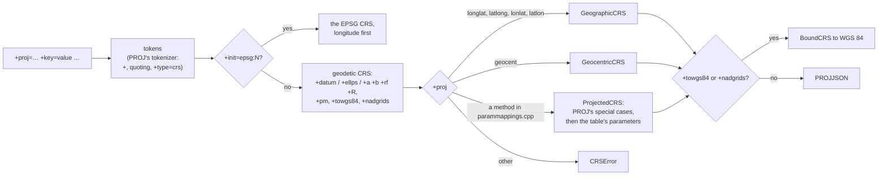

# pyproj compatibility, phase 3: the ecosystem

> **Status: designed, 2026-10-24; reviewed, 2026-10-31 (decision 8:
> unknown datums raise; PROJ's own projections and other celestial
> bodies are in); PROJ strings, 2026-10-31 (steps 1 and 2, see
> [Order of work](#order-of-work)); PROJ's own methods and other
> celestial bodies, 2026-10-31 (step 2b); `install_as_pyproj()` and
> GeoPandas, 2026-11-01 (step 3); the objects table and the sub-objects'
> constructors, 2026-11-03 (step 4).** This is phase 3 of
> [pyproj-compat.md](pyproj-compat.md#phases). Facts about PROJ, pyproj
> and GeoPandas were checked against PROJ 9.8.1 through pyproj 3.8.0 and
> GeoPandas 1.2.0, with the oracle database
> (`scripts/build_proj_oracle.py`).

Phase 3 is "ecosystem": what libraries built on pyproj need, beyond
scripts that convert coordinates. It covers these rows of the
[compatibility table](pyproj-compat.md#compatibility-table), plus three
additions:

- `xeibe_proj.compat.install_as_pyproj()`, and GeoPandas under it;
- PROJ strings: `CRS.from_proj4`, `from_dict`, `CRS(proj=…)`, `to_proj4`
  and `to_dict`, `Proj(proj=…)`, `Proj.definition_string` and
  `to_latlong_def`;
- the builder classes (`GeographicCRS`, `ProjectedCRS`, …,
  `TransverseMercatorConversion`, …, `CustomDatum`, `Ellipsoidal2DCS`, …)
  and the sub-objects' constructors (`Datum.from_name`,
  `Ellipsoid.from_epsg`, `CoordinateOperation.from_string`, …);
- `CRS.to_cf`, `from_cf` and `cs_to_cf` (the table's "3, if asked");
- GeoArrow arrays in and out (`xeibe_proj.arrow`), which pyproj doesn't
  have;
- a Pyodide wheel;
- **additions:** `Transformer.from_proj` (now "Out") and
  `query_geodetic_crs_from_datum`.

## Where pyproj's suite fails today

The pyproj suite passes 356 of its 963 tests. The failures that phase 3
can fix, from `target/pyproj-suite.xml`, by first error:

| Cause | Tests |
|---|---|
| PROJ strings and dicts (`CRS("+proj=…")`, `CRS(proj=…)`, `from_proj4`, `to_proj4`, and the `+init=` tests that expect pyproj's `FutureWarning`) | ~150 |
| `from_name`, `from_epsg`, `from_string`, `from_authority` on `Datum`, `Ellipsoid`, `PrimeMeridian`, `CoordinateSystem` and `CoordinateOperation` | 78 |
| The builder classes and coordinate systems | ~120 |
| CF (`from_cf`, `to_cf`) | 29 |
| `Transformer.from_proj` | 22 |
| `query_geodetic_crs_from_datum` | 12 |

Many tests fail on more than one cause, so the gain is smaller than the
sum. The rest of the failures are what stays out: `from_pipeline` (39
tests), `TransformerGroup`'s options (21), `errcheck` and `inplace`,
other authorities, PROJ's context and CA bundle, and `get_factors`.

## Decisions

| # | Decision | Why |
|---|---|---|
| 1 | **PROJ strings come first, then `install_as_pyproj()`**, together with a runner for GeoPandas' own test suite. | PROJ strings fix the most of pyproj's tests (about 150), and depend on nothing else in this phase. The shim is small, and GeoPandas' suite then measures every later step, as pyproj's suite does now. |
| 2 | **The shim is a meta path finder that maps each `pyproj.*` module to the xeibe_proj module itself.** So `pyproj.crs.CRS is xeibe_proj.CRS`, and `isinstance` and pickles work across the two names. Only the top-level `pyproj` is a module of its own, which forwards to `xeibe_proj` and has `__version__ = "3.8.0"`, the pyproj release whose API is followed. | Libraries compare `pyproj.__version__` with minimum versions; xeibe_proj's own 0.x version would fail those checks. One class under two names avoids two `CRS` types that don't compare equal. |
| 3 | **`install_as_pyproj()` raises when pyproj is already imported**, and has no placeholders for missing names: a missing name raises `AttributeError` or `ImportError` as usual. | Objects from both libraries in one process would mix. The placeholders are a tool of the test runner only. |
| 4 | **PROJ strings are translated to and from PROJJSON in Rust, in a new `xeibe_reproject::proj_string` module**, ported from PROJ's `PROJStringParser` (`io.cpp`) and `_exportToPROJString` (`crs.cpp`, `conversion.cpp`, `datum.cpp`). | As with WKT ([crs-wkt.md](crs-wkt.md)), the CLI and the web page can then take PROJ strings too. PROJ's code is the specification: it has dozens of special cases (`utm`, `+south`, Mercator variants A and B, polar `stere`, `lcc` with one or two standard parallels, `omerc`'s `no_uoff`, `krovak`'s axes). |
| 5 | **The method and parameter names come from PROJ's `parammappings.cpp`, generated by `scripts/gen_wkt1_names.py`.** That table already gives WKT1's names, and the same entries give PROJ's (`proj_name_main`, `proj_name_aux` and each parameter's `proj_name`). | One generator for one table. No hand-kept names. |
| 6 | **A PROJ string is read when PROJ would read it into a CRS**: with EPSG's method, one of PROJ's own with a WKT2 name (Robinson, Mollweide, Geostationary Satellite, …), or the "PROJ hammer" method PROJ makes for a projection with neither ([PROJ's own methods](#projs-own-methods)), whether or not `xeibe-reproject` implements that method. Such a CRS can be inspected and written out, but not converted, as with WKT. Everything else raises `CRSError` and names what isn't supported: options PROJ keeps only as a PROJ-based operation (`+over`, `+lon_wrap`, `+geoc`, an `+axis` it can't express), `+proj=pipeline`, and `+geoidgrids`. | Same rule as divergence 6: only what a CRS can hold. The error says why, instead of an approximation. |
| 7 | **`to_proj4` writes PROJ's string token for token**, with pyproj's `UserWarning` ("You will likely lose important projection information"). `to_dict` is pyproj's parsing of that string. | It can be checked against PROJ for every EPSG CRS, as WKT is. |
| 8 | **A CRS whose datum is unknown still can't be converted to a CRS on another datum**: there is no zero datum shift, as PROJ's "Ballpark geographic offset" would apply. "Unknown" means a PROJ string with an ellipsoid but no `+datum` or `+towgs84`, a WKT datum that is identified with no EPSG datum (`D_unknown`), or one of EPSG's "Not specified (based on … ellipsoid)" datums. The `ProjError` says that the datum is unknown, and that giving the CRS as an EPSG code, or adding `+datum` or `+towgs84`, fixes it. Between two CRSs on the same unknown datum (`+proj=longlat +ellps=GRS80` to `+proj=utm +zone=33 +ellps=GRS80`), no datum change is needed, and the conversion works. | Such a definition doesn't say where its datum is, and a zero shift is off by the whole datum shift when the data is really on a local datum. Measured against EPSG's operations to WGS 84: 0 m for GRS80 data in ETRS89, but 54 m for NTF in Paris, 117 m for S-JTSK in Prague, 125 m for OSGB36 in London and 128 m for Pulkovo 1942(58) in Warsaw. An error is better than such numbers. Divergence 1 stays as it is. `+proj=utm +zone=30` isn't affected: with no ellipsoid, PROJ's default is the WGS 84 datum, which is known. |
| 9 | **`+init=epsg:CODE` gives the EPSG CRS with longitude first**, as PROJ does, with pyproj's `FutureWarning`. Other `+init` files raise. | PROJ 6 and later read `+init=epsg:` from the database and keep the old axis order. pyproj warns about it. |
| 10 | **`+nadgrids=@null` (or `null`) is a Bound CRS with a zero shift to WGS 84**, and PROJ's Web Mercator string is EPSG:3857, as PROJ recognises it. Other `+nadgrids` grids are read when the grid catalog has them under their old PROJ name. | `@null` is the common case, in every Web Mercator `.prj` file. The catalog already maps PROJ's old names (`conus`, `ntv1_can.dat`) to the CDN files ([reprojection.md](reprojection.md)). |
| 11 | **The builder classes have pyproj's signatures and docstrings (MIT), and bodies of our own**: a conversion is EPSG's method and parameters from one table, built by one function, where pyproj writes each class's PROJJSON out in full. They build PROJJSON and call `from_json_dict`, so they need nothing native. pyproj's tests for them run unchanged, and a differential test builds every class with several sets of arguments in both libraries and compares the PROJJSON. | pyproj's 2,400 lines of builders are mostly the same parameters written out 22 times, and branches on PROJ's version. The interface must be pyproj's; the PROJJSON must be what PROJ makes of pyproj's (pyproj passes each through PROJ), which pyproj's tests check in a few cases only, and the differential test in all. |
| 12 | **EPSG's ellipsoids, prime meridians, datums and conversions go into a new generated table in `xeibe-crs`** (`data/objects.bin`), each as PROJJSON with its names and aliases. The sub-objects' `from_epsg`, `from_authority`, `from_name`, `from_string` and `from_user_input` read it, and so does `query_geodetic_crs_from_datum`. | Today these objects exist only inside CRSs. EPSG has 55 ellipsoids, 15 prime meridians, 983 datums and datum ensembles, and 3,577 conversions, 206 of them used by no CRS. Compressed, this should be about 100 KB. |
| 13 | **CF is pyproj's `_cf1x8.py` (MIT), ported.** | It is pure Python over PROJJSON and the builders. xarray and rioxarray use it. |
| 14 | **`Transformer.from_proj` is implemented**: it is `from_crs` on the two `Proj`s' CRSs, as in pyproj. | pyproj deprecated it in its documentation, but it still works without a warning. Once PROJ strings exist, it costs one line. |
| 15 | **GeoArrow is `xeibe_proj.arrow`, a module of its own**, not new methods on pyproj's classes. It reads and writes through the Arrow PyCapsule interface, without depending on any Arrow library. | The classes keep pyproj's surface, so the type checks and the shim stay exact. |
| 16 | **GeoArrow's native encodings and WKB are supported**, not WKT. WKB is rewritten in place: a copy of the buffer, with each coordinate overwritten. | WKB is what GeoParquet and `GeoDataFrame.to_arrow` write by default. Its coordinates have fixed widths, so the offsets don't change. WKT's lengths would change. |
| 17 | **The Arrow code uses `arrow-array` and `arrow-schema` with `ffi`** (`xeibe-py` already does), if the wheel grows by less than 0.5 MB. If it grows more, the C Data Interface is written by hand for the few layouts needed. | That is the measurement phase 0 was to make. Writing the FFI by hand costs time, and is only worth it if the size matters. |
| 18 | **Pyodide gets its own wheel**, built by maturin for Emscripten, with grids fetched through `pyodide.http.pyxhr`. | abi3 doesn't apply to Pyodide, and `urllib` has no sockets there. `pyxhr` is Pyodide's synchronous client. |

## `install_as_pyproj()`

```python
import xeibe_proj.compat
xeibe_proj.compat.install_as_pyproj()

import geopandas  # imports "pyproj", gets xeibe_proj
```

`install_as_pyproj()` puts a finder at the front of `sys.meta_path`.
For `pyproj.X` it returns `xeibe_proj.X`, for every module in pyproj
3.8.0's tree that xeibe_proj has: `aoi`, `crs` and its submodules,
`database`, `datadir`, `enums`, `exceptions`, `geod`, `list`, `network`,
`proj`, `transformer`, and with this phase `crs.coordinate_operation`,
`crs.coordinate_system`, `crs.datum`, `crs.enums` and `utils`. The other
modules (`pyproj.sync`, `pyproj._crs`, …) raise `ModuleNotFoundError`
with the reason, and so do pyproj's private modules (`pyproj._crs`), which
are never mapped to xeibe_proj's own private ones. The finder takes
precedence over an installed pyproj. Calling it twice is harmless; calling
it once pyproj is imported raises `RuntimeError` (decision 3).

The top-level `pyproj` module forwards every attribute to `xeibe_proj`, and
adds:

- `__version__ = "3.8.0"`, the pyproj release whose API is followed;
- `__xeibe_proj_version__`, the package's own version;
- its modules as attributes before they are imported (`pyproj.datadir`,
  which GeoPandas' `show_versions` reads), since pyproj's `__init__`
  imports them.

`proj_version_str` still raises `AttributeError`. GeoPandas'
`show_versions` catches that and prints `None`.

What the shim can't hide:

- `importlib.metadata.version("pyproj")` reads installed distributions, so
  it gives the real pyproj's version, or raises if pyproj isn't installed.
- Code that imported pyproj before `install_as_pyproj()` was called keeps
  the real one. That is why the call raises when `pyproj` is already in
  `sys.modules`.

The function is documented as experimental. Using `xeibe_proj` directly
stays the recommended way.

### GeoPandas

GeoPandas uses a narrow slice of pyproj, and everything in it is
implemented already:

- `CRS.from_user_input`, `from_epsg`, `equals`, `is_exact_same`, `==`,
  `to_epsg`, `to_authority`, `to_string`, `to_wkt` (WKT2_2019 and
  WKT1_GDAL), `to_json_dict` (GeoParquet and GeoArrow metadata), pickling,
  `is_geographic`, `is_projected`, `axis_info` and `name`;
- `Transformer.from_crs(…, always_xy=True)` under `functools.lru_cache`
  (so `CRS` must hash), `transform` on numpy arrays, and
  `transform_bounds`;
- `query_utm_crs_info` and `AreaOfInterest`, for `estimate_utm_crs`;
- `datadir.get_data_dir` and `exceptions.CRSError`.

Its tests also give CRSs as PROJ strings and dicts
(`"+proj=utm +zone=30"`, `{"init": "epsg:4326"}`), and as `IGNF:WGS84`,
which stays out.

**Validation.** A new runner, `tests/geopandas_suite/run.py`, works like
pyproj's. It runs GeoPandas' test suite, which the wheel includes, twice:
once with pyproj 3.8.0 and once with the shim installed. The measure is
the tests that pass with pyproj. A committed `pass-list.txt` lists those
that pass with the shim too, and the run fails when one of them stops
passing. A committed `known.txt` lists the rest, each with its reason.
Expected reasons:

- **Failed coordinates raise** (divergence 2), where GeoPandas' tests
  expect `inf`.
- **No ballpark** (divergence 1), between known datums or from an unknown
  one (decision 8).
- **Other authorities** (`IGNF:`).
- **Text that differs**, in tests that compare WKT or `repr` text.

The dependencies are GeoPandas' own required ones plus pyarrow. pyogrio
and matplotlib are left out, so the file and plotting tests are skipped in
both runs. GeoPandas requires pyogrio, so the runner runs pytest through
`pytest_env.py`, a PEP 723 script whose metadata declares the environment
and excludes pyogrio (uv's `exclude-dependencies`); uv builds it with the
wheel added and keeps it in its own cache. It used to be a virtual
environment in `target/geopandas-suite/`, which CI's rust-cache emptied of
its files. pyproj stays installed for the shim's run, which also checks
that the finder takes precedence.

**Results** (2026-11-01). With pyproj 1,827 of GeoPandas' tests pass (167
fail and 845 skip without pyogrio, as they do with the shim). Through the
shim 1,823 of those pass. The other four are in `known.txt`:

- three give `IGNF:` CRSs, another authority;
- `test_concat_axis0_crs_wkt_mismatch` expects two equal CRSs whose WKT
  differs in an area name to hash differently, as pyproj's hash of the WKT
  text does. Equal xeibe_proj CRSs hash equal, as Python's hash requires.

None of the expected failures from raising on failed coordinates or from
text that differs showed. The run found one difference of our own:
`test_transform2` converts EPSG:26918 to WGS 84 and back through
`+proj=utm +zone=18 +datum=NAD83 +nadgrids=null`, and came back 0.1 mm
off, over the tolerance of GeoPandas' comparison. "NAD83 to WGS 84 (1)" is
a geocentric translation of zeros between GRS 1980 and WGS 84, which
`xeibe-reproject` ran through geocentric coordinates on each ellipsoid;
PROJ's pipeline optimiser leaves it out. A Helmert of zeros between those
ellipsoids now keeps the coordinates
([reprojection.md](reprojection.md#deviations-from-proj-documented-deliberate)),
and the ten `test_transform2` cases pass.

## PROJ strings

### Reading

`xeibe_reproject::proj_string::to_projjson(&str)` follows
`PROJStringParser::createFromPROJString`:



It ports these parts of `io.cpp`:

- **Tokens.** `+key=value`, bare `key=value` (`Proj`'s keyword form),
  flags without a value, and `+type=crs`. `+no_defs` and `+wktext` are
  ignored.
- **The geodetic CRS.**
  - `buildDatum`: PROJ's `+datum` names (`WGS84`, `NAD83`, `NAD27`,
    `GGRS87`, `potsdam`, `carthage`, `hermannskogel`, `ire65`, `nzgd49`,
    `OSGB36`). The first three are PROJ's static datums, the rest its
    `datumDescs` table in `io.cpp`, kept with the reader.
  - The ellipsoid: `+ellps`, or `+a` with `+b`, `+rf`, `+f`, `+e`, `+es`
    or `+R`.
  - The prime meridian: `+pm`, by name or in degrees.
  - With no ellipsoid, WGS 84, as PROJ does.
- **The unit.** `+units` and `+to_meter`, through the unit tables
  `get_units_map` already uses.
- **Axes.** `+axis=enu`, `neu` and `wsu`, wherever PROJ's CRS has an
  axis order for them.
- **The projection.** The table's method for `+proj`, with PROJ's special
  cases. Mercator is variant A with `+k` and variant B with `+lat_ts`.
  `stere` at `+lat_0=±90` is a polar stereographic variant. `lcc` has one
  standard parallel or two. There are also `utm` with `+zone` and
  `+south`, `tmerc` with `+approx`, `etmerc`, `omerc`'s `+no_uoff`,
  `+no_rot` and `+gamma`, `krovak` and `mod_krovak` with their axis order,
  `somerc`, `geos`' `+sweep`, and `cea`, `aeqd` and `laea` on a sphere.
- **Bound CRSs.** `+towgs84` with 3 or 7 values gives a Bound CRS to WGS 84
  with a Helmert transformation, which `xeibe-reproject` converts already
  ([crs-wkt.md](crs-wkt.md#towgs84-and-boundcrs)). `+nadgrids` gives an
  NTv2 Bound CRS (decision 10). One by the grid `@null` (or `null`) is
  converted as a geographic offset of zero, which is what PROJ does with
  it; one by a named grid is read but not yet converted.
- **Names.** PROJ calls the CRS `unknown`, and names the datum
  `Unknown based on <ellipsoid> ellipsoid` when there is no `+datum`.
  PROJ recognises the Web Mercator string and returns EPSG:3857 by name.

Ids are left out where PROJ leaves them out. A CRS read from a PROJ string
is then identified like any other CRS without a code (`Crs::identify`):
`+proj=utm +zone=33 +datum=WGS84` gives `to_epsg() == 32633`, as in pyproj,
and routes through EPSG's operations.

**Unknown datums** (decision 8) still have no route to another datum.
The selection's error for them names the unknown datum and says how to
give a known one, instead of the general "no usable transformation". Two
unknown datums are the same when their ellipsoids and prime meridians
are, so a PROJ string converts to another string on the same ellipsoid.

**As built (2026-10-31).** Reading the code against PROJ's output added
these rules:

- **Which parameters count.** PROJ builds the string's operation, keeps
  the parameters the operation looks up and drops the rest (`+lat_ts` on
  `tmerc` vanishes). `gen_wkt1_names.py` now also writes
  `proj_string/names.rs`: the mapping table with PROJ's names, the keys
  each of PROJ's projections looks up (scanned from `src/projections/*.cpp`,
  a superset where a file defines several), the keys every projection's
  set-up reads, and PROJ's other operations (`noop`, `axisswap`, …). A
  parameter kept but not used by the CRS is what PROJ would keep as the
  CRS's `PROJ4` extension, and is refused (decision 6).
- **No database.** PROJ reads a string with `proj=` and no `init=` without
  opening `proj.db`, so a 7-value `+towgs84` is not autocorrected, as
  WKT1's `TOWGS84` is.
- **Ids** follow PROJ's JSON writer: an object's id is written only when
  no object around it has one, except for a projected CRS's base CRS, an
  operation's method and parameters, and a datum ensemble and its
  members. PROJ's static objects carry ids (`+datum=WGS84` is datum 6326,
  `+ellps=GRS80` ellipsoid 7019, UTM zone 30N conversion 16030).
- **PROJ checks values by building the operation**; a projection this
  crate implements is checked the same way, by building it, and `omerc`
  without `+alpha` or `+gamma` gets PROJ's two-point checks.
- **`+init=epsg:CODE`** takes the EPSG CRS from `xeibe-crs`, with the
  conversion's EPSG id and the base CRS's remarks, which PROJ writes.
  With other parameters (`+towgs84`, `+units`), the CRS's own PROJ string
  is read with them put first, as PROJ does.
- **Two fixes outside the reader**, both in
  [reprojection.md](reprojection.md). A projected CRS whose axes both point
  south (or north) along meridians now has PROJ's axes whatever the
  meridians, which PROJ's PROJ strings fix at 90°E and 180°E: such a CRS
  was off by hundreds of kilometres, from the PROJJSON pyproj writes too.
  And a CRS EPSG doesn't have, on a datum it does, is converted from the
  EPSG geographic CRS on its datum, where before it had no route at all:
  most hand-written PROJ strings, and custom projections in WKT.

### Writing

`proj_string::from_projjson` follows `_exportToPROJString` for CRSs, not
for operations:

- `+proj=…` and the parameters, in the table's order, through the same
  special cases in reverse (`utm` and `+zone` for EPSG's UTM conversions,
  `+south`);
- `+datum=` for the datums PROJ abbreviates, else `+ellps=` with PROJ's
  name, else `+a`/`+rf` or `+R`;
- `+pm`, `+units` or `+to_meter`, `+towgs84` for a Bound CRS, `+no_defs`
  and `+type=crs`;
- numbers formatted as PROJ formats them (`%.15g`, after rounding a value
  within 1e-8 of a tenth to it).

A CRS PROJ can't write as a PROJ string (an engineering CRS, a method PROJ
has no PROJ name for, Mercator with a latitude of origin, TM South
Orientated with a false easting) raises `CRSError`, as PROJ does.

**As built (2026-10-31).** PROJ writes the same string in its PROJ_4 and
PROJ_5 conventions for every EPSG CRS, so one writer serves both
`to_proj4(version)`s. Besides the list above it follows PROJ in writing
Swiss Oblique Mercator (`somerc`) for Hotine with both angles 90°,
`+czech` for Krovak's west-south axes, `+lat_0=±90` for Polar
Stereographic B, Web Mercator's own string, Coordinate Frame rotations
turned into Position Vector ones in `+towgs84`, and a derived vertical
CRS as a vertical one (PROJ's database holds EPSG's as plain vertical
CRSs). For every EPSG CRS (8,883, with the 45 PROJ can't write) and for
PROJ's reading of each corpus string, the string is PROJ's token for
token, numbers to 1e-13: for 15 CRSs PROJ's database holds an angle one
step from `xeibe-crs`'s (`-91.2944444444444` against `…445`). Corpus
strings whose reading carries what PROJJSON can't hold (`+over`,
`+approx`, a pipeline) are left out.

### In `xeibe_proj`

- **CRSs.**
  - `CRS(string)`, `CRS(dict)`, `CRS(**kwargs)`, `from_proj4`, `from_dict`
    and `from_user_input` read PROJ strings and dicts. They follow
    pyproj's `_prepare_from_dict` and `_prepare_from_string` (MIT),
    including their `FutureWarning` for `+init=`.
  - `CRS.srs` is the string with `+type=crs` added, as pyproj's is.
  - `to_proj4(version=4 | 5)`, `to_dict` and `to_string` (the authority
    code, else the PROJ string, else the input, as in pyproj) write them.
- **`Proj`.**
  - `Proj(proj="utm", zone=33)` and `Proj("+proj=…")` build the CRS from
    the parameters. The rest is phase 2's `Proj`
    ([pyproj-phase2.md](pyproj-phase2.md#proj)).
  - `definition_string()` is the projection's PROJ string without `+` or
    `+type=crs` (`proj=utm zone=33 ellps=WGS84 units=m no_defs`).
  - `to_latlong_def()` is the geodetic CRS's string with the ellipsoid
    only.
- **`Transformer.from_proj`** (decision 14).

`Transformer.definition` and `to_proj4` stay out. They are PROJ pipeline
strings, not CRS strings.

### Validation

A new `scripts/gen_proj_string_vectors.py` writes vectors with PROJ on the
oracle database, to `tests/data/proj-string/` (a committed subset) and
`target/proj-string/` (`--all`):

- **`epsg.jsonl`**: for every EPSG CRS, PROJ's `to_proj4()` or its error,
  PROJ's PROJJSON when it reads that string back, and `to_epsg` of that
  reading.
- **`corpus.jsonl`**: hand-written strings as pyproj prepares them, with
  PROJ's PROJJSON or its error, and five points around the string's
  origin converted by PROJ from its geodetic CRS. They come from PROJ's
  `test/unit/test_io.cpp` (the tarball `build_proj_oracle.py` pins: 273
  strings), pyproj's tests (56) and a list in the script (GeoPandas'
  tests and the design's cases).

Gates:

- `from_projjson` gives PROJ's string token for token, for every EPSG CRS
  but a listed set of differences.
- `to_projjson` gives PROJ's PROJJSON, compared as the WKT reader's output
  is ([crs-wkt.md](crs-wkt.md#validation)), and the same `to_epsg`.
- Every corpus string is either read like PROJ, or refused with an error
  of one of decision 6's kinds, and the count of each kind is reported.
- Coordinates agree within [reprojection.md](reprojection.md)'s level-1
  tolerances.

**Results of the reader (2026-10-31).** Every one of the 8,838 strings
PROJ writes for EPSG CRSs reads as PROJ reads it, to 1e-11 relative. Of
the 369 corpus strings, 115 are no CRS for PROJ either, and we refuse
them too; 223 read as PROJ reads them (185 before PROJ's own methods,
the projections without a CRS method and other bodies were read); 31 PROJ
reads that we refuse, each for one of decision 6's reasons: pipelines
(16), `+over` (6), `+geoidgrids` (3), a `geos` with a `+lat_0` PROJ keeps
as an extension, `+lon_wrap`, `+geoc`, `+proj=noop` and `topocentric`. The converted points agree to 0.1 mm but for two kinds,
skipped or allowed with their reason: `+approx`, PROJ's approximate
Transverse Mercator, which is converted with the exact one (2 mm apart
1° from the central meridian), and Krovak at points far outside its area
(up to 22 µm). Every reading gets PROJ's `to_epsg()`.

## PROJ's own methods

EPSG has no Robinson, Mollweide, Eckert IV, Natural Earth, Winkel Tripel
or Sinusoidal, and these are what world maps use
(`to_crs("+proj=robin")`; cartopy builds its CRSs from them). PROJ maps
50 projections of its own to CRS methods with a WKT2 name and no EPSG
code (`gProjectionMethodMappings`), and writes and reads them in every
format: `METHOD["Robinson"]` in WKT2, `PROJECTION["Robinson"]` in WKT1,
ESRI's names, PROJJSON without an id. They come to `xeibe-reproject` in
WKT and PROJJSON from PROJ (GeoParquet files, `.prj` files) as well as in
PROJ strings. Four EPSG methods that no EPSG CRS uses, and so weren't
implemented, come the same way: Orthographic (9840), Equidistant Conic
(1119), Vertical Perspective (9838) and Mercator (Spherical) (1026).

**Codes.** `gen_wkt1_names.py` gives PROJ's own methods and parameters
codes of this crate's own, from `0x4100_0000` and `0x4200_0000` in PROJ's
table order, and writes them to `methods/proj_codes.rs` with their WKT2
names. Every table (WKT1, ESRI, PROJ strings) is then keyed by code as
for EPSG's methods, and `Params` holds "Satellite Height" like any EPSG
parameter. The codes never leave the crate: a method or parameter is
written with an EPSG id only when its code is EPSG's, and read by its
id, its EPSG name or PROJ's name.

**Projections.** Each is a port of PROJ 9.8.1's `src/projections/` code
(MIT). PROJ's spherical projections set the eccentricity to zero and work
on the sphere of the semi-major axis; Miller and Van der Grinten, whose
CRS methods say `+R_A`, on the authalic sphere. Sinusoidal has an
ellipsoidal form too.

**What PROJ does around them**, also ported:

- Peirce Quincuncial's latitude of origin defaults to 90° in a PROJ
  string, and PROJ writes it in one only at 90° with a scale of 1.
- `+R_A` on Miller or Van der Grinten says nothing more, but PROJ never
  looks it up, so it keeps such a string as an extension: in its
  PROJJSON's remarks ("PROJ CRS string: …") and in WKT1_GDAL's `PROJ4`
  extension. The reader keeps the remark too; the CRS is the same.
- WKT1_GDAL has no name for Geostationary Satellite (Sweep X): PROJ writes
  Sweep Y's, with the CRS's PROJ string in a `PROJ4` extension. Reading
  WKT1, PROJ takes a `PROJ4` extension's `+proj=` string as the CRS's
  conversion and keeps it in the remarks; so does the WKT1 reader, which
  refuses one whose ellipsoid or unit isn't the WKT's, since PROJ would
  convert with the extension's.
- WKT2 leaves out Vertical Perspective's false easting and northing, and
  Equidistant Cylindrical's latitude of natural origin, when zero.
- ESRI's WKT1 for methods ESRI has no name for uses PROJ's WKT2 parameter
  names, which PROJ's WKT1 reader takes as their WKT1 names
  (`areEquivalentParameters`). PROJ's two flags for ESRI's dialect are
  kept apart (`esriStyle_`, `maybeEsriStyle_`): a `GCS_` name makes WKT1
  surely ESRI's, but while it may be ESRI's an ESRI projection still
  needs most of its parameters, so ESRI's "Orthographic" without them is
  EPSG's.

Writing these CRSs as WKT2 also needed PROJ's rule for ids inside a CRS
with none of its own (a PROJ string's): the datum's, ellipsoid's, prime
meridian's (Greenwich, 8901) and units' ids (metre 9001, degree 9122,
unity 9201), each where no object around it has an id
([crs-wkt.md](crs-wkt.md#writing)).

**Other celestial bodies.** The projections take any ellipsoid, so only
the PROJ string reader refused them. PROJ calls a semi-major axis more
than 20% from 6375 km another body's and gives its datum the "Reference
meridian" instead of Greenwich (`fixupPrimeMeridan`); it names the body
from its database but writes the name nowhere. A datum of another body is
unknown to EPSG, so decision 8 already allows conversion only to CRSs on
that same datum.

**Projections without a CRS method.** PROJ defines about 85 more
projections that have neither an EPSG code nor a WKT2 name (Hammer,
Putnins, Nicolosi, `ob_tran`, HEALPix, …). PROJ still reads a string of
one into a CRS (`buildProjectedCRS`'s last branch): its conversion's
method is "PROJ" and the projection, with the string's flags and keys
with a word for a value in the name (`PROJ ups south`, `PROJ ob_tran
o_proj=moll`), and its other keys as parameters named by the key, in
metres for `x_0`, `y_0`, `h` and `h_0`, unitless for the keys PROJ lists
(`k`, `n`, `W`, …), in degrees for the rest. PROJ looks none of those keys
up, so with any of them it keeps the string as the CRS's extension, in its
remarks ("PROJ CRS string: …"); it writes that string back as the CRS's
PROJ string and in WKT1's `PROJ4` extension (`custom_proj4`). To convert,
it rebuilds the PROJ string from the method's name and parameters. So
does `xeibe-reproject`:

- `Params` holds such a method's flags and keys beside EPSG codes, and
  `methods::custom` sets the projection up from them as PROJ sets it up
  from the string. A key a projection doesn't read is refused, as are
  the ones that change more than the projection (`+over`, `+lon_wrap`).
- `ob_tran` turns another projection (`o_proj`) to a new pole. Its inner
  projection is built from the same keys and ellipsoid through the PROJ
  string reader, without its central meridian and false origin, which
  PROJ doesn't apply to it, and scaled by the outer semi-major axis
  rather than by a radius the inner set-up puts in its place (HEALPix's
  authalic one, CalCOFI's 1). With `o_proj=longlat` PROJ makes a derived
  geographic CRS, a rotated pole: `Crs` holds it as a projection whose
  output is the turned longitude and latitude, on an ellipsoidal
  coordinate system, and WKT2 writes and reads it as `GEOGCRS` with
  `BASEGEOGCRS` and `DERIVINGCONVERSION`.
- Any CRS whose remarks carry a "PROJ CRS string" is written as PROJ
  writes it: that string as its PROJ string, and in a `PROJ4` extension in
  WKT1.
- PROJ writes such a method in WKT1_ESRI as `PROJECTION["PROJ_hammer"]`,
  which it reads back as a method of that name it can't convert either;
  `xeibe-reproject` refuses it.

**Vectors.** `gen_proj_string_vectors.py` writes `methods.jsonl`: a few
strings for each method (on a sphere, on an ellipsoid, with its own
parameters), with PROJ's PROJJSON, its WKT in three versions and its
reading of that, and points over the whole globe converted forwards and
back. Gates: every string reads and writes as PROJ reads and writes it;
WKT2 and WKT1_GDAL are written as PROJ writes them; PROJ's WKT in all
three versions is read with PROJ's method and parameters and as an
equivalent CRS; forward points agree to 2 µm and inverse ones to 1e-9°,
failing exactly where PROJ fails. `custom.jsonl` does the same for the
projections without a CRS method (a string of each, on a sphere and on an
ellipsoid, and with its keys), forwards from pyproj's `Proj` where PROJ
has no inverse to build a transformation from. Where we fix one of PROJ's
mistakes (`DIVERGES` in the tests), a point may differ from PROJ's only
where our inverse takes our forward back to it, to 1e-9° and closer than
PROJ's takes its own, or where PROJ's comes back more than 1° away.

**Results (2026-10-31).** All 50 of PROJ's own methods and the four EPSG
ones are ported. The 129 strings of `methods.jsonl` read and write as PROJ
reads and writes them, their WKT is written and read as PROJ does, and all
13,040 converted points agree, forwards to 2 µm and back to 1e-9°.

All of PROJ's projections without a CRS method are ported too, so a PROJ
string of any of PROJ's projections converts. The 187 strings of
`custom.jsonl` read and write as in PROJ, and their 16,673 points convert
as in PROJ but where we fix its mistakes.

**PROJ's mistakes, fixed.** We don't copy PROJ where its results are
wrong rather than a choice. A round trip through PROJ, its inverse of
its own forward, found each, and our inverse takes our forward back to
the point. They are divergence 10 of
[pyproj-compat.md](pyproj-compat.md#deliberate-divergences-from-pyproj):

- ISEA on an ellipsoid. PROJ's forward is on the sphere of the
  semi-major axis with the geodetic latitude (a TODO in its source), its
  inverse on the authalic sphere, 9 km apart on WGS 84. Ours is on the
  authalic sphere with the authalic latitude both ways, so equal-area.
- ISEA's `lon_0`, which PROJ takes both as the icosahedron's orientation
  and as the central meridian, turning by it twice. Ours only turns the
  icosahedron. Its inverse, which PROJ has only for the plane with its
  default grid in the ISEA or polar orientation, with the ISEA latitude
  rounded to 1e-9°, exists for the plane in any orientation and azimuth.
- The Bipolar Oblique Conic. PROJ's forward leaves the tangent out of
  Snyder's angle where the cones meet, (tanⁿ(z/2) + tanⁿ((104° − z)/2))
  / T, which its inverse has. That band is up to 240 km off (80°W
  10°N): 2,042 of a 1° grid's 4,900 points from 10°S to 60°N and 110°W
  to 40°W don't come back through PROJ's own inverse, 2 through ours. Its
  inverse stops at 1e-10 of the radius (0.6 mm), ours at 1e-13, and an
  acos argument a hair over 1 is ±1 as an angle in PROJ, 0 or π in ours.
- GS48, GS50 and Alaska: PROJ's inverse uses the CRS's sphere or
  ellipsoid, its forward the projection's fixed one (1.7 km for GS48 on
  WGS 84). Ours uses the fixed one both ways.
- S2 on the far side of a face, which PROJ projects onto the face as if
  it were the antipode. Ours refuses it.
- Mercator (Spherical) with a latitude of origin: PROJ sets up `+R_C`'s
  conformal sphere before it reads `lat_0`, so it is always the equator's.
  Ours is at the latitude of origin, as EPSG has it.
- Interrupted Mollweide and Goode Homolosine, whose inverse in PROJ
  refuses the south pole (`-y90 + EPSLN`).

**PROJ's choices, kept.** S2 and CalCOFI aren't scaled by the radius: S2
gives the cube face's s and t, CalCOFI the line and station numbers. S2's
central meridian only picks the face, and CalCOFI ignores the false
origin. HEALPix and rHEALPix on an ellipsoid use the authalic radius.
Bertin 1953 fixes its central meridian at 0. Space Oblique Mercator reads
`ps_rev` (days per revolution) as a plain number, though PROJ writes it in
degrees in PROJJSON and WKT, which we copy so that the text stays PROJ's.

## Sub-objects and builders

### The objects table

`scripts/gen_crs_tables.py` writes `data/objects.bin`: EPSG's ellipsoids,
prime meridians, geodetic and vertical datums, datum ensembles and
conversions. Each is the PROJJSON that PROJ writes for it, with its name,
EPSG's aliases and its deprecation. `xeibe_crs::object(kind, code)` and
`xeibe_crs::objects_by_name(kind, name)` read it. Names match as PROJ's
`createObjectsFromName` does, with EPSG's aliases, and more leniently
(`xeibe_crs::name_key`).

On top of the table, every sub-object gets pyproj's constructors:

- `from_epsg`, `from_authority("EPSG", …)`, `from_name(name,
  auth_name=None)`, `from_string` (an authority code, a name, WKT or
  PROJJSON) and `from_user_input`;
- `from_json` and `from_json_dict`.

`query_geodetic_crs_from_datum(crs_auth_name, datum_auth_name,
datum_code, pj_type)` comes from the CRS records and the table.

**As built.** `data/objects.bin` is one LZ4 block (346 KiB) of 55
ellipsoids, 15 prime meridians, 997 datums and ensembles and 3,606
conversions, a line each: kind, code, deprecation, names and PROJJSON.
EPSG's worked examples are left out, as their CRSs are. The names are
EPSG's, EPSG's aliases of datums and PROJ's own nine (`WGS84`, `NAD83`,
`potsdam`, …, from its `customizations.sql`). PROJ's search is exact, not
canonical: the name or an alias equal to it ignoring the case of ASCII
letters (SQLite's `NOCASE`), current objects first, names before aliases,
shorter names first; a name ending in " (deprecated)" finds deprecated
objects only. Ours keeps that order and compares by `name_key`: lowercase
in any script, without accents, typographic apostrophes and dashes as
ASCII ones, whitespace collapsed and trimmed. EPSG's own names need it
(`Gauss–Kruger` with an en dash, `d’Alofi`, "Chart Datum Portugal " with a
trailing space), and PROJ finds none of its 61 non-ASCII names in another
case. Names equal ignoring case come before names equal only by key, so
where PROJ finds something ours finds the same: EPSG gives "Réseau
Géodésique Français 1993" to the three RGF93 frames and "Reseau
Geodesique Francais 1993" to v1 only. Of datums whose names tie, an
ensemble comes first, then a geodetic datum, a vertical one and any
other: `ETRS89` is an alias of both the ETRS89 ensemble and IRENET95.
pyproj gets the same by trying its `DatumType`s in turn, which never
reaches engineering datums. CRS names and aliases (`CRS("…")`,
`xeibe_crs::alias`) and operation names compare by the same key.

A conversion carries its usage, which PROJ keeps for its area of use but
leaves out of its PROJJSON, whose schema has no usage for a conversion or
an ensemble (nor has WKT2's `CONVERSION` or `ENSEMBLE`); the Python side
moves it to `area_of_use` and `scope`, and a projected CRS's
`coordinate_operation` gets its conversion's.

On the Python side:

- `CoordinateOperation.from_epsg` also gives EPSG's transformations and
  concatenated operations, from the operations `xeibe-reproject` chooses
  among, and their grids: EPSG's file names, or with
  `use_proj_alternative_grid_names` PROJ-data's
  (`xeibe_reproject::proj_data_file`). `from_name` finds those by their
  `coordinate_operation_type`.
- `from_string` reads `urn:ogc:def:<type>:EPSG::<code>` (`ellipsoid`,
  `meridian`, `datum`, `ensemble`, `coordinateOperation`) in any case, its
  URL at opengis.net and `EPSG:<code>`, as `CRS` reads a CRS's, where
  PROJ takes only the lowercase URN; a part of a CRS in WKT2 on its own
  (`xeibe_reproject::wkt::object_to_projjson`: `ELLIPSOID`, `PRIMEM`,
  `DATUM`, `VDATUM`, `EDATUM`, `PDATUM`, `TDATUM`, `ENSEMBLE`,
  `CONVERSION`, and a datum after its `DYNAMIC` or before its `PRIMEM`, as
  they are written); and PROJJSON, then a name.
- `Ellipsoid.from_name` falls back to PROJ's `+ellps` table (`intl`), as
  pyproj does. `Datum.from_name` takes the first datum the table's search
  finds, of `datum_type` when given; a type is any PROJJSON datum type
  (`DynamicGeodeticReferenceFrame` is `DYNAMIC_GEODETIC_REFERENCE_FRAME`
  and `GEODETIC_REFERENCE_FRAME`), and an ensemble is of its members' type
  too, as in PROJ's tables.
- Equality is equivalence, as pyproj's: the other side as
  `from_user_input` takes it (`Datum.from_epsg(6326) == 6326`). An
  ellipsoid, a prime meridian and a geodetic, vertical or engineering datum
  are compared as a CRS's are (`xeibe_reproject::equivalent_parts`), by
  their numbers in SI units to PROJ's tolerances, and a datum by its id
  or name too, but an ellipsoid's or a meridian's name doesn't count, so
  that one written another way is the
  same: Clarke 1858's semi-axes in feet and the inverse flattening its WKT
  has, Paris in grads and degrees. An ensemble isn't a datum. Their hash is
  their class's: nothing finer is equal for equal objects, and there are at
  most a thousand. Other parts compare as PROJJSON without ids, usages and
  remarks, and hash it.
- `query_geodetic_crs_from_datum` lists EPSG's current geographic and
  geocentric CRSs on the datum by code, then OGC's (CRS84, CRS83, CRS27)
  when no authority is given, as PROJ's database has them.

**Validation.** `scripts/gen_object_vectors.py` writes PROJ's PROJJSON and
WKT for every such object in PROJ's database (4,645), pyproj's `from_name`
for each name and alias in either case and with " (deprecated)" (13,290),
and `query_geodetic_crs_from_datum` for each geodetic datum with each type
(5,664). Over all of them ours match PROJ's, with nested ids dropped (ours
keep them, as a CRS's PROJJSON does) and WKT numbers to 1e-11, but for:

- Krovak Modified's evaluation point and C1 to C10: PROJ's database keeps
  seven parameters of a conversion, ours all nineteen of EPSG's;
- Rikets hojdsystem 2000: EPSG types it a static vertical datum, and its
  own WKT is a `VDATUM` without an epoch, but its record has a frame
  reference epoch, from which PROJ makes it dynamic. Ours is static;
- Lambert Azimuthal Equal Area (Spherical) on its own in WKT1, in three
  deprecated conversions: PROJ mixes the ellipsoidal method's name with the
  spherical one's parameters, ours keeps the spherical name;
- other authorities: Esri's names of EPSG objects, and IGNF's and NKG's
  objects and CRSs, which PROJ's database adds;
- names ours finds where PROJ finds nothing: those in another case than
  ASCII's (`rÉSEAU`), and the 15 engineering datums' (`Dabajuro`), which
  pyproj never looks for;
- an engineering datum's WKT on its own, which has its `ID` where PROJ's
  has none;
- equality of EPSG's ellipsoids, prime meridians and datums, pair by pair
  (`tests/it/parts.rs`, 1,485, 105 and 68,823 pairs): the same as PROJ's,
  but for six pairs of datums PROJ finds equal because one's alias is the
  other's name. That isn't transitive (`Mhast` is an alias of both
  `Mhast (onshore)` and `Mhast (offshore)`, which PROJ keeps apart), and
  ours aren't equal.

The run found two things in the WKT writer, now as PROJ writes them: an
ellipsoid given by its axes has its inverse flattening computed in metres
(the last digit of Clarke 1866 Michigan's, in feet), and an ensemble on its
own has its ellipsoid's id. Reading each object's WKT back found that
neither PROJ nor ours read a dynamic datum's `DYNAMIC[…],DATUM[…]`, and
ours not `DATUM[…],PRIMEM[…]`; ours reads both now.

### Builders

pyproj's modules, with its signatures and docstrings and our own bodies
(decision 11):

- `crs/enums.py`: `DatumType`, `CoordinateOperationType` and the axis
  enums;
- `crs/coordinate_system.py`: `Ellipsoidal2DCS`, `Ellipsoidal3DCS`,
  `Cartesian2DCS`, `VerticalCS`;
- `crs/datum.py`: `CustomDatum`, `CustomEllipsoid`, `CustomPrimeMeridian`;
- `crs/coordinate_operation.py`: the 22 conversion classes (`UTMConversion`
  among them, a `from_name` lookup) and `ToWGS84Transformation`;
- `crs/crs.py`'s `CustomConstructorCRS` subclasses: `GeographicCRS`,
  `DerivedGeographicCRS`, `GeocentricCRS`, `ProjectedCRS`, `VerticalCRS`,
  `CompoundCRS` and `BoundCRS`.

Each builds PROJJSON and calls `from_json_dict`, and its output is what PROJ
makes of pyproj's: a part nested in another without `$schema` and usage,
and without the `type` its key implies (`ellipsoid`, `coordinate_system`,
`conversion`, `datum_ensemble`); a datum without Greenwich as its prime
meridian; a Bound CRS's transformation without its source and target
CRSs (PROJJSON's abridged transformation). Nested ids stay, as in our
CRSs' PROJJSON, where PROJ's has none inside an object with an id but an
ensemble's, its members', a method's and its parameters'. Mercator
(variant A) refuses a latitude of origin, as PROJ does.
`LambertCylindricalEqualAreaScaleConversion` is the conversion of the PROJ
string it stands for (`+proj=cea +k_0=…`), as in pyproj: PROJ turns the
scale factor into a standard parallel on the ellipsoid.

**As built.** A conversion is EPSG's method and parameters by code from
one table (`_METHODS`, `_PARAMETERS` in `crs/coordinate_operation.py`), and
a coordinate system's axes are made from the enum member's name
(`…_US_FT`, `NORTHING_…`). Parts' `to_json_dict` has `$schema`, as PROJ
writes an object at the root, and so has a CRS made from a dict.
`urn:ogc:def:datum:EPSG::6326` is the ensemble as a datum, as PROJ makes
it (`World Geodetic System 1984`, its ellipsoid and id), where
`urn:ogc:def:ensemble:…` and `Datum.from_epsg(6326)` are the ensemble.
The WKT writer writes a compound CRS's components' ids, and an ensemble's
and its members' in a CRS, where nothing around them has an id, as PROJ
does for a CRS built without one. Divergence 12 in
[pyproj-compat.md](pyproj-compat.md#deliberate-divergences-from-pyproj)
lists where the builders differ from pyproj's. A CRS built with a method
that `xeibe-reproject` doesn't implement (`GeostationarySatelliteConversion`,
`VerticalPerspectiveConversion`) works as a CRS, but raises when converted,
as such CRSs read from WKT do.

**Validation.** pyproj's `test_crs_maker.py`, `test_crs_coordinate_operation.py`,
`test_crs_coordinate_system.py` and `test_crs_datum.py` in the suite, and
`tests/test_builders.py`: every builder class's signature and every enum
against pyproj's, every conversion with each argument given and with only
the required ones, and 40 other builds, their PROJJSON and WKT compared
with pyproj's. All of pyproj's tests of the builders pass but six of
coordinate systems' `to_cf` (CF is step 6) and one that identifies a
geographic 3D CRS as `OGC:CRS84h`, an OGC CRS ours doesn't have.

The comparison found that pyproj's `CRS(4258).datum` depends on what ran
before it: once a CRS is built on `urn:ogc:def:datum:EPSG::6258`, PROJ's
cache gives the ETRS89 datum for the ensemble for the rest of the process.
The builds that name an ensemble so run in a pyproj process of their own.

## CF

`crs/_cf1x8.py` is pyproj's, ported: `CRS.to_cf`, `from_cf` and `cs_to_cf`,
over the builders. The validation is pyproj's `test_crs_cf.py`, and an
oracle test runs `to_cf` and `from_cf` round trips on every EPSG CRS
against pyproj's.

## GeoArrow

```python
from xeibe_proj import Transformer, arrow

t = Transformer.from_crs(2180, 4326, always_xy=True)
out = arrow.transform(t, table["geometry"])   # anything with __arrow_c_array__ or __arrow_c_stream__
out = arrow.to_crs(table["geometry"], 4326)   # source CRS from the field's GeoArrow metadata
```

- **Input.** Anything with `__arrow_c_array__`, or `__arrow_c_stream__`
  for chunked data. That covers pyarrow, arro3, polars, nanoarrow and
  xeibe's own GML reader (`xeibe.read_gml`), without importing any of them.
- **Encodings.**
  - `geoarrow.point`, `linestring`, `polygon`, `multipoint`,
    `multilinestring` and `multipolygon`, interleaved or separated, in XY,
    XYZ, XYM or XYZM (M passes through);
  - `geoarrow.wkb`, little- or big-endian, ISO or EWKB;
  - `geoarrow.box`, through `transform_bounds`.
- **Output.** An object with `__arrow_c_array__` (or `__arrow_c_stream__`)
  in the same encoding. Offsets and validity buffers are shared with the
  input, and only the coordinates are new. The field's extension metadata
  keeps its other keys and gets the target CRS as PROJJSON
  (`"crs_type": "projjson"`).
- **CRSs.** If the input's metadata has a CRS that isn't equivalent to the
  transformer's source CRS, `transform` raises `ValueError`. `to_crs`
  builds the transformer from that CRS with `always_xy=True`, because
  GeoArrow coordinates are always easting or longitude first, as in
  GeoParquet.
- **Errors.** Failed coordinates raise as in `transform`. Arrays with
  `"edges": "spherical"` raise too, because their edges would change
  meaning.

The conversion runs in Rust without the GIL, over the coordinate buffers.
Decision 17 picks the FFI code. The tests run each encoding through
pyarrow and arro3 and check it against `Transformer.transform` on the same
coordinates. A bare-install test checks that `xeibe_proj.arrow` itself
imports no Arrow library.

## Pyodide

- **The wheel.** maturin builds it for `wasm32-unknown-emscripten` with
  the Emscripten version of the targeted Pyodide release, and the Rust
  toolchain that release requires. `xeibe-reproject` already builds for
  `wasm32-unknown-unknown` in `xeibe-wasm`, so the code is portable.
- **Grids.** `_grids.py` fetches ranges through `pyodide.http.pyxhr` when
  it runs under Pyodide (`sys.platform == "emscripten"`). There is no
  disk cache between page loads; the in-memory cache stays. Pyodide's
  documentation warns that synchronous requests block the page on the
  main thread, so the README recommends a web worker.
- **To be checked when the step starts:**
  - whether `pyxhr` returns binary range responses on the main thread, or
    only in a worker;
  - whether PyPI accepts Pyodide wheels for the targeted release (Pyodide
    announced this for its 314 ABI), or whether the wheel goes on the
    GitHub release instead.
- **CI.** A job builds the wheel and runs the package's tests under
  `pyodide venv` in Node, without the grid tests. One Playwright test runs
  the grid fetch in a browser against the local grid server.

## What stays out

- `Transformer.from_pipeline`, `definition`, `to_proj4`: PROJ pipelines.
- Other authorities (`IGNF:`, `ESRI:` beyond the old EPSG codes, `IAU_2015:`).
- Ballparks, between known datums or from an unknown one (divergence 1,
  decision 8).
- `+geoidgrids`, `+proj=pipeline`, `+over`, `+lon_wrap`, `+geoc`.
- `TransformerGroup`'s `crs_extent_use`, `pivot_crs`, `grid_check` and
  `allow_superseded`; `Proj.get_factors`; `pyproj.sync`; PROJ's context.

## Order of work

1. **PROJ strings in Rust**: the generator, `proj_string`, the vectors
   script, `@null`, and the error and same-datum rule for unknown datums
   (decision 8). Gated on the vectors. **Done** (2026-10-31): see
   [Writing](#writing) and [the results](#validation).
2. **PROJ strings in `xeibe_proj`**, with `Proj`, `from_proj` and the
   warnings, gated on pyproj's suite. **Done** (2026-10-31): pyproj's
   suite went from 356 to 438 of 963. CRSs read from PROJ strings are
   identified as PROJ identifies them, which took PROJ's database search
   for projected CRSs ([crs-wkt.md](crs-wkt.md#identification), "PROJ
   strings").
2b. **PROJ's own methods and other celestial bodies**
   ([PROJ's own methods](#projs-own-methods)), gated on their vectors.
   **Done** (2026-10-31): pyproj's suite went to 439 of 963 (its other
   projection tests use projections PROJ has no CRS method for, such as
   `hammer`).
3. **`install_as_pyproj()` and the GeoPandas runner**, gated on GeoPandas'
   suite: every test that passes with pyproj is in the pass list or in
   `known.txt` with a reason. **Done** (2026-11-01): 1,823 of the 1,827
   tests that pass with pyproj pass with the shim
   ([the results](#geopandas)).
4. **The objects table and the sub-objects' constructors**, with
   `query_geodetic_crs_from_datum`, gated on pyproj over every EPSG
   object. **Done** (2026-11-03): see [the objects table](#the-objects-table).
   pyproj's suite went from 444 to 560 of 994 (more of its tests collect
   now).
5. **The builders**, gated on pyproj's tests for them. **Done**
   (2026-11-03): see [Builders](#builders). pyproj's suite went from 560
   to 667 of 996.
6. **CF**, gated on pyproj's `test_crs_cf.py`.
7. **GeoArrow**: first the wheel-size measurement for decision 17, then
   the module.
8. **Pyodide.**

Each step updates [pyproj-compat.md](pyproj-compat.md)'s table and status,
and the two pass lists.

## Open questions

None open. The last, on the projections only PROJ defines, became
[PROJ's own methods](#projs-own-methods).
