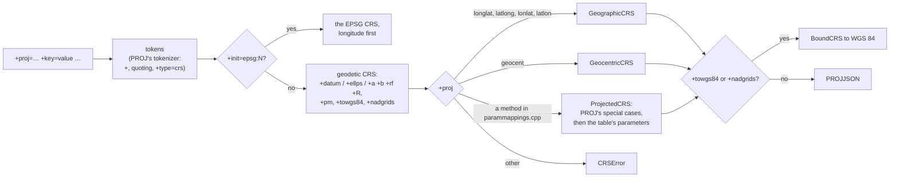

# pyproj compatibility, phase 3: the ecosystem

> **Status: designed, 2026-10-24; reviewed, 2026-10-31 (decision 8:
> unknown datums raise; the PROJ-only projections are still open).** This is phase 3 of
> [pyproj-compat.md](pyproj-compat.md#phases). Facts about PROJ, pyproj
> and GeoPandas were checked against PROJ 9.8.1 through pyproj 3.8.0 and
> GeoPandas 1.2.0, with the oracle database
> (`scripts/build_proj_oracle.py`).

Phase 3 is "ecosystem": what libraries built on pyproj need, beyond
scripts that convert coordinates. It covers these rows of the
[compatibility table](pyproj-compat.md#compatibility-table), plus three
additions:

- `xeibe_proj.compat.install_as_pyproj()`, and GeoPandas under it;
- PROJ strings: `CRS.from_proj4`, `from_dict`, `CRS(proj=…)`, `to_proj4`
  and `to_dict`, `Proj(proj=…)`, `Proj.definition_string` and
  `to_latlong_def`;
- the builder classes (`GeographicCRS`, `ProjectedCRS`, …,
  `TransverseMercatorConversion`, …, `CustomDatum`, `Ellipsoidal2DCS`, …)
  and the sub-objects' constructors (`Datum.from_name`,
  `Ellipsoid.from_epsg`, `CoordinateOperation.from_string`, …);
- `CRS.to_cf`, `from_cf` and `cs_to_cf` (the table's "3, if asked");
- GeoArrow arrays in and out (`xeibe_proj.arrow`), which pyproj doesn't
  have;
- a Pyodide wheel;
- **additions:** `Transformer.from_proj` (now "Out") and
  `query_geodetic_crs_from_datum`.

## Where pyproj's suite fails today

The pyproj suite passes 356 of its 963 tests. The failures that phase 3
can fix, from `target/pyproj-suite.xml`, by first error:

| Cause | Tests |
|---|---|
| PROJ strings and dicts (`CRS("+proj=…")`, `CRS(proj=…)`, `from_proj4`, `to_proj4`, and the `+init=` tests that expect pyproj's `FutureWarning`) | ~150 |
| `from_name`, `from_epsg`, `from_string`, `from_authority` on `Datum`, `Ellipsoid`, `PrimeMeridian`, `CoordinateSystem` and `CoordinateOperation` | 78 |
| The builder classes and coordinate systems | ~120 |
| CF (`from_cf`, `to_cf`) | 29 |
| `Transformer.from_proj` | 22 |
| `query_geodetic_crs_from_datum` | 12 |

Many tests fail on more than one cause, so the gain is smaller than the
sum. The rest of the failures are what stays out: `from_pipeline` (39
tests), `TransformerGroup`'s options (21), `errcheck` and `inplace`,
other authorities, PROJ's context and CA bundle, and `get_factors`.

## Decisions

| # | Decision | Why |
|---|---|---|
| 1 | **PROJ strings come first, then `install_as_pyproj()`**, together with a runner for GeoPandas' own test suite. | PROJ strings fix the most of pyproj's tests (about 150), and depend on nothing else in this phase. The shim is small, and GeoPandas' suite then measures every later step, as pyproj's suite does now. |
| 2 | **The shim is a meta path finder that maps each `pyproj.*` module to the xeibe_proj module itself.** So `pyproj.crs.CRS is xeibe_proj.CRS`, and `isinstance` and pickles work across the two names. Only the top-level `pyproj` is a module of its own, which forwards to `xeibe_proj` and has `__version__ = "3.8.0"`, the pyproj release whose API is followed. | Libraries compare `pyproj.__version__` with minimum versions; xeibe_proj's own 0.x version would fail those checks. One class under two names avoids two `CRS` types that don't compare equal. |
| 3 | **`install_as_pyproj()` raises when pyproj is already imported**, and has no placeholders for missing names: a missing name raises `AttributeError` or `ImportError` as usual. | Objects from both libraries in one process would mix. The placeholders are a tool of the test runner only. |
| 4 | **PROJ strings are translated to and from PROJJSON in Rust, in a new `xeibe_reproject::proj_string` module**, ported from PROJ's `PROJStringParser` (`io.cpp`) and `_exportToPROJString` (`crs.cpp`, `conversion.cpp`, `datum.cpp`). | As with WKT ([crs-wkt.md](crs-wkt.md)), the CLI and the web page can then take PROJ strings too. PROJ's code is the specification: it has dozens of special cases (`utm`, `+south`, Mercator variants A and B, polar `stere`, `lcc` with one or two standard parallels, `omerc`'s `no_uoff`, `krovak`'s axes). |
| 5 | **The method and parameter names come from PROJ's `parammappings.cpp`, generated by `scripts/gen_wkt1_names.py`.** That table already gives WKT1's names, and the same entries give PROJ's (`proj_name_main`, `proj_name_aux` and each parameter's `proj_name`). | One generator for one table. No hand-kept names. |
| 6 | **A PROJ string is read when PROJ would read it into an EPSG method**, whether or not `xeibe-reproject` implements that method. Such a CRS can be inspected and written out, but not converted, as with WKT. Everything else raises `CRSError` and names what isn't supported: PROJ-only projections (`robin`, `moll`, …), options PROJ keeps only as a PROJ-based operation (`+over`, `+lon_wrap`, `+geoc`, an `+axis` it can't express), `+proj=pipeline`, and `+geoidgrids`. | Same rule as divergence 6: only EPSG's methods. The error says why, instead of an approximation. |
| 7 | **`to_proj4` writes PROJ's string token for token**, with pyproj's `UserWarning` ("You will likely lose important projection information"). `to_dict` is pyproj's parsing of that string. | It can be checked against PROJ for every EPSG CRS, as WKT is. |
| 8 | **A CRS whose datum is unknown still can't be converted to a CRS on another datum**: there is no zero datum shift, as PROJ's "Ballpark geographic offset" would apply. "Unknown" means a PROJ string with an ellipsoid but no `+datum` or `+towgs84`, a WKT datum that is identified with no EPSG datum (`D_unknown`), or one of EPSG's "Not specified (based on … ellipsoid)" datums. The `ProjError` says that the datum is unknown, and that giving the CRS as an EPSG code, or adding `+datum` or `+towgs84`, fixes it. Between two CRSs on the same unknown datum (`+proj=longlat +ellps=GRS80` to `+proj=utm +zone=33 +ellps=GRS80`), no datum change is needed, and the conversion works. | Such a definition doesn't say where its datum is, and a zero shift is off by the whole datum shift when the data is really on a local datum. Measured against EPSG's operations to WGS 84: 0 m for GRS80 data in ETRS89, but 54 m for NTF in Paris, 117 m for S-JTSK in Prague, 125 m for OSGB36 in London and 128 m for Pulkovo 1942(58) in Warsaw. An error is better than such numbers. Divergence 1 stays as it is. `+proj=utm +zone=30` isn't affected: with no ellipsoid, PROJ's default is the WGS 84 datum, which is known. |
| 9 | **`+init=epsg:CODE` gives the EPSG CRS with longitude first**, as PROJ does, with pyproj's `FutureWarning`. Other `+init` files raise. | PROJ 6 and later read `+init=epsg:` from the database and keep the old axis order. pyproj warns about it. |
| 10 | **`+nadgrids=@null` (or `null`) is a Bound CRS with a zero shift to WGS 84**, and PROJ's Web Mercator string is EPSG:3857, as PROJ recognises it. Other `+nadgrids` grids are read when the grid catalog has them under their old PROJ name. | `@null` is the common case, in every Web Mercator `.prj` file. The catalog already maps PROJ's old names (`conus`, `ntv1_can.dat`) to the CDN files ([reprojection.md](reprojection.md)). |
| 11 | **The builder classes are pyproj's own Python (MIT), ported** as `geod.py` was. They build PROJJSON and call `from_json_dict`, so they need nothing native. | It gives pyproj's behaviour, and pyproj's tests for these classes then run unchanged. |
| 12 | **EPSG's ellipsoids, prime meridians, datums and conversions go into a new generated table in `xeibe-crs`** (`data/objects.bin`), each as PROJJSON with its names and aliases. The sub-objects' `from_epsg`, `from_authority`, `from_name`, `from_string` and `from_user_input` read it, and so does `query_geodetic_crs_from_datum`. | Today these objects exist only inside CRSs. EPSG has 55 ellipsoids, 15 prime meridians, 983 datums and datum ensembles, and 3,577 conversions, 206 of them used by no CRS. Compressed, this should be about 100 KB. |
| 13 | **CF is pyproj's `_cf1x8.py` (MIT), ported.** | It is pure Python over PROJJSON and the builders. xarray and rioxarray use it. |
| 14 | **`Transformer.from_proj` is implemented**: it is `from_crs` on the two `Proj`s' CRSs, as in pyproj. | pyproj deprecated it in its documentation, but it still works without a warning. Once PROJ strings exist, it costs one line. |
| 15 | **GeoArrow is `xeibe_proj.arrow`, a module of its own**, not new methods on pyproj's classes. It reads and writes through the Arrow PyCapsule interface, without depending on any Arrow library. | The classes keep pyproj's surface, so the type checks and the shim stay exact. |
| 16 | **GeoArrow's native encodings and WKB are supported**, not WKT. WKB is rewritten in place: a copy of the buffer, with each coordinate overwritten. | WKB is what GeoParquet and `GeoDataFrame.to_arrow` write by default. Its coordinates have fixed widths, so the offsets don't change. WKT's lengths would change. |
| 17 | **The Arrow code uses `arrow-array` and `arrow-schema` with `ffi`** (`xeibe-py` already does), if the wheel grows by less than 0.5 MB. If it grows more, the C Data Interface is written by hand for the few layouts needed. | That is the measurement phase 0 was to make. Writing the FFI by hand costs time, and is only worth it if the size matters. |
| 18 | **Pyodide gets its own wheel**, built by maturin for Emscripten, with grids fetched through `pyodide.http.pyxhr`. | abi3 doesn't apply to Pyodide, and `urllib` has no sockets there. `pyxhr` is Pyodide's synchronous client. |

## `install_as_pyproj()`

```python
import xeibe_proj.compat
xeibe_proj.compat.install_as_pyproj()

import geopandas  # imports "pyproj", gets xeibe_proj
```

`install_as_pyproj()` puts a finder at the front of `sys.meta_path`.
For `pyproj.X` it returns `xeibe_proj.X`, for every module in pyproj
3.8.0's tree that xeibe_proj has: `aoi`, `crs` and its submodules,
`database`, `datadir`, `enums`, `exceptions`, `geod`, `list`, `network`,
`proj`, `transformer`, and with this phase `crs.coordinate_operation`,
`crs.coordinate_system`, `crs.datum`, `crs.enums` and `utils`. The other
modules (`pyproj.sync`, `pyproj._crs`, …) raise `ModuleNotFoundError`
with the reason. The finder takes precedence over an installed pyproj.
Calling it twice is harmless.

The top-level `pyproj` module forwards every attribute to `xeibe_proj`, and
adds:

- `__version__ = "3.8.0"`, the pyproj release whose API is followed;
- `__xeibe_proj_version__`, the package's own version.

`proj_version_str` still raises `AttributeError`. GeoPandas'
`show_versions` catches that and prints `None`.

What the shim can't hide:

- `importlib.metadata.version("pyproj")` reads installed distributions, so
  it gives the real pyproj's version, or raises if pyproj isn't installed.
- Code that imported pyproj before `install_as_pyproj()` was called keeps
  the real one. That is why the call raises when `pyproj` is already in
  `sys.modules`.

The function is documented as experimental. Using `xeibe_proj` directly
stays the recommended way.

### GeoPandas

GeoPandas uses a narrow slice of pyproj, and everything in it is
implemented already:

- `CRS.from_user_input`, `from_epsg`, `equals`, `is_exact_same`, `==`,
  `to_epsg`, `to_authority`, `to_string`, `to_wkt` (WKT2_2019 and
  WKT1_GDAL), `to_json_dict` (GeoParquet and GeoArrow metadata), pickling,
  `is_geographic`, `is_projected`, `axis_info` and `name`;
- `Transformer.from_crs(…, always_xy=True)` under `functools.lru_cache`
  (so `CRS` must hash), `transform` on numpy arrays, and
  `transform_bounds`;
- `query_utm_crs_info` and `AreaOfInterest`, for `estimate_utm_crs`;
- `datadir.get_data_dir` and `exceptions.CRSError`.

Its tests also give CRSs as PROJ strings and dicts
(`"+proj=utm +zone=30"`, `{"init": "epsg:4326"}`), and as `IGNF:WGS84`,
which stays out.

**Validation.** A new runner, `tests/geopandas_suite/run.py`, works like
pyproj's. It runs GeoPandas' test suite, which the wheel includes, twice:
once with pyproj 3.8.0 and once with the shim installed. The measure is
the tests that pass with pyproj. A committed `pass-list.txt` lists those
that pass with the shim too, and the run fails when one of them stops
passing. A committed `known.txt` lists the rest, each with its reason.
Expected reasons:

- **Failed coordinates raise** (divergence 2), where GeoPandas' tests
  expect `inf`.
- **No ballpark** (divergence 1), between known datums or from an unknown
  one (decision 8).
- **Other authorities** (`IGNF:`).
- **Text that differs**, in tests that compare WKT or `repr` text.

The dependencies are GeoPandas' own required ones plus pyarrow. pyogrio
and matplotlib are left out, so the file and plotting tests are skipped in
both runs.

## PROJ strings

### Reading

`xeibe_reproject::proj_string::to_projjson(&str)` follows
`PROJStringParser::createFromPROJString`:



It ports these parts of `io.cpp`:

- **Tokens.** `+key=value`, bare `key=value` (`Proj`'s keyword form),
  flags without a value, and `+type=crs`. `+no_defs` and `+wktext` are
  ignored.
- **The geodetic CRS.**
  - `buildDatum`: PROJ's `+datum` names from `datums.cpp` (`WGS84`,
    `NAD83`, `NAD27`, `GGRS87`, `potsdam`, `carthage`, `hermannskogel`,
    `ire65`, `nzgd49`, `OSGB36`). They are a new table in
    `xeibe_reproject::proj_tables`, next to the ellipsoids already there.
  - The ellipsoid: `+ellps`, or `+a` with `+b`, `+rf`, `+f`, `+e`, `+es`
    or `+R`.
  - The prime meridian: `+pm`, by name or in degrees.
  - With no ellipsoid, WGS 84, as PROJ does.
- **The unit.** `+units` and `+to_meter`, through the unit tables
  `get_units_map` already uses.
- **Axes.** `+axis=enu`, `neu` and `wsu`, wherever PROJ's CRS has an
  axis order for them.
- **The projection.** The table's method for `+proj`, with PROJ's special
  cases. Mercator is variant A with `+k` and variant B with `+lat_ts`.
  `stere` at `+lat_0=±90` is a polar stereographic variant. `lcc` has one
  standard parallel or two. There are also `utm` with `+zone` and
  `+south`, `tmerc` with `+approx`, `etmerc`, `omerc`'s `+no_uoff`,
  `+no_rot` and `+gamma`, `krovak` and `mod_krovak` with their axis order,
  `somerc`, `geos`' `+sweep`, and `cea`, `aeqd` and `laea` on a sphere.
- **Bound CRSs.** `+towgs84` with 3 or 7 values gives a Bound CRS to WGS 84
  with a Helmert transformation, which `xeibe-reproject` converts already
  ([crs-wkt.md](crs-wkt.md#towgs84-and-boundcrs)). `+nadgrids` gives an
  NTv2 Bound CRS (decision 10). For a grid named `@null`, the grid code
  adds a zero shift to the files it knows.
- **Names.** PROJ calls the CRS `unknown`, and names the datum
  `Unknown based on <ellipsoid> ellipsoid` when there is no `+datum`.
  PROJ recognises the Web Mercator string and returns EPSG:3857 by name.

Ids are left out where PROJ leaves them out. A CRS read from a PROJ string
is then identified like any other CRS without a code (`Crs::identify`):
`+proj=utm +zone=33 +datum=WGS84` gives `to_epsg() == 32633`, as in pyproj,
and routes through EPSG's operations.

**Unknown datums** (decision 8) still have no route to another datum.
The selection's error for them names the unknown datum and says how to
give a known one, instead of the general "no usable transformation". Two
unknown datums are the same when their ellipsoids and prime meridians
are, so a PROJ string converts to another string on the same ellipsoid.

### Writing

`proj_string::from_projjson` follows `_exportToPROJString` for CRSs, not
for operations:

- `+proj=…` and the parameters, in the table's order, through the same
  special cases in reverse (`utm` and `+zone` for EPSG's UTM conversions,
  `+south`);
- `+datum=` for the datums PROJ abbreviates, else `+ellps=` with PROJ's
  name, else `+a`/`+rf` or `+R`;
- `+pm`, `+units` or `+to_meter`, `+towgs84` for a Bound CRS, `+no_defs`
  and `+type=crs`;
- numbers formatted as PROJ formats them (`%.15g`, then its rounding of
  values close to whole numbers).

A CRS PROJ can't write as a PROJ string (a compound CRS with a vertical
part that has no `+geoidgrids`, an engineering CRS) raises `CRSError`, as
PROJ does.

### In `xeibe_proj`

- **CRSs.**
  - `CRS(string)`, `CRS(dict)`, `CRS(**kwargs)`, `from_proj4`, `from_dict`
    and `from_user_input` read PROJ strings and dicts. They follow
    pyproj's `_prepare_from_dict` and `_prepare_from_string` (MIT),
    including their `FutureWarning` for `+init=`.
  - `CRS.srs` is the string with `+type=crs` added, as pyproj's is.
  - `to_proj4(version=4 | 5)`, `to_dict` and `to_string` (the authority
    code, else the PROJ string, else the input, as in pyproj) write them.
- **`Proj`.**
  - `Proj(proj="utm", zone=33)` and `Proj("+proj=…")` build the CRS from
    the parameters. The rest is phase 2's `Proj`
    ([pyproj-phase2.md](pyproj-phase2.md#proj)).
  - `definition_string()` is the projection's PROJ string without `+` or
    `+type=crs` (`proj=utm zone=33 ellps=WGS84 units=m no_defs`).
  - `to_latlong_def()` is the geodetic CRS's string with the ellipsoid
    only.
- **`Transformer.from_proj`** (decision 14).

`Transformer.definition` and `to_proj4` stay out. They are PROJ pipeline
strings, not CRS strings.

### Validation

A new `scripts/gen_proj_string_vectors.py` writes vectors with PROJ on the
oracle database, to `tests/data/proj-string/` (a committed subset) and
`target/proj-string/` (`--all`):

- **`epsg.jsonl`**: for every EPSG CRS, PROJ's `to_proj4()` or its error,
  PROJ's PROJJSON when it reads that string back, and `to_epsg` of that
  reading.
- **`corpus.jsonl`**: hand-written strings, with PROJ's PROJJSON or its
  error. They come from PROJ's `test/unit/test_io.cpp` (157 cases; the
  tarball `build_proj_oracle.py` pins), pyproj's tests and GeoPandas'
  tests.
- **`coordinates.jsonl`**: for each string whose method `xeibe-reproject`
  implements, points converted by PROJ to the string's geodetic CRS.

Gates:

- `from_projjson` gives PROJ's string token for token, for every EPSG CRS
  but a listed set of differences.
- `to_projjson` gives PROJ's PROJJSON, compared as the WKT reader's output
  is ([crs-wkt.md](crs-wkt.md#validation)), and the same `to_epsg`.
- Every corpus string is either read like PROJ, or refused with an error
  of one of decision 6's kinds, and the count of each kind is reported.
- Coordinates agree within [reprojection.md](reprojection.md)'s level-1
  tolerances.

## Sub-objects and builders

### The objects table

`scripts/gen_crs_tables.py` writes `data/objects.bin`: EPSG's ellipsoids,
prime meridians, geodetic and vertical datums, datum ensembles and
conversions. Each is the PROJJSON that PROJ writes for it, with its name,
EPSG's aliases and its deprecation. `xeibe_crs::object(kind, code)` and
`xeibe_crs::object_by_name(kind, name)` read it. Names match as PROJ's
`createObjectsFromName` does, ignoring case, spaces and punctuation, and
with EPSG's aliases.

On top of the table, every sub-object gets pyproj's constructors:

- `from_epsg`, `from_authority("EPSG", …)`, `from_name(name,
  auth_name=None)`, `from_string` (an authority code, a name, WKT or
  PROJJSON) and `from_user_input`;
- `from_json` and `from_json_dict`.

`query_geodetic_crs_from_datum(crs_auth_name, datum_auth_name,
datum_code, pj_type)` comes from the CRS records and the table.

### Builders

Ports of pyproj's modules:

- `crs/coordinate_system.py`: `Ellipsoidal2DCS`, `Ellipsoidal3DCS`,
  `Cartesian2DCS`, `VerticalCS` and their axis enums;
- `crs/datum.py`: `CustomDatum`, `CustomEllipsoid`, `CustomPrimeMeridian`;
- `crs/coordinate_operation.py`: the 22 conversion classes (`UTMConversion`
  among them, a `from_name` lookup) and `ToWGS84Transformation`;
- `crs/crs.py`'s `CustomConstructorCRS` subclasses: `GeographicCRS`,
  `DerivedGeographicCRS`, `GeocentricCRS`, `ProjectedCRS`, `VerticalCRS`,
  `CompoundCRS` and `BoundCRS`.

Each builds PROJJSON and calls `from_json_dict`. A CRS built with a method
that `xeibe-reproject` doesn't implement (`GeostationarySatelliteConversion`,
`VerticalPerspectiveConversion`) works as a CRS, but raises when converted,
as such CRSs read from WKT do.

**Validation.** pyproj's `test_crs_maker.py`, `test_crs_coordinate_operation.py`,
`test_crs_coordinate_system.py`, `test_crs_datum.py` and `test_datum.py`
in the suite. An oracle test compares each sub-object of every EPSG CRS,
read by code and by name, with pyproj's.

## CF

`crs/_cf1x8.py` is pyproj's, ported: `CRS.to_cf`, `from_cf` and `cs_to_cf`,
over the builders. The validation is pyproj's `test_crs_cf.py`, and an
oracle test runs `to_cf` and `from_cf` round trips on every EPSG CRS
against pyproj's.

## GeoArrow

```python
from xeibe_proj import Transformer, arrow

t = Transformer.from_crs(2180, 4326, always_xy=True)
out = arrow.transform(t, table["geometry"])   # anything with __arrow_c_array__ or __arrow_c_stream__
out = arrow.to_crs(table["geometry"], 4326)   # source CRS from the field's GeoArrow metadata
```

- **Input.** Anything with `__arrow_c_array__`, or `__arrow_c_stream__`
  for chunked data. That covers pyarrow, arro3, polars, nanoarrow and
  xeibe's own GML reader (`xeibe.read_gml`), without importing any of them.
- **Encodings.**
  - `geoarrow.point`, `linestring`, `polygon`, `multipoint`,
    `multilinestring` and `multipolygon`, interleaved or separated, in XY,
    XYZ, XYM or XYZM (M passes through);
  - `geoarrow.wkb`, little- or big-endian, ISO or EWKB;
  - `geoarrow.box`, through `transform_bounds`.
- **Output.** An object with `__arrow_c_array__` (or `__arrow_c_stream__`)
  in the same encoding. Offsets and validity buffers are shared with the
  input, and only the coordinates are new. The field's extension metadata
  keeps its other keys and gets the target CRS as PROJJSON
  (`"crs_type": "projjson"`).
- **CRSs.** If the input's metadata has a CRS that isn't equivalent to the
  transformer's source CRS, `transform` raises `ValueError`. `to_crs`
  builds the transformer from that CRS with `always_xy=True`, because
  GeoArrow coordinates are always easting or longitude first, as in
  GeoParquet.
- **Errors.** Failed coordinates raise as in `transform`. Arrays with
  `"edges": "spherical"` raise too, because their edges would change
  meaning.

The conversion runs in Rust without the GIL, over the coordinate buffers.
Decision 17 picks the FFI code. The tests run each encoding through
pyarrow and arro3 and check it against `Transformer.transform` on the same
coordinates. A bare-install test checks that `xeibe_proj.arrow` itself
imports no Arrow library.

## Pyodide

- **The wheel.** maturin builds it for `wasm32-unknown-emscripten` with
  the Emscripten version of the targeted Pyodide release, and the Rust
  toolchain that release requires. `xeibe-reproject` already builds for
  `wasm32-unknown-unknown` in `xeibe-wasm`, so the code is portable.
- **Grids.** `_grids.py` fetches ranges through `pyodide.http.pyxhr` when
  it runs under Pyodide (`sys.platform == "emscripten"`). There is no
  disk cache between page loads; the in-memory cache stays. Pyodide's
  documentation warns that synchronous requests block the page on the
  main thread, so the README recommends a web worker.
- **To be checked when the step starts:**
  - whether `pyxhr` returns binary range responses on the main thread, or
    only in a worker;
  - whether PyPI accepts Pyodide wheels for the targeted release (Pyodide
    announced this for its 314 ABI), or whether the wheel goes on the
    GitHub release instead.
- **CI.** A job builds the wheel and runs the package's tests under
  `pyodide venv` in Node, without the grid tests. One Playwright test runs
  the grid fetch in a browser against the local grid server.

## What stays out

- `Transformer.from_pipeline`, `definition`, `to_proj4`: PROJ pipelines.
- Other authorities (`IGNF:`, `ESRI:` beyond the old EPSG codes, `IAU_2015:`).
- Ballparks, between known datums or from an unknown one (divergence 1,
  decision 8).
- PROJ-only projections; see [Open questions](#open-questions).
- `+geoidgrids`, `+proj=pipeline`, `+over`, `+lon_wrap`, `+geoc`.
- `TransformerGroup`'s `crs_extent_use`, `pivot_crs`, `grid_check` and
  `allow_superseded`; `Proj.get_factors`; `pyproj.sync`; PROJ's context.

## Order of work

1. **PROJ strings in Rust**: the generator, `proj_string`, the vectors
   script, the grid code's `@null`, and the error and same-datum rule for
   unknown datums (decision 8). Gated on the vectors.
2. **PROJ strings in `xeibe_proj`**, with `Proj`, `from_proj` and the
   warnings, gated on pyproj's suite.
3. **`install_as_pyproj()` and the GeoPandas runner**, gated on GeoPandas'
   suite: every test that passes with pyproj is in the pass list or in
   `known.txt` with a reason.
4. **The objects table and the sub-objects' constructors**, with
   `query_geodetic_crs_from_datum`, gated on pyproj over every EPSG
   object.
5. **The builders**, gated on pyproj's tests for them.
6. **CF**, gated on pyproj's `test_crs_cf.py`.
7. **GeoArrow**: first the wheel-size measurement for decision 17, then
   the module.
8. **Pyodide.**

Each step updates [pyproj-compat.md](pyproj-compat.md)'s table and status,
and the two pass lists.

## Open questions

- **PROJ-only projections.** EPSG has no Robinson, Mollweide, Eckert IV,
  Natural Earth, Winkel Tripel or Sinusoidal. These are what world maps
  use (`to_crs("+proj=robin")`), and cartopy builds its CRSs from them.
  Each is a short port of PROJ's code (MIT), with no EPSG id, written as
  PROJ writes it in WKT2. The proposal is a step 9 for these six plus
  EPSG's Orthographic (9840), which `xeibe-reproject` doesn't have yet. It
  would widen divergence 6 from "EPSG's methods" to "EPSG's methods and
  these six". Should it be in phase 3?
