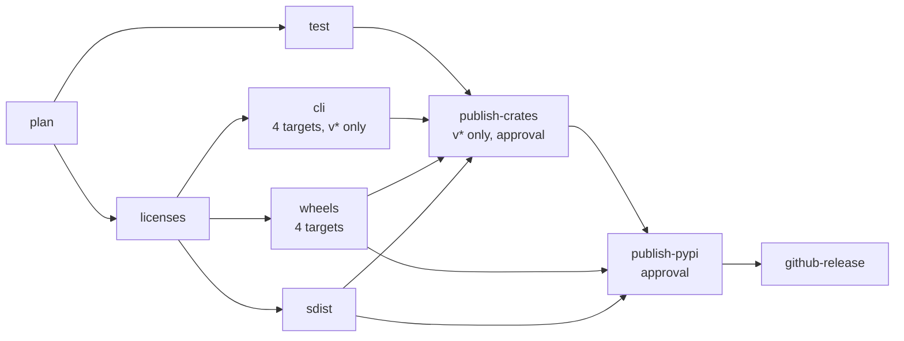

# Releasing

How xeibe is versioned and released: the crates on crates.io, the `xeibe`
CLI binaries on GitHub, and the Python packages on PyPI. A tag starts
`.github/workflows/release.yml`, which builds and tests everything first and
publishes only after an approval.

## What is released

| Tag | crates.io | GitHub release | PyPI |
|---|---|---|---|
| `v0.2.0` | The workspace crates (below) | CLI archives, wheels, sdist, `SHA256SUMS` | `xeibe` (crate `xeibe-py`) |
| `xeibe-proj-v0.2.0` | — | Wheels, sdist, `SHA256SUMS` | `xeibe-proj` (crate `xeibe-proj-py`) |

Published to crates.io: `xeibe-core`, `xeibe-crs`, `xeibe-esri`,
`xeibe-reproject`, `xeibe-geom`, `xeibe-schema`, `xeibe-arrow`,
`xeibe-export`, `xeibe-io`, `xeibe-wfs`, `xeibe-datafusion` and
`xeibe-cli` (`cargo install xeibe-cli`). Not published: `xeibe-py` and
`xeibe-proj-py` (PyPI only), `xeibe-wasm` (built into the web page) and
`xeibe-testkit`. `scripts/release.py crates` lists them in publishing order.

## Versions

- **The workspace crates share one version**, `[workspace.package]`'s, and
  the `xeibe` Python package has it too. They are released together, so a
  `v*` tag names one version for all of them.
- **`xeibe-crs` and `xeibe-esri` have their own versions.** `xeibe-crs`
  follows EPSG releases (`0.4.0+epsg-13.106`; see
  [geometry.md](geometry.md)), `xeibe-esri` Esri's tables. A `v*` release
  publishes each of them only if its version isn't on crates.io yet.
- **`xeibe-proj` has its own version and tags**, as
  [pyproj-compat.md](pyproj-compat.md#versioning) describes.
- **Before 1.0, a minor bump is a breaking change** (Cargo's 0.x rule).
- **An EPSG update is a minor bump of `xeibe-crs`.** Under the 0.x rule
  that breaks every crate above it, so it also means a minor `v*` release.
  `xeibe-proj` gets its own minor release for it too.

Each crate's dependencies on its siblings are versioned in
`[workspace.dependencies]` (`version = "0.1.0"`), because a published crate
depends on releases, not paths. A minor bump changes those too. Cargo
refuses to build if one is left behind, so nothing stale gets through.

Pre-releases are semver pre-releases (`0.3.0-rc.1`). The tag is
`v0.3.0-rc.1`, maturin converts the version for PyPI (`0.3.0rc1`), and the
GitHub release is marked as a pre-release.

## Making a release

1. In a commit on `main`:
   - bump the version: `[workspace.package]` and the sibling versions in
     `[workspace.dependencies]` for `v*`; `crates/xeibe-proj-py/Cargo.toml`
     for `xeibe-proj-v*`;
   - rename `## Unreleased` in the changelog to `## <version>`
     (`CHANGELOG.md`, or `crates/xeibe-proj-py/CHANGELOG.md`);
   - run `cargo check` so `Cargo.lock` follows.
2. Tag that commit and push the tag: `git tag v0.2.0 && git push origin v0.2.0`.
3. Approve the `crates-io` and `pypi` deployments in the workflow run once
   the builds are green.

The workflow refuses a tag that doesn't match the version, a version with
no changelog section, and a commit that isn't on `main`. Afterwards, add a
new `## Unreleased` section.

## The workflow

- **plan.** `scripts/release.py plan` works out the series, version and
  Python package from the tag, and checks that the tag is on `main`.
- **test.**
  - `cargo test --workspace` for `v*` tags; the `xeibe-crs`, `xeibe-esri`
    and `xeibe-reproject` tests for `xeibe-proj-v*` tags.
  - For `v*` tags, also `cargo check` on the MSRV, and `cargo package` for
    every published crate, which builds each one from its package alone.
- **licenses.** cargo-about writes `THIRD-PARTY-LICENSES.md` for the CLI and
  the Python package (see [Licences](#licences)).
- **cli.**
  - Builds `--profile dist --features object-store` for each target, then a
    smoke test: `--version` reports the tag's version and `object-store`,
    and one sample converts.
  - On Linux it also checks that the binary needs no glibc newer than 2.28.
  - Packs the binary with the notices into
    `xeibe-<version>-<target>.tar.gz` (`.zip` on Windows).
- **wheels and sdist.**
  - maturin builds abi3 wheels, Python 3.11 and newer, manylinux_2_28 on
    Linux.
  - Each wheel is checked for its licence files and tested on its own
    platform: `crates/xeibe-py/tests/smoke.py` for `xeibe`; for
    `xeibe-proj`, the bare install check and the pytest suite, as
    `proj-py.yml` runs them.
- **Build provenance.** Every archive, wheel and sdist of a tagged release
  gets an attestation (`gh attestation verify <file> -R ttomasz/xeibe`).
- **publish-crates.** `scripts/release.py publish-crates` publishes each
  crate whose version isn't on crates.io yet, in dependency order.
  - It uses `--no-verify`, because the test job already built them.
  - It retries when crates.io's limit on new crates stops it. The limit
    allows a few new crates at once, then about one every 10 minutes, so
    the first release, with 12 new crates, takes over an hour.
- **publish-pypi.** Trusted publishing, after the crates. A failure on
  crates.io stops the PyPI upload too.
- **github-release.** Creates the release with the changelog section as
  notes.

The artifacts are built without the build cache, from a clean checkout of
the tag. The test job uses the cache.

**Dry runs.** Dispatching the workflow by hand (Actions → Release → Run
workflow) builds and tests a series at any branch and publishes nothing. A
missing changelog section is reported but doesn't stop it. With
`testpypi`, the wheels and sdist go to TestPyPI, which is the way to try
trusted publishing before a real release.

## Platforms

| | Linux x86_64 | Linux aarch64 | macOS arm64 | Windows x86_64 |
|---|---|---|---|---|
| CLI | glibc ≥ 2.28 | glibc ≥ 2.28 | macOS ≥ 11 | static CRT |
| Wheels | manylinux_2_28 | manylinux_2_28 | macOS ≥ 11 | ✓ |

Not built, for now:

- **Intel macOS.** Apple stopped selling Intel Macs in 2023, and macOS 26 is
  the last release for them. Users can build it with `cargo install` (CLI)
  or `pip install` from the sdist, which needs Rust.
- **Windows on ARM.** Windows 11 on ARM runs the x86_64 binary and wheel
  through emulation.
- **musl** (Alpine). It's static, but musl's allocator slows down badly
  under the many threads of a parallel read, unless a different allocator
  is linked in.

The Linux binaries are linked by cargo-zigbuild against glibc 2.28 (RHEL 8,
Debian 10, Ubuntu 18.10 and newer), not the runner's glibc. The Windows
binary links the MSVC runtime statically, so it needs no Visual C++
redistributable.

## Licences

The CLI and both Python packages embed EPSG data (`xeibe-crs`) and code
ported from PROJ (`xeibe-reproject`), and are compiled from a few hundred
third-party crates. Each artifact carries:

| | Archive | Wheel and sdist |
|---|---|---|
| CC0 | `LICENSE` | — (the licence expression) |
| EPSG, PROJ | `EPSG-NOTICE.md`, `PROJ-NOTICE.md` | `NOTICE.md` of the Python crate |
| Rust crates | `THIRD-PARTY-LICENSES.md` | `THIRD-PARTY-LICENSES.md` |

`THIRD-PARTY-LICENSES.md` is generated from `scripts/licenses/about.toml`
and `about.hbs` by [cargo-about](https://github.com/EmbarkStudios/cargo-about),
for the four targets. It isn't in git. The workflow writes it into the Python
crate's directory before building, where `license-files` in `pyproject.toml`
picks it up, and checks that every wheel has it. A dependency under a
licence that isn't on `accepted` fails the job. Adding a licence there is a
decision to ship under it.

To see it locally:
`cargo about generate -c scripts/licenses/about.toml -m crates/xeibe-cli/Cargo.toml --features object-store scripts/licenses/about.hbs`
(`cargo install cargo-about --features cli`).

## Integrations

- **SedonaDB.** `xeibe.sedona` is part of the `xeibe` wheel
  (`pip install xeibe[sedona]`) and is released with it. The later Rust
  form ([architecture.md](architecture.md#sedonadb)) would live in
  SedonaDB's workspace and be released by them, on `xeibe-arrow` from
  crates.io.
- **DuckDB.** Today DuckDB reads xeibe's output through Python's Arrow
  interface or from Parquet, and there is no extension.
  - An extension would go through DuckDB's community-extensions repository,
    whose CI builds and signs it for each DuckDB release.
  - A release would be a pull request there that moves the extension's
    `ref` to the new tag, not a job here.

## One-time setup

Before the first release:

1. **GitHub environments** `crates-io`, `pypi` and `testpypi`
   (Settings → Environments), each with the maintainer as a required
   reviewer.
2. **A tag ruleset** (Settings → Rules → Rulesets) that lets only the
   maintainer create `v*` and `xeibe-proj-v*` tags.
3. **PyPI and TestPyPI:** a pending trusted publisher for `xeibe` and for
   `xeibe-proj`, with owner `ttomasz`, repository `xeibe`, workflow
   `release.yml`, and environment `pypi` (`testpypi` on TestPyPI). No PyPI
   token is ever needed.
4. **crates.io.** Trusted publishing can only be set up for crates that
   exist, so the first `v*` release needs a token.
   - Create an API token with the `publish-new` and `publish-update`
     scopes.
   - Add it as the `CARGO_REGISTRY_TOKEN` secret of the `crates-io`
     environment.
   - After the release, add a trusted publisher to each crate on crates.io
     (repository `ttomasz/xeibe`, workflow `release.yml`, environment
     `crates-io`).
   - Then delete the secret and revoke the token. Without the secret, the
     workflow uses trusted publishing.

## Not chosen

- **release-plz, cargo-release.** They write changelogs from
  conventional-commit messages, which this repository doesn't use. The
  version bump itself is a two-line change.
- **cargo-dist.** It generates its own release workflow with installers.
  The few build steps written out here, with the glibc pin and the smoke
  tests, are easier to read than its generated workflow.
- **`cargo publish --workspace`.** It fails on a version that is already on
  crates.io. That is the normal case for `xeibe-crs` and `xeibe-esri`
  between their own bumps.
