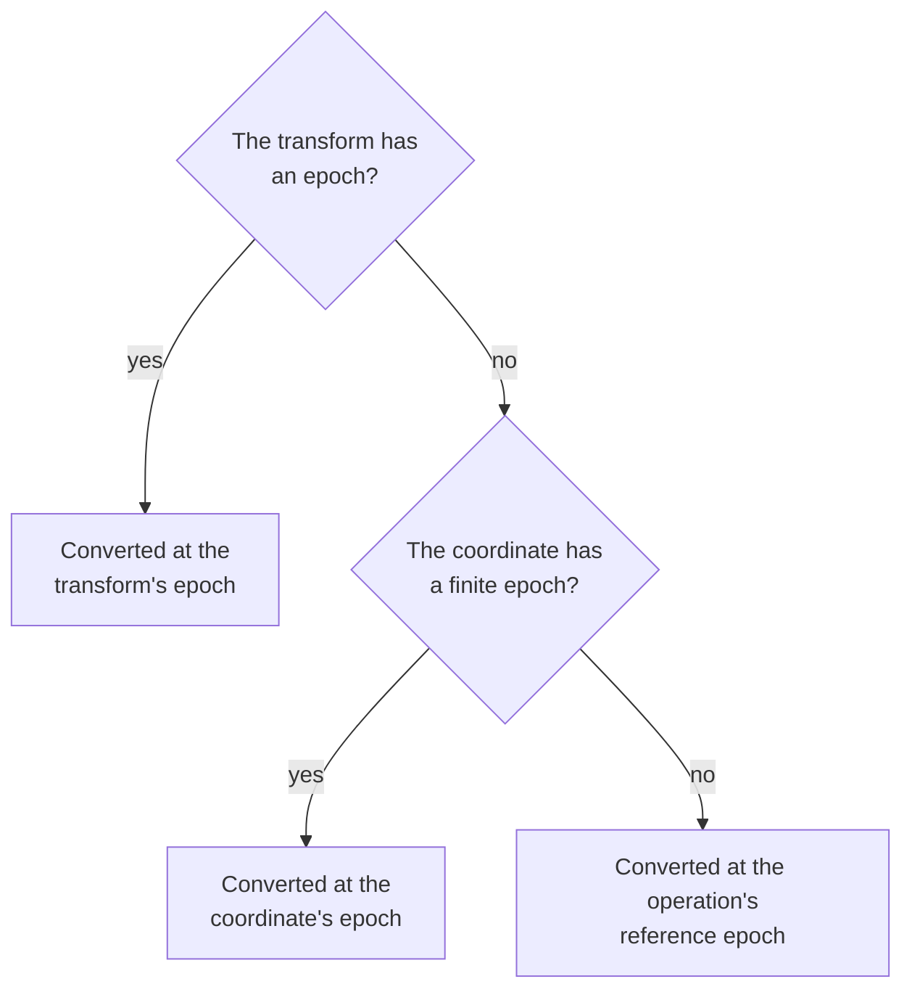
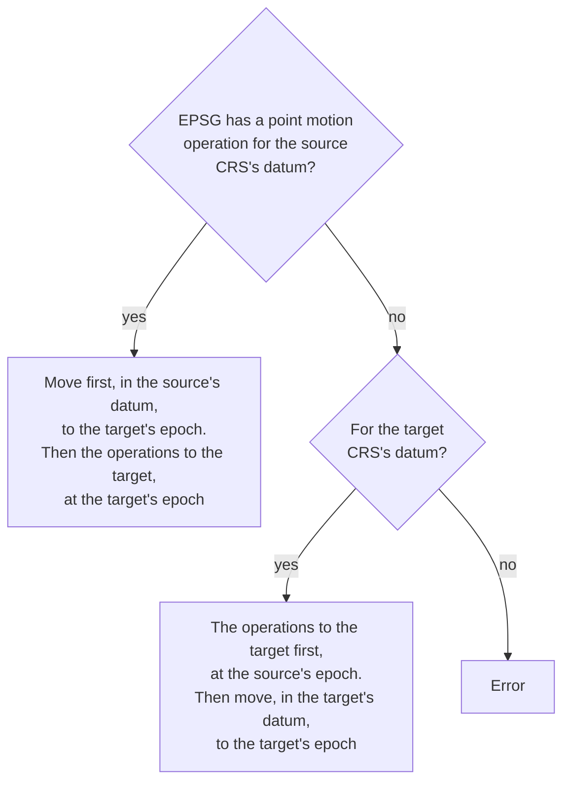
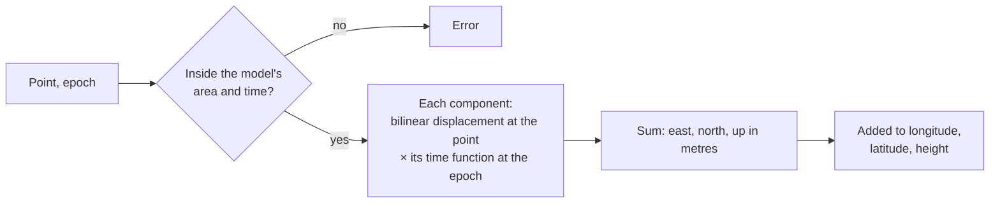

# Reprojection

> **Status: adopted 2026-10-17. Levels 1 and 2 are implemented** in
> `crates/xeibe-reproject`, **and level 3** (2026-10-18): horizontal,
> geocentric and vertical grids, with vertical, compound and engineering
> CRSs. **Reads convert** with a target CRS (2026-10-20,
> [geometry.md](geometry.md#reprojection), decision 7). The numbers below come from
> EPSG 13.103/13.106, PROJ 9.8.1 and pyproj 3.8.0.

A native, pure-Rust reprojection engine that works from the CRS data in
`xeibe-crs`, keeping the "no C dependencies, runs on WebAssembly" goal from
[README.md](README.md#goals). It comes in three levels. Each level is defined by
how it is validated, not by its size.

Geometry types the engine can't reproject exactly (GML curves: arcs, circles,
clothoids, …) fail with a clear error. They are never linearised silently.

## What the CRS data does and doesn't contain

The PROJJSON in `xeibe-crs` describes each CRS: datum, ellipsoid, prime meridian,
projection method and parameters, axes and units. The generator already decodes
EPSG's sexagesimal angle packings into decimal degrees. That is everything needed
to convert between CRSs on the **same datum**.

It does **not** contain datum transformations, i.e. how one datum relates to
another. EPSG publishes those as separate coordinate operations (2,776
Transformations and 220 ConcatenatedOperations in 13.103), and
`scripts/gen_crs_tables.py` doesn't extract them yet.

## Level 1: projections within one datum

### Scope

- A parser for the PROJJSON subset that EPSG produces.
- Axis order and direction (`FirstAxis`), units, prime meridians.
- Geographic ↔ geocentric conversion.
- Projection methods, in order of coverage across the 5,419 projected CRSs in
  EPSG 13.103:

  | Method | CRSs |
  |---|---|
  | Transverse Mercator (Poder/Engsager series, as in PROJ, not the short series) | 3,887 |
  | Lambert Conic Conformal (2SP, 1SP) | 1,200 |
  | Albers, Cassini, Polar Stereographic A/B, LAEA, Hotine A/B, Oblique Stereographic, Mercator, Krovak variants | ~180 |
  | 30 other methods | ~150 |

  The first two rows cover 94%, and about a dozen methods cover more than 98%.
- Coordinates are transformed in place in GeoArrow coordinate buffers. Envelopes
  are reprojected by densifying their edges, not by transforming two corners.

This level covers data that stays on its datum, e.g. ETRS89 geographic
(EPSG:4258), PL-1992 (EPSG:2180), UTM/ETRS89 (EPSG:25832–25835) and LAEA Europe.
Not everything that looks like one family is one datum, though:

- ETRS89 ↔ WGS 84 is a (null) transformation in EPSG, so level 2.
- PL-2000 (EPSG:2176–2179) is on ETRF2000-PL since EPSG 12, a member of the
  ETRS89 ensemble rather than the ensemble itself, so PL-1992 ↔ PL-2000 is
  level 2 as well. EPSG has no direct operation; xeibe passes coordinates
  unchanged between the member and its ensemble, good to the ensemble's
  0.1 m. PROJ goes through WGS 84 with two null transformations (stated 2 m),
  which gives the same coordinates.

### API

`Crs::from_epsg(code)` or `Crs::from_projjson(json)` (or
`Crs::from_projjson_value` for PROJJSON already parsed), or
`Crs::from_user_input(text)` for text in any form pyproj's
`CRS.from_user_input` takes: EPSG codes in their usual spellings (`2180`,
`EPSG:2180`, OGC URNs and URLs, `EPSG:2180+9650`), OGC's CRS84, CRS83 and
CRS27, EPSG names and aliases, Esri's old codes of EPSG CRSs
(`ESRI:102100`), PROJ strings (read as CRSs, `+type=crs` or not), WKT and
PROJJSON (`user_input::parse` says which a text is without reading it), then
`Transform::new(&src, &dst, AxisOrder::EastFirst)` and `convert`,
`convert_xy`, `convert_xyz` or `convert_interleaved` on GeoArrow-shaped buffers,
in place. Heights take part when a CRS has them: a geographic 3D or compound
CRS (`Crs::compound(&horizontal, &vertical)` for a pair EPSG doesn't name,
see level 3). `AxisOrder::EastFirst` is the order xeibe writes (first two values
swapped for a northing-first CRS); `Authority` is the CRS's own. Two CRSs on
different datums go through level 2; when no transformation applies, the error
is `NoTransformation`. `operations()` lists the candidates and
`operation_for(x, y, z)` names the one a coordinate goes through.
`operation_info()` describes each candidate, best first: its name, the EPSG
operation it is (if one) and the transformations it runs, accuracy, area of
use and grid files, and its `chain`: every step with PROJ's name, what it is
(an EPSG operation, a map projection, one of PROJ's null operations to an
ensemble member, a change on one datum) and the CRSs it runs between. `operation_index_for(x, y, z)` gives a coordinate's
candidate by its index there, and `with_operation_index(i)` makes the
transform through that candidate alone, for every coordinate (PROJ's
`TransformerGroup` members; its inverse runs the same operation back).
`explain_point(x, y, z)` tells how a coordinate's candidate was chosen:
for each candidate, whether its area contains the point (as the choice
tests it, in the source CRS) and what became of it: chosen, the fallback
or the only one (used whatever their area), passed over for another and
why (less accurate, a larger area, offshore…), outside, failed, not
reached. It runs the same choice as `convert`, which pays nothing for it
(a generic recorder, `select/explain.rs`).
`trace_point(x, y, z)` gives each step the coordinate went through, with
the CRS and the coordinates after it: the projections, the operations
between datums (EPSG's code, PROJ's name, whether the height was kept),
the horizontal position kept and put back around an operation on
heights, a Bound CRS's transformation to its hub, and whether the third
value is an ellipsoidal or a gravity-related height. The step loop
tells the same recorder what it runs (`select/trace.rs`), so the last
step is `convert`'s result; a grid's shift is the difference across its
step.
`Crs::equivalent(&other, ignore_axis_order)` compares two CRSs' definitions
(datum, ellipsoid, prime meridian, projection method and parameters, axes
and units) whatever their names and ids, to PROJ's relative 1e-10, as
`proj_is_equivalent_to` does: ellipsoids by their semi-major axes, then
their inverse flattenings where both are given by one, else their
semi-minor axes, which alone would make GRS 1980 WGS 84 (0.1 mm apart).
`equivalent_parts` compares an ellipsoid, a prime meridian or a datum on
its own the same way. A coordinate
that can't be converted is an error naming its index; NaN (GeoArrow's empty
point) passes through.
`convert_bounds` converts a bounding box as PROJ's `proj_trans_bounds` does,
by densifying its edges (21 points per edge by default), and handles boxes
across the antimeridian and around a pole.

### Validation

1. **IOGP Guidance Note 7-2 worked examples** for each method. These are published
   values, independent of PROJ.
2. **PROJ's `test/gie` suites** (22 files, ~700 KiB, MIT). Port the vectors for
   the methods we implement.
3. **Differential test against PROJ for every EPSG CRS we claim to support:**
   - Points per CRS: a grid over the area of use, its edges and corners, and
     seeded random points.
   - Both directions, forward and inverse.
   - Fixed tolerances per method, e.g. 1 mm projected and 1e-9° geographic.
   - Points outside the area of use form a separate set with documented
     tolerances.
4. **Round-trip property tests** (forward then inverse), independent of PROJ.
5. **EPSG version mismatch** doesn't arise at this level: the oracle is given
   the very PROJJSON `xeibe-crs` embeds, not its own `proj.db` definitions, so
   the vectors test the math and nothing else.

How 3 is run: `scripts/gen_reprojection_vectors.py` writes PROJ's results for
12 points per CRS (a 3 × 3 grid over the area of use plus three seeded random
points), forward and inverse.

- A committed subset, a few CRSs per method plus the CRSs xeibe's data uses, is
  in `tests/data/reprojection/vectors.jsonl` and runs with every `cargo test`.
- `--all` writes every projected and geocentric CRS to `target/`, for
  `cargo test -p xeibe-reproject -- --ignored` before a release or after an
  EPSG update.
- Tolerances are 1 mm for projected and geocentric coordinates and 1e-9 of the
  angular unit for geographic ones.

Result on 2026-10-17: 38 projection methods are implemented. Every projected
CRS PROJ can convert from EPSG's definition (6,594, deprecated ones included)
and all 303 geocentric CRSs match PROJ, forward and inverse. Since
2026-11-14, so are the five EPSG methods PROJ can't convert (below), so
every live EPSG CRS converts. Most methods agree
to within 0.1 µm. The exceptions are Krovak (1 µm), Transverse Mercator
(0.14 mm) and TM South Orientated (25 µm), where the worst cases come from the
Bessel Namibia ellipsoid below. A unit test also checks that
`AxisOrder::EastFirst` swaps exactly the CRSs `xeibe-crs` marks `NorthOrLat`.

Polar CRSs define their axes along meridians ("south along 45°E"). Each
CRS's two horizontal axes are held as a 2 × 2 matrix over (east, north),
and for a projected CRS whose two axes point the same way (both south, or
both north, along meridians) that matrix is PROJ's
(`addUnitConvertAndAxisSwap`): the projection's easting and northing as
they are, or swapped when the axes are named northing then easting,
whatever the meridians say. For EPSG's polar CRSs the meridians agree.
PROJ's own PROJ strings name 90°E and 180°E whatever the projection's
origin (`+proj=stere +lat_0=90 +lon_0=-39`), and until 2026-10-31 such a
CRS, read from a PROJ string or from the PROJJSON pyproj writes for one,
was turned by its origin, hundreds of kilometres off. `AxisOrder::EastFirst` swaps them as PROJ's
`always_xy` does (`mustAxisOrderBeSwitchedForVisualization`): of the polar
CRSs only UPS North and South (N,E) and RSPS2000. The others are easting
first as written: EPSG:3031's "E" points north along 90°E, its "N" north
along 0°E. Northing then westing (Faroe Lambert, old Greenland zones, Astra
Minas) is kept as it is too. Until 2026-10-26, any CRS whose first axis
pointed north was swapped, which turned 31 Antarctic CRSs (3031, 3976,
EASE-Grid 2.0 South…) and those northing-westing ones round, and left UPS
North (N,E) as it was.

Known differences from PROJ, kept because xeibe follows EPSG:

- **Rounded built-in ellipsoids.** PROJ swaps some EPSG ellipsoids for its
  own built-in ones. For Bessel Namibia (GLM), EPSG gives a = 6377397.155
  German legal metres = 6377483.86528 m. PROJ's `bess_nam` is 6377483.865 m.
  Results differ by up to 0.15 mm, and the angular tolerance for those CRSs is
  2e-9.
- **Exact inverses where PROJ's is a truncated series.** PROJ's inverses of
  Laborde Oblique Mercator and Colombia Urban don't quite undo their forward
  formulas (off by up to 8e-8° and 4e-9°). Here a few Newton or fixed-point
  steps on the forward finish the job, so a round trip returns its input. The
  results differ from PROJ's inverse by under 1 cm (Laborde) and 1 mm
  (Colombia Urban).
- **Swiss Oblique Mercator.** Like PROJ, Hotine Oblique Mercator with an
  azimuth and a skew-grid angle of 90° uses the `somerc` formulas, chosen by
  the parameter values, not by code. This matters for EOV (EPSG:23700), where
  the two differ by 9 cm.
- **Krovak's cone axis.** PROJ ignores EPSG's co-latitude of the cone axis
  and uses the defining 30°17′17.30311″. EPSG stores it as 30.1717303
  (sexagesimal), one digit short, which moves points by up to 3 mm. The
  defining value is kept here too; the other Krovak parameters, including
  Modified Krovak's coefficients, come from EPSG.

Methods PROJ can't convert from EPSG's definition have no vectors:

- Bonne (South Orientated) (EPSG:2963, 5017) is implemented and checked
  against PROJ's `bonne` given a PROJ string, in a unit test.
- Five methods PROJ has no mapping for are implemented from EPSG Guidance
  Note 7-2 (2026-11-14) and checked against EPSG's worked examples, or
  against PROJ's results for what they are made of where EPSG gives none
  (`tests/it/epsg_examples.rs`):
  - Lambert Conic Conformal (West Orientated) (15 Greenland CRSs): the 1SP
    formulas with W = FE − r sin θ; with the false easting 0, PROJ's `lcc`
    easting negated.
  - Polar Stereographic (variant C) (Terre Adélie, 2 CRSs): variant B with
    its false origin on the standard parallel.
  - Lambert Conic Near-Conformal (Deir ez Zor / Levant Zone): the
    meridional arc cut to its cubic term; the reverse solves EPSG's two
    equations by iteration rather than with its 3 mm shortcut.
  - Tunisia Mining Grid: linear in grads from Paris, a kilometre of
    northing worth 0.010015 grad north of the false origin and 0.01002
    south.
  - Transverse Mercator Zoned Grid System (WGS 84 / UTM grid system, north
    and south): each point in the zone its longitude falls in, the zone
    number times a million leading the easting; each zone is its UTM CRS.

Since 2026-10-31 the projections only PROJ defines (Robinson, Mollweide,
Geostationary Satellite, …) and the four EPSG methods no EPSG CRS uses
(Orthographic, Equidistant Conic, Vertical Perspective, Mercator
(Spherical)) are implemented as well, each a port of PROJ's code checked
against PROJ over the whole globe, forwards and back
([pyproj-phase3.md](pyproj-phase3.md#projs-own-methods)). Mercator
(Spherical) and Mercator (1SP) (Spherical) are on the conformal sphere at
the latitude of origin, as EPSG has it; PROJ (`merc +R_C`) sets its sphere
up before it reads `lat_0`, so it always takes the equator's
([pyproj-compat.md](pyproj-compat.md#deliberate-divergences-from-pyproj),
divergence 10).

## Level 2: datum shifts with automatic selection

**Implemented** (2026-10-17): `Transform::new` between CRSs on different datums
chooses the transformation per coordinate as PROJ does, among EPSG's operations;
`Transform::via(src, dst, code)` forces one operation instead.

### Scope

- `scripts/gen_crs_tables.py` exports EPSG's operations into
  `crates/xeibe-crs/data/operations.bin` (`xeibe_crs::operations_json`), the way
  PROJ's `build_db.py` imports them: only the operations PROJ imports, its
  supersession rules, concatenated operations only when every step exists,
  parameters in SI units. Alongside: geodetic CRSs, datums (publication dates as
  PROJ derives them, ensembles with their accuracy, dynamic flag), areas of use with
  PROJ's names (the extent description) and each CRS's first area of use, in
  PROJ's domain order.
- Methods (`src/operation/`): the Helmert family in its geocentric, geog2D and
  geog3D domains (geocentric translations, Position Vector, Coordinate Frame,
  Molodensky-Badekas, full-matrix Coordinate Frame, time-dependent ones at the
  coordinates' epoch or, without one, their reference epoch: see
  [Coordinate epochs](#coordinate-epochs)), longitude rotation, geographic
  offsets, and the plane
  similarity, affine and grid-offset transformations between projected CRSs.
- Selection (`src/select/`): a port of PROJ's search, filter, sort and per-point
  choice; see [Implementation](#implementation). `Transform::with_selection`
  takes the options of PROJ's operation factory context that pyproj passes
  on: an area of interest, which replaces the CRSs' areas as the one
  operations must intersect and are ranked by, and a minimum accuracy
  (`Selection`; [pyproj-phase2.md](pyproj-phase2.md#selection-area_of_interest-accuracy-only_best)).
  Their vectors are `selection-options.jsonl` (`--options`).
- Not in level 2: grid-based operations and vertical and compound CRSs (both
  level 3). Operations that move coordinates to another epoch (point
  motion) and deformation models read grids too: see
  [Coordinate epochs](#coordinate-epochs).
- The operation a coordinate took is not written into output metadata; a
  read's report lists the candidates per srsName.

### Coordinate epochs

**Implemented** (2026-11-14). In a dynamic CRS (ITRF2014, a WGS 84
realization) the ground moves a few centimetres a year, so coordinates are
only complete with their epoch: the date they are valid for, as a decimal
year (2024.5). EPSG's time-dependent Helmert transformations (methods 1053
and 1056 in the data, 200 operations; 1054, 1055, 1057 and 1058 are their
geographic-domain forms) give a rate for each of the seven parameters and a
reference epoch, and their parameters for a coordinate are
`P + rate × (epoch − reference epoch)`.

The epoch comes in two ways, which are PROJ's:

- **With the transform**, for all its coordinates:
  `Transform::with_epochs(source, target)`. PROJ takes it as a CRS with an
  epoch (`ITRF2014@2024.5`, WKT's `COORDINATEMETADATA`, `cs2cs --s_epoch`).
  This is the form for xeibe's own data: a GML file or a GeoArrow array has
  at most one epoch, and no slot for one per vertex. `convert`, the buffer
  and Arrow conversions, `trace_point` and `explain_point` all run at it.
- **With each coordinate**: `Transform::convert_at(x, y, z, epoch)`,
  `convert_xyt` and `convert_xyzt`. This is PROJ's fourth value, `t`, and
  pyproj's `tt`, which `xeibe-proj` passes on.

Without either, a time-dependent Helmert runs at its reference epoch, the
rates unused, as it did before and as PROJ does. A deformation model has no
such epoch and fails ([below](#deformation-models)), as do velocities to a
target epoch ([below](#velocities-to-a-target-epoch)).

PROJ's rules, kept:

- **The transform's epoch replaces a coordinate's own.** PROJ writes the
  CRS's epoch into the pipeline as `+proj=set +v_4=2030` before the
  Helmert, which overwrites `t`. A point at 2025 through a transform at
  2030 is converted at 2030 (0.29 m away, ITRF2014 to GDA2020), without a
  word from PROJ. xeibe gives the same result;
  `Transform::overrides_epoch(epoch)` tells a caller that takes both kinds
  of epoch that it would happen, so that it can warn. Nothing in the
  workspace takes both yet: the CLI, the `xeibe` Python module and the web
  pages take no epoch, and pyproj's API has none for a CRS.
- **One epoch counts for both CRSs.** ITRF2014 at 2030 to GDA2020 and
  GDA2020 to ITRF2014 at 2030 both run at 2030. `Transform::inverse` moves
  each epoch with its CRS.
- **Only a dynamic CRS takes an epoch** (`Crs::is_dynamic`: its datum has a
  frame reference epoch, or it is WGS 84, the ensemble or the datum), or a
  static one that EPSG has a point motion operation for (the realizations
  of NAD83(CSRS)). For any other static CRS, `with_epochs` is an error, as
  PROJ's "Coordinate epoch should not be provided for a static CRS".
- **The epoch has no say in the selection.** Which operations there are and
  which one a coordinate takes are the same with and without it, but for a
  coordinate a deformation model can't place: without an epoch, or at one
  outside the model's time.
- An epoch within a millionth of a year of a thousandth is that thousandth
  (`getRoundedEpochInDecimalYear`).

Deviations from PROJ:

- **An epoch that isn't finite is none.** PROJ's "none" is `HUGE_VAL`
  (`inf`); NaN and `-inf`, which give PROJ a NaN result, are read the same.

The time-specific Helmert methods 1065 and 1066, which PROJ can't run,
run only when forced ([Beyond PROJ](#beyond-proj)).

#### Between two epochs: point motion operations

**Implemented** (2026-11-14). Two different epochs
(`with_epochs(Some(2010.0), Some(2002.0))`, PROJ's `EPSG:8254@2010` to
`EPSG:8254@2002`) ask for more than a conversion at an epoch: the
coordinates are to be moved in time, as the ground moved between the two.
That takes a **point motion operation**: an operation from a CRS to itself
that reads the velocity of each point from a grid and applies it over the
time between the epochs. A time-dependent Helmert can't do it: it changes
the frame at one epoch.

EPSG has six live ones. The three whose grid PROJ-data has are run, as PROJ
runs them (`+proj=deformation +dt=…` on geocentric coordinates, between
`+proj=set +v_4=` steps for the two epochs):

| EPSG | Operation | Method | CRS | Grid |
|---|---|---|---|---|
| 9483 | Canada velocity grid v7 | 1141, NTv2_Vel | NAD83(CSRS)v7 | `ca_nrc_NAD83v70VG.tif` |
| 8676 | Canada velocity grid v6 | 1141 | NAD83(CSRS)v6 | `ca_nrc_NAD83v6VG.tif` |
| 10808 | NKG_RF17vel | 1139, Gravsoft | ETRF2014 | `eur_nkg_nkgrf17vel.tif` |
| 10707 | Canada velocity grid v8 | 1141 | NAD83(CSRS)v8 | not in PROJ-data |
| 9375 | Indonesian Deformation Model 2020 | 1086, geocentric velocities | SRGI2013 | not in PROJ-data |
| 10323 | New Caledonia velocity model 2015 | 1120, geocentric velocities | RGNC15 | not in PROJ-data |

Which one, and where in the route, are PROJ's rules
(`createOperationsWithDatumPivot`, `createOperationsGeodToGeod`):

- The motion runs in the geographic 3D CRS of its operation, with the
  conversions PROJ names around it: from a geocentric CRS and back, from a
  geographic 2D CRS and back (at height 0), a projection undone first.
  With a transformation in the route it sits next to it, in the CRS the
  transformation works on: from ITRF2014 (geog2D) to NAD83(CSRS)v7
  (geog2D), the Helmert's geocentric result is converted to geographic 3D,
  moved, and converted back, and only then to geographic 2D.
- It is named as PROJ names it, `Canada velocity grid v7 from epoch 2010
  to epoch 2002`, and `operation_info` gives its code, grid and accuracy
  with the rest of the route's, `time_dependent` set.
- The candidates and the per-point choice are those of the transform
  without epochs, each with the motion added: the route's area of use is
  then also within the velocity grid's.
- `Transform::inverse` exchanges the epochs and makes the motion the other
  way; `with_operation_index` keeps it.
- The grid is loaded like any other (`grid_requests`, level 3). With
  `Grids::None`, or for an operation whose grid PROJ-data doesn't have,
  `with_epochs` is an error that names the operation and the grid.

Deviations from PROJ:

- **Without a point motion operation for either CRS, two epochs are an
  error** (`Error::Epoch`). PROJ converts at the source's epoch and leaves
  the coordinates there, whatever the target's says. For Indonesia's and
  New Caledonia's CRSs the error names EPSG's operation, which xeibe can't
  run (below).
- **The motion is made wherever a CRS has one.** PROJ adds it only where
  it looks for the CRSs of each datum to join: between two CRSs that one
  registered operation joins directly (ITRF2014 to NAD83(CSRS)v7, both
  geocentric: `EPSG:7789@2010` to `EPSG:8253@2002`) it runs the Helmert at
  2010 and stops. xeibe makes the same route as between the geographic
  CRSs, which PROJ does make.
- **Projected CRSs work.** PROJ 9.8.1 crashes on a projected CRS with two
  epochs (and on a few other pairs, EPSG:8254@2010 to EPSG:4955@1997 among
  them); here the projection is undone first.
- **A Bound CRS with two epochs is an error**, not attempted.

Not implemented, and why:

- **Canada velocity grid v8** (EPSG:10707). Its method is the one above;
  only the grid is missing. NRCan publishes `NAD83v80VG.gvb` behind its
  sign-in, PROJ-data hasn't converted it, and PROJ fails with "File not
  found". It will work once PROJ-data has it and
  `scripts/gen_grid_catalog.py` is rerun.
- **Indonesia** (EPSG:9375, method 1086) and **New Caledonia**
  (EPSG:10323, method 1120): grids of geocentric X, Y, Z velocities, in
  formats of their own (`v3_dm_grd01_xyz.dat`, `grmmncl08.tac`). EPSG gives
  the formula (add `velocity × years` to the geocentric coordinates), but
  the files aren't published anywhere found (2026-11-14: not in PROJ-data,
  no download on BIG's or DITTT's sites), their formats aren't documented
  in EPSG, and PROJ has no method for them, so there would be neither data
  nor an oracle to test a reader against.

#### Deformation models

**Implemented** (2026-11-14): EPSG's *New Zealand Deformation Model*
(method 1079), `ITRF96 to NZGD2000 (1)` to `(7)`, the seven published
versions of Land Information New Zealand's model
(`nz_linz_nzgd2000-20180701.json` the latest). NZGD2000 is ITRF96 at
2000.0 with the motion of the plates and the displacement of every large
earthquake since taken out, so the operation needs to know **when** a
coordinate in ITRF96 was measured: it can't run without an epoch (nor can
[velocities to a target epoch](#velocities-to-a-target-epoch)).

A model is a JSON master file that lists components. Each has a grid of
displacements (a GeoTIFF of its own, with nested grids down to 200 m near
the faults), and a function of time that scales it: a velocity, a step at
an earthquake, a ramp for the slow slip after one. A point's displacement
is the sum over the components.

- `src/grid/defmodel.rs` is a port of PROJ's `defmodel` (the forward and
  its iterated reverse); `src/operation/defmodel.rs` runs it as PROJ
  writes EPSG's operation, `+inv +proj=defmodel`: PROJ-data's model goes
  from NZGD2000 to ITRF96.
- **The grids load in two steps.** The transform knows the master file;
  the grids it names are known once that is loaded. `grid_requests` asks
  for the master file first, then for the grids' headers, then for their
  blocks, and `load_grids` and `load_grids_from_dir` loop until nothing is
  asked for, as for any grid. `Transform::grids` lists the component grids
  once the master file is in (32 for the latest model, 4.3 MB in all).
- **Without an epoch it fails**: `CoordinateError::MissingEpoch`, on the
  coordinate, as PROJ returns no result ("missing time"). The epoch comes
  with each coordinate or with the transform, on ITRF96 (NZGD2000 is
  static). `OperationInfo::needs_epoch` tells before any coordinate is
  converted; the reproject page, which takes no epoch, says so on the
  operation's card.
- **Outside the model**: `CoordinateError::OutsideGrid` beyond its area
  (around New Zealand, 158°E to 166°W and 58°S to 25°S), `EpochOutOfRange`
  beyond its time (1900 to 2050).
- `operation_for`, `operation_index_for` and `explain_point` answer for a
  coordinate at the transform's epoch, and so have no operation for one
  through a deformation model on a transform without an epoch.
- Of the format, what New Zealand's files use is read. A model with
  offsets in degrees, geocentric addition or geocentric bilinear
  interpolation, or defined in a projected CRS, is refused as an invalid
  grid file: PROJ-data has none to check a reader against.
- To a CRS without heights (NZTM), `convert` hands back the height given,
  as everywhere; PROJ's pipeline lets the model's vertical shift through
  into the third value.

#### Velocities to a target epoch

**Implemented** (2026-11-14): EPSG's *Geocentric translations using NEU
velocity grid (gtg)* (method 1144), whose one operation is "ETRF2014 to
NKG_ETRF14 (1)", the first step of the Nordic Geodetic Commission's
transformations from ITRF2014 and ITRF2020 to the Nordic and Baltic
realizations of ETRS89 (14 concatenations, "ITRF2014 to ETRS89-SWE
[SWEREF 99] (1)" among them). It takes a point of ETRF2014, a dynamic CRS,
from the coordinate's epoch to NKG_ETRF14's 2000.0 by the NKG_RF17vel
velocity grid. EPSG gives its source epoch as −999 years, its flag for "the
coordinate's epoch, user input" (parameter 1068's description), and its
target epoch as 2000.0.

- **As PROJ writes it**: `+inv +proj=deformation +t_epoch=2000`, the
  velocities over (epoch − 2000) years taken off. The reverse, NKG_ETRF14
  to ETRF2014 at an epoch, adds them by the velocity at the point.
- **Without an epoch it fails** (`MissingEpoch`, `needs_epoch`), as in
  PROJ, and the choice goes on to the next candidate: from ITRF2014 to
  SWEREF 99, a coordinate with an epoch takes the NKG route, one without
  takes what PROJ takes then.
- **Not marked time-dependent for the search**, as PROJ marks only the
  time-dependent Helmerts (`requiresPerCoordinateInputTime`): the routes
  through it compete as any others.
- PROJ refuses an operation of the method with a source epoch of its own;
  so does xeibe. EPSG has none.

### Why selection is the hard part

Finding a path is easy: about 8k CRSs, 3k operations, and useful paths rarely
longer than three hops. The difficulty is choosing among valid candidates.

- **Many candidates per pair.** 330 CRS pairs have more than one direct
  transformation. NAD83 → WGS 84 has 52. Pulkovo 1942(58) has 10 to
  WGS 84/ETRS89, with stated accuracies from 1 m to 10 m, mostly fitted for
  different countries.
- **The right one depends on where the data is.** A 1 m transformation fitted for
  one country is wrong in the next. EPSG's accuracy is a single, often
  conventional, number for the whole area of use.
- **Edges aren't uniform.** Projected CRSs are unprojected to their base CRS
  first. Methods defined in the geog2D domain vs the geocentric domain need
  geographic ↔ geocentric adapters. Concatenated operations list their steps
  without directions, so each step's direction is inferred by matching CRSs.
  Compound and vertical CRSs need their steps in a particular order.
- **Semantic traps.**
  - Position Vector and Coordinate Frame use the same 7 parameters with opposite
    rotation signs.
  - "WGS 84" and "ETRS89" are datum ensembles, so a transformation to "WGS 84"
    is good to about 2 m.
  - Time-dependent operations need a coordinate epoch, which GML data almost
    never has ([Coordinate epochs](#coordinate-epochs)).

### PROJ's selection rules

Read from PROJ 9.8.1 (the port follows all of it, see [Implementation](#implementation)):
[`coordinateoperationfactory.cpp`](https://github.com/OSGeo/PROJ/blob/9.8.1/src/iso19111/operation/coordinateoperationfactory.cpp)
(`SortFunction`, about line 900) and
[`trans.cpp`](https://github.com/OSGeo/PROJ/blob/9.8.1/src/trans.cpp)
(`pj_get_suggested_operation`).

**1. Filters, before ranking:**
- the operation can be run (PROJ: exported to a pipeline)
- not deprecated
- not superseded (`discardSuperseded` is on by default)
- the area of use matches the area of interest
- the grids are available

**2. Ranking.** One comparison function. The source warns that "the order of
the comparisons is extremely important". The criteria, in order:

1. exportable to PROJ (the method is implemented)
2. not a ballpark
3. no ballpark vertical step
4. not a null transformation
5. all grids available locally
6. all grids known to the database
7. accuracy known
8. if neither accuracy is known, grid-based first
9. **larger area of use intersecting the area of interest** (the data's bbox
   when one is given)
10. **better accuracy**
11. at equal accuracy, the one without grids
12. the ETRF2000-hub rule from IOGP 373-07-7 (ETRS89 realization to realization)
13. fewer steps
14. fewer pipeline steps
15. a special case parsing "Ballpark geographic offset from A to B" names
16. shorter name

Coverage of the data comes **before** accuracy.

**3. Per point**, at transform time. Among the ranked candidates, PROJ takes the
one whose area of use (converted into the source CRS) contains the point and has
the best accuracy. On a tie it takes the smaller area. Areas named "offshore" are
skipped in favour of onshore ones, and there are exceptions for unknown area
names and "priority" operations. If the chosen one fails, it tries up to two
more; if none contains the point, the first candidate is used anyway.

These are about 20 explicit, deterministic rules, not 2, and their output is a
discrete operation code. That makes them practical to port and to test
exhaustively.

### Implementation

The port follows PROJ 9.8.1's code paths, with the registry in place of
`proj.db`:

| PROJ | xeibe |
|---|---|
| `createOperations`, `createOperationsFromDatabase`, `findOpsInRegistryDirect`, `findsOpsInRegistryWithIntermediate`, `createOperationsWithDatumPivot`, `createOperationsDerivedTo`, `createOperationsGeodToGeod`, `hasTooSmallAreas` | `select/search.rs` |
| `factory.cpp`: `createFromCoordinateReferenceSystemCodes`, `createFromCRSCodesWithIntermediates`, `createBetweenGeodeticCRSWithDatumBasedIntermediates` | `select/search.rs` |
| `FilterResults`, `SortFunction` | `select/filter.rs` |
| `ConcatenatedOperation::createComputeMetadata`, `getAccuracy`, `getExtent`, naming of inverses and concatenations | `select/candidate.rs` |
| `GeographicBoundingBox`, `Extent` | `extent.rs` |
| `isSameGeodeticDatum` (replaced: EPSG codes and ensemble membership, see the deviations) | `datum.rs` |
| `build_db.py`'s `create_datumensemble_transformations` (PROJ's null operations between a datum ensemble and its members) | `registry.rs` |
| `crs_to_crs.cpp` (alternatives, areas in source CRS), `trans.cpp` (per-point choice, retries, fallback) | `select/mod.rs` |

Details that turned out to matter, each found by the differential:

- **Candidates carry PROJ's names** (`Inverse of …`, concatenations joined
  with ` + `, synthetic `Null geographic offset from …`). They no longer take
  part in the ranking (see the deviations), but the test matches operations
  to PROJ's by name.
- **PROJ's pipeline optimiser.** Between consecutive geog2D-domain operations
  the transformed height carries over (PROJ drops the `pop`/`push` pair), and a
  Helmert followed by its own inverse cancels exactly. Run step by step, both
  leave millimetres. A Helmert of zeros between GRS 1980 and WGS 84 is no
  step at all when nothing geocentric is next to it, which xeibe
  generalises (see the deviations).
- **What PROJ can run.** Time-specific Helmert methods (1065, 1066) have no
  PROJ pipeline and never compete (xeibe runs them only when forced);
  time-dependent ones run at their reference epoch when coordinates have no
  epoch, as in PROJ.
- **PROJ's own operations between a datum ensemble and its members.**
  PROJ's `build_db.py` adds a null operation between the CRS of each datum
  ensemble and the CRS of each of its members ("WGS 84 to WGS 84 (G2296)",
  "ETRS89 to ETRF2014", "BI height to ODN height"), with the ensemble's
  accuracy and the member CRS's area, unless EPSG has an operation "A to B
  (1)" between them: 91 for EPSG 13.106. Its search uses them anywhere in a
  route, and when every route it found goes through one, it also looks
  through other datums' CRSs (`useOnlyIntermediateCRSThroughDatumEnsembleNullOp`).
  The registry adds the same 91, with codes from `PROJ_CODES` up, and they
  are never reported as EPSG operations. Before, xeibe's tests ran PROJ on
  EPSG's operations only, which hid them, while PROJ's default uses them:
  ITRF2008, ITRF2014 or ITRF2020 to WGS 84 went through NAD83(2011)'s
  Puerto Rico operation, outside its area, and moved points by 1 to 11 m,
  where WGS 84 (G2296) is aligned to ITRF2020 at centimetres; 53 of 55
  random EPSG pairs PROJ joins this way had no route at all.
- **Routes that differ only in their CRSs' dimension.** The same
  operations reached through geog2D or geog3D CRSs give the same pipeline;
  PROJ keeps the first by its name order, which prefers the CRSs of the
  source's dimension. xeibe ranks by that directly (see the tie-breaks).
- **A CRS EPSG doesn't have, on a datum it does** (a projection of one's
  own on WGS 84, from WKT or a PROJ string, that identification finds no
  EPSG CRS for) is converted from the EPSG geographic CRS on its datum
  (3D for a 3D CRS; the lowest code, live ones first), as PROJ starts from
  a derived CRS's base: the conversion onto it is the first step. Until
  2026-10-31 such a CRS had no route to another datum at all.
- **An accuracy of 999 is unknown.** EPSG gives 999 m for 34 operations
  whose accuracy it doesn't know, and PROJ's factory drops it. Ranked as a
  known 999 m it sorted ahead of better operations with smaller areas, and
  an offshore one among them could then never be chosen per point
  ("Kalianpur 1962 to WGS 84 (2)", Pakistan - offshore Indus).

### Deviations from PROJ (documented, deliberate)

- **The last tie-breaks use EPSG's data, never names.** When candidates tie
  on area, accuracy, number of operations and pipeline steps, PROJ takes the
  shorter name, then the reverse alphabetical order, and prefers
  "NTF (Paris) to NTF (1)" over "(2)" by name. xeibe takes, in order:
  1. no emulation where EPSG has the operation it emulates: EPSG's remarks
     call some NTv2 grids an "emulation using NTv2 method of" a transformation
     by another method (IGN's geocentric grids for NTF and New Caledonia);
     the generator records that relation. PROJ, by name, takes the original
     one way and the emulation the other; xeibe takes the original both ways
     (only with grids: see level 3);
  2. PROJ's null operation between a datum ensemble and a member rather
     than xeibe's own identity, which stands in only where PROJ has none;
  3. an operation to a vertical CRS rather than its twin to the compound
     CRS: EPSG publishes some geoid models both ways, the second as a
     "reversible alternative", and its remarks sometimes call only one of
     the pair replaced;
  4. fewer operations EPSG's remarks say are replaced ("Replaced by RAF18b
     model", "Replaced by CT code 6866 from 2002-01-01");
  5. fewer operations run against their published direction;
  6. a longitude rotation that agrees with its CRSs' prime meridians. NTF is
     the only case in EPSG: "(1)" uses IGN's Paris meridian, the one EPSG
     defines it with, "(2)" the Royal Geographic Society's, 1.6 m away, and
     EPSG notes "OGP prefers value from IGN Paris";
  7. fewer steps, then fewer CRSs on the way whose dimension isn't the
     source's: the same operations reached through extra null geographic
     offsets, or through geog2D CRSs between geocentric ones;
  8. the route through the realizations EPSG published last (its
     `publication_date`, not the frame reference epoch, which is 1989 for
     every ETRF): ITRF2020 (2022) over ITRF2014 and ITRF2008, ETRF2020
     (2024) over ETRF2000 (2001). Ensembles have no date;
  9. the CRSs the route goes through, by code; between variants of one
     route, the newer variant (EPSG numbers the operations between two CRSs
     in the order it adds them; codes don't always follow);
  10. the EPSG codes. Candidates still equal keep the order the search found
      them in.

  Before 2026-10-22, PROJ's name order decided the last ties, and variant
  numbers were compared across routes, numbers EPSG counts per pair of
  CRSs: ITRF2005 to NAD83(2011) went through ITRF2008 because its operation
  from ITRF2005 is the second EPSG added, 0.18 m from PROJ's route through
  ITRF2020. Rules 2, 3, 7 and 8 give PROJ's choice everywhere the vectors
  reach but one pair, Monte Mario to ED50 through ETRS89 rather than
  WGS 84: both ensembles, undated; the same coordinates.

  Measured on 2026-10-22, 28 of 22,128 points in 5 pairs differ from PROJ:
  Monte Mario, and four where EPSG's remarks side with xeibe's choice or
  call the two equivalent: "MGI 1901 to ETRS89-SVN [D96] (12)" replaces "(1)" (0.25 m);
  for Bogota 1975 to MAGNA-SIRGAS "OGP recommends" the Molodensky-Badekas
  version PROJ passes over (2 mm); two LUREF methods are declared equivalent
  (1 mm); one Slovak route gives the same coordinates. Against all of EPSG's
  remarks that state a preference between two grid-free operations (153
  testable cases, 9 points each), PROJ's order picks the operation EPSG calls
  worse at 121 points, xeibe's at 58, never where PROJ's picks the better
  one. The remaining 58 are offshore operations that PROJ's per-point rule
  (kept) doesn't let displace onshore ones.

- **An object's area of use covers all its usages.** EPSG can give a CRS or
  an operation several areas of use. PROJ takes the first in `proj.db`'s
  order ("large scale" scopes first, then row order, which is the order of
  EPSG's data script), so "WGS 72BE to WGS 84 (1)" counts as World rather
  than "Vietnam - offshore" only by that order. xeibe takes the area that
  contains the others, else their bounding box: 8 operations and 17 CRSs
  have several areas, and the results don't change (the selection vectors
  include every such CRS). PROJ also lists the CRSs on a datum by code
  compared as text; xeibe sorts them numerically, with no change either.

- **Datums are compared by EPSG code, and an ensemble stands in for its
  members.** PROJ compares datum names through EPSG's aliases and its own (old
  EPSG names, short names), so EUREF-FIN, once named "European Terrestrial
  Reference System 1989", is ETRS89 to it, with no step between them. xeibe
  goes through PROJ's null operation between the ensemble and the member
  instead (the same coordinates: 12 points in 1 pair without heights, 56 in
  9 pairs with Norwegian heights on EUREF89). Where PROJ has no such
  operation (between CRSs other than the ensemble's and the member's
  geographic 2D ones, or where EPSG has its own "A to B (1)"), xeibe adds
  an identity of its own, "Ensemble member identity", with the ensemble's
  accuracy: 36 points, all with PROJ's coordinates.
- **Routes through a national realization compete with direct operations.**
  EPSG has replaced many operations to ETRS89 with ones to a country's
  realization of it ("RT90 to ETRS89-SWE [SWEREF 99] (1)", 0.1 m, replaces
  "RT90 to ETRS89 (1)", 0.5 m). When one side is on a datum ensemble, xeibe
  also tries an EPSG operation to a CRS on one of its members followed by the
  step between member and ensemble; PROJ looks for routes through other
  CRSs only when no direct operation exists, or only replaced ones. Measured
  on 2026-10-22, 3 points in 2 pairs take such a route where PROJ doesn't,
  each with a better stated accuracy: MGI 1901 1.0 → 0.4 m (0.18 m), and
  Pulkovo 1942(83) in Bulgaria, where PROJ falls back to an East German
  operation outside its area and xeibe uses the Bulgarian one (1.03 m).
  With grids, HD72 to ETRF2000 (2) (0.015 m against 0.4 m) and GDA94 to
  GDA2020 by grid on to WGS 84 (2.25 m against 3 m) as well. RT90, KKJ,
  GGRS87, SWEREF 99, D96, STRS00, BH_ETRS89 and KOSOVAREF01, which went
  their own way here before, now match PROJ, which reaches the same routes
  through its null operations. A route no coordinate could take is left
  out: one where an operation found directly, without a grid, is at least
  as accurate over the route's whole area (WGS 84 to Poland CS92 through
  each national ETRS89 in reach), so the candidates stay PROJ's there.

- **No ballpark fallback.** When no EPSG operation applies, `Transform::new`
  fails with `NoTransformation`; PROJ would offer a "ballpark" approximation.
  When the reason is that a CRS's datum is unknown (no EPSG datum, as in a
  PROJ string with an ellipsoid but no `+datum`, or one of EPSG's "Not
  specified (based on … ellipsoid)" datums), it fails with `UnknownDatum`,
  which names the datum and says what to give instead: PROJ would shift
  by zero, off by the whole datum shift (54 m for NTF in Paris, 128 m for
  Pulkovo 1942(58) in Warsaw; `docs/pyproj-phase3.md`, decision 8).
- **Grid-based operations are unavailable** with `Grids::None`: they are left
  out as PROJ leaves them out when their grids are missing (`ONLY_BEST=NO`).
  By default (level 3) a grid is available when PROJ-data publishes it.
- **EPSG operations only**, plus PROJ's null operations between datum
  ensembles and their members (above). `proj.db` adds other PROJ-authority
  operations plus ESRI, IGNF, NKG and NRCAN ones that xeibe doesn't have.
- **The inverse transform chooses again** for the opposite direction, rather
  than inverting the chosen list.
- **A Helmert of zeros between two practically equal ellipsoids keeps
  the coordinates**, wherever it is on a route. "NAD83 to WGS 84 (1)",
  "ETRS89 to WGS 84 (1)", EPSG's other zero "to WGS 84" operations and a
  zero `TOWGS84` on such a datum state that two datums coincide, to 1–4 m.
  Run through geocentric coordinates, as EPSG writes the method, they
  would move latitude and ellipsoidal height by up to 0.105 mm, the
  difference between GRS 1980 and WGS 84, whose flattening WGS 84 defines
  through a rounded coefficient. Ellipsoids within 0.15 mm of each other
  in each semi-axis count as one (`SAME_ELLIPSOID_M` in
  `operation/helmert.rs`): of EPSG's, GRS 1980 and CGCS2000 against
  WGS 84 and GEM 10C. The next closest, Clarke 1880 (Arc) and (RGS), are
  0.19 mm apart, and zeros between ellipsoids further apart change the
  ellipsoid as the method says. PROJ gets the same where nothing
  geocentric is next to the step: its optimiser drops a Helmert of zeros,
  then a geocentric round trip between `ellps=GRS80` and `ellps=WGS84`
  (its comment puts the difference at "1e-14 deg"; it is 9e-10°). Next to
  another geocentric step, such as a Bound CRS's Helmert, PROJ's round
  trips cancel the other way and keep the point where it is in space,
  0.1 mm from xeibe's result; `towgs84_transforms_as_proj_does` pins one
  such case. `+nadgrids=@null` is a grid of zeros, and keeps the
  coordinates in both.

### Validation

The oracle is PROJ 9.8.1 (pyproj 3.8.0) on a `proj.db` rebuilt from the same
EPSG release as `xeibe-crs` by `scripts/build_proj_oracle.py`, which runs PROJ's
own `build_db.py` on our EPSG archive. PROJ runs without grids or network, with
ballparks disallowed and `ONLY_BEST=NO`, on a copy of that database with
only EPSG's operations and PROJ's null operations between datum ensembles
and their members (`target/proj-oracle-epsg`), which xeibe has too.
`scripts/gen_transformation_vectors.py` writes two kinds of vectors (a committed
subset in `tests/data/reprojection/`, everything with `--all` into `target/`):

1. **Operation differential**, each EPSG transformation forced
   (`Transform::via` against PROJ's pipeline for that operation), 12 points in
   its area of use. On 2026-10-17: all 1,688 grid-free EPSG transformations of
   the implemented methods match PROJ to within 1e-8 m / 1e-14°, except
   operations whose CRSs xeibe couldn't read then: 102 *Geographic2D with
   Height Offsets* from compound CRSs and one similarity transformation to
   an engineering CRS, all of which match since level 3.
2. **Selection differential**, the main test. 2,690 CRS pairs: every pair
   an EPSG operation joins, every live geographic 2D CRS to WGS 84 and to
   ETRS89, every tenth projected CRS to WGS 84, and every CRS with several
   areas of use to both. For 22,128 points in the area of interest, xeibe
   picks the same operation as PROJ (by name) for every point and gives the
   same coordinates, except through xeibe's own ensemble-member identity
   and PROJ's datum aliases (above, judged by coordinates), the routes
   through a national realization (3 points, listed in the test) and the
   ties broken by EPSG's data (28 points, listed in the test); 846 pairs
   have no usable transformation on either side. These vectors run with
   `Grids::None`. On 2026-10-22, the first run with PROJ's null
   operations: no coordinate failures, and no pair that only one side
   transforms.

3. **Epochs** (`--epochs`, `epochs.jsonl`, `tests/it/epochs.rs`), every
   point at one of five epochs or at none. Each time-dependent Helmert
   transformation forced, forwards and back on PROJ's own result, and the
   automatic choice between the CRSs they join and a few routes with
   other steps (a projection, a geographic 2D CRS, a pivot through an
   ensemble). On 2026-11-14, on the full set: all 200 operations (2,400
   points) match PROJ to within 1e-6 m both ways, and all 4,728 points
   over 394 pairs take PROJ's operation and match to within a millimetre,
   with the epoch on the coordinate and with the same epoch on the
   transform. pyproj has no CRS with an epoch, so PROJ's results with one
   (`cs2cs --s_epoch`, `--t_epoch`, and a point at another epoch) are
   written out in the test.

"Good precision" means choosing the operation with the best accuracy EPSG states.
That is the best signal available, PROJ included, but it remains a proxy.

## Level 3: grids, built natively

### How PROJ does it

- **Definitions** live in `proj.db` (~9.6 MB SQLite), which always ships. Of its
  operations, 1,062 are grid-based and name their grid by file. The
  `grid_alternatives` table (472 rows) maps EPSG's file names to PROJ-data
  files and CDN URLs, for example
  `Model_quasi-geoidy-PL-geoid2021-PL-EVRF2007-NH.txt` →
  `pl_gugik_geoid2021-PL-EVRF2007-NH.tif` →
  `https://cdn.proj.org/pl_gugik_geoid2021-PL-EVRF2007-NH.tif`.
- **Grid files** are the actual offset lattices, as GeoTIFFs in PROJ-data:
  - The pyproj wheel ships none: 16 files, 10 MB, mostly `proj.db`.
  - The `scripts/gdal` image (`ubuntu-full`) bundles all of PROJ-data, 775 MB
    in `/usr/local/gdal-internal/share/proj`.
- **Network access** (PROJ ≥ 7, off by default) reads Cloud-Optimized GeoTIFFs
  from `cdn.proj.org` with HTTP range requests. It fetches only the tiles it
  needs and caches them in `~/.local/share/proj/cache.db` (300 MB by default).
- **When a grid is missing, PROJ downgrades silently.** EPSG:4258+9651 →
  EPSG:4937 at (21.0, 52.2, 100 m) with pyproj 3.8:

  | network | operation chosen | h |
  |---|---|---|
  | off | ballpark vertical, no geoid correction (accuracy unknown) | 100.00 |
  | on | ETRF2000-PL to EVRF2007-PL height (2), GUGiK geoid2021 (0.02 m) | 131.12 |

  The only signal is a Python `UserWarning`.

### Scope

**Implemented** (2026-10-18): grids between geodetic CRSs, then vertical and
compound CRSs with their grids (geoid models, vertical offsets).

- **Grids are PROJ-data's GeoTIFFs**, read natively (`src/grid/tiff.rs`):
  tiled or striped, uncompressed, DEFLATE or LZW, horizontal or floating-point
  predictor, contiguous or separate samples, either byte order, `Int16` to
  `Float64` with GDAL's offset and scale, subgrids in further images, rows
  from the north or the south, pixel-is-point or pixel-is-area. PROJ's
  triangulations and deformation model master files (`.json`) are read
  too. Nothing else is: PROJ-data and the
  CDN have only these, so NTv2 or GTX files in their original formats are not
  supported.
- **Grid names** map from EPSG's file names to PROJ-data's through PROJ's
  `grid_alternatives` (MIT), generated into `src/grid/catalog.rs` by
  `scripts/gen_grid_catalog.py`, in `xeibe-reproject` (which already carries
  PROJ's notice) rather than in `xeibe-crs`. A grid counts as **available
  when the catalog puts it on `cdn.proj.org`**: what PROJ does with network
  access (`KNOWN_AVAILABLE`), and how a grid PROJ-data doesn't publish keeps
  its operation out of the selection (95 of 373 such operations).
- **Methods** (`src/operation/`): NTv2, NTv1 and NADCON (`hgridshift`),
  NADCON5 2D and 3D (`gridshift`, biquadratic), IGN's geocentric translations
  by grid (`xyzgridshift`), velocity grids over the fixed span between the
  CRSs' anchor epochs or the operation's own epochs (`deformation +dt`:
  NAD83(CSRS) realizations; NKG_ETRF14 to the Nordic and Baltic ETRS89
  realizations, with a Helmert or a geocentric grid), and triangulations
  between projected or geographic CRSs (`tinshift`: KKJ to ETRS-TM35FIN, NGO
  1948 to EUREF89). Each follows PROJ's code and the pipeline PROJ writes for
  the method.
- **Selection** with grids is PROJ's: the grids decide availability as above,
  the per-point choice retries the next operation when a point is outside
  the chosen one's grid, and the fallback to the first candidate without
  grids stays. A transformation can be set up without grids
  (`Transform::with_grids(.., Grids::None)`), which is level 2's world, or
  with the grids of a local copy of PROJ-data only (`Grids::local(files)`,
  PROJ-data's file names), as PROJ without network access chooses among
  the grids in its data directories.
- **Loading** (decision 6): a transform does no I/O. `grid_requests(bounds)`
  lists byte ranges of PROJ-data files; the caller fetches them (from
  `GridRequest::url()` with range requests, or a local copy) and hands them to
  `add_grid_data`. The first round asks for each file's first 16 KiB (PROJ's
  network chunk) to read its directories, the next for the blocks covering
  the box, two nodes beyond it and a margin of 0.05° for datum shifts on the
  way. Only grids of candidates whose area or box meets the bounds are asked
  for. `load_grids` runs the rounds with a fetch function, and
  `load_grids_from_dir` reads a local PROJ-data directory. Grid files are
  shared by name across the process and stay loaded after their transforms
  are gone, so each range is loaded once per process; `clear_grids()` lets
  them go.
- **A missing grid is always an error** (`CoordinateError::GridNotLoaded`),
  never a reason to fall back to a less accurate operation. A point outside a
  grid is different: PROJ tries the next operation, and so does xeibe.
- **Vertical and compound CRSs** (`src/crs.rs`): vertical CRSs (heights or
  depths, metres or feet, derived ones by their base's datum) and compound
  ones, EPSG's or made up with `Crs::compound`. A vertical CRS can't be a
  transform's end on its own: a height needs a position. Within one vertical
  datum, heights change unit and direction; to a CRS without heights the
  height is handed back as is, as for a geographic 2D CRS.
- **Vertical methods** (`src/operation/vertical.rs`): the geoid models
  (PROJ's list of *Geographic3D to GravityRelatedHeight* methods, the
  *Geog3D to Geog2D+GravityRelatedHeight* ones that end in a compound CRS,
  and the constant geoid heights), *Geographic3D to Depth* (methods 1116
  and 1121, hydroid models to chart datums, which PROJ can't run; see the
  deviations), vertical offset grids (VERTCON, the
  `gtx`/`gtg`/`txt` and NZLVD ones, NRCan's with their opposite sign),
  vertical offsets with and without slope, the vertical TIN between
  projected CRSs, and NRCan's vertical velocity grid. A vertical step reads
  the position from the CRS the horizontal part is in at that point, its
  interpolation CRS. EPSG's conversions without CRSs in a concatenation
  (height to depth, a change of vertical unit) take their CRSs from the
  steps around them, two in a row too ("KOC CD height to KOC WD depth (ft)
  (1)", which matches PROJ's since 2026-11-14).
- **Selection** with heights is PROJ's (`select/search/vertical.rs`):
  compound to geographic 3D through the vertical transformation's
  interpolation CRS (horizontal there, vertical, horizontal on), between
  compound CRSs through their vertical CRSs, and vertical to vertical
  through an intermediate vertical CRS or a geographic 3D one. PROJ's
  *ballpark* vertical step (ellipsoidal height taken as the gravity-related
  one) stays out, as ballparks do in level 2, so no geoid grid means no
  transformation rather than a silent metre-scale error.
- **Engineering CRSs** (local grids of a site, a plant or an airport: 16 in
  EPSG, and EPSG's example moving platform): CRSs on one engineering datum
  convert as the same grid (Barcelona Grid B1 and B2, which EPSG defines with
  one origin and one datum), and EPSG's four operations to projected CRSs
  (similarity transformations and grid offsets) reach them. Nothing else
  does, in PROJ either: an engineering datum has no tie to the Earth.
- **Operations in time**: point motion operations by velocity grid
  (Canada, the Nordic countries) for a transform between two coordinate
  epochs, and New Zealand's deformation model and the NKG velocities from
  ETRF2014 to NKG_ETRF14, which need each coordinate's epoch. See
  [Coordinate epochs](#coordinate-epochs).
- Not implemented: the point motion operations PROJ-data has no grid for
  (Canada's v8 grid, Indonesia, New Caledonia; see
  [there](#between-two-epochs-point-motion-operations)) and the few other
  grid methods PROJ-data has no grid for.

### Implementation

| PROJ 9.8.1 | xeibe |
|---|---|
| `grids.cpp`: `GTiffDataset`, `GTiffGrid` (reading, offset/scale, nodata) | `grid/tiff.rs`, `grid/lzw.rs` |
| `grids.cpp`: `ExtentAndRes`, `insertIntoHierarchy`, `GTiffHGridShiftSet::open`, `GTiffGenericGridShiftSet::open`, `gridAt` | `grid/set.rs` |
| `grids.cpp`: `pj_hgrid_interpolate`, `pj_hgrid_apply`, `pj_bilinear_interpolation_three_samples`; `gridshift.cpp` | `grid/shift.rs` |
| `tinshift_impl.hpp` (with a bucket grid in place of the quadtree) | `grid/tin.rs` |
| `hgridshift.cpp`, `xyzgridshift.cpp`, `gridshift.cpp`, `SingleOperation::exportToPROJString` for these methods | `operation/grid.rs` |
| `deformation.cpp` and its export | `operation/velocity.rs` |
| `PointMotionOperation::_exportToPROJString`, `getPointMotionOperationsFor`, `cloneWithEpochs` | `operation/velocity.rs` (`PointMotion`) |
| The epoch changes of `createOperationsWithDatumPivot` and `createOperationsGeodToGeod` | `select/mod.rs` (`Motion`), `transform.rs` (`at_epochs`) |
| `defmodel_impl.hpp`, `defmodel.cpp` and the export of method 1079 | `grid/defmodel.rs`, `operation/defmodel.rs` |
| `tinshift.cpp` and its export | `operation/tin.rs` |
| `grid_alternatives`, `lookForGridInfo`, `gridsNeeded` | `grid/catalog*.rs`, `select/candidate.rs` |
| `vgridshift.cpp`, `read_vgrid_value`, `GTiffVGridShiftSet::open`; `vertoffset.cpp`; the exports of the vertical methods | `grid/set.rs`, `grid/shift.rs`, `operation/vertical.rs` |
| `createOperationsFromDatabaseWithVertCRS`, `createOperationsVertToVert`, `createOperationsVertToGeog(Synthetized)`, `createOperationsCompoundToGeog`, `createOperationsCompoundToCompound`, `createOperationsToGeod`, `getInterpolationGeogCRS`, `useCompatibleTransformationsForSameSourceTarget` | `select/search/vertical.rs` |
| `createHorizVerticalPROJBased`, `createHorizVerticalHorizPROJBased`, `createHorizNullVerticalPROJBased` | `select/candidate.rs` (`SingleKind::Composite`), `select/mod.rs` |

What else the comparison with grids brought into the port (it applies to
level 2 too, which still matches PROJ exactly):

- **A single candidate serves every point**, whatever its area, because
  PROJ's `proj_create_crs_to_crs` then returns the operation itself.
- **Conversion steps of concatenated operations** take their CRSs from their
  neighbours (`ConcatenatedOperation::fixSteps`): a projected CRS's
  deriving conversion runs forwards into the next step's CRS or backwards
  out of the previous one. KKJ to ETRS89-FIN (3) needs it.
- **A replacement whose grid PROJ doesn't know doesn't supersede** (PROJ's
  `createFromCoordinateReferenceSystemCodes`): ED50 to ETRS89 (12) stays
  while (16) and (17) have no published grid.
- **Grid steps compare by PROJ-data file**: two EPSG names for one grid
  cancel when one runs backwards after the other, as in PROJ's pipeline, and
  count as one in PROJ's duplicate and step counting. A pipeline with
  `xyzgridshift` (methods 1087 and 1142) doesn't take part in the step-count
  comparison, as in PROJ.

With heights, the differential brought in:

- **A datum shift changes an ellipsoidal height and leaves any other
  alone.** A Helmert or NADCON5 3D shift transforms the height when it is
  ellipsoidal (from a geographic 3D source, or after a geoid model run
  backwards) and keeps a gravity-related height, or a 2D CRS's value, as it
  is. PROJ gets there by the dimensions of each operation's CRSs as the
  route sets them (`push`/`pop +v_3`, `no_z_transform`); the two agree on
  every point of the differentials, and treating every height as one or the
  other puts heights 0.08 to 1.4 m off.
- **A combined operation is one step.** PROJ's horizontal–vertical–horizontal
  composite is never flattened into a concatenation. When the way to the
  interpolation CRS is one EPSG transformation and the route comes back to
  the source's horizontal CRS, the source's horizontal position is kept
  across it (PROJ: only after a Helmert, where the way back wouldn't cancel
  exactly; elsewhere the two agree to well below a millimetre). Inside it, an
  inverse geoid step
  followed by the forward one on the same grid cancels, looking past null
  geographic offsets, as PROJ's pipeline optimiser does (Latvia).
- **Equivalent operations name the route.** PROJ names a composite "using"
  the operations on either side only when they differ, comparing Helmerts by
  their TOWGS84 parameters and concatenations step by step.
- **A horizontal grid shift alone doesn't follow the vertical step.** PROJ
  drops an NTv2, NTv1 or NADCON step from the interpolation CRS to the target
  (its `HORIZONTAL_SHIFT_GTIFF` check): it would carry the interpolation
  CRS's ellipsoidal height into the target's.
- **A concatenation counts as registered when a step is.** PROJ's
  `hasIdentifiers` looks inside concatenations; whether a registered vertical
  route exists decides whether the search tries the geographic 3D CRS of the
  source's datum (EVRF2007 heights to WGS 84 through ETRS89).

Where PROJ's code is a means to a result, the port takes the simpler route
to the same result:

- **The interpolation CRS is the end on its datum.** PROJ compares whole
  CRSs, ignoring axis order for the IGN method and dimension for the velocity
  grids; for every EPSG operation with an interpolation CRS the datum alone
  gives the same answer (and rejects the same one, the deprecated
  "NAD83(CSRS)v8 to NAD83(CSRS)v4 (1)").
- **Velocity grids are interpolated bilinearly**, as in PROJ and as NRCan's
  own tools do: "Online tools provided by the CGS (e.g., CSRS-PPP, TRX) use
  bilinear interpolation" (Geomatics Canada Open File 0062, NAD83v70VG,
  §7). EPSG's text for method 1114 (and the deprecated 1070) says NRCan uses
  biquadratic interpolation; its newer method 1141, for the same grids, says
  bilinear, agreeing with NRCan. Biquadratic would move points by 0.5 mm or
  less at 99% of places over 13 years, but up to 2 cm in the fast-uplift
  area around Glacier Bay.
- **NRCan's geoid models and CGVD28 → CGVD2013 grids are interpolated
  bilinearly too**, as in PROJ, although EPSG (methods 1060, 1126) says
  NRCan's software is biquadratic and bilinear "will give results agreeing
  to within 1cm 99.97% of the time". NRCan describes GPS·H's interpolation
  only as "a least-squares fit of a bi-quadratic polynomial to nine
  surrounding grid points" (Véronneau, Mainville and Craymer, *The GPS Height
  Transformation (v2.0)*, 2001), and publishes no reference values finer
  than EPSG's millimetre example. The two readings of that sentence (all
  nine terms, i.e. NGS's biquadratic as in NADCON5; or the six-term
  quadratic surface) differ from each other by up to 4.7 cm on CGG2013a and
  18 cm on HT2_2010v70, as much as either differs from bilinear (7.8 cm,
  10.7 cm; 99% of places within 9 mm). Neither reproduces EPSG's 99.97%
  (both about 99.3% over the grid), so the choice waits for NRCan's
  algorithm or reference values.
- **A NaN in a grid is always nodata.** PROJ's fast path for 256×256
  single-precision blocks skips its nodata check, which only matters for NaN.
- **Vertical methods follow EPSG's formulas.** A vertical velocity grid adds
  (t₂ − t₁)·v_U to the height, as EPSG defines method 1113, rather than going
  through geocentric coordinates and back as PROJ's pipeline does (equal to
  3e-14 m). The offset and slope (1046) takes its radii of curvature on the
  ellipsoid of the operation's horizontal CRS, as EPSG says, where PROJ
  always uses GRS 1980 (all 42 EPSG operations are on GRS 1980).

### Deviations from PROJ

The level 2 deviations hold. Grids add:

- **EPSG's supersession of NTv1 by NTv2 is kept.** EPSG records "NAD27 to
  NAD83 (3)" (NTv1) as superseded by (4) (NTv2) and, in Quebec, by (5) and
  then (6). PROJ's `build_db.py` skips these three supersessions and its
  `customizations.sql` raises the NTv1 operations' accuracy from 1 m to 2 m
  so that NTv2 wins. Keeping EPSG's supersession makes the same choice
  without editing EPSG's data, except 500 km off the Pacific coast, where only
  the NTv1 grid reaches (1 point of 22,224, no operation in xeibe).
- **The original before its emulation** (the first tie-break of level 2):
  "NTF (Paris) to ETRS89-FRA [RGF93 v1] (1)" rather than PROJ's "(2)", whose
  second step EPSG calls "an emulation (using the NTv2 method) of the
  geocentric interpolation" in (1); both 1 m. The other three NTF pairs now
  agree with PROJ, which takes the original there by name length.
- **A superseded operation whose replacement has no published grid stays
  usable in every search.** PROJ keeps it when it searches direct operations
  but drops it when it searches through an intermediate datum, and then may
  have no route: NAD83 to NAD83(CSRS)v6 and v7 (geog2D) work in xeibe only,
  through "NAD83(CSRS)v3 to NAD83(CSRS)v6 (3)" or "NAD83(CSRS)v2 to
  NAD83(CSRS)v7 (2)", whose replacements use `NAD83v80VG.gvb`, not in
  PROJ-data.
- **Realization routes reach further with grids.** HD72 to ETRS89 goes
  through "HD72 to ETRF2000 (2)" (0.015 m) and the ETRS89 member identity
  rather than PROJ's 0.4 m Helmert; GDA94 to WGS 84 through GDA2020 by grid
  and WGS 84 (G1762) (2.25 m) rather than the null "GDA94 to WGS 84 (1)"
  (3 m). The Hungarian grid is zero outside Hungary, so at the border inside
  EPSG's box the route doesn't move the point; PROJ's route from
  ETRS89-HUN [ETRF2000] to ETRS89 runs through the same zeros and lands
  100 m off.
- **Reverse NADCON5 is iterated, as EPSG describes it.** EPSG's NADCON5
  methods repeat the interpolation "until the difference between results
  from successive iterations is insignificant", as for NTv2. PROJ, like
  NOAA's NCAT, keeps the first estimate for biquadratic grids, which misses
  NADCON5's own forward by up to 0.33 m on NAD27 to NAD83 over CONUS (2 mm on
  average) and 4 to 7 cm on St. George Island; xeibe's reverse returns to the
  forward's input within 4 nm. The biquadratic surface steps at half cells,
  where PROJ found the iteration may not settle; there xeibe keeps the
  estimate that came closest, never worse than PROJ's.
- **The reverse of a velocity grid is a plain fixed-point iteration** on all
  three coordinates. PROJ's `pj_deformation_reverse_shift` steps away from
  the solution after its first estimate (it adds the residual where it
  should subtract it, and starts Z with the wrong sign) and keeps Z at that
  estimate. Over the fixed spans of the NAD83(CSRS) and NKG operations the
  difference stays far below a micrometre. Over the decades between a
  coordinate's epoch and 2000.0 in "ETRF2014 to NKG_ETRF14 (1)" it grows:
  2e-5 m at 2030, 8e-5 m at 2060, where xeibe's result and the first
  estimate (the velocity read at the point, which is how EPSG applies
  velocities) agree to 6e-8 m. The tests compare routes through it to
  0.1 mm.
- **Heights tie like level 2.** In 201 of 13,044 points with heights, the
  route is PROJ's but for an EPSG variant inside it ("NAD83 to NAD83(HARN)
  (47)" rather than "(1)"): level 2's newer-variant tie-break, met again in
  each route. NTF compounds with NGF-IGN69 heights to WGS 84 tie between
  RGF93 v2 with the RAF18 geoid (PROJ, by name length) and RGF93 v2b with
  RAF20 (xeibe: EPSG says RAF18 is replaced): heights up to 0.041 m apart
  (48 points).
- **No alias datums with heights either.** At one inland point, CD Norway
  depth's newest grid has no value. PROJ takes ETRS89-NOR [EUREF89] for
  ETRS89 by an EPSG alias, so its next candidate is the older grid; xeibe's
  candidates through the ensemble come first and use up the three
  attempts, and the point fails (3 points). Elsewhere the alias only
  changes names: PROJ applies EUREF89's geoid models to ETRS89 directly,
  xeibe through PROJ's null operation between the two (56 points, the same
  heights).
- **PROJ can't build two of EPSG's concatenations.** "BES2020 Saba to
  Saba height (1)" and its Sint Eustatius twin chain a Helmert and a
  constant geoid height of zero; PROJ fails on its own pipeline ("Mismatched
  units between step 1 and 2") and has no transformation between the
  compound CRSs and BES2020 3D. xeibe runs them; its results are PROJ's
  Helmert, as the zero geoid height says they should be (4 pairs).
- **Engineering CRSs on one datum convert whatever their axes.** PROJ's
  identity between engineering CRSs needs equal coordinate systems; EPSG
  defines a CRS by its datum and coordinate system, so on one engineering
  datum xeibe also changes axis order and units. No two EPSG engineering CRSs
  on one datum differ in their axes yet, so the results are PROJ's.
- **Offsets only between axes of one direction and unit.** EPSG's offset
  formulas (constant, with a slope, by grid) cover CRSs whose axes point the
  same way in the same unit; 18 deprecated EPSG offsets go from a height to a
  depth or between units, and EPSG has replaced them with concatenations
  through a conversion. PROJ adds such an offset to the value as it stands,
  which puts a depth on the wrong side of the datum (Hong Kong Principal
  Datum height 10 m becomes a Chart Datum depth of +9.854 m, not −10.146 m).
  xeibe refuses them; only `Transform::via` could reach them.
- **Geographic3D to Depth runs.** EPSG's methods 1116 (txt) and 1121
  (gtx) take a geographic 3D position to a depth below a tidal surface
  through a hydroid model. PROJ lists neither among the methods it runs
  from a grid (`isGeographic3DToGravityRelatedHeight`), so it has no
  pipeline for them; xeibe runs them as their twins, *Geog3D to
  Geog2D+Depth* (1115, 1122), which EPSG publishes beside each as the
  "reversible alternative" to the compound CRS: the same grid, the same
  arithmetic, the depth axis turning the height round. Where both reach a
  pair, xeibe takes the operation to the depth CRS (level 2's third
  tie-break) and PROJ the twin: the same depths (40 points in 4 pairs).
  It matters since EPSG 13.106 deprecated the Dutch twins from ETRS89 for
  ones from ETRS89-NLD [AGRS2010]: from ETRS89 + LAT-NLD or MSL-NLD depth
  to ETRS89 or WGS 84, and from any other horizontal CRS with those depths
  (UTM 31N, RD), PROJ has no transformation; xeibe goes through 1121 and
  the step between ETRS89 and its member (8 pairs). Of EPSG's 1116 and
  1121 operations only the Dutch four have grids on PROJ's CDN (VORF08 and
  BSCD2000 aren't); PROJ's results for the twins are their oracle
  (`gen_transformation_vectors.py`, `"oracle"`), which they match exactly.
- **Heights on a national realization reach the ensemble.** EPSG gives
  some geoid models only as the operation from a realization's geographic
  3D CRS to its own compound CRS ("ETRS89-SVK [SKTRF09] to ETRS89-SVK
  [SKTRF09] + EVRF2007 height (1)"), having deprecated the ones from the
  ensemble's ("Correction to use explicit national realization of
  ETRS89"). PROJ looks for vertical transformations from the compound
  CRS's vertical CRS, and none starts there: SKTRF09 + EVRF2007 height to
  ETRS89 has no transformation, and SKTRF09 + Baltic 1957 height to ETRS89
  takes the Czech geoid model, which misses Slovakia. From a compound CRS
  whose horizontal datum is a member of the target's ensemble, xeibe also
  tries EPSG's operations between the compound CRS and the member's
  geographic 3D CRS, then the step from member to ensemble, as level 2
  does for geodetic CRSs. Only to the ensemble: on to another datum
  (WGS 84) the same route would compete with the routes PROJ builds, and
  across the vertical vectors it changed choices PROJ's way of reaching the
  same heights (and lost a point in Australia to the attempt limit). The
  vertical vectors are unchanged by it.
- **A concatenation keeps its own area and accuracy.** EPSG's "NAD27 to
  ITRF2014 (2)" (9104) chains five NADCON5 grids, NAD83(2011) to ITRF2008
  and ITRF2008 to ITRF2014, and EPSG gives it the Gulf of Mexico offshore
  and 0.2 m, although each step reaches over CONUS. When PROJ's datum
  pivot search (`createOperationsWithDatumPivot`) puts such an operation
  into a concatenation of its own, `ConcatenatedOperation::createComputeMetadata`
  flattens it into its steps and computes the area again as the
  intersection of theirs and the accuracy as their sum. The concatenation's
  own area is lost: for NAD27 to ITRF2014 (geocentric), PROJ offers 9104's
  seven steps over CONUS onshore and the Gulf, at 0.36 m. xeibe takes the
  area and accuracy EPSG gives the concatenation, so over CONUS it has no
  operation (2 points). With PROJ's full `proj.db` there is a CONUS route
  of PROJ's own besides ("NAD27 to NAD83(2011) (NADCON5, CONUS)", a PROJ
  concatenation, then "ITRF2014 to NAD83(2011) (1)"), which xeibe doesn't
  have either (EPSG operations only, level 2). Found on 2026-11-14 with
  pyproj 3.8.0 on its own `proj.db` (EPSG 12.029) cut down as
  `build_proj_oracle.py` cuts the oracle's.

### Validation

The oracle is the same PROJ and database, with every PROJ-data grid in a local directory
(copied from the `scripts/gdal` image, which bundles PROJ-data; all but one
geoid grid of the catalog): PROJ then counts every published grid as
available, as with network access. `scripts/gen_transformation_vectors.py
--grids DIR` writes `*-grids.jsonl`; with `--all` everything into `target/`,
without it the operations and pinned pairs whose grids are committed.

1. **Operation differential.** On 2026-10-18: all 278 EPSG operations of the
   implemented grid methods whose grid PROJ-data publishes (NADCON 113,
   NTv2 103, NADCON5 27, NTv2_Vel 16, IGN geocentric 8, NKG 7, TIN 3,
   NTv1 1), 12 points each, match PROJ to within 6.4e-14° and 7.5e-9 m;
   every point PROJ rejects (outside the grid) xeibe rejects too.
2. **Selection differential**, the 2,654 pairs of level 2 with grids:
   22,944 points on 2026-10-22. 22,777 take PROJ's operation with PROJ's
   coordinates; the rest are xeibe's own ensemble identity and PROJ's
   datum aliases (48 points, judged by coordinates), the listed deviations
   (realization routes 65 points, ties 40, pairs 14); 741 pairs have no
   transformation on either side. These pairs run in the direction EPSG publishes; the committed
   vectors also pin St. George Island's NADCON5 in reverse, where PROJ's
   estimate differs (12 points). The test accepts a difference only when
   xeibe's result converts back to the input and PROJ's doesn't.
3. **The reader**, against PROJ's `hgridshift` on the same grid re-encoded
   every way above (`scripts/gen_grid_fixtures.py`: tiles, LZW, no
   compression, big-endian, scaled `Int32`, rows from the south,
   pixel-is-area, subgrids), forward and inverse, 880 results: within
   1e-11°.
4. **Loading.** The committed tests read small public-domain NOAA grids and
   openly licensed IGN, Danish and LINZ grids
   (`tests/data/reprojection/grids/`) through `load_grids_from_dir`; a tiled
   copy shows a box fetching its tiles, not the whole file; an unloaded grid
   is an error.
5. **Vertical operations**, forced as in 1: all 370 EPSG operations of the
   vertical grid methods PROJ-data has grids for, and the 99 grid-free ones
   (vertical offsets, with slope, constant geoid heights), match PROJ to
   within 2e-13 m, the vertical TIN to 2e-9 m.
6. **Selection with heights** (`--vertical`): 1,621 pairs, every EPSG
   compound CRS to the geographic 3D CRS on its datum and back, to WGS 84
   3D, every fifth to its geographic 2D CRS, and compound CRSs across each
   EPSG vertical operation. Of 13,524 points on 2026-11-14 (EPSG 13.106),
   13,176 take PROJ's operation with PROJ's coordinates (heights to 1 mm);
   the rest are PROJ's datum aliases (56 points, the same coordinates), the
   variant ties (201) and the listed pairs (91 points, and the 12 pairs
   PROJ can't transform, 8 of them Dutch depths); 482 pairs have no
   transformation on either side. The committed
   vectors run without grids, and with the fixtures' geoid model and offset
   grids. Where PROJ has no transformation, the test also checks that xeibe
   has none, but for the listed pairs.
7. **Engineering CRSs**, in the level 2 vectors: each of EPSG's four
   operations both ways, every engineering CRS to WGS 84 and to the
   geographic CRS of its operation's other end, and the CRSs sharing an
   engineering datum (36 pairs): the same operations and coordinates as
   PROJ, and no transformation where PROJ has none.
8. **Epochs with grids** (`--epochs --grids DIR`, `epochs-grids.jsonl`,
   `tests/it/epochs.rs`). New Zealand's model: each operation forced,
   forwards and back, and the automatic choice between ITRF96 and NZGD2000
   as geographic 3D, 2D and geocentric CRSs and to NZTM, each point at one
   of seven epochs (before the first earthquake, between patches, after
   the last) or at none. Changes of epoch: 19 CRS pairs at two pairs of
   epochs each, within one CRS (geographic 3D, 2D, geocentric), across the
   CRSs of a datum, and with a Helmert before or after the motion, for
   Canada's two grids and the Nordic one. On 2026-11-14, on the whole
   grids: the seven versions of the model (294 points with an epoch, both
   ways), 81 points of 8 routes and 456 points of 38 changes of epoch all
   take PROJ's operation, under PROJ's name, and match to within 2e-8 m
   and 2e-13°; a point without an epoch has no result on either side. The
   tests allow a micrometre.

   The committed vectors run on **cropped grids**
   (`tests/data/reprojection/grids/cropped/`, 126 KiB): the three velocity
   grids and the latest model's 20 component grids that reach a window
   north of Kaikoura, cut down by GDAL to the nodes around their windows
   and kept under PROJ-data's names, with a master file reduced to match,
   and since 2026-11-14 the Dutch hydroid model off IJmuiden and the
   Slovak geoid model to EVRF2007. Every operation on those grids is also
   forced at points in its window (`--grids` on the cropped set alone,
   `operations-cropped.jsonl`), the Dutch Geographic3D to Depth against
   PROJ's run of its twin.
   `scripts/gen_grid_fixtures.py` checks that PROJ gives on them what it
   gives on the whole files (to 1e-12 m, 400 points per set). It guards
   against one thing worth knowing: PROJ makes a grid the child of the one
   its metadata names only if that one's extent contains it, so a nested
   grid cut at the same node as its parent, the two edges one bit apart,
   is silently never read, in PROJ and in xeibe's port alike. Parents are
   cut one node wider.

   The grid store is the process's and goes by file name, so the tests on
   the whole files must not share a process with those on the cropped
   ones: `cargo test -- --ignored`, not `--include-ignored`.

## Beyond PROJ

The selection follows PROJ's import of EPSG (`scripts/gen_crs_tables.py`
exports what PROJ's `build_db.py` imports), and PROJ is the oracle. Some
of EPSG has no PROJ mapping at all; where EPSG publishes the method's
formulas (Guidance Note 7-2, transcribed into the dataset with a worked
example), xeibe runs it from them, and tests it against EPSG's example or,
where EPSG gives none, against PROJ's results for what the method is made
of (`tests/it/epsg_examples.rs`). A method beyond PROJ competes in the
choice where PROJ has nothing proper for the pair; where it would displace
an operation PROJ takes, it runs only when forced (`Transform::via`,
`operation::only_forced`):

- **Projections** (level 1): Lambert Conic Conformal (West Orientated),
  Polar Stereographic (variant C), Lambert Conic Near-Conformal, Tunisia
  Mining Grid, Transverse Mercator Zoned Grid System. PROJ has no mapping
  for them, so no EPSG CRS on them is ever in PROJ's choice; with them,
  every live EPSG CRS converts.
- **Geographic3D to Depth** (methods 1116 and 1121, level 3's deviations),
  which PROJ imports but can't run.
- **EVRF2019 zero-tide to mean-tide heights** (method 1107), which PROJ
  doesn't import. `gen_crs_tables.py` exports such methods by a list of
  their own (`BEYOND_PROJ_METHODS`), so they compete in the choice like
  EPSG's others. Where PROJ has a route for the same pair, it is two
  constant offsets via Antalya heights, valid in Turkey, which PROJ
  applies everywhere as its fallback for a point no candidate covers
  (−0.054 m; EPSG's formula goes from −0.053 m at 42°N to +0.072 m at
  69°N): 4 pairs listed as deviations.
- **Time-specific Helmert transformations** (methods 1065 and 1066, 41
  operations: SIRGAS-CON's weekly solutions, PZ-90 to PZ-90.11, GSK-2011),
  which PROJ imports but can't run. EPSG's method moves the point to the
  transformation reference epoch by its own velocities, applies the
  Helmert there and moves it back; a coordinate here carries no velocity,
  so the Helmert alone runs, for a coordinate without an epoch (taken to
  be at the reference epoch) or at that epoch to the thousandth, and one
  at another epoch fails (`EpochOutOfRange`). **Only when forced**
  (`Transform::via`): in the choice "WGS 84 to ETRS89 (2)" (1989.0,
  0.1 m) would beat PROJ's null "ETRS89 to WGS 84 (1)" (1 m) and move
  every point between ETRS89 and WGS 84 by up to 0.55 m, for coordinates
  that aren't at 1989.0. EPSG's example (ITRF2008 to PZ-90.11) gives a Z
  1.2 mm from what its parameters give; PROJ's `helmert` with them agrees
  with xeibe.
- **Polynomials** (methods 9645, 9648, 9651, 9652, 9653, 9654, 9617; 17
  live operations: RD and Belge Lambert 72 to ED50 / UTM zone 31N and
  back, TM75 to ETRS89 and WGS 84, ED50 to ED87 and to WGS 84 (35), Madrid
  1870 to ED50, Fiji), which PROJ doesn't import. **Only when forced**:
  TM75 to ETRS89 (1) (0.4 m) would displace PROJ's "TM75 to ETRS89 (2)"
  (1 m) all over Ireland, and EPSG has replaced several of the others. On
  the ordinates as each CRS gives them (degrees, metres, links), reduced
  to the evaluation points and scaled. The general and complex ones go
  backwards by iteration, as EPSG says to; the reversible ones with their
  coefficients' signs reversed. EPSG's examples hold for the complex
  polynomials, ED50 to ED87 and Madrid to ED50 (both ways). Two
  readings the data alone doesn't settle:
  - "ED50 to WGS 84 (35)" (degree 13) is NIMA's TR8350.2 regression, whose
    differences are arc-seconds although EPSG says degrees: as degrees a
    point would move 2.6°; as arc-seconds it agrees to 0.6 m over its area
    with "ED50 to WGS 84 (36)", which EPSG says approximates it to 0.5 m.
  - Fiji's grid lists northing first and its target easting first. Each
    target ordinate adds the source ordinate of its own direction, the
    only reading under which EPSG's remark on the coefficients (DLAS's
    "modified by subtracting (1/ms)") holds; it agrees with the route
    through both CRSs' transformations to WGS 84 to 4 m.

  EPSG gives no example for the general polynomials: TM75 to ETRS89 (1)
  agrees with the 1 m Helmert to 1.6 m.

## Test oracle notes

- pyproj's bundled `proj.db` lags EPSG (v12.029 for PROJ 9.8.1); level 2's
  vectors use the database `scripts/build_proj_oracle.py` builds from our EPSG
  archive instead (`pyproj.datadir.set_data_dir`, since pyproj ignores
  `PROJ_DATA`). Level 1 doesn't need it: PROJ is given our PROJJSON.
- `scripts/gdal` bundles all of PROJ-data (`/usr/local/gdal-internal/share/proj`);
  level 3's oracle uses a copy in `target/proj-grids/` with pyproj, whose
  own PROJ matches the rebuilt `proj.db`. The vectors record the grids PROJ
  read for each point.
- pyproj's `CRS` drops the epoch of `EPSG:8254@2010`, so the generator
  hands such strings to PROJ itself (pyproj's `TransformerFromCRS`). PROJ
  9.8.1 crashes on some pairs of CRSs with epochs, so each pair runs in a
  process of its own, over a fixed list of pairs that PROJ gets through.
- Test vectors go in `tests/data`, generated by a script, like the other
  samples.
- Numbers in JSON are parsed exactly, as PROJ's `strtod` parses them:
  the workspace turns on `serde_json`'s `float_roundtrip`. Its default
  parser can be one ulp off, which made PROJJSON parameters and test
  inputs differ from PROJ's in the last bit (found by the geodesic
  vectors, [pyproj-phase2.md](pyproj-phase2.md#geodesics)).

## Decisions so far

1. **Reprojection is in scope**, reversing the "no reprojection" rule
   (adopted 2026-10-17). Level 1 first.
2. **Automatic selection by default**, provided the ported rules pass the
   selection differential (they do: see level 2's validation).
   `Transform::via` is the optional override.
3. **Grids built natively**, using PROJ's CDN or a local copy the user
   downloads.
4. **The oracle runs on our EPSG release.** Superseding the earlier
   "overlap-only comparison": `scripts/build_proj_oracle.py` rebuilds PROJ's
   `proj.db` from the same EPSG archive as `xeibe-crs` with PROJ's own import
   script, so nothing falls outside the comparison.
5. **Per-point selection, as in PROJ and GDAL.** Each coordinate gets the most
   accurate operation whose area of use contains it. A shared vertex always
   lands in the same place, so neighbouring features keep fitting together. The
   cost is a small kink in a line or polygon edge that crosses an area-of-use
   boundary, where two operations meet.
6. **Grids load through a store that does no I/O itself** (implemented
   2026-10-18, see level 3; the rest 2026-10-20). The transform lists the
   grid tiles it needs for a box before it runs, the caller loads them into
   the store, and the transform then runs synchronously from memory.
   - **The store keeps them for the process.** Loaded ranges stay after the
     transforms that used them are gone, so the CLI, Python, DataFusion and
     the browser fetch each range once per process, and no caller keeps a
     byte cache of its own. `clear_grids()` lets a long-running process
     have the memory back.
   - **No cache on disk.** As [architecture.md](architecture.md#sources-and-remote-input)
     keeps no files of our own, every run fetches the grids it needs again,
     unless the user points at a local PROJ-data copy (`--grid-dir`,
     `grid_dir=`, `GridLoader::from_dir`).
   - On native, `xeibe-io` fetches them: `HttpClient::get_range`, a `Range`
     request with the client's retries, cut to the range when a server
     sends the whole file.
   - On WebAssembly, the web pages (`web/src/gml/worker.ts`,
     `web/src/reproject/main.ts`) fetch them with `fetch` and a `Range` header, in rounds; browser storage maybe
     later. `xeibe-io` stays synchronous and
     gets no wasm HTTP client: the browser's `fetch` is async, and `xeibe-io`
     (blocking `reqwest`, `ByteSource::open` returning `Read + Send`) is not.
     `cdn.proj.org` allows these requests: checked 2026-10-17, it answers a
     CORS preflight with `access-control-allow-origin: *`, allows the `range`
     header and exposes `content-range`.
7. **Reprojection in reads** (adopted and implemented 2026-10-20; details
   in [geometry.md](geometry.md#reprojection)).
   - The option is `target_crs` (`--target-crs`), the same name in the CLI,
     Python, DataFusion and the settings file: `--crs` already relabels the
     source.
   - Geometries convert right after they are parsed; a column with mixed
     source CRSs converts them all instead of failing.
   - Grids load before the read, over the source CRS's area of use: the
     data's own extent isn't known before a streamed read, and the
     extents GML declares are as written, before the axis order is decided.
     The CLI and Python fetch from `cdn.proj.org` unless given a directory.
   - A grid that can't be loaded fails the read; a geometry that can't be
     converted (no CRS, no transformation, arcs, a point outside every
     operation) is a feature error. `no_grids` (`--no-grids`) is the
     explicit way to do without grids; there is no silent fallback.

## Open questions

None at the moment. The last, why PROJ composes NAD27 to ITRF2014
(geocentric) over CONUS, is answered in level 3's deviations.
