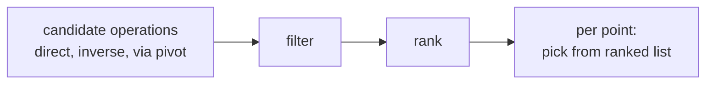

# Reprojection

> **Status: adopted 2026-10-17. Level 1 is implemented** in `crates/xeibe-reproject`.
> Reads don't reproject yet, so [geometry.md](geometry.md#crs-metadata)'s "no
> reprojection" still describes what a read does. The numbers below come from
> EPSG 13.103/13.106, PROJ 9.8.1 and pyproj 3.8.0.

A native, pure-Rust reprojection engine that works from the CRS data in
`xeibe-crs`, keeping the "no C dependencies, runs on WebAssembly" goal from
[README.md](README.md#goals). It comes in three levels. Each level is defined by
how it is validated, not by its size.

Geometry types the engine can't reproject exactly (GML curves: arcs, circles,
clothoids, …) fail with a clear error. They are never linearised silently.

## What the CRS data does and doesn't contain

The PROJJSON in `xeibe-crs` describes each CRS: datum, ellipsoid, prime meridian,
projection method and parameters, axes and units. The generator already decodes
EPSG's sexagesimal angle packings into decimal degrees. That is everything needed
to convert between CRSs on the **same datum**.

It does **not** contain datum transformations, i.e. how one datum relates to
another. EPSG publishes those as separate coordinate operations (2,776
Transformations and 220 ConcatenatedOperations in 13.103), and
`scripts/gen_crs_tables.py` doesn't extract them yet.

## Level 1: projections within one datum

### Scope

- A parser for the PROJJSON subset that EPSG produces.
- Axis order and direction (`FirstAxis`), units, prime meridians.
- Geographic ↔ geocentric conversion.
- Projection methods, in order of coverage across the 5,419 projected CRSs in
  EPSG 13.103:

  | Method | CRSs |
  |---|---|
  | Transverse Mercator (Poder/Engsager series, as in PROJ, not the short series) | 3,887 |
  | Lambert Conic Conformal (2SP, 1SP) | 1,200 |
  | Albers, Cassini, Polar Stereographic A/B, LAEA, Hotine A/B, Oblique Stereographic, Mercator, Krovak variants | ~180 |
  | 30 other methods | ~150 |

  The first two rows cover 94%, and about a dozen methods cover more than 98%.
- Coordinates are transformed in place in GeoArrow coordinate buffers. Envelopes
  are reprojected by densifying their edges, not by transforming two corners.

This level covers data that stays on its datum, e.g. ETRS89 geographic
(EPSG:4258), PL-1992 (EPSG:2180), UTM/ETRS89 (EPSG:25832–25835) and LAEA Europe.
Not everything that looks like one family is one datum, though:

- ETRS89 ↔ WGS 84 is a (null) transformation in EPSG, so level 2.
- PL-2000 (EPSG:2176–2179) is on ETRF2000-PL since EPSG 12, not on the ETRS89
  ensemble, so PL-1992 ↔ PL-2000 is level 2 as well.

### API

`Crs::from_epsg(code)` or `Crs::from_projjson(json)`, then
`Transform::new(&src, &dst, AxisOrder::EastFirst)` and `convert`,
`convert_xy`, `convert_xyz` or `convert_interleaved` on GeoArrow-shaped buffers,
in place. `AxisOrder::EastFirst` is the order xeibe writes (first two values
swapped for a northing-first CRS); `Authority` is the CRS's own. Two CRSs on
different datums are an error (`DatumMismatch`). A coordinate that can't be
converted is an error naming its index; NaN (GeoArrow's empty point) passes
through.
`convert_bounds` converts a bounding box as PROJ's `proj_trans_bounds` does,
by densifying its edges (21 points per edge by default), and handles boxes
across the antimeridian and around a pole.

### Validation

1. **IOGP Guidance Note 7-2 worked examples** for each method. These are published
   values, independent of PROJ.
2. **PROJ's `test/gie` suites** (22 files, ~700 KiB, MIT). Port the vectors for
   the methods we implement.
3. **Differential test against PROJ for every EPSG CRS we claim to support:**
   - Points per CRS: a grid over the area of use, its edges and corners, and
     seeded random points.
   - Both directions, forward and inverse.
   - Fixed tolerances per method, e.g. 1 mm projected and 1e-9° geographic.
   - Points outside the area of use form a separate set with documented
     tolerances.
4. **Round-trip property tests** (forward then inverse), independent of PROJ.
5. **EPSG version mismatch** doesn't arise at this level: the oracle is given
   the very PROJJSON `xeibe-crs` embeds, not its own `proj.db` definitions, so
   the vectors test the math and nothing else.

How 3 is run: `scripts/gen_reprojection_vectors.py` writes PROJ's results for
12 points per CRS (a 3 × 3 grid over the area of use plus three seeded random
points), forward and inverse.

- A committed subset, a few CRSs per method plus the CRSs xeibe's data uses, is
  in `tests/data/reprojection/vectors.jsonl` and runs with every `cargo test`.
- `--all` writes every projected and geocentric CRS to `target/`, for
  `cargo test -p xeibe-reproject -- --ignored` before a release or after an
  EPSG update.
- Tolerances are 1 mm for projected and geocentric coordinates and 1e-9 of the
  angular unit for geographic ones.

Result on 2026-10-17: 38 projection methods are implemented. Every projected
CRS PROJ can convert from EPSG's definition (6,594, deprecated ones included)
and all 303 geocentric CRSs match PROJ, forward and inverse. Most methods agree
to within 0.1 µm. The exceptions are Krovak (1 µm), Transverse Mercator
(0.14 mm) and TM South Orientated (25 µm), where the worst cases come from the
Bessel Namibia ellipsoid below. A unit test also checks that
`AxisOrder::EastFirst` swaps exactly the CRSs `xeibe-crs` marks `NorthOrLat`.

Polar CRSs define their axes along meridians ("south along 45°E"), so each
CRS's two horizontal axes are held as a 2 × 2 matrix over (east, north), not
just a swap and signs.

Known differences from PROJ, kept because xeibe follows EPSG:

- **Rounded built-in ellipsoids.** PROJ swaps some EPSG ellipsoids for its
  own built-in ones. For Bessel Namibia (GLM), EPSG gives a = 6377397.155
  German legal metres = 6377483.86528 m. PROJ's `bess_nam` is 6377483.865 m.
  Results differ by up to 0.15 mm, and the angular tolerance for those CRSs is
  2e-9.
- **Exact inverses where PROJ's is a truncated series.** PROJ's inverses of
  Laborde Oblique Mercator and Colombia Urban don't quite undo their forward
  formulas (off by up to 8e-8° and 4e-9°). Here a few Newton or fixed-point
  steps on the forward finish the job, so a round trip returns its input. The
  results differ from PROJ's inverse by under 1 cm (Laborde) and 1 mm
  (Colombia Urban).
- **Swiss Oblique Mercator.** Like PROJ, Hotine Oblique Mercator with an
  azimuth and a skew-grid angle of 90° uses the `somerc` formulas, chosen by
  the parameter values, not by code. This matters for EOV (EPSG:23700), where
  the two differ by 9 cm.
- **Krovak's cone axis.** PROJ ignores EPSG's co-latitude of the cone axis
  and uses the defining 30°17′17.30311″. EPSG stores it as 30.1717303
  (sexagesimal), one digit short, which moves points by up to 3 mm. The
  defining value is kept here too; the other Krovak parameters, including
  Modified Krovak's coefficients, come from EPSG.

Methods PROJ can't convert from EPSG's definition have no vectors:

- Bonne (South Orientated) (EPSG:2963, 5017) is implemented and checked
  against PROJ's `bonne` given a PROJ string, in a unit test.
- Lambert Conic Conformal (West Orientated), Lambert Conic Near-Conformal,
  Transverse Mercator Zoned Grid System and Tunisia Mining Grid are not
  implemented.

## Level 2: datum shifts with automatic selection

### Scope

- Extend `gen_crs_tables.py` to export EPSG's `coordoperation*` tables:
  transformations, concatenated operations and their parameters.
- Implement the Helmert-family methods: Geocentric translations, Position Vector,
  Coordinate Frame, Molodensky-Badekas. Together they cover about 1,300 of the
  2,776 transformations.
- Choose the operation automatically by porting PROJ's selection rules (next
  section). `--via EPSG:nnnn` stays available as an optional override.
- Write the EPSG code of the operation used into the output metadata.

### Why selection is the hard part

Finding a path is easy: about 8k CRSs, 3k operations, and useful paths rarely
longer than three hops. The difficulty is choosing among valid candidates.

- **Many candidates per pair.** 330 CRS pairs have more than one direct
  transformation. NAD83 → WGS 84 has 52. Pulkovo 1942(58) has 10 to
  WGS 84/ETRS89, with stated accuracies from 1 m to 10 m, mostly fitted for
  different countries.
- **The right one depends on where the data is.** A 1 m transformation fitted for
  one country is wrong in the next. EPSG's accuracy is a single, often
  conventional, number for the whole area of use.
- **Edges aren't uniform.** Projected CRSs are unprojected to their base CRS
  first. Methods defined in the geog2D domain vs the geocentric domain need
  geographic ↔ geocentric adapters. Concatenated operations list their steps
  without directions, so each step's direction is inferred by matching CRSs.
  Compound and vertical CRSs need their steps in a particular order.
- **Semantic traps.**
  - Position Vector and Coordinate Frame use the same 7 parameters with opposite
    rotation signs.
  - "WGS 84" and "ETRS89" are datum ensembles, so a transformation to "WGS 84"
    is good to about 2 m.
  - Time-dependent operations need a coordinate epoch, which GML data almost
    never has.

### PROJ's selection rules

Read from PROJ 9.8.1:
[`coordinateoperationfactory.cpp`](https://github.com/OSGeo/PROJ/blob/9.8.1/src/iso19111/operation/coordinateoperationfactory.cpp)
(`SortFunction`, about line 900) and
[`trans.cpp`](https://github.com/OSGeo/PROJ/blob/9.8.1/src/trans.cpp)
(`pj_get_suggested_operation`).

**1. Filters, before ranking:**
- the method is implemented
- not deprecated
- not superseded (`discardSuperseded` is on by default)
- the area of use matches the area of interest
- the grids are available

**2. Ranking.** One comparison function. The source warns that "the order of
the comparisons is extremely important". The criteria, in order:

1. exportable to PROJ (the method is implemented)
2. not a ballpark
3. no ballpark vertical step
4. not a null transformation
5. all grids available locally
6. all grids known to the database
7. accuracy known
8. if neither accuracy is known, grid-based first
9. **larger area of use intersecting the area of interest** (the data's bbox
   when one is given)
10. **better accuracy**
11. at equal accuracy, the one without grids
12. the ETRF2000-hub rule from IOGP 373-07-7 (ETRS89 realization to realization)
13. fewer steps
14. fewer pipeline steps
15. a special case parsing "Ballpark geographic offset from A to B" names
16. shorter name

Coverage of the data comes **before** accuracy.

**3. Per point**, at transform time. Among the ranked candidates, PROJ takes the
one whose area of use contains the point and has the best accuracy. On a tie it
takes the smaller area. Areas named "offshore" are skipped in favour of onshore
ones, and there are exceptions for unknown area names and "priority" operations.

These are about 20 explicit, deterministic rules, not 2, and their output is a
discrete operation code. That makes them practical to port and to test
exhaustively.

### Deviations from PROJ (documented, deliberate)

- **No ballpark fallback.** If only ballpark operations remain, the transform
  fails with an error that lists the candidates.
- **Grid availability is "exists on the CDN", not "installed locally".** The
  choice then doesn't depend on the machine, and a failed fetch is an error.
  PROJ instead silently picks a worse operation (see level 3).
- **Final tiebreak by EPSG code**, not by name length.
- **EPSG operations only.** `proj.db` adds 144 PROJ-authority operations plus
  ESRI, IGNF, NKG and NRCAN ones that we don't have.

### Validation

1. **Selection differential, the main test.**
   - For every pair of geographic CRSs with candidates (direct or through a
     pivot), sample points inside each candidate's area of use.
   - Compare the operation code xeibe picks with PROJ's pick, using pyproj with
     `authority="EPSG"` and the network on.
   - Every mismatch is either a bug or an entry in the deviations list above.
2. **Coordinate differential with the operation fixed.** Force PROJ onto the same
   operation, which separates the math from the selection.
3. **GN 7-2 examples** for each Helmert method, plus explicit tests of the
   Position Vector and Coordinate Frame rotation signs.

"Good precision" means choosing the operation with the best accuracy EPSG states.
That is the best signal available, PROJ included, but it remains a proxy.

## Level 3: grids, built natively

### How PROJ does it

- **Definitions** live in `proj.db` (~9.6 MB SQLite), which always ships. Of its
  operations, 1,062 are grid-based and name their grid by file. The
  `grid_alternatives` table (472 rows) maps EPSG's file names to PROJ-data
  files and CDN URLs, for example
  `Model_quasi-geoidy-PL-geoid2021-PL-EVRF2007-NH.txt` →
  `pl_gugik_geoid2021-PL-EVRF2007-NH.tif` →
  `https://cdn.proj.org/pl_gugik_geoid2021-PL-EVRF2007-NH.tif`.
- **Grid files** are the actual offset lattices, as GeoTIFFs in PROJ-data:
  - The pyproj wheel ships none: 16 files, 10 MB, mostly `proj.db`.
  - The `scripts/gdal` image (`ubuntu-full`) bundles all of PROJ-data, 775 MB
    in `/usr/local/gdal-internal/share/proj`.
- **Network access** (PROJ ≥ 7, off by default) reads Cloud-Optimized GeoTIFFs
  from `cdn.proj.org` with HTTP range requests. It fetches only the tiles it
  needs and caches them in `~/.local/share/proj/cache.db` (300 MB by default).
- **When a grid is missing, PROJ downgrades silently.** EPSG:4258+9651 →
  EPSG:4937 at (21.0, 52.2, 100 m) with pyproj 3.8:

  | network | operation chosen | h |
  |---|---|---|
  | off | ballpark vertical, no geoid correction (accuracy unknown) | 100.00 |
  | on | ETRF2000-PL to EVRF2007-PL height (2), GUGiK geoid2021 (0.02 m) | 131.12 |

  The only signal is a Python `UserWarning`.

### Scope

- Native readers and interpolation for NTv2, GeoTIFF and vertical offset grids.
- Grids come from `cdn.proj.org` (range requests plus a local cache) or from an
  offline directory the user provides (PROJ-data, or `projsync` for selected
  areas). xeibe doesn't ship grids. They come from many national agencies under
  their own licences, and the full set is ~0.8 GB and keeps changing.
- EPSG grid names map to PROJ-data names through PROJ's `grid_alternatives`
  (MIT), shipped with the CRS data along with its notice.
- **A missing grid is always an error.**
- Out of scope: time-dependent and dynamic-datum operations, deformation models.

### Validation

1. **Same grid and same operation compared against PROJ** in the GDAL
   container, which has every grid.
2. **Interpolation edge cases:** cell boundaries, grid edges, points outside the
   grid (an error), nodata cells.
3. **Fetching tested offline:** the CDN path against recorded responses or a
   local mirror, plus the offline-directory path.

## Test oracle notes

- `scripts/gdal` (full grids) and the pyproj in `verify_crs_tables.py` (no
  grids, network off) disagree on grid-based cases. Use the GDAL container, or
  pyproj with the network explicitly on, and record which grids each test
  vector depends on.
- Test vectors go in `tests/data`, generated by a script, like the other
  samples.

## Decisions so far

1. **Reprojection is in scope**, reversing the "no reprojection" rule
   (adopted 2026-10-17). Level 1 first.
2. **Automatic selection by default**, provided the ported rules pass the
   selection differential. `--via` is an optional override.
3. **Grids built natively**, using PROJ's CDN or a local copy the user
   downloads.
4. **Overlap-only oracle comparison.** The selection differential runs on the
   CRSs and operations that both `xeibe-crs` and the oracle's `proj.db` know.
   Everything outside that overlap goes on a generated list of untested CRSs,
   kept next to the test vectors.
5. **Per-point selection, as in PROJ and GDAL.** Each coordinate gets the most
   accurate operation whose area of use contains it. A shared vertex always
   lands in the same place, so neighbouring features keep fitting together. The
   cost is a small kink in a line or polygon edge that crosses an area-of-use
   boundary, where two operations meet.
6. **Grids load through a store that does no I/O itself.** The transform lists
   the grid tiles it needs for the data's bbox before it runs, the caller loads
   them into the store, and the transform then runs synchronously from memory.
   - On native, `xeibe-io` loads them with a range `GET` on the existing
     `HttpClient` plus a disk cache, or from the user's offline directory.
   - On WebAssembly, `xeibe-wasm` loads them with `fetch`, in memory only at
     first, with browser storage maybe later. `xeibe-io` stays synchronous and
     gets no wasm HTTP client: the browser's `fetch` is async, and `xeibe-io`
     (blocking `reqwest`, `ByteSource::open` returning `Read + Send`) is not.
     `cdn.proj.org` allows these requests: checked 2026-10-17, it answers a
     CORS preflight with `access-control-allow-origin: *`, allows the `range`
     header and exposes `content-range`.

## Open questions

None at the moment.
