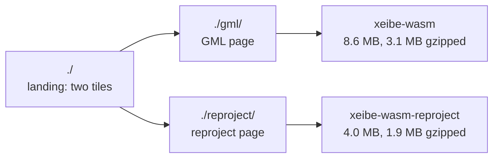

# Web page: a landing page, a GML page and a reproject page

> **Status: first version built, 2026-10-25: pieces 1 to 8, 9.1 and 10.**
> Pieces 9.2 to 9.4 and 11 (map) aren't started. A plan in
> pieces, each to be gone over on its own. Extends [web.md](web.md). Sizes
> were measured on 2026-10-24 (see [Two wasm builds](#2-two-wasm-builds));
> the module as built is 3.7 MB, 1.8 MB gzipped.

Today the web page does one thing: it reads GML. The plan splits it in
three:

- a **landing page** with two large tiles, one linking to each subpage;
- the **GML page**: what [web.md](web.md) describes, unchanged;
- a **reproject page**: coordinates pasted in, converted between two EPSG
  CRSs by `xeibe-reproject`, with what is needed to judge whether the
  conversion is right: which operation was chosen, among which, and why.



## Pieces

| # | Piece | Needs |
|---|---|---|
| 1 | [Subpages and landing page](#1-subpages-and-landing-page) | — |
| 2 | [Two wasm builds](#2-two-wasm-builds) | — |
| 3 | [CRS input](#3-crs-input) | 2 |
| 4 | [Coordinate input](#4-coordinate-input) | 3 |
| 5 | [Conversion and grids](#5-conversion-and-grids) | 2, 3, 4 |
| 6 | [Output pane](#6-output-pane) | 5 |
| 7 | [Per-point details](#7-per-point-details) | 6 |
| 8 | [CRS cards, operations, options](#8-crs-cards-operations-options) | 5 |
| 9 | [How a point was converted: engine additions](#9-how-a-point-was-converted-engine-additions) | 7, 8 |
| 10 | [Commands to cross-check with PROJ](#10-commands-to-cross-check) | 8 |
| 11 | [Map](#11-map) | 5 |
| 12 | [Docs and tests](#12-docs-and-tests) | all |

## 1. Subpages and landing page

A Vite multi-page build, no client-side router: `build.rollupOptions.input`
lists three HTML entries.

| URL | File | Contents |
|---|---|---|
| `./` | `web/index.html` | Landing page: two large tiles (title, one line on what it does, link) |
| `./gml/` | `web/gml/index.html` | Today's page, moved |
| `./reproject/` | `web/reproject/index.html` | The new page |

- `base: './'` keeps every URL relative, so the pages work under GitHub
  Pages' `/<repository>/`. The worker's `new URL('./worker.ts',
  import.meta.url)` keeps working after the move.
- Sources: `web/src/gml/` (today's files, moved), `web/src/reproject/`,
  `web/src/common/` (the CSS tokens taken out of `style.css`, and a shared
  header: "xeibe · GML · Reproject · GitHub").
- The page isn't deployed yet, so no old links need redirecting.
- Each page loads only its own JavaScript: the reproject page has no
  deck.gl (today's main chunk is 0.49 MB gzipped, most of it deck.gl and
  MapLibre).

Open: directories (`gml/`, `reproject/`) or files (`gml.html`,
`reproject.html`). Directories read better in links.

## 2. Two wasm builds

A new crate, `crates/xeibe-wasm-reproject`, like `xeibe-wasm`: not
published, not a default workspace member. It depends on `xeibe-crs`,
`xeibe-reproject` (without `esri`), `wasm-bindgen` and `serde_json`, and
nothing else. `serde_json` writes what crosses to JavaScript (a CRS's
card, the operations, a point's details) as JSON text, as `xeibe-wasm`
does; `xeibe-reproject` depends on it already, so it adds nothing to the
module. `web/scripts/build-wasm.sh` and `.github/workflows/pages.yml`
build both modules; each page imports its own.

Measured on 2026-10-24 with a throwaway crate that calls what the page
needs (transform setup, `operation_info`, the grid loop, a forced
candidate, the inverse, CRS records, remarks, usages, replacements, WKT
output), built with the `dist` profile and the `wasm-opt` flags of
`build-wasm.sh`:

| Module | Raw | gzip |
|---|---|---|
| `xeibe-wasm` (GML page, as of 2026-10-21) | 8.6 MB | 3.1 MB |
| reproject only | 4.0 MB | 1.9 MB |

- The GML module doesn't get smaller: its map needs the reprojection
  engine anyway.
- About 1 MB of the reproject module is the EPSG data, already compressed
  (`projjson.bin`, `operations.bin`, …), so gzip can't do much more.
- A visitor of both pages downloads 5.0 MB instead of 3.1 MB with one
  shared module. The reproject page alone loads 40% less.
- A cold `dist` build of the small crate took 25 s.

## 3. CRS input

Source and target CRS as EPSG codes only: `2180` or `EPSG:2180`. No
aliases, URNs, URLs, WKT or PROJJSON.

- A swap button exchanges source and target (and the output becomes the
  input).
- Each field shows the CRS's name as soon as the code is valid, or why
  it isn't (unknown code, a CRS that can't be converted).
- A deprecated CRS is accepted, with its replacements shown
  (`xeibe_crs::replacements`).

Open: a search by name, since codes are hard to remember. It needs a
listing of all records in `xeibe-crs` (`pub fn records() -> &'static
[CrsRecord]`; the table exists, only `get` is public) and a few hundred
KB of names, searched in wasm or sent to JavaScript once.

## 4. Coordinate input

A textarea: one point per line, two or three decimal numbers (`dd.dddd`,
or metres for a projected CRS) separated by spaces or tabs. Tabs are what
a spreadsheet's cells paste as.

Each line is checked by a regular expression:

```
^\s*[+-]?\d+(\.\d+)?[ \t]+[+-]?\d+(\.\d+)?([ \t]+[+-]?\d+(\.\d+)?)?\s*$
```

- Blank lines are kept, so output line *n* is input line *n*.
- The textarea has a gutter of line numbers (an element over its left
  padding, scrolled with it). Lines that don't match have their numbers in
  red, and are also listed under the textarea.
- The regex checks syntax only. After parsing, from the source CRS:
  latitude within ±90 and longitude within ±180 (geographic CRSs),
  outside the CRS's area of use (a warning, not an error), a third value
  where neither CRS has a vertical axis.
- **Axis order.** With plain decimals, latitude/longitude order is the
  classic mistake. Above the textarea: which value is which, from the
  CRS's axes ("Latitude (°), Longitude (°)"; "Easting (m), Northing (m)"),
  and a toggle between the CRS's order and x/y (east first), which is
  `AxisOrder`.

Open: comma as a separator too (CSV) — then decimal commas are out; DMS
input — out for now.

## 5. Conversion and grids

On the main thread, not in a worker: setting up a transform takes about
43 ms (measured for [web.md](web.md#map)) and a few thousand points
convert in milliseconds.

- `Transform::new` (or `with_selection` with the options of piece 8)
  when both CRSs are valid; converting again on every edit of the
  textarea, debounced.
- Grids: the loop the GML page's map runs, with `fetch` instead of a
  synchronous request. `grid_requests` for the points' bounds, `fetch`
  each range from `cdn.proj.org`, `add_grid_data`, again until nothing is
  left; then convert. Grids stay in memory while the transform lives.
- A grid that can't be fetched is an error for the points that need it,
  as in the library. No fallback without the grid; piece 7 shows what the
  other candidates give instead.

## 6. Output pane

Next to the input, read-only, in the same monospaced font and line height
so the lines face each other.

- Each line: the converted values, then ⚠ for a warning or ✕ and the
  error. A gutter, like an editor's line numbers, names the operation the
  line went through ("Op. 1", "Op. 2"…), with a bar in its colour from the
  operation list of piece 8.
- Under it: Copy (plain text, line for line), the decimals (by default
  from the target's unit: 9 for degrees, about 0.1 mm, and 4 for metres,
  trailing zeros trimmed) and the separator: as on the input line (the
  default), tab or space.
- Clicking a line opens its details (piece 7).

Open: a table instead (one row a point, columns for input, output,
operation, warnings), which holds more but no longer mirrors the
textarea.

## 7. Per-point details

For the line clicked:

- The operation used, and whether the point lies inside each candidate's
  area of use (piece 9.1).
- The steps, with their methods, parameters and the coordinates in
  between (piece 9.2).
- **The result through every other candidate**
  (`Transform::with_operation_index`) and how far each lands from the
  chosen one, in metres (geodesic, `xeibe_reproject::geodesic`, after
  converting both to the target's geographic CRS). This tells whether the
  choice matters at all: 2 cm or 2 m.
- Round trip: the result converted back (`Transform::inverse`), and how
  far it is from the input.
- Warnings: outside the source's or the target's area of use; and the
  operation used outside its own, from the engine's explanation (9.1),
  in four cases: no operation's area contains the point, so the first
  without grids stood in (the details give its stated accuracy and how far
  the other candidates' results lie from it); some do but couldn't convert
  it (outside their grid), so the same stand-in; the only operation there
  is, used everywhere as PROJ does (no ⚠ when it shifts nothing); the one
  forced (a note, no ⚠). A grid that couldn't be fetched is an error, not
  a warning.

## 8. CRS cards, operations, options

The general area, for the whole transform.

**A card for each CRS**, from `xeibe_crs`: name and code (linked to
epsg.org), kind, datum or ensemble, the axes with their order and units,
the area of use, deprecated and its replacements, EPSG's remarks
(`crs_remarks`) and usages.

**The candidate operations**, best first, from `Transform::operation_info`:

| Shown | From `OperationInfo` |
|---|---|
| Name, EPSG code (linked), inverted or not | `name`, `code` |
| The EPSG transformations it runs | `steps` |
| Accuracy in metres, or unknown | `accuracy` |
| Area of use: name and box | `area_name`, `area` |
| Scope and remarks | `scope`, `xeibe_crs::operation_remarks` |
| Grids, each fetched / failed and its size | `grids` |
| Time-dependent (not supported: said so) | `time_dependent` |
| Every step: projection, datum shift, ensemble null operation, ballpark vertical…, with its CRSs | `chain` |
| How many of the points went through it | `operation_index_for` per point |

A conversion on one datum has no candidates: the card says so ("same
datum: a conversion, exact").

Steps worth flagging: a ballpark vertical step (heights passed
unchanged), an ensemble null operation (datum ensemble to a member: no
shift), unknown accuracy.

**Options** (`Selection`): an area of interest (west, south, east, north;
or "the points' bounds"), a minimum accuracy, and forcing one candidate
for every point (`with_operation_index`).

## 9. How a point was converted: engine additions

For someone who knows the geodesy and wants to follow the calculation, or
redo it in their own software: which operation, whether the point is
inside its area of validity, and every step with its method, parameters
and the coordinates in between. What exists answers which operation was
chosen, among which (piece 8). These read-only additions to
`xeibe-reproject` answer the rest.

**9.1. The choice for one point** (`Transform::explain_point(x, y, z)`,
built): the `Explanation` gives the operation used and the error, and an
`Explained` for each operation: `inside` and an `Outcome` (`Chosen`,
`Fallback`, `Only`, `Passed { by, reason }`, `Outside`, `Failed`,
`NotReached`), the reasons being PROJ's rule read backwards. The plan
was:
the index chosen, whether the fallback was taken (no candidate's area
contains the point: the first without grids), and for each candidate
whether its area contains the point (in the source CRS, as the engine
tests it, not the box in degrees), its accuracy, and its outcome: chosen,
inside but less accurate, inside and as accurate but a larger area,
passed over as offshore or with an unknown area name, outside, tried and
failed (with the error), not reached. The page then says "A: contains
the point, 0.1 m. B: contains it too, 1 m. C: outside its area." From
`suggest` and the loop in `run_with` (`select/mod.rs`); a Bound CRS's
transform answers for its hub, as `index_for` does.

**9.2. The steps** (`Transform::trace_point(x, y, z)`): each step the
point went through, with its CRS and the coordinates after it; heights
(ellipsoidal or gravity-related) and the horizontal position saved and
restored around a vertical step made explicit. A grid step's shift is the
difference across it. The page joins each step with what is known
already, with no engine change:

- an EPSG step (`OperationInfo::chain`, `StepKind::Epsg`): its method
  (name and code: Position Vector 9606 and Coordinate Frame 9607 differ
  only in the rotations' sign, a classic mistake) and parameters, from
  `xeibe_crs::operations_json()`. They are stored in SI units; the page
  shows them as EPSG publishes them (arc-seconds, ppm). Whether it runs
  inverted;
- a projection step: the projected CRS's conversion parameters, from its
  PROJJSON;
- each CRS's ellipsoid (a, 1/f) and prime meridian.

The last traced coordinate is `convert`'s result: the test.

**9.3. The other operations** between the two CRSs' datums that EPSG
lists, each with "convert through this" (`Transform::via`) and a link to
epsg.org, for "why not the official transformation N?": the user sees
the difference, and with 9.2 both calculations step by step. Needs a
listing of those operations; the registry finds them already, inside the
search.

**9.4. Optional: scale factor and meridian convergence** at the point,
for a projected CRS (PROJ's `proj_factors`, pyproj's
`Proj.get_factors`): numeric derivatives of the projection, with pyproj
as the oracle.

Not planned: why the candidates are ranked as they are (the deciding
rule for each pair: PROJ's tie-breakers, software policy rather than
geodesy), and why an operation isn't a candidate at all (the search drops
them in about 15 places without a record).

**No cost to `convert`.** Built for 9.1: `suggest` and `run_with` are
generic over a `Recorder` (`select/explain.rs`) with an associated
`DETAILED` constant that skips the work only an explanation needs.
Measured on 2026-10-25, a million points, best of 7, before and after:
ED50 to ETRS89 with 12 candidates 183.7 and 183.9 ns a point (run to run
±2%), WGS 84 to PL-1992 499 and 501, a conversion 138 and 137; and on
every point of the committed selection vectors the explanation names
the operation `convert` uses. The plan was:

9.1 and 9.2 run the same code as `convert`,
so they can't disagree with it, and `convert` pays nothing for them. The
step loop (`run`) and the choice (`suggest`, `run_with`) become generic
over a recorder:

```rust
trait Recorder {
    fn step(&mut self, step: &Exec, crs: &Crs, coords: [f64; 3]);
}

impl Recorder for () {
    fn step(&mut self, _: &Exec, _: &Crs, _: [f64; 3]) {}
}
```

`convert` passes `()`: the compiler makes a copy of the loop for it with
the empty calls gone, which is the loop as it is now. `trace_point` and
`explain_point` pass recorders that keep what they are given, for one
point, when asked: on the page, when a line is clicked. Checked before
and after by timing a million points through a projection, a Helmert
transformation and a grid.

## 10. Commands to cross-check

Ready to copy, for the CRSs, axis order and options on the page: PROJ's,
which the engine is tested against. `cs2cs EPSG:4258 EPSG:2180` with the
points, and `projinfo -s EPSG:4258 -t EPSG:2180 --spatial-test
intersects` for its list of operations.

A Python snippet with `xeibe_proj` waits until it is published.

## 11. Map

Optional. MapLibre alone (no deck.gl), OpenStreetMap tiles as on the GML
page: the points (converted to EPSG:4326), the areas of use of both CRSs
and of the chosen operation, a candidate's on hover. A click on the map
adds a point to the input.

## 12. Docs and tests

- [web.md](web.md): a section on the landing page, today's content as the
  GML page, and the reproject page moved in from here once built.
- `CLAUDE.md`: the `web/` row and the new crate in the layout table.
- `crates/xeibe-wasm-reproject`: the work in plain Rust, tested natively
  like `xeibe-wasm`'s `session.rs`, against a few committed vectors in
  `tests/data/reprojection/`, a grid case among them with the committed
  grid fixtures.
- A check in headless Chromium of each page.

## Phases

1. Pieces 1 and 2: the split and the landing page; the GML page unchanged.
2. Pieces 3 to 8: CRS input, coordinates, conversion, output, per-point
   details, the general area.
3. Pieces 9.1 and 9.2, then 10 and 11.
4. Pieces 9.3 and 9.4, if wanted.
