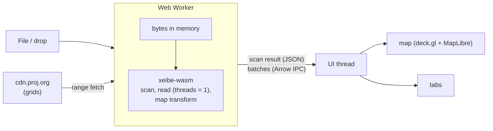

# Web page (WebAssembly)

📋 Planned (P2). A static page on GitHub Pages that runs xeibe compiled to
WebAssembly. A user drops a local GML file or a saved WFS response on it and sees
how xeibe reads it: layers, the inferred schema and why, axis-order decisions,
the read report, the data on a map and in a table. Nothing is uploaded: the file
never leaves the browser.

It serves two purposes at once:

- **Debugging.** "Why is this column `text`?", "why are my points in the sea?",
  "which features were skipped?" answered without installing anything.
- **Showcase.** The quickest way to see what xeibe does with real data.

It is a thin front end over `xeibe-arrow`. It adds no reading behaviour of its
own, so what the page shows is what the CLI and Python produce with the same
options.

## Non-goals

- A general GIS viewer or editor. One file (or zip), one layer at a time.
- Reprojecting the data. The map converts coordinates for display only (see
  [Map](#map)); what the page reads stays in the source CRS, as reads do.
- Exporting the data, in the first version. Downloads (GeoParquet, Arrow IPC)
  come once the first version works as intended (see [Phases](#phases)).
- Multi-GB inputs. Browser memory limits apply (see [Limits](#limits)). The CLI is
  the tool for those.
- A hosted service. The page is static files; there is no server side.

## Layout

The screen is split in two halves. The divider can be dragged; on narrow screens
the map stacks above the tabs.

| Area | Contents |
|---|---|
| Top bar | File picker and drop zone, layer selector (BDOT10k-style files have dozens of layers), "Try a sample", progress |
| Left half | Map, in one of two views (see [Map](#map)) |
| Right half | Tabs, below |

| Tab | Shows | From |
|---|---|---|
| Overview | Feature count, extent, CRS, axis-order decisions with their reasons, read report (skipped features, warnings, skipped sources, whether the scan was complete) | `ScanResult::layers`, `extent`, `axis_decisions`, `is_complete`, `skipped_sources`; the read report |
| Schema | Columns with Arrow type and source path, and the inference reasoning | `ScanResult::schema`, `explain` |
| Data | Virtualized table of the read rows | the record batches |
| Options | Form for the read options (preset, overrides, axis order, CRS, linearization, …) and the equivalent `xeibe` command, Python snippet and settings file, ready to copy | `ReadOptions`, `ScanResult::to_settings` |

Selecting a row zooms the map to its feature; clicking a feature on the map
selects its row.

The Options tab is what makes the page more than a viewer: options are tried
interactively, then carried over to the CLI or Python unchanged.

## Map

Rendering: deck.gl with `@geoarrow/deck.gl-layers`, which draws GeoArrow arrays
straight from Arrow IPC, with no GeoJSON conversion. The same layers serve two
views; a switch on the map picks one.

| View | deck.gl view | Coordinates | Basemap |
|---|---|---|---|
| **Map** (default) | `MapView`, Web Mercator | converted to lon/lat by `xeibe-reproject` in the wasm module | MapLibre |
| **Source CRS** | `OrthographicView`, plain x/y | as read, unchanged | none |

Why these two:

- **Map** puts the data on the Earth. Wrong axis order is visible at a glance:
  swapped coordinates land in the wrong country or the sea.
- **Source CRS** shows the file's own numbers with nothing in between. It works
  for any CRS, engineering and unknown ones included, and is the fallback when
  the Map view can't be drawn.
- Other projections with a basemap are left out. deck.gl and MapLibre draw
  only Web Mercator (and a globe); arbitrary projections would mean OpenLayers,
  which doesn't read GeoArrow and would turn every feature into a JavaScript
  object.

The Map view's conversion:

- **Same engine as the library.** `xeibe-reproject` ([reprojection.md](reprojection.md))
  in the wasm module, with no proj4js. It builds for `wasm32-unknown-unknown`
  and adds 1.1 MB to the module (0.5 MB gzipped); checked 2026-10-18 in Node,
  where EPSG:2180 → 4326 converts correctly and setting up the transform takes
  43 ms.
- **Target EPSG:4326.** When EPSG has no operation to it, the CRS's own
  geographic CRS, which is on the data's datum but always reachable; the
  difference doesn't show on a map. A CRS that can't be converted at all
  (unknown, engineering) leaves only the Source CRS view.
- **Grids** come from `cdn.proj.org` with range requests, which it allows from
  any origin (checked 2026-10-17, see [reprojection.md](reprojection.md#decisions-so-far)).
  The worker runs the loading loop in JavaScript: `grid_requests` for the
  layer's extent, `fetch` each range, `add_grid_data`, again until nothing is
  left. They are kept in memory. The page keeps its transform for as long as
  the file is open, since grid files are shared only while some transform
  holds them.
- **When a grid can't be fetched,** the Map view uses the transform without
  grids and says so ("shown without grid X"). This is for display only; the
  library's rule that a missing grid is an error stays.
- **Curves** (arcs, circles, …) are drawn linearized: deck.gl draws only lines
  and polygons. The table keeps them as read.

The **CRS's area of use** (`CrsRecord::area_in_axis_order`) is drawn as a
rectangle in both views. Data outside it explains itself.

## Architecture

- **`crates/xeibe-wasm`**: wasm-bindgen bindings. Not a default workspace member,
  like `xeibe-py`. Kept thin, so the unstable Rust API doesn't spread into
  JavaScript: a few functions taking bytes and an options object, returning JSON
  and Arrow IPC. They open the dropped files, scan, read batches (with an
  optional row limit) and the report, and set up the map transform: its grid
  requests, grid data handed in, and a batch's geometry converted to lon/lat.
- **Web Worker.** Everything runs in a worker so a long read doesn't freeze the
  UI. Results cross to the UI thread as Arrow IPC buffers (transferable, no copy).
- **Single-threaded.** WebAssembly threads need `SharedArrayBuffer`, which needs
  COOP/COEP headers, which GitHub Pages can't set. The read runs with
  `threads = 1`, which means "everything on the calling thread" (see
  [Library changes](#library-changes)).
- **`web/`**: the front end (Vite, TypeScript) in this repository.
- **`.github/workflows/pages.yml`**: builds `xeibe-wasm` (with `wasm-bindgen-cli`
  pinned to the crate's version, then `wasm-opt`) and `web/`, deploys to GitHub
  Pages.

### Inputs

| Input | How |
|---|---|
| `.gml`, `.xml`, saved WFS responses | Read into memory, wrapped in an in-memory `ByteSource` |
| `.gz`, `.zst` | As above; `Source::open` decompresses |
| `.zip` | Needs an in-memory archive source (below) |
| Live WFS | Out of scope at first (see [Network](#network)). Maybe later as best effort for servers that allow it |

A streaming `ByteSource` over `Blob.slice()` with `FileReaderSync` (available in
workers) would avoid holding the whole file in memory. That is a later
improvement, not needed for the first version.

### Network

WebAssembly in a browser has no network access of its own: a request from Rust
(`web-sys`, or `reqwest`'s wasm backend) goes through the browser's `fetch`,
under the same rules as JavaScript, in a worker too.

- **CORS.** A cross-origin response is readable only if the server sends
  `Access-Control-Allow-Origin`; range requests also need the `Range` header
  allowed and `Content-Range` exposed. `cdn.proj.org` does all of this. Most WFS
  servers send no CORS headers, and nothing on the page can get around that
  short of a CORS proxy, which would route the user's requests through a third
  party.
- **Mixed content.** The page is served over HTTPS, and browsers block its
  requests to `http://` URLs. Many WFS endpoints are still plain HTTP.
- **Same origin** needs neither: samples served from the Pages site load freely.

None of this applies to the CLI or Python.

## Library changes

| Crate | State |
|---|---|
| `xeibe-core`, `xeibe-crs`, `xeibe-reproject`, `xeibe-geom`, `xeibe-schema`, `xeibe-arrow`, `xeibe-io` and `xeibe-wfs` without `http` | Build for `wasm32-unknown-unknown`. zstd's C code compiles with the system clang. `file://` inputs are an error there |
| Threads | Done: `threads = 1` runs a scan or read on the calling thread, and it is the default where the number of cores can't be known ([architecture.md](architecture.md#parallel-pipeline)). Asking for more is an error, not a panic. Checked on 2026-10-17 with a test module run in Node: reads and scans of 500 features with `threads` 0 and 1, an error with 4 |

Still needed:

1. **In-memory zip archives.** `Source::ZipMember` holds a `PathBuf` and
   `archive.rs` opens it with `std::fs::File`. The `zip` crate itself only needs
   `Read + Seek`, so an archive held in memory (`Cursor<Bytes>`) is a small
   addition.
2. **zstd.** Builds with clang. If linking or CI makes it a problem, the
   pure-Rust `ruzstd` decoder can replace it on wasm only.

With export, later: the GeoParquet writer (`GeoColumns`, the `geo` and
`gml:settings` metadata) moves out of `xeibe-cli` into a library crate, so the
page writes the same files as `xeibe gml convert`. `parquet`'s `zstd` feature
brings the same C dependency as above.

## Limits

- **Memory.** wasm32 addresses at most 4 GB; in practice browsers manage 1–2 GB.
  Files of a few hundred MB are fine. For bigger ones the page offers "first N
  features": it stops pulling batches after N rows, which with an inline read
  also stops the parsing. That bounds the Arrow output but not the input, which
  is in memory until reads stream from the `Blob` (see [Inputs](#inputs)). Beyond
  that, the page points to the CLI.
- **Speed.** One thread, so several times slower than the CLI on a multi-core
  machine. Fine for previewing.
- **Bundle size.** A test module with `xeibe-arrow` and `xeibe-reproject` (EPSG
  tables, arrow, geoarrow; no `wasm-opt`) is 8.5 MB, 2.5 MB gzipped. `wasm-opt`
  takes some off. Loaded once, then cached.
- **Network** rules out most live WFS endpoints (see [Network](#network)).

## Phases

1. **First version.** Drop a file; layer selector; Overview, Schema and Data
   tabs (first rows, then more on scroll); the map in both views, with grids and
   the area-of-use box; deployed to GitHub Pages.
2. **Options and inputs.** Options tab with the CLI, Python and settings
   output; zip inputs; samples from `tests/data`.
3. **Later.** Export (GeoParquet, Arrow IPC); streaming reads of large files;
   grids cached in browser storage; WFS against servers that allow it; a target
   CRS in the Options tab once reads reproject.

## Open questions

- Basemap tiles: OSM's own tile servers don't allow heavy use; OpenFreeMap or
  Carto are the usual free choices.
- Which `tests/data` samples to offer under "Try a sample", and whether to bundle
  them or fetch them from the repository.
- Could `ReadOptions` be described (JSON Schema) so the Options form is
  generated rather than kept in sync by hand?
- When reads reproject (support matrix, P1), the read must list the grids it
  needs before it starts, from the scan's CRS and extent, so the worker can
  fetch them first; a blocking fetch inside the read can't work in the browser.
