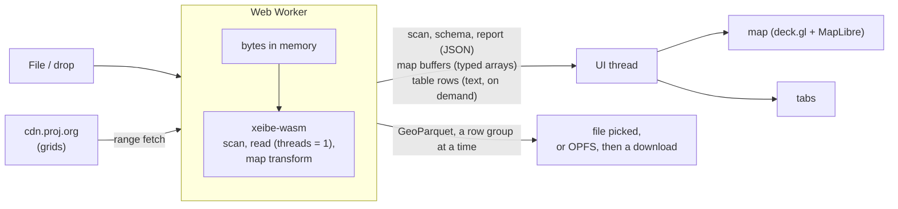

# Web page (WebAssembly)

🚧 In progress (P2): the first version ([Phases](#phases)) is built, in
`crates/xeibe-wasm` and `web/`, and not yet deployed. A static page on GitHub Pages that runs xeibe compiled to
WebAssembly. A user drops a local GML file or a saved WFS response on it and sees
how xeibe reads it: layers, the inferred schema and why, axis-order decisions,
the read report, the data on a map and in a table. Nothing is uploaded: the file
never leaves the browser.

It serves two purposes at once:

- **Debugging.** "Why is this column `text`?", "why are my points in the sea?",
  "which features were skipped?" answered without installing anything.
- **Showcase.** The quickest way to see what xeibe does with real data.

It is a thin front end over `xeibe-arrow`. It adds no reading behaviour of its
own, so what the page shows is what the CLI and Python produce with the same
options.

## Non-goals

- A general GIS viewer or editor. One file (or zip), one layer at a time.
- Reprojecting the data. The map converts coordinates for display only (see
  [Map](#map)); what the page reads stays in the source CRS, as reads do.
- Multi-GB inputs. Browser memory limits apply (see [Limits](#limits)). The CLI is
  the tool for those.
- A hosted service. The page is static files; there is no server side.

## Layout

The screen is split in two halves. The divider can be dragged; on narrow screens
the map stacks above the tabs.

| Area | Contents |
|---|---|
| Top bar | File picker and drop zone, layer selector (BDOT10k-style files have dozens of layers), "Try a sample", Export (see [Export](#export)), progress |
| Left half | Map, in one of two views (see [Map](#map)) |
| Right half | Tabs, below |

| Tab | Shows | From |
|---|---|---|
| Overview | Feature count, extent, CRS, axis-order decisions with their reasons and a choice to override them, read report (skipped features, warnings, skipped sources, whether the scan was complete) | `ScanResult::layers`, `extent`, `axis_decisions`, `is_complete`, `skipped_sources`; the read report |
| Schema | Columns with Arrow type and source path, each with the reasons for it in plain words | `ScanResult::schema` (its decisions, as `explain` prints them) |
| Data | Virtualized table of the read rows | the record batches |
| XML | The selected row's feature as written in its file (see [Map](#map)) | the read's location column |
| Options | Form for the read options (preset, overrides, axis order, CRS, linearization, …) and the equivalent `xeibe` command, Python snippet and settings file, ready to copy | `ReadOptions`, `ScanResult::to_settings` |

Selecting a row zooms the map to its feature; clicking a feature on the map
selects its row. Clicking where features overlap lists them in the Data tab
(see [Map](#map)).

Opening files shows a dialog first, before anything is scanned:

- **The files**, with their sizes, and a zip archive's GML members with their
  sizes, unpacked and compressed. Every GML file and member is checked; the
  user unchecks what they don't want. A member xeibe can't read (encrypted, or
  a compression method other than stored, deflate and Deflate64) is listed
  greyed out with the reason, rather than failing the whole archive; other
  members are counted, not listed.
- **How much to scan for the schema**: the whole files, with the time that
  should take, or the first N features of each file (10,000 by default). The
  dialog suggests the sample above 150 MB of XML.

The scan then shows its progress in a dialog of its own, since the status at
the top is easy to miss: what it reads, a bar (over the bytes for a full scan;
a sample ends when it has its features, so there it only moves), and Stop and
Close. Closing it (or Esc) leaves the scan running, with the status at the
top; the dialog closes when the scan ends, and shows again if it fails or
finds no layers.

Reads show the same dialog: the one after the scan if its dialog is still
open, and any other (another layer, a new "Max features") once it has taken
400 ms, so that a quick one doesn't flash it. It says how many features the
scan counted ("at least" after a sample) and the limit, and the rows and bytes
read so far: a layer that starts late in its file draws nothing for a while
("No AD_PunktAdresowy features yet: 34 MB of 121 MB read"), and this is where
that shows. The bar is the larger of the bytes read and the rows of those
expected, when an exact count or the limit says how many. The worker reports
a read's bytes as it does a scan's, every 8 MiB.

Stopping a scan brings the dialog back with the sample chosen. After a sampled scan the Overview says so and offers a full scan of the same
files.

The Options tab is what makes the page more than a viewer: options are tried
interactively, then carried over to the CLI or Python unchanged.

## Export

Export, in the top bar, writes the whole layer to GeoParquet: the file
`xeibe gml convert` writes, from the same writer (`xeibe-export`), whatever
"Max features" says. The page offers no Arrow IPC. The worker reads the layer
again with the page's options, the axis order chosen included, and the
module hands over the file's bytes as the writer produces them, a row group
(128,000 rows) at a time, so the file is never held whole. Parquet has no
curves, so the export replaces them by straight segments, as `--linearize`
does.

The bytes go to:

- **the file the user picks**, where the browser has `showSaveFilePicker`
  (Chromium). The worker writes to it as the export goes; the browser puts
  the file in place when it is complete.
- **a file in the browser's private storage** (OPFS, written with
  `createSyncAccessHandle`, which every current browser has in a worker)
  elsewhere, downloaded when it is complete. It is on disk, not in memory.
  Only the last export is kept there: its download may still be reading it.
- **memory**, where the browser refuses the page that storage (Firefox in a
  private window, or with the site's data blocked: `getDirectory()` throws
  a `SecurityError`). The file is downloaded as above, but must fit in what
  the browser will hold. The dialog says so before saving: it asks for the
  same storage when it opens.

The dialog shows the rows and bytes written. Close leaves the export running,
with its share on the Export button; Stop removes what was written. Checked
in headless Chromium on 2026-10-21: the 606,980 address points of PRG
lubelskie (657 MB of XML) export in 8.8 s to a 32.8 MB file, which GDAL reads
with the CLI's count and extent. The CLI's file lacks one rare column: it
samples the layer for its schema, and the page used its full scan's.

## Map

Rendering: deck.gl's own layers (`SolidPolygonLayer`, `PathLayer`,
`ScatterplotLayer`) in binary mode, fed typed arrays the wasm module lays out:
positions, Arrow-style offsets, polygon triangles (earcut, in Rust) and the
feature row of each item, for picking. Not `@geoarrow/deck.gl-layers`: the
geometry is converted, linearized and triangulated in wasm anyway, and that
library takes neither WKB columns nor curves. The same layers serve two
views; a switch on the map picks one.

| View | deck.gl view | Coordinates | Basemap |
|---|---|---|---|
| **Map** (default) | `MapView`, Web Mercator | converted to lon/lat by `xeibe-reproject` in the wasm module | OpenStreetMap's raster tiles in MapLibre, with their attribution |
| **Source CRS** | `OrthographicView`, plain x/y | as read, less an origin (the layer's first coordinate) so they fit the GPU's 32-bit floats; the pointer readout adds it back | none |

Why these two:

- **Map** puts the data on the Earth. Wrong axis order is visible at a glance:
  swapped coordinates land in the wrong country or the sea. The Overview's
  Axis order table then lets the user choose x/y or y/x per srsName, over
  xeibe's decision: the layer is read again with that override (the read
  options' `geometry.axis.overrides`), and the table shows the matching
  `--axis-override` for the CLI. The choice holds for every layer until other
  files are opened.
- **Source CRS** shows the file's own numbers with nothing in between. It works
  for any CRS, engineering and unknown ones included, and is the fallback when
  the Map view can't be drawn.
- Other projections with a basemap are left out. deck.gl and MapLibre draw
  only Web Mercator (and a globe); arbitrary projections would mean OpenLayers,
  which doesn't read GeoArrow and would turn every feature into a JavaScript
  object.

The Map view's conversion:

- **Same engine as the library.** `xeibe-reproject` ([reprojection.md](reprojection.md))
  in the wasm module, with no proj4js. It builds for `wasm32-unknown-unknown`
  and adds 1.1 MB to the module (0.5 MB gzipped); checked 2026-10-18 in Node,
  where EPSG:2180 → 4326 converts correctly and setting up the transform takes
  43 ms.
- **Target EPSG:4326.** When EPSG has no operation to it, the CRS's own
  geographic CRS, which is on the data's datum but always reachable; the
  difference doesn't show on a map. A CRS that can't be converted at all
  (unknown, engineering) leaves only the Source CRS view.
- **Grids** come from `cdn.proj.org` with range requests, which it allows from
  any origin (checked 2026-10-17, see [reprojection.md](reprojection.md#decisions-so-far)).
  The worker runs the loading loop in JavaScript: `grid_requests` for the
  layer's extent, `fetch` each range, `add_grid_data`, again until nothing is
  left. They are kept in memory. The page keeps its transform for as long as
  the file is open, since grid files are shared only while some transform
  holds them.
- **When a grid can't be fetched,** the Map view uses the transform without
  grids and says so ("shown without grid X"). This is for display only; the
  library's rule that a missing grid is an error stays.
- **Curves** (arcs, circles, …) are drawn linearized, with the read's
  default steps: deck.gl draws only lines and polygons. The table keeps them
  as read. WKB columns go back to xeibe's geometry model through
  `xeibe_geom::wkb::read_wkb`, which reads what the writer writes.
- **A feature is on the map whole or not at all.** One that fails to convert
  is left off and counted, with the first error, in the Overview and over the
  map.

The **CRS's area of use** (EPSG's box, `CrsRecord::area_wgs84`) is drawn as
a ring in both views, densified, and converted to the source CRS without
grids for that view. Data outside it explains itself.

Selecting a row in the table zooms the current view to the feature and draws
it highlighted, with its vertices; clicking a feature selects its row. A
feature counts as hit within 6 pixels of the pointer.

**Overlapping features.** A click finds every feature under it, up to 10.
With more than one, the Data tab shows only theirs, the top one first and
selected, under a bar that says how many there are: "the first 10 … there may
be more" at the limit. Selecting one of them doesn't move the map, since they
are all under the click. "Show all rows", Esc, or a click on one feature or on
nothing shows all the rows again, at the selected one.

deck.gl finds them one at a time (`pickMultipleObjects`), each by drawing
every feature again off screen and then hiding the one found, so the limit
keeps a click short where hundreds are under it zoomed out. Measured
2026-10-20 as above: a pass takes 9 ms with 3 million polygons and 5.5 ms
with 2.7 million address points (20 and 10 ms with the CPU slowed 4×); a
click on one feature takes two passes, and one on 10 or more takes 11. From
input to the next paint, with 3 million polygons, a click on one feature went
from 88–96 ms to 104 ms (208 to 240 ms with the CPU slowed 4×), and one
zoomed out, listing 10, from 40 to 120 ms (104 to 280 ms). Vertices aren't
picked: they lie on their features, and zoomed out each of the selected
feature's took a pass. deck.gl hides only 10 found points per layer (layers
without a picking buffer), and an 11th pass finds one of them again: the
click stops there.
Two alternatives didn't pay: picking only in the layers whose box meets the
click (a group's 65,536 consecutive rows spread over most of the map), and
testing every row's box in JavaScript (4–15 ms for 3 million rows, 17–65 ms
slowed 4×, before an exact test of each candidate).

**Layers.** deck.gl draws, and picks under the pointer on every mouse
move, layer by layer, and each layer costs a frame whatever its size. The
batches (8,192 rows) are merged into groups of 65,536 rows or 2 million
vertices, at most, as they fill up and when the read ends; the newest stay
batches meanwhile, so the read doesn't stop to rebuild a growing layer.
Measured 2026-10-19 in Chromium on a Radeon RX 7700 XT with the CPU slowed 4×
(a laptop's, roughly): a hover over 606,980 PRG address points, or 300,000
polygons, took 33 ms a frame (95th percentile 50 and 67 ms) with a layer per
batch, and keeps to 16.7 ms (60 fps) with groups.

**Points** closer than 8 pixels apart on screen (their box's area shared
among them) are drawn as 1.5-pixel dots without an outline; farther apart, as
3-pixel circles. Circles piled on the same pixels cost a frame for nothing:
with 2,722,651 PRG address points zoomed out, hovering took 29 ms a frame
(full CPU) and 34 ms (CPU slowed 4×) with circles, and takes 20 and 28 ms
with dots; panning went from 31 ms to 16.7 ms.

**Hover picking** stops with more than 500,000 features in view (estimated
from each group's box and rows, as the view settles): deck.gl picks under the
moving pointer by drawing every feature again off screen. Then the cursor,
highlight and tooltips wait until the view holds fewer, and a click picks on
its own. With 2,722,651 address points zoomed out, hovering went from 20 ms
a frame (28 ms with the CPU slowed 4×) to 16.7 ms.

**deck.gl's own arrays** (picking colours, tesselated paths and polygons)
are allocated at their size and not pooled (`_typedArrayManagerProps:
{overAlloc: 1, poolSize: 0}`): by default deck.gl makes them twice the size
asked for, for layers that grow, and keeps up to 100 freed ones, and a layer
here never grows. Measured 2026-10-19 on the page with 300,000 polygons,
after a forced garbage collection: 324 MB of arrays instead of 483 MB, and
132 MB on the GPU instead of 151 MB.

**Polygon outlines** are drawn only while a typical segment is at least 3
pixels on screen. Below that, outlines double the cost of a frame and cover
the polygons anyway, and a fill alone may cover no pixel: each polygon is
drawn as one dot at its first position instead, which also keeps it
clickable. (Measured: drawing the outlines as `LineLayer` segments over the
same buffer instead of a `PathLayer` saves about 8 ms of JavaScript per
batch and nothing per frame: not worth it.)

**Vertices** show as small markers in either view once the view is zoomed in
far enough that they are spread out: a typical segment of the batch (the
median of a sample) at least 10 pixels long. They are drawn only for the
features in view, and half a view around it, collected from the features'
bounds 150 ms after the view settles; with more than 200,000 of them in view,
only the selected feature's. Measured with 300,000 polygons (2.7 million
vertices) and the CPU slowed 4×: drawing every vertex of a group that had
reached the zoom froze the page for 120–150 ms at each zoom in and took 43 MB
of GPU memory; collecting the 5,445 in view at the widest such zoom takes
5 ms, and nothing shows on the GPU. Hovering a vertex or a point
shows its coordinates as read (in the Map view also its longitude and
latitude) and where it is in its feature: the row, the polygon or line of a
multi-geometry, the ring (exterior or interior N) and the vertex's number in
it. The coordinates as read are the origin added back to the drawn ones,
shown to 15 significant digits, which gives back any coordinate written with
no more.

**The XML tab** shows the selected row's feature as it is written in its
file, read again on demand. The read adds a location column
(`ReadOptions::location_column`, kept out of the table) with each row's
source and byte range in the source's decoded text. A plain UTF-8 file is
read at that range directly; a compressed file or a zip member is decoded
from its start up to it, which for a feature near the end of a member of
gigabytes takes seconds. Up to 2 MiB of a feature is shown, as written or
indented (the default for a feature written on one line), with tags and
attributes highlighted.

## Architecture



- **`crates/xeibe-wasm`**: wasm-bindgen bindings. Not a default workspace member,
  like `xeibe-py`. Kept thin, so the unstable Rust API doesn't spread into
  JavaScript: JSON text and typed arrays cross, nothing else. `Dataset` holds
  the dropped files, lists them (a zip archive's members too), scans the
  files and members chosen, and starts a read with the scan's schema; `Reader` reads a batch at a
  time (with an optional row limit), lists the grid ranges the map needs for
  it, takes the grid data, lays the batch out for the map and keeps it for
  the table; `Export` writes a whole layer to GeoParquet (see
  [Export](#export)). The work is in plain Rust (`session.rs`, `display.rs`),
  tested natively.
- **Web Worker.** Everything runs in a worker so a long read doesn't freeze the
  UI. Between batches the worker fetches grids and lets new messages in (a
  stop, another layer). The map's buffers cross to the UI thread transferred,
  not copied. The batches stay in the worker; the table asks for the rows in
  view, formatted by Arrow's formatter in Rust, so cells read as they do
  elsewhere. Browsers cap an element's height (Chrome near 33.5 million
  pixels, Firefox near 17.9 million: 1.29 million and 690,000 rows of 26
  pixels), so past 15 million pixels the scrollbar stands for the rows
  rather than measuring them, and the wheel moves by its own distance in
  the rows. Checked 2026-10-19 with 3,000,000 rows: the scrollbar's end
  shows the last row, its middle row 1,500,000. Timestamps with a time zone show as UTC instants (`…Z`): naming
  zones would need Arrow's time-zone database in the module.
- **Single-threaded.** WebAssembly threads need `SharedArrayBuffer`, which needs
  COOP/COEP headers, which GitHub Pages can't set. The read runs with
  `threads = 1`, which means "everything on the calling thread" (see
  [Library changes](#library-changes)).
- **`web/`**: the front end: Vite, TypeScript, no UI framework. deck.gl and
  MapLibre are its only runtime dependencies.
- **`.github/workflows/pages.yml`**: builds `xeibe-wasm` (with `wasm-bindgen-cli`
  pinned to the crate's version, then `wasm-opt`) and `web/`, deploys to GitHub
  Pages.

### Inputs

| Input | How |
|---|---|
| `.gml`, `.xml`, saved WFS responses | Read from the browser's `File` in slices, as a scan or read needs them (`RandomAccessSource`) |
| `.gz`, `.zst` | As above; `Source::open` decompresses |
| `.zip` | The same `File`, read at any offset (`archive::Archive::Random`). Its directory is read when it is opened (`archive::list_members`), and the open dialog lists its `.gml`, `.xml` and `.gml.gz`/`.xml.gz` members to choose from; the chosen ones are the sources, as for a local zip in the CLI ([architecture.md](architecture.md#zip-archives)). The Overview lists them under the archive |
| Live WFS | Out of scope at first (see [Network](#network)). Maybe later as best effort for servers that allow it |

Files are never held whole. The page hands the worker the `File` objects
themselves (no bytes are copied), and the module reads 256 KiB slices with
`FileReaderSync`, which only a worker has (`crates/xeibe-wasm/src/blob.rs`).
So a file's size isn't limited by the module's memory, nor by the largest
`ArrayBuffer` a browser allocates: Chrome refuses to read a 3.3 GB file into
one. Each slice is a new `ArrayBuffer` left for the garbage collector, which
costs about 1 GB of memory in the worker during a long scan, whatever the
file's size.

Each slice is a call into the browser, so the number of calls counts more
than the bytes. `RandomReader` keeps its last slice across seeks: the zip
crate reads an archive's directory entry by entry with seeks in between, and a
`BufReader`, which drops its buffer on every seek, made each entry a call. On
the BDOT10k zip that was 6,068 calls for a read of one layer; it is 519, and
the read went from 3.8 to 2.1 s (1.8 s with the zip copied into memory).

A scan runs to the end in one call into the module. Its progress comes from
the bytes read (a callback every 8 MiB), and Stop ends it by replacing the
worker. A read stops between batches and keeps the rows read so far.

A sampled scan reads the first N features of each file
(`ScanExtent::SamplePerSource`), not of the input: BDOT10k has a layer per
file, and a sample of the input would only see the first. Each file still
loses the layers that start late in it: PRG's address points come after
about 10,000 localities and streets, so a sample of 10,000 misses them in the
older exports. A layer's feature count is then a lower bound ("≥" in the layer
selector, "at least" in the Overview) until a read of the whole layer counts
it. The read takes the scan's schema, so the Schema tab shows the columns
read; with a sample, a later value that doesn't fit its column's type stops
the read (`on_feature_error` is `error`), as it would in the CLI.

### Network

WebAssembly in a browser has no network access of its own: a request from Rust
(`web-sys`, or `reqwest`'s wasm backend) goes through the browser's `fetch`,
under the same rules as JavaScript, in a worker too.

- **CORS.** A cross-origin response is readable only if the server sends
  `Access-Control-Allow-Origin`; range requests also need the `Range` header
  allowed and `Content-Range` exposed. `cdn.proj.org` does all of this. Most WFS
  servers send no CORS headers, and nothing on the page can get around that
  short of a CORS proxy, which would route the user's requests through a third
  party.
- **Mixed content.** The page is served over HTTPS, and browsers block its
  requests to `http://` URLs. Many WFS endpoints are still plain HTTP.
- **Same origin** needs neither: samples served from the Pages site load freely.

None of this applies to the CLI or Python.

## Building

```sh
cargo install wasm-bindgen-cli --version 0.2.129 --locked   # the version Cargo.toml pins
rustup target add wasm32-unknown-unknown
cd web
npm ci
npm run wasm      # crates/xeibe-wasm → web/src/wasm (dist profile, wasm-bindgen, wasm-opt)
npm run dev       # or: npm run build, then npm run preview
```

`npm run wasm` again after changing a crate. The deployed page is built the
same way by `.github/workflows/pages.yml`, which needs GitHub Pages set to
"GitHub Actions" in the repository's settings.

## Library changes

| Crate | State |
|---|---|
| `xeibe-core`, `xeibe-crs`, `xeibe-reproject`, `xeibe-geom`, `xeibe-schema`, `xeibe-arrow`, `xeibe-io` and `xeibe-wfs` without `http` | Build for `wasm32-unknown-unknown`. zstd's C code compiles with the system clang. `file://` inputs are an error there |
| WKB back to geometry | Done: `xeibe_geom::wkb::read_wkb`, the writer's inverse (curves included, OGC/EWKB codes too), so the map can draw WKB columns |
| Threads | Done: `threads = 1` runs a scan or read on the calling thread, and it is the default where the number of cores can't be known ([architecture.md](architecture.md#parallel-pipeline)). Asking for more is an error, not a panic. Checked on 2026-10-17 with a test module run in Node: reads and scans of 500 features with `threads` 0 and 1, an error with 4 |

| Zip archives in memory | Done: `Source::ZipMember` takes an `archive::Archive`, a local file or bytes with a name |

zstd's C code builds with clang. If linking or CI makes it a problem, the
pure-Rust `ruzstd` decoder can replace it on wasm only.

For export: the GeoParquet writer is in `xeibe-export` (done, 2026-10-21),
moved out of `xeibe-cli`, so the page writes the same files as
`xeibe gml convert`. `parquet`'s `zstd` feature brings the same C dependency as
above.

## Limits

- **Memory.** wasm32 addresses at most 4 GB; in practice browsers manage 1–2 GB.
  The input isn't held (see [Inputs](#inputs)); what is held is the Arrow data
  of the rows read, for the table, and the map's buffers. "Max features"
  (100,000 by default; empty reads them all, as the field says) stops a read
  after N rows, which with an inline read also stops the parsing.
- **Time.** One thread, so several times slower than the CLI on a multi-core
  machine. A full scan reads everything, at about 80 MB/s of XML: seconds for
  hundreds of MB, minutes for tens of GB. The national PRG zip (1.8 GB, 33
  members holding about 25 GB of XML) scans in 6.7 minutes; that is a job for
  the CLI, or for a sample. A read of one layer still goes through every
  chosen file, but skips the other layers' features without parsing them.
- **Bundle size.** The module is 8.6 MB after `wasm-opt`, 3.1 MB gzipped
  (EPSG tables and operations, arrow, geoarrow, the reprojection engine, and
  for export `parquet` with its zstd encoder: 1.7 MB of it, 0.5 MB gzipped). The
  JavaScript is 1.8 MB, 0.5 MB gzipped, most of it deck.gl and MapLibre.
  Loaded once, then cached.
- **Measured** in headless Chromium on 2026-10-18: a 35 MB BDOT10k file (24,026
  buildings) scans in 0.6 s and reads onto the map in 0.8 s; the 657 MB PRG
  file of lubelskie scans in 7.7 s, and its first 100,000 address points read
  in 2.2 s; BDOT10k 0808 as a zip (63 MB, 73 members, 315 MB unpacked) scans in
  3.4 s, and its 24,026 buildings read in 2.1 s; the 1.5 GB PRG file of
  mazowieckie scans in 17 s and the 3.3 GB one in 41 s, with the browser at
  2.0 and 2.3 GB of memory in all (1.2 GB with a small file); the national PRG
  zip in 401 s, at 1.7 GB. With a sample of 10,000 features of each file, 4
  members of that zip (4.5 GB of XML) scan in 1.6 s, and their 10,198
  localities read in 6.8 s.
- **Network** rules out most live WFS endpoints (see [Network](#network)).

## Phases

1. **First version** (built 2026-10-18). Drop or open files, and choose
   them, a zip archive's members and the scan's extent in a dialog; layer selector;
   a row limit (100,000 by default) and a stop button; Overview, Schema and
   Data tabs; the map in both views, with grids, the area-of-use ring and
   selection both ways; the GitHub Pages workflow.
2. **Options.** Options tab with the CLI, Python and settings output. Zip
   inputs: done (2026-10-18). Samples ("Try a sample") maybe, not decided.
3. **Later.** Export to GeoParquet: done (2026-10-21). Streaming reads of large files;
   grids cached in browser storage; WFS against servers that allow it; a target
   CRS in the Options tab once reads reproject.

## Open questions

- OpenStreetMap's tile servers are for light use
  ([tile policy](https://operations.osmfoundation.org/policies/tiles/)). Fine for
  a debugging page; if it ever draws heavy traffic, another provider.
- Could `ReadOptions` be described (JSON Schema) so the Options form is
  generated rather than kept in sync by hand?
- When reads reproject (support matrix, P1), the read must list the grids it
  needs before it starts, from the scan's CRS and extent, so the worker can
  fetch them first; a blocking fetch inside the read can't work in the browser.
