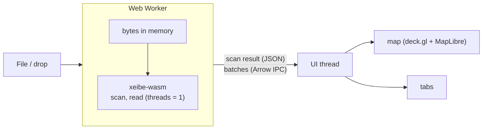

# Web page (WebAssembly)

🤔 Considering (P2). A static page on GitHub Pages that runs xeibe compiled to
WebAssembly. A user drops a local GML file or a saved WFS response on it and sees
how xeibe reads it: layers, the inferred schema and why, axis-order decisions,
the read report, the data on a map and in a table. Nothing is uploaded: the file
never leaves the browser.

It serves two purposes at once:

- **Debugging.** "Why is this column `text`?", "why are my points in the sea?",
  "which features were skipped?" answered without installing anything.
- **Showcase.** The quickest way to see what xeibe does with real data.

It is a thin front end over `xeibe-arrow`. It adds no reading behaviour of its
own, so what the page shows is what the CLI and Python produce with the same
options.

## Non-goals

- A general GIS viewer or editor. One file (or zip), one layer at a time.
- Reprojection in the library. The page reprojects for display only (see
  [Map](#map)); exports keep the source CRS, as everywhere else.
- Multi-GB inputs. Browser memory limits apply (see [Limits](#limits)). The CLI is
  the tool for those.
- A hosted service. The page is static files; there is no server side.

## Layout

The screen is split in two halves. The divider can be dragged; on narrow screens
the map stacks above the tabs.

| Area | Contents |
|---|---|
| Top bar | File picker and drop zone, layer selector (BDOT10k-style files have dozens of layers), "Try a sample", progress |
| Left half | Map |
| Right half | Tabs, below |

| Tab | Shows | From |
|---|---|---|
| Overview | Feature count, extent, CRS, axis-order decisions with their reasons, read report (skipped features, warnings, skipped sources, whether the scan was complete) | `ScanResult::layers`, `extent`, `axis_decisions`, `is_complete`, `skipped_sources`; the read report |
| Schema | Columns with Arrow type and source path, and the inference reasoning | `ScanResult::schema`, `explain` |
| Data | Virtualized table of the read rows | the record batches |
| Options | Form for the read options (preset, overrides, axis order, CRS, linearization, …) and the equivalent `xeibe` command, Python snippet and settings file, ready to copy | `ReadOptions`, `ScanResult::to_settings` |
| Export | Download as GeoParquet or Arrow IPC | the record batches |

Selecting a row zooms the map to its feature; clicking a feature on the map
selects its row.

The Options tab is what makes the page more than a viewer: options are tried
interactively, then carried over to the CLI or Python unchanged.

## Map

**The map needs lon/lat; xeibe never reprojects** ([geometry.md](geometry.md),
support matrix: "Reprojection: not planned"). The page reprojects in JavaScript,
for display only:

- proj4js, given the CRS definition from `xeibe_crs::projjson(code)`. proj4js
  parses definitions with `wkt-parser`, which reads WKT1, WKT2 and PROJJSON.
  **Unverified:** check that proj4js accepts our PROJJSON for the common cases
  (EPSG:2180, the ETRS89 / UTM and Gauss-Krüger families, the AdV CRSs) before
  relying on it.
- A CRS that can't be reprojected (unknown, engineering, failed parse) falls back
  to a plain Cartesian view with no basemap.

Two things the map shows that a table doesn't:

- **Wrong axis order is visible at a glance.** Swapped coordinates land in the
  wrong country or the sea.
- **The CRS's area of use** (`CrsRecord::area_in_axis_order`) drawn as a
  rectangle. Data outside it explains itself.

Rendering: deck.gl with `@geoarrow/deck.gl-layers`, which draws GeoArrow arrays
straight from Arrow IPC, with no GeoJSON conversion. A basemap via MapLibre.
Reprojection then has to happen on the GeoArrow coordinate buffers before they
are handed to deck.gl.

## Architecture

- **`crates/xeibe-wasm`**: wasm-bindgen bindings. Not a default workspace member,
  like `xeibe-py`. Kept thin, so the unstable Rust API doesn't spread into
  JavaScript: a few functions taking bytes and an options object, returning JSON
  and Arrow IPC.
- **Web Worker.** Everything runs in a worker so a long read doesn't freeze the
  UI. Results cross to the UI thread as Arrow IPC buffers (transferable, no copy).
- **Single-threaded.** WebAssembly threads need `SharedArrayBuffer`, which needs
  COOP/COEP headers, which GitHub Pages can't set. The read runs with
  `threads = 1`, which means "everything on the calling thread" (see
  [Library changes](#library-changes)).
- **`web/`**: the front end (Vite, TypeScript or plain JS) in this repository.
- **`.github/workflows/pages.yml`**: builds `xeibe-wasm` and `web/`, deploys to
  GitHub Pages.

### Inputs

| Input | How |
|---|---|
| `.gml`, `.xml`, saved WFS responses | Read into memory, wrapped in an in-memory `ByteSource` |
| `.gz`, `.zst` | As above; `Source::open` decompresses |
| `.zip` | Needs an in-memory archive source (below) |
| Live WFS | Out of scope at first: most servers send no CORS headers, so the browser blocks the request. Maybe later as best effort for servers that do |

A streaming `ByteSource` over `Blob.slice()` with `FileReaderSync` (available in
workers) would avoid holding the whole file in memory. That is a later
improvement, not needed for the first version.

## Library changes

| Crate | State |
|---|---|
| `xeibe-core`, `xeibe-crs`, `xeibe-geom`, `xeibe-schema`, `xeibe-arrow`, `xeibe-io` and `xeibe-wfs` without `http` | Build for `wasm32-unknown-unknown`. zstd's C code compiles with the system clang. `file://` inputs are an error there |
| Threads | Done: `threads = 1` runs a scan or read on the calling thread, and it is the default where the number of cores can't be known ([architecture.md](architecture.md#parallel-pipeline)). Asking for more is an error, not a panic. Checked on 2026-10-17 with a test module run in Node: reads and scans of 500 features with `threads` 0 and 1, an error with 4 |

Still needed:

1. **In-memory zip archives.** `Source::ZipMember` holds a `PathBuf` and
   `archive.rs` opens it with `std::fs::File`. The `zip` crate itself only needs
   `Read + Seek`, so an archive held in memory (`Cursor<Bytes>`) is a small
   addition.
2. **zstd.** Builds with clang. If linking or CI makes it a problem, the
   pure-Rust `ruzstd` decoder can replace it on wasm only.
3. **GeoParquet export** needs `parquet` in the wasm build; its `zstd` feature
   brings the same C dependency.

## Limits

- **Memory.** wasm32 addresses at most 4 GB; in practice browsers manage 1–2 GB.
  Files of a few hundred MB are fine. For bigger ones the page offers "first N
  features": it stops pulling batches after N rows, which with an inline read
  also stops the parsing. That bounds the Arrow output but not the input, which
  is in memory until reads stream from the `Blob` (see [Inputs](#inputs)). Beyond
  that, the page points to the CLI.
- **Speed.** One thread, so several times slower than the CLI on a multi-core
  machine. Fine for previewing.
- **Bundle size.** A test module with `xeibe-arrow` (EPSG tables, arrow, geoarrow;
  no parquet, no `wasm-opt`) is 7.3 MB, 2.0 MB gzipped. Parquet adds to that,
  `wasm-opt` takes some off. Loaded once, then cached.
- **CORS** rules out most live WFS endpoints (see [Inputs](#inputs)).

## Phases

1. **MVP.** Drop a file; layer selector; Overview, Schema and Data tabs (first
   100 rows); Parquet download.
2. **Map and options.** Map with display reprojection and the area-of-use box;
   Options tab with the CLI, Python and settings export; zip inputs; samples from
   `tests/data`.
3. **Maybe.** Streaming reads of large files; WFS against servers that allow
   CORS.

## Open questions

- Does proj4js accept `xeibe_crs::projjson` output for the CRSs that matter? If
  not: WKT from the same tables, or proj4 strings.
- Which `tests/data` samples to offer under "Try a sample", and whether to bundle
  them or fetch them from the repository.
- Front-end tooling: plain JS keeps the toolchain smallest; TypeScript helps once
  the Options form mirrors `ReadOptions`. Could `ReadOptions` be described
  (JSON Schema) so the form is generated rather than kept in sync by hand?
