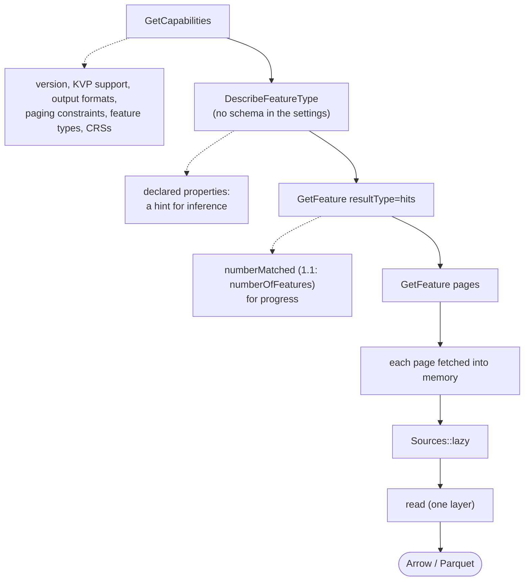

# WFS client

`xeibe-wfs` is a **bulk-read** client: it fetches every feature of one feature type
from a WFS, with paging, and streams the pages into a normal read. It is not a
general WFS SDK, and it stores nothing: no saved pages, no manifest, no resume.

References (PDFs in `ogc_schemas/`):
- WFS 2.0.2 (OGC 09-025r2). §-numbers below refer to this document unless stated otherwise;
- WFS 1.1.0 (OGC 04-094);
- WFS 1.0.0 (OGC 02-058);
- OWS Common 2.0 (OGC 06-121r9);
- Filter Encoding 2.0.2 (OGC 09-026r2).

## Flow



- `WfsClient::new(endpoint, options)?.pages(type_name, progress)` returns the
  pages as a lazy sequence of sources (see
  [architecture.md](architecture.md#sources-and-remote-input)). `progress` is
  called after every page with the counts so far and any new warnings.
  `read` pulls the next page when it needs more features. A scan pulls them too.
- **A page is fetched completely into memory before it is parsed.** Pages are
  bounded by the page size (typically a few MB to tens of MB), and a whole page
  can be retried, or re-requested with half the page size after a truncated
  response, without emitting any feature twice.
- The schema is given (a settings file) or sampled from the first pages, like any
  other read. A scan followed by a read fetches every page twice. That is the
  user's choice.
- A failure that retries can't fix fails the read. There is no resume. The user
  reruns it.

HTTP (retries, backoff, auth) comes from `xeibe-io` and is shared with plain file
reads.

## Capabilities

What we read from `GetCapabilities`:

| Item | WFS 2.0 | WFS 1.1 | WFS 1.0 | Used for |
|---|---|---|---|---|
| Feature types | `FeatureTypeList/FeatureType`: `Name`, `Title`, `DefaultCRS`, `OtherCRS`, `OutputFormats`, `ows:WGS84BoundingBox` | same, but `DefaultSRS`/`OtherSRS` | `Name`, `Title`, `SRS`, `LatLongBoundingBox` | `xeibe wfs layers`, default CRS, bbox checks |
| KVP support | `KVPEncoding` constraint (Table 13) | assumed | assumed | Read, not used: requests are `GET` unless too long (see [XML POST](#request-encoding-xml-post)) |
| XML support | `XMLEncoding` constraint (Table 13), `GetFeature` `DCP/HTTP/Post` | `DCP/HTTP/Post` | `DCPType/HTTP/Post` | A `POST` to a server that advertises no `Post` endpoint, or declares `XMLEncoding = FALSE`, is sent anyway, with a warning |
| Paging support | `ImplementsResultPaging` (Table 13) | — | — | Paging strategy |
| Server page limit | `CountDefault` (Table 14) | — | — | Page size cap |
| Paging consistency | `PagingIsTransactionSafe` (Table 14, default FALSE) | — | — | Warns that duplicates or skipped features are possible |
| Sorting support | FES 2.0 `ImplementsSorting` (`fes:Filter_Capabilities/fes:Conformance`) | — | — | A warning when `--sort-by` is given and the server declares FALSE |
| Page cache lifetime | `ResponseCacheTimeout` (Table 14, seconds) | — | — | Read, not used yet. Resuming after `ResponseCacheExpired` doesn't depend on it |
| Output formats | `GetFeature` `outputFormat` parameter domain | same | `ResultFormat` (`GML2`) | Format negotiation |

## Schema hint from `DescribeFeatureType`

A WFS read without a settings file samples its schema from the first pages.
That leaves two gaps: a property null in every sampled feature becomes `text`,
and a property that never appears in the sample has no column, so it is not
read at all (the schema is the projection). The type's `DescribeFeatureType`
XSD fills them, **as a hint only**. `xeibe wfs convert` asks for it whenever
the settings file has no schema for the layer, after `GetCapabilities` and
before the first page (`WfsClient::describe`, then
`InferenceOptions::hint`).

- The request is `DescribeFeatureType` with the type name and namespace as
  `GetFeature` sends them (`TYPENAMES`/`NAMESPACES` in 2.0, `TYPENAME`/`NAMESPACE`
  in 1.1, `TYPENAME` in 1.0) and no `OUTPUTFORMAT`, so the server's default
  schema language: an XSD.
- Only the feature type's **direct properties** are read: the elements of its
  content model (named or inline complex type, `sequence`/`choice`/`all`), after
  those of a base type the same document defines (a `complexContent`
  extension). A simple type the document defines, inline or named, is
  followed to the built-in type it restricts. `maxOccurs > 1` on the element
  or on a group around it makes a list.
- Declared types become column types:

  | Declared type | Column |
  |---|---|
  | `xs:boolean` | `bool` |
  | `xs:integer`, `long`, `int`, `short`, `byte` and the other integer types | `int64` (`xs:unsignedLong`: `uint64`) |
  | `xs:double`, `float`, `decimal` | `double` |
  | `xs:date` | `date` |
  | `xs:time` | `time` in the timestamp unit |
  | `xs:dateTime` | `text`: a timestamp column takes values either with a time zone or without one, and the declaration doesn't say which, so a guess could fail the read |
  | other built-in simple types (`xs:string`, `token`, `anyURI`, `gYear`, …) | `text` |
  | GML geometry property types (`gml:PointPropertyType`, …, `gml:GeometryPropertyType`, GML 2 to 3.2) | geometry, WKB |
  | anything else (complex types, `gml:CodeType`, `gml:MeasureType`, `xs:anyType`) | ignored |

  A type the type options leave out (`types.enabled`, e.g. `--preset strings`)
  is `text`.
- It **types a sampled column that never had a value** with the declared type,
  and **adds a column** for a declared property the sample never saw, after the
  sampled columns in XSD order. The settings' overrides still apply to both:
  a dropped path stays out, a typed one takes the settings' type.
- It **never overrides evidence**: a column the sample typed keeps its type,
  whatever the XSD says. Declared types are not trusted over data.
- Anything else is ignored: nested complex types, references (`ref`, e.g.
  `gml:boundedBy`), substitution groups, wildcards (`xs:any`), groups, and
  imports: nothing is fetched beyond the response itself. A
  `DescribeFeatureType` that fails, is no schema, or doesn't declare the type
  is a warning, and the read goes on with the sample alone.
- The reasons of every column it typed or added name the XSD (what
  `--explain` prints). The settings a read can save keep the columns
  themselves, not the hint.

This is not XSD-driven mapping, which stays a non-goal
([architecture.md](architecture.md#non-goals-and-deliberate-limits)): the data
decides, and the XSD only fills what the data couldn't show.

## Paging

### What the standard says (WFS 2.0.2 §7.7.4.4)

- Paging happens only when the request sets `count`, **or** the server has a
  `CountDefault`.
- Each response may carry `next` and `previous` attributes: **URIs generated by the
  server**, whose format is up to the implementation. The last page has no `next`.
- The server may drop the cached result set after `ResponseCacheTimeout`. Following a
  `next` link after that returns a **`ResponseCacheExpired`** exception.
- `PagingIsTransactionSafe = FALSE`, the default, means data may change between
  pages: "it is possible to have a result set element be skipped or duplicated
  between iterations".
- `startIndex` (§7.6.3.4) is the index in the result set where the response starts.
  It is 0-based: the default is 0 (§7.6.3.2).
- `count` (§7.6.3.5) counts **only features of the requested types**. Nested
  features inside properties, and features referenced by xlink, are not counted.
  In a join, each tuple counts once.

### Strategies

Chosen automatically, or forced with `WfsOptions::strategy`. Before the first
request, a WFS 2.0 server with `ImplementsResultPaging = TRUE` gets `startIndex`
paging and any other server a single request; when the first response carries a
`next` link, the read follows `next` links from then on
(`xeibe_wfs::paging::choose`). Without a page size from the user or a
`CountDefault`, pages hold 5,000 features.

| Strategy | Condition | Notes |
|---|---|---|
| **`next` link** | WFS 2.0 response has `next` | Follow it until there is none. On `ResponseCacheExpired`, switch to `startIndex` at the number of features fetched so far, if supported. Otherwise the read fails |
| **`startIndex` + `count`** | WFS 2.0 with `ImplementsResultPaging = TRUE`, or forced | Page size = `min(user page size, CountDefault)`. Stops when `numberReturned < count` or the total reaches `numberMatched` |
| **Vendor `startIndex` on 1.x** | WFS 1.1/1.0 on servers known to support it (GeoServer, some MapServer) | `maxFeatures` + `startIndex`. Enabled with an explicit flag |
| **Spatial tiling** | No paging support | Split the bbox into tiles until each tile's `hits` count is below the server limit. Duplicates across tile edges are removed by `gml:id` within the run (🤔 Considering; forcing it is an `Unsupported` error) |
| **Single request** | Small layers, or forced | Warns if `numberReturned < numberMatched` |

### Stable ordering and duplicates

Offset-based paging is only correct when the order is stable. The standard itself
warns that pages may overlap or skip features without transactional consistency.

- **`SORTBY` is the user's choice** (`WfsOptions::sort_by`, `--sort-by`). Nothing
  is sorted unless it is given, and no property is guessed: an id that looks
  unique may not be, a property may not be sortable on the server (or slow to
  sort without an index), and `gml:id` is an attribute, not a property, so not every
  server can sort by it.
  A wrong guess would look safe while it isn't.
- The keys are `property [ASC|DESC]`, comma-separated, ascending by default
  (`name DESC,id`; 1.1's `A`/`D` are read too). They are written in each version's
  spelling:
  - 2.0: `SORTBY=prop [ASC|DESC],…` (Table 8);
  - 1.1: `SORTBY=prop [A|D],…` (04-094 Table for GetFeature KVP).
- **Every `GetFeature` of the read carries them**: the first request, whatever the
  paging strategy (a single request, `startIndex` pages, or the request whose
  response starts `next` links, which the server builds from it), and the
  `startIndex` pages after `ResponseCacheExpired`. Sending them on offset pages
  only would let the order change partway: a `next`-link read would never be
  sorted, and offsets after the switch would count positions in a different
  order than the pages before it. `resultType=hits` gets none.
- Warnings, never errors:
  - offset paging without `SORTBY`, once, when a second offset page is about to be
    requested: unless the server keeps one order across requests, features may be
    skipped or repeated. It suggests sorting by an identifier property and names
    none;
  - `SORTBY` given to a server that declares `ImplementsSorting = FALSE`: it may
    ignore it;
  - `SORTBY` given for WFS 1.0, which has no `SORTBY`: not sent;
  - `xeibe wfs convert`: a sort property the type's `DescribeFeatureType`
    schema doesn't declare (by the local name of its first step; `gml:` and
    `@` names, from base types outside the schema, are not checked). The server
    may reject the sort with an exception, which ends the read, or ignore it.
- `xeibe wfs convert` writes the rows in the order the server sends them
  (`ReadOptions::preserve_order`): pages are fetched one at a time, so keeping
  the order costs nothing.
- Always: check `gml:id` for duplicates across pages and **report** them. Each page
  is compared with the previous one. Removing duplicates (`WfsOptions::dedupe`)
  would need a set of ids and memory proportional to their count. It is not
  implemented and will be if the need appears; until then, setting it fails
  the read.
- A server that doesn't declare `PagingIsTransactionSafe = TRUE` gets a warning
  under offset paging.
- Compare `numberMatched` at the start and at the end. A changed count means the
  data changed during the read, and a warning is raised.

## Response structure

| Case | Structure | Handling |
|---|---|---|
| Single query (2.0) | `wfs:FeatureCollection` → `wfs:member` → feature (§11.3.3.4) | Normal |
| Several queries (2.0) | `wfs:FeatureCollection` → `wfs:member` → `wfs:FeatureCollection` per query, in query order. Inner collections may be inline **or referenced by `xlink:href`**. A feature matching several queries appears in one collection and is referenced from the others (§11.3.3.5) | Inner members become layers as usual; a layer spans every query's collection. Referenced members are counted and reported, not fetched |
| Join (2.0) | `wfs:member` → `wfs:Tuple` (§11.3.3.6) | Not supported |
| `resolve` used (2.0) | Referenced objects are placed in `wfs:additionalObjects`, and references are changed to point to them (§11.3.4) | Their features become layers of their own, like any member; the references hold the `@id` they point to (`#` stripped) |
| `GetFeatureById` stored query | The bare feature, without any collection element (§11.3.5) | "Single feature as document root" |
| `resultType=hits` | Empty collection with `numberMatched` (2.0), or `numberOfFeatures` (1.1) holding the **total** | Count only |
| WFS 1.1 results | `wfs:FeatureCollection` with `numberOfFeatures` = features **in this response** (04-094 §9.3) | Progress only. 1.1 has no total count in results |
| WFS 1.0 results | `wfs:FeatureCollection` → `gml:featureMember`, GML 2 | Normal |

`numberMatched` may be `"unknown"` (§7.7.4.2). If `count` isn't set and the server
has no `CountDefault`, `numberReturned` equals `numberMatched` (§7.7.4.3).

The counts are not always true, filtered requests especially, and a wrong
count would end an offset read early without a word:

- **`numberReturned` below the features on the page** is replaced by the
  features counted in it (`ResponseInfo::returned`). deegree writes `0` for
  "unknown", which the schema doesn't allow (its responses say so in a
  comment). A count above them stays: referenced members are in it, but not
  among the counted features.
- **`numberMatched` below the features received so far** is no total
  (`ResponseInfo::plausible_matched`): offset paging stops at a short page
  instead, as with `unknown`, and progress shows no total. The
  "`numberMatched` changed" check still compares the server's own numbers.

## Request encoding (KVP)

| Parameter | 2.0 | 1.1 | 1.0 | Notes |
|---|---|---|---|---|
| Service/version | `SERVICE=WFS&VERSION=2.0.2` (or `2.0.0`) | `1.1.0` | `1.0.0` | |
| Feature type | `TYPENAMES` | `TYPENAME` | `TYPENAME` | Mandatory unless `RESOURCEID` is used (Table 8) |
| Namespaces | `NAMESPACES=xmlns(prefix,uri)` | `NAMESPACE=xmlns(prefix=uri)` | — | Sent when the type name has a prefix. Some servers require it |
| Page size | `COUNT` | `MAXFEATURES` | `MAXFEATURES` | For 1.x, `MAXFEATURES` counts only requested types; a nested collection counts as one (04-094 §9.2) |
| Offset | `STARTINDEX` | vendor | vendor | |
| CRS | `SRSNAME` | `SRSNAME` | `SRSNAME` | Must be `DefaultCRS` or an `OtherCRS` of the type, otherwise `InvalidParameterValue`. WFS 1.1 servers must accept `EPSG:<code>`, `http://www.opengis.net/gml/srs/epsg.xml#<code>` and `urn:EPSG:geographicCRS:<code>` (04-094 §9.2) |
| Output format | `OUTPUTFORMAT` | `OUTPUTFORMAT` | `OUTPUTFORMAT` | Preference: `application/gml+xml; version=3.2` → `text/xml; subtype=gml/3.1.1` (1.1 default) → `text/xml; subtype=gml/2.1.2` / `GML2` |
| Bounding box | `BBOX=minx,miny,maxx,maxy[,crs]` | same | same | Values in **the CRS's axis order**, lower corner then upper corner (06-121r9 §10.2.3). Default CRS is the type's `DefaultCRS`. A single bbox applies to all queries |
| Filter | `FILTER` (FES 2.0 XML) | `FILTER` (Filter 1.1) | `FILTER` (Filter 1.0) | Passed through as-is. Mutually exclusive with `BBOX`/`RESOURCEID` |
| Properties | `PROPERTYNAME` | `PROPERTYNAME` | `PROPERTYNAME` | |
| Sorting | `SORTBY` | `SORTBY` | — | See above |
| Result type | `RESULTTYPE=hits` | `RESULTTYPE=hits` | — | |
| Resolution | `RESOLVE`, `RESOLVEDEPTH`, `RESOLVETIMEOUT` | `TRAVERSEXLINKDEPTH`, `TRAVERSEXLINKEXPIRY` | — | 🤔 Considering |
| Vendor | anything (`CQL_FILTER`, …) | same | same | `--param key=value` |

**Several queries in one KVP request** (2.0): each parameter's values are grouped in
parentheses, one group per query, and every query must use the same optional
parameters (Table 8 notes). We send one query per request instead. It's simpler,
and paging then applies to one type at a time. Multi-query responses from other
tools are still read correctly.

## Request encoding (XML POST)

A filter can be too long for a URL. `GetFeature` (pages and hits) is then sent
as an XML document in a `POST` (`WfsOptions::method`, `--http-method`):

| Method | Sends |
|---|---|
| `Auto` (default) | `GET`, unless its URL would be longer than `request::MAX_GET_URL_LENGTH` (1,800 bytes); then `POST` |
| `Get` | Always `GET`, however long the URL |
| `Post` | Always `POST` |

`GetCapabilities` and `DescribeFeatureType` are always `GET`.

How servers treat long URLs decides the threshold. Measured on public
services (November 2026), none of them says so with a `414` reliably:

| Server | Fails from | With |
|---|---|---|
| ArcGIS Server | about 2,000 bytes (1,958 worked, 2,124 failed) | `500` "Xml Parsing failed"; `404` from IIS at about 11,000 |
| GeoServer, MapServer (behind nginx), deegree | about 10,800 bytes | `414` |
| Any of them | 50,000 bytes and more | A dropped connection, or a TLS error |

So `Auto` decides by length before sending, rather than retrying a failed `GET`.

### The document

`request::GetFeature::to_xml` builds it (WFS 2.0.2 §7.8, 04-094 §9.2), sent with
`Content-Type: text/xml` (WFS 2.0.2 Table D.1, 04-094 Table 2b):

```xml
<wfs:GetFeature xmlns:wfs="http://www.opengis.net/wfs/2.0" xmlns:fes="http://www.opengis.net/fes/2.0"
    service="WFS" version="2.0.0" count="1000" startIndex="2000" outputFormat="application/gml+xml; version=3.2">
  <wfs:Query typeNames="app:Parcel" srsName="urn:ogc:def:crs:EPSG::2180" xmlns:app="http://example.com/app">
    <wfs:PropertyName>app:n</wfs:PropertyName>
    <fes:Filter>…</fes:Filter>
    <fes:SortBy><fes:SortProperty><fes:ValueReference>app:n</fes:ValueReference><fes:SortOrder>DESC</fes:SortOrder></fes:SortProperty></fes:SortBy>
  </wfs:Query>
</wfs:GetFeature>
```

| KVP | 2.0 | 1.1 |
|---|---|---|
| `TYPENAMES`/`TYPENAME`, `NAMESPACES`/`NAMESPACE` | `Query/@typeNames`, the prefix declared on `wfs:Query` | `Query/@typeName`, same |
| `COUNT`/`MAXFEATURES`, `STARTINDEX` | `@count`, `@startIndex` | `@maxFeatures`; `@startIndex` is a vendor attribute (GeoServer and ArcGIS honour it, deegree ignores it) |
| `RESULTTYPE`, `OUTPUTFORMAT` | `@resultType`, `@outputFormat` | same |
| `SRSNAME` | `Query/@srsName` | same |
| `PROPERTYNAME` | `wfs:PropertyName` | `wfs:PropertyName` (not `ogc:`) |
| `FILTER` | the filter's element, inside `wfs:Query` | same |
| `SORTBY` | `fes:SortBy`, `ValueReference`, `ASC`/`DESC` | `ogc:SortBy`, `PropertyName`, `ASC`/`DESC` (KVP's `A`/`D` are not valid here) |

The documents validate against `wfs/2.0/wfs.xsd` and `wfs/1.1.0/wfs.xsd`
(the 1.1 `startIndex` aside).

- **The filter** goes in as written, without its XML declaration and the
  comments and whitespace around it. One that is not one well-formed element,
  or has a DTD, is an error before anything is sent.
- **What XML can't carry is an error**, before any request:
  - WFS 1.0 (the 1.0 `Query` has no `srsName`, and its BBOX needs a property
    name): requests stay `GET`.
  - A bbox: XML has no `BBOX` parameter. A filter with a `BBOX` operator does
    the same, and bbox and filter don't combine in KVP either.
  - Vendor parameters: GeoServer ignores query parameters next to an XML body
    (a `CQL_FILTER` was dropped, the read would have been unfiltered).

  With `Auto` the error says the URL was too long and that `Get` sends it
  anyway.

### Where the POST goes

To the URL the capabilities came from after redirects, without the WFS
parameters (`SERVICE`, `REQUEST`, `TYPENAMES`, `FILTER`, …; `request::post_url`):

- **Redirects.** HTTP clients follow a `301` or `302` to a `POST` with a `GET`
  without the body (RFC 9110 §15.4.2–3; reqwest does too). An `http://`
  endpoint that redirects to `https://` would get a bare `GET`. The
  capabilities `GET` follows the redirect, so `POST`s go to where it led.
- **WFS parameters.** MapServer reads a request from the query string when it
  finds `SERVICE` there, and ignores the body. Other parameters, such as
  MapServer's `map=`, stay.

A `POST` that is still redirected and then fails, or is answered with
something other than a feature collection (a bare `GET` may get the
capabilities, which would otherwise read as one feature), is an error that
names the URL it went to and suggests it as the service URL.

### Paging

Pages are `POST`s too: the same document with another `startIndex`. `next`
links are followed as in a `GET` read (they are `GET` URLs), except one longer
than `MAX_GET_URL_LENGTH`. GeoServer repeats the whole `POST`ed request in its
links as KVP (155 KB for a filter of 600 conditions), and following one fails.

- Under `startIndex` paging the read doesn't take such a link up: GeoServer's
  links hold nothing but offsets anyway.
- Under `next`-link paging (forced, or a server that pages without declaring
  `ImplementsResultPaging`) the read continues with `startIndex` from the
  features fetched so far, with a warning, if the server implements paging.
  Otherwise the read fails.

ArcGIS and deegree send no `next` links; MapServer's come from `GET`s.

## Errors and robustness

| Condition | Detection | Action |
|---|---|---|
| OWS exception | `ows:ExceptionReport` (1.1/2.0) or `ServiceExceptionReport` (1.0), **also inside HTTP 200 responses** | Error with `exceptionCode`, `locator` and the message |
| `ResponseCacheExpired` | exception code | Resume via `startIndex` (see above) |
| `OperationProcessingFailed` / `OperationParsingFailed` | exception code | No retry. Report the request |
| Truncated response | `wfs:truncatedResponse` (2.0), or no closing collection element | Retry with half the page size (up to N times) |
| HTTP 5xx, 429, network errors | status | Exponential backoff. Respects `Retry-After` |
| Changed `numberMatched` | start vs. end | Warning |
| Duplicate `gml:id` | compared with the previous page | Reported. Removal is planned |
| `POST` redirected (`301`/`302` turn it into a `GET` without the body) | the response came from another URL, and failed or is no feature collection | Error naming the URL, suggested as the service URL |
| `next` link too long to send in a `POST` read | longer than `MAX_GET_URL_LENGTH` | Continue by `startIndex` (with a warning unless offsets were the strategy already), or fail |
| Empty response (one MapServer answered every `POST` with an empty `200`) | no root element | Error ("an empty WFS response") |

Also:
- gzip/deflate `Content-Encoding`.
- `WfsOptions::concurrency` (default 1) is the number of pages held at once:
  the one being read plus the ones fetched ahead of it, in order. They are
  fetched one request at a time. Parallel requests (possible only with
  `startIndex` paging; `next` links can only be followed one after another) and
  a rate limit are not planned for now.
- Authentication: HTTP basic, bearer token, custom headers (`WfsOptions::auth`,
  `headers`; library only, the CLI has no flags for them yet).

## Out of scope

- WFS-T (Transaction), LockFeature, GetFeatureWithLock.
- GetPropertyValue.
- Stored-query management (Create/Drop). `GetFeatureById`, `ListStoredQueries` and
  `DescribeStoredQueries` may come later.
- Joins (`wfs:Tuple`).
- `previous` links (not needed to page forward).
- OGC API – Features (WFS 3). It is GeoJSON/JSON-based and belongs in a different
  tool. Its GML output encoding is not planned.
